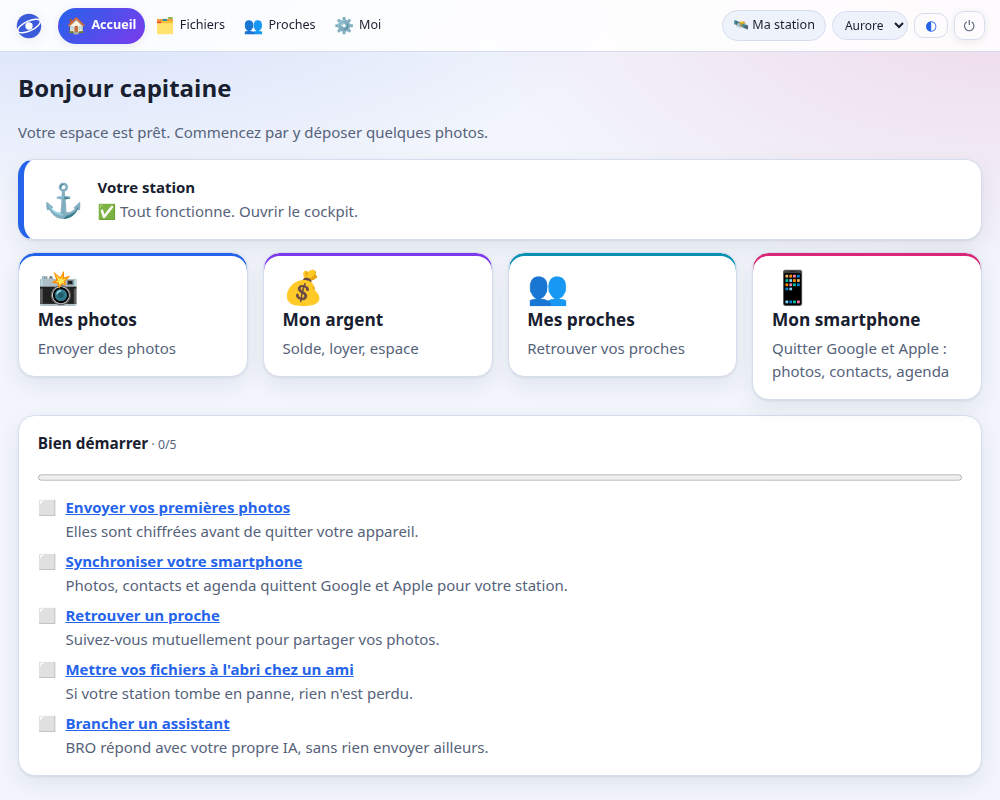
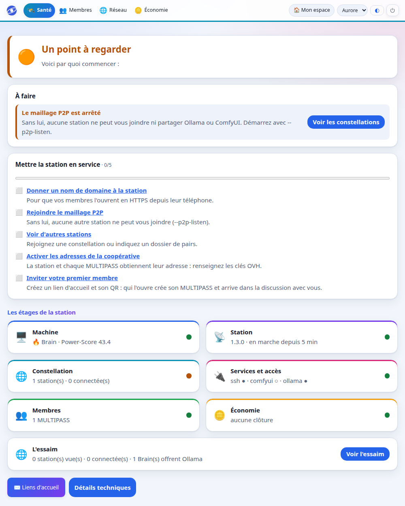
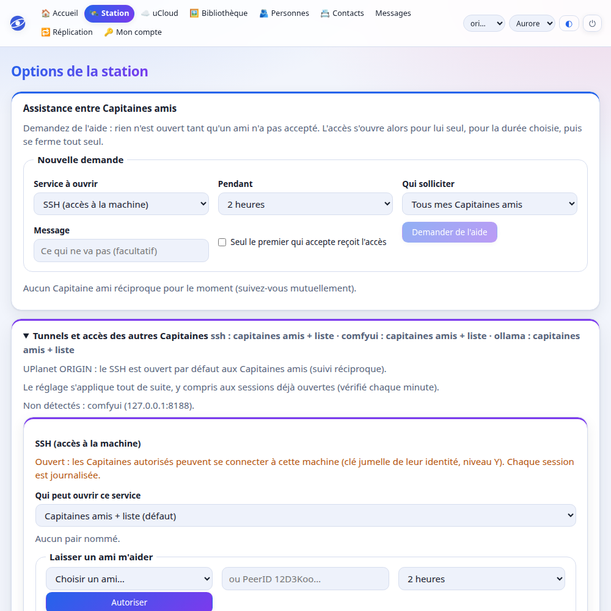
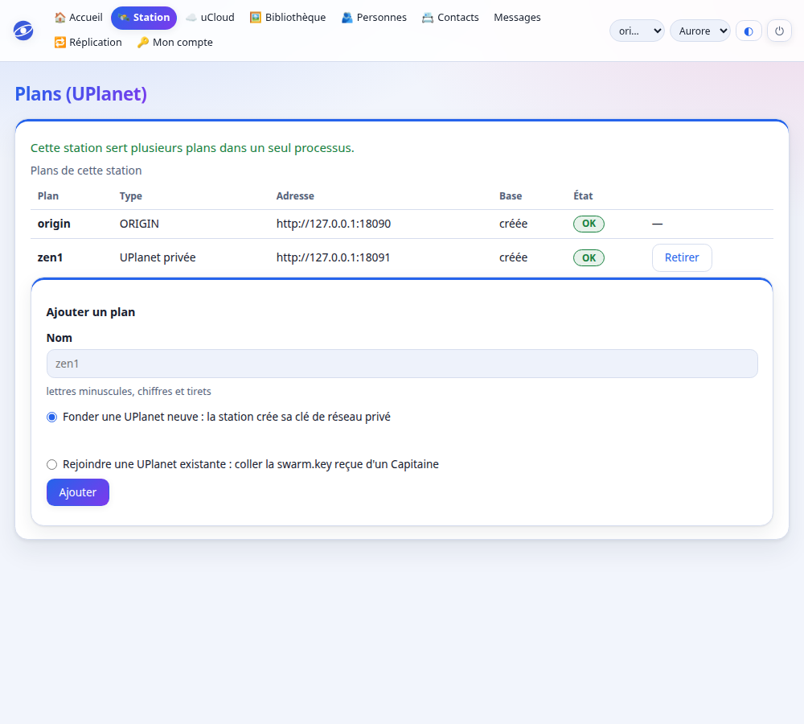

# Guide du Capitaine : ouvrir et tenir sa station

> Version texte du [guide illustré](guide.html). Pour découvrir Astroport sans rien installer : [la page d'accueil](index.html). Version **1.3.0**. Chaque étape propose le **terminal (CLI)** et, quand c'est possible, le **navigateur (Web)**.

**Sommaire** :

- [**Partie 1 — Mettre la station en service**](#partie-1) : [1. Avant de commencer](#etape-0) · [2. Installer astroportd](#etape-1) · [3. Donner une identité à la station (Y-Level)](#etape-2) · [4. Choisir sa constellation](#etape-3) · [5. Démarrer la station](#etape-4) · [6. Créer votre compte de Capitaine, puis ceux des membres](#etape-5) · [7. Vérifier que tout va bien](#etape-6) · [8. Entrer dans l'interface web](#etape-7) · [9. Le cockpit du Capitaine](#etape-7b)
- [**Partie 2 — Ce que la station offre à vos membres**](#partie-2) : [FaceCloud](#etape-8) · [Inviter quelqu'un à recevoir des photos](#etape-8quater) · [La clé de secours](#secours) · [Contacts, agenda et Mon compte](#etape-8b) · [Messages privés, et une personne dans plusieurs UPlanet](#etape-8bis-j) · [Appeler en visio](#visio) · [Le coffre de mots de passe (KeePass)](#etape-8bis-b) · [Le site public](#etape-8bis-m) · [Un jeton par appareil (téléphones, tablettes, ordinateurs)](#etape-8bis-f) · [Reprendre ses fichiers d'un autre serveur (Nextcloud, ownCloud…)](#etape-8bis-d) · [Ranger son uCloud par type](#etape-8bis-e) · [Connexion par PASS, compte sans email, signature déléguée](#etape-8quinquies) · [Sur un smartphone](#sur-un-smartphone)
- [**Partie 3 — Les Ẑen de la station**](#partie-3) : [Hébergement facturé et partage de la semaine](#etape-8bis-g) · [Ma UPlanet](#etape-8c) · [Les Ẑen](#etape-8bis-l) · [La PAF de la machine et les nouvelles machines](#la-paf-de-la-machine-et-les-nouvelles-machines) · [Relier une UPlanet à OpenCollective](#relier-une-uplanet-opencollective) · [Ğ1Billet](#1billet-des-billets-papier-en-en)
- [**Partie 4 — Relier, ouvrir, administrer**](#partie-4) : [Être trouvé](#annuaire) · [Relier sa station aux autres Capitaines](#etape-9) · [Options du Capitaine](#etape-8ter) · [Une adresse pour chaque station et chaque MULTIPASS (DNSLink)](#etape-9b) · [Les anciens clients (zelkova, coracle) sur astroportd](#etape-8bis-h) · [Plusieurs astroportd sur une machine](#plusieurs-astroportd-sur-une-machine-un-seul-bassin-de-fichiers) · [Plusieurs UPlanet dans un seul processus](#etape-8bis-i) · [En cas de problème](#etape-10)

<a id="partie-1"></a>

## Partie 1 — Mettre la station en service

Neuf étapes, à suivre dans l'ordre. À la fin, votre station tourne, vous avez votre compte de Capitaine, et le cockpit vous dit d'un regard ce qui demande votre attention.

**Terminal puis navigateur.** Les étapes 1 à 5 se font au terminal : on installe un programme et on lui donne une clé secrète, qui ne doit jamais passer par un navigateur. Le navigateur prend le relais à l'étape 6, dès que la station tourne (page `/welcome`).

**Où est quoi.**

| Adresse | À quoi elle sert | Pour qui |
|---|---|---|
| `astroport.one` | Le logiciel libre : télécharger, lire la documentation, ouvrir sa station | Futurs Capitaines, curieux |
| `map.astroport.one` | La carte des stations : trouver celle qui a de la place près de chez soi | Futurs membres |
| `qo-op.com` | Le portail de la coopérative : adhésion, soutien, offres d'hébergement et d'accompagnement | Sociétaires, partenaires |
| `votre-station.exemple.org` | Votre station : l'application de vos membres (photos, proches, messages, compte) et votre cockpit | Vos membres et vous |

Une station n'est pas un portail : ne faites pas pointer le nom de la coopérative sur l'écran de connexion d'une seule station.

**Les mots du guide, en clair.**

| Mot du guide | Ce que cela veut dire |
|---|---|
| Y-Level | L'identité de la station : une seule clé secrète d'où viennent ses clés SSH, IPFS, Ğ1 et Nostr |
| ORIGIN | Le réseau ouvert, pour découvrir et tester |
| ẐEN | Le réseau privé de la coopérative, sur invitation (clé `swarm.key`) |
| Certification DRAGON | Le parrainage par un Capitaine du réseau privé |
| MULTIPASS | Le compte d'un membre, avec son code PASS |
| Clé de secours | Une clé en trois morceaux, deux suffisent : un QR imprimé, la station, des amis |
| PAF | Les frais de fonctionnement de la machine (électricité, matériel) |

<a id="etape-0"></a>

## Étape 1 — Avant de commencer

**astroportd** est un programme unique qui fait tourner votre « Astroport » : un cloud personnel chiffré, vos photos avec reconnaissance des visages, le partage entre amis et un relais Nostr. Ce guide vous mène de zéro à une station qui fonctionne.

Pas à pas, chaque étape se fait au **terminal** (colonne de gauche) ou, quand c'est possible, au **navigateur** (colonne de droite).

### 🖥️ Terminal (CLI)

Il vous faut :

- un ordinateur **Linux** (PC, serveur) ou un **Raspberry Pi** (de préférence 64 bits : Pi 4, Pi 5, Pi Zero 2 W), ou un **Mac** Apple Silicon (bêta : voir [MACOS.md](MACOS.md)) ;
- une connexion Internet et environ 15 minutes ;
- une **horloge à l'heure** : un Raspberry Pi sans pile démarre en 1970, et astroportd refuse alors de calculer ses échéances ;
- facultatif, pour une station ouverte sur Internet : un nom de domaine et les ports 80 et 443 ouverts ;
- facultatif : de quoi reconnaître les visages (pour FaceCloud : un service d'inférence, ou les modèles locaux que l'installeur peut mettre en place).

Deux commandes pour vérifier votre machine :

```bash
uname -m   # x86_64, aarch64 ou armv7l
date       # l'année doit être 2026 ou plus
```

### 🌐 Navigateur (Web)

Il vous faut un navigateur récent (Firefox, Chrome, Safari…). L'interface de la station est une application web : elle s'installe aussi comme une application sur téléphone.

> **À savoir.** astroportd est en **version 1.3.0** : il est testé de bout en bout, et les anciens formats d'Astroport.ONE ne sont plus repris (voir les notes de version). Gardez une sauvegarde de vos clés.

Vous aurez aussi besoin d'un compte **MULTIPASS** (votre identité Nostr) : astroportd le crée pour vous à l'[étape 6](#etape-5).

<a id="etape-1"></a>

## Étape 2 — Installer astroportd

Le plus simple : l'installeur. Il choisit le bon fichier pour votre machine et **vérifie son empreinte SHA-256** avant de l'installer. S'il y a le moindre doute, il s'arrête.

### 🖥️ Terminal (CLI)

```bash
curl -fsSL https://raw.githubusercontent.com/papiche/astroportd/main/install.sh | bash
```

Options utiles : `--version v1.3.0`, `--static` (binaire statique, x86_64 et aarch64 : l'installeur le choisit seul si la glibc de la machine est plus ancienne que la 2.35, et s'arrête net si le binaire ne démarre pas), `--prefix DIR`, `--no-init`, `--yes`.

**Plugins** : à la fin, l'installeur propose de les présenter (`install-plugins.sh` : `git clone` du dépôt `astroportd-plugins`, puis l'`install.sh` de chacun : films et musique, énergie, DNSLink). Pour y revenir : `curl -fsSL https://raw.githubusercontent.com/papiche/astroportd-plugins/main/install-plugins.sh | bash`.

**Mettre à jour** : relancez simplement le même `install.sh`. Il montre l'installation en place (version, constellation, domaine, Capitaine, service), installe la nouvelle version, garde vos modèles et votre station, puis redémarre le service. Il ne relance jamais `init`, qui changerait l'identité de la station. `--force` réinstalle la même version.

Ensuite :

```bash
astroportd --version
```

Si la commande est introuvable, ajoutez `~/.local/bin` à votre PATH : `export PATH="$HOME/.local/bin:$PATH"`.

> **À savoir.** L'installeur ne fonctionne que sous **Linux** (Android sous Termux compris, voir la fin du guide). Sur un **Mac**, téléchargez l'archive à la main (colonne Navigateur ci-contre, et [MACOS.md](MACOS.md)).

**L'installeur s'adapte à votre machine.** Reconnaître les visages et comprendre le sens des textes *dans* astroportd (sans service externe) coûte de la mémoire, du disque et du processeur. Avant de télécharger les modèles, l'installeur examine donc votre machine : architecture, nombre de cœurs, mémoire, place libre, **vitesse d'écriture du disque** (carte SD, disque mécanique, SSD, NVMe), carte graphique et présence d'Ollama. Il vous montre ce qu'il a trouvé et **recommande un profil** :

| Profil | Ce qui tourne sur la machine | Pour qui |
|---|---|---|
| **léger** | Rien en local : visages et mémoire passent par une autre machine (Brain GPU, Ollama) | Machine juste en mémoire (moins de 2 Go), en place ou en disque : Pi Zero, Pi 2/3, binaire statique |
| **standard** | Visages en local (≈ 190 Mo) et, si la machine a assez de mémoire (≈ 4 Go : au moins 3,5 Go utilisables) et de disque (≥ 2,5 Go libres), **embeddings locaux** (≈ 560 Mo) ; la moitié des cœurs au plus | Raspberry Pi 4/5 (4 Go et plus), mini-PC, NAS correct |
| **confort** | Tout en local, tous les cœurs | PC ou serveur : 8 Go de mémoire (7 Go utilisables) et 6 cœurs ou plus |

Au terminal, l'installeur propose la recommandation et vous laisse en choisir une autre ; avec `--yes`, il applique la recommandation. Il vous prévient quand la machine est juste (disque très lent, carte SD, pas d'accélération int8) mais il obéit si vous insistez.

```bash
curl -fsSL https://raw.githubusercontent.com/papiche/astroportd/main/install.sh | bash -s -- --check-hardware    # diagnostic seul, rien n'est installé
curl -fsSL https://raw.githubusercontent.com/papiche/astroportd/main/install.sh | bash -s -- --profile standard   # impose un profil : leger, standard ou confort
curl -fsSL https://raw.githubusercontent.com/papiche/astroportd/main/install.sh | bash -s -- --no-embed           # pas d'embeddings locaux (ni leur téléchargement de 560 Mo)
```

> **Détails techniques.** Chaque modèle est vérifié par SHA-256 avant d'être gardé ; un fichier incorrect est refusé. Les fils de calcul retenus sont inscrits dans `station.conf` et dans la commande de démarrage (`--face-threads`, `--embed-threads`) : un second `astroportd init` les conserve.

### 🌐 Navigateur (Web)

Ouvrez la page des versions : [https://github.com/papiche/astroportd/releases](https://github.com/papiche/astroportd/releases). Téléchargez l'archive qui correspond à votre machine :

- `x86_64-unknown-linux-gnu` : PC et serveurs ;
- `aarch64-unknown-linux-gnu` : Raspberry Pi 4/5 et Zero 2 W en 64 bits ;
- `armv7-unknown-linux-gnueabihf` : Raspberry Pi 2/3, Pi OS 32 bits ;
- `x86_64-unknown-linux-musl` : binaire statique, sans dépendance ;
- `aarch64-unknown-linux-musl` : binaire statique ARM 64 bits (Android sous Termux, Pi, NAS) ;
- `aarch64-apple-darwin` et `x86_64-apple-darwin` : **Mac** (Apple Silicon, Intel). *Bêta* : jamais compilé sur un Mac avant la 0.5.0, voir [MACOS.md](MACOS.md).

Téléchargez aussi `SHA256SUMS`. Décompressez l'archive avec votre gestionnaire de fichiers et copiez `astroportd` dans `~/.local/bin`. Comparez l'empreinte (ligne de commande : `sha256sum archive.tar.gz`) avec celle de `SHA256SUMS`.

<a id="etape-2"></a>

## Étape 3 — Donner une identité à la station (Y-Level)

Y-Level est le rituel qui relie **vous**, votre **machine** et le **réseau**. À partir de votre clé SSH, astroportd fabrique une graine unique. De cette graine viennent quatre identités qui partagent la même clé publique : une clé SSH « jumelle », l'identité **IPFS** de la station (`12D3Koo…`, appelée IPFSNODEID), votre portefeuille **Ğ1** et votre identité **Nostr**.

En clair : la clé qui vous ouvre la machine est aussi sa carte d'identité sur le réseau. Personne ne peut se faire passer pour votre station sans cette clé, et l'on peut vérifier, de n'importe où, que l'accès SSH à une machine et son identité sur le réseau sont **la même clé**.


### 🖥️ Terminal (CLI)

L'assistant `init` fait ce rituel pour vous (c'est sa première étape) :

```bash
astroportd init
```

Il part de `~/.ssh/id_ed25519` (il en crée une si elle n'existe pas). **Une station déjà en niveau Y n'est jamais redérivée** : `secret.june`, le PeerID de kubo (`~/.ipfs/config`, lu seul) et la clé SSH sont comparés, et l'assistant s'arrête plutôt que de changer l'identité (seul `--rederive-y` l'autorise). Si `~/.ipfs/swarm.key` existe, l'assistant propose de reprendre cette constellation ẐEN. L'assistant demande aussi la position de la station, l'email du Capitaine, le domaine et la **visio** : STUN + relais d'appel (recommandé), STUN seul ou aucune, plus d'éventuels serveurs STUN/TURN extérieurs (`--visio relais|stun|aucune`, `--ice-server stun:hôte:port`). Les ports à ouvrir sur la box sont résumés à l'étape 5 (« Réseau : ce qu'il faut ouvrir ») ; `init` les affiche aussi à la fin. **Votre ancienne clé SSH n'est pas détruite** : elle est conservée sous `~/.ssh/origin.key` et `~/.ssh/origin.pub`. Les secrets de la station sont écrits en `0600` dans `~/.zen/game`.

Pour voir la correspondance, ou la vérifier plus tard :

```bash
astroportd ylevel            # affiche SSH ↔ PeerID IPFS ↔ Ğ1 ↔ Nostr
astroportd ylevel --verify   # code de sortie 1 si ça ne correspond pas
```

> ⚠️ **Attention.** Votre clé SSH publique **change** : si vous l'aviez enregistrée ailleurs (GitHub, un serveur), il faudra y mettre la nouvelle. Pour ne pas toucher à SSH : `astroportd init --no-ssh` (le lien SSH ↔ IPFS n'est alors pas établi). Avec Kubo, `--kubo-config` aligne aussi son identité.

### 🌐 Navigateur (Web)

Il n'y a **volontairement pas d'écran web** pour cette étape : une clé privée ne doit jamais passer par un navigateur.

Une fois la station démarrée ([étape 5](#etape-4)), *Ma station › Santé › Détails techniques* dans l'interface web montre l'identité IPFS (PeerID) de votre station.

<a id="etape-3"></a>

## Étape 4 — Choisir sa constellation : ORIGIN ou ẐEN

Une **constellation** est un groupe de stations qui se parlent. Il y en a deux sortes.

**ORIGIN** est le bac à sable ouvert à tous : on apprend, on essaie, sans clé secrète (1 Ẑen = 0,1 Ğ1, un jeu). **ẐEN** est le réseau privé de production : il faut la clé du réseau, la `swarm.key` (1 Ẑen = 1 € dans la coopérative UPlanet ẐEN).

La règle est simple : **pas de `swarm.key` = ORIGIN ; une `swarm.key` présente = ẐEN.** La clé du réseau sert aussi de « nom » à la constellation (`UPLANETNAME`), dont dépend la dérivation des clés des nouveaux MULTIPASS.


### 🖥️ Terminal (CLI)

**Parcours A — Démarrer une constellation ORIGIN** (le plus simple pour commencer)

```bash
astroportd init --mode origin
```

Aucune clé à fournir : le réseau est ouvert. Vous rejoignez les autres stations ORIGIN, et **vous proposez votre machine au collectif** : quand elle est acceptée et que le Capitaine est inscrit et reconnu, il reçoit la `swarm.key` de la constellation ẐEN (`astroportd plane-setup add`, ou `astroportd init --join`).

L'assistant résume ensuite le réseau selon votre cas (HTTPS direct, derrière un reverse proxy, sans domaine ; maillage ; visio) : ce qu'il faut ouvrir sur la box, et ce qui ne l'est pas.

**Parcours B — Rejoindre une constellation ẐEN existante**

Un Capitaine de la constellation vous remet sa `swarm.key` (après la certification DRAGON, à demander à support@qo-op.com, objet « Candidature Capitaine DRAGON »). Gardez-la secrète.

```bash
chmod 600 swarm.key
astroportd init --mode zen --swarm-key ./swarm.key
```

Plus simple, **sans recopier de fichier** : le Capitaine de la station marraine lance `astroportd parrainer` et vous donne le jeton affiché (de la main à la main, ou par message chiffré). Sur votre station :

```bash
astroportd init --join 'astro-join:v1|https://marraine.exemple.org|…'
```

La station retire une seule fois l'offre de la marraine. Elle reçoit la `swarm.key` chiffrée (seul le jeton l'ouvre), puis s'amorce sur la marraine au démarrage : elle n'est pas seule dans l'essaim. Le jeton expire après 24 h et ne sert qu'une fois. Comparez l'empreinte de la `swarm.key` affichée des deux côtés.

**Parcours C — Fonder SA constellation ẐEN**

```bash
astroportd swarm-key > swarm.key
chmod 600 swarm.key
# Copiez ensuite swarm.key sur chaque station, par un canal sûr (scp, clé USB) :
astroportd init --mode zen --swarm-key ./swarm.key
```

> ⚠️ **Attention.** Sauvegardez `swarm.key` : la perdre, ou en changer, change le nom de la constellation (`UPLANETNAME`) et donc la dérivation des clés des futurs MULTIPASS. Ne la publiez jamais.

> **À savoir.** Fonder sa constellation crée un **réseau privé** dont vous fixez les règles. La valeur « 1 Ẑen = 1 € » est celle de la coopérative UPlanet ẐEN ; elle ne s'applique pas toute seule à une constellation que vous créez.

### 🌐 Navigateur (Web)

**ORIGIN** — pour s'inscrire sur une station ORIGIN publique sans installer quoi que ce soit, choisissez-en une sur la carte [map.astroport.one](https://map.astroport.one). Ce n'est pas une obligation : sur votre propre station, vous créez vos MULTIPASS vous-même ([étape 6](#etape-5)). Le portail [qo-op.com](https://qo-op.com) est celui de la coopérative (adhésion, soutien, offres d'hébergement), pas une station.

**ẐEN** — pour passer d'ORIGIN à ẐEN, la voie habituelle est la certification DRAGON, puis la réception de la `swarm.key`. Informations : le dépôt [Astroport.ONE](https://github.com/papiche/Astroport.ONE) et support@qo-op.com.

> **À savoir.** Une commande `astroportd serve` sert **une** constellation (une `swarm.key`, ou aucune). Pour raccorder **la même station** à ORIGIN **et** à une ou plusieurs UPlanet ẐEN, on utilise `astroportd planes` (voir [Plusieurs UPlanet dans un seul processus](#etape-8bis-i)) : un seul processus, la **même identité Y-Level** (même `IPFSNODEID`), et pour chaque *plan* sa base, son dossier de comptes, son **réseau P2P privé** (sa `swarm.key`) et son port. Chaque MULTIPASS est rattaché à un plan et rien ne passe d'un plan à l'autre sans votre accord.

Le **premier** choix (ORIGIN ou ẐEN) se fait au terminal avec `astroportd init` : il engage une clé secrète. Ensuite, **ajouter** une UPlanet à une station existante (la fonder, ou la rejoindre avec une `swarm.key` reçue) se fait aussi dans l'interface web, écran *Ma station › Réseau › Constellations* (voir [Plusieurs UPlanet dans un seul processus](#etape-8bis-i)).

<a id="etape-4"></a>

## Étape 5 — Démarrer la station

`init` a préparé le dossier de la station (`~/.zen/astroportd` : la base `uplanet.db`, les fichiers chiffrés `blobs`, les sauvegardes `snapshots`) et vous a affiché la commande suivante. Voici les deux façons de démarrer.

### 🖥️ Terminal (CLI)

**Essai local** (HTTP simple, sur votre machine seulement) :

```bash
astroportd serve --db ~/.zen/astroportd/uplanet.db --blobs ~/.zen/astroportd/blobs
# → http://127.0.0.1:8090
```

**Station publique.** Deux cas, et `init` choisit seul le bon :

- **La machine n'a pas de reverse proxy** : la station obtient et renouvelle elle-même son certificat (Let's Encrypt). Elle tient les ports 80 et 443.

  ```bash
  astroportd serve --db ~/.zen/astroportd/uplanet.db --blobs ~/.zen/astroportd/blobs \
    --domain station.exemple.org --acme-email moi@exemple.org \
    --lat 45.76 --lon 4.84          # vos coordonnées règlent l'entretien de nuit (20h12 solaire)
  # en ẐEN, ajoutez : --swarm-key ./swarm.key
  ```

- **Un reverse proxy sert déjà vos sites** (Nginx Proxy Manager, Caddy…), sur cette machine ou une autre du réseau local : il garde le certificat, la station écoute sur le **port 8090** et se présente sous `https://<domaine>`.

  ```bash
  astroportd serve --db ~/.zen/astroportd/uplanet.db --blobs ~/.zen/astroportd/blobs \
    --public-domain station.exemple.org --lat 45.76 --lon 4.84
  ```

  `init` le reconnaît quand le proxy est sur cette machine (ports 80/443 déjà pris), ou quand le domaine arrive sur un autre serveur web. S'il ne peut pas trancher, il pose la question ; `astroportd init --proxy` le dit d'avance. Le cockpit a la même case : *Nom de domaine › Un reverse proxy sert ce domaine*.

### 🌐 Réseau : ce qu'il faut ouvrir

| Port | Sur la box, vers… | À quoi il sert | |
|---|---|---|---|
| **443 et 80** (TCP) | la station, ou la machine du proxy | les pages web, l'application, le relai Nostr, WebDAV, CardDAV, CalDAV | indispensable avec un domaine |
| **8090** (TCP) | rien : seul le proxy y accède (même machine, Docker ou réseau local) | l'interface de la station derrière le proxy | derrière un proxy |
| **4101** (TCP) | la station | le maillage entre stations de la constellation | indispensable pour une station relais ; conseillé sinon |
| **443** ou **8090** (UDP) | la station (un proxy ne transmet pas l'UDP) | la visio : STUN et relais d'appel. 443 quand la station a son certificat, 8090 derrière un proxy | pour la visio entre deux box |

**Dans Nginx Proxy Manager**, un seul *Proxy Host* :

- *Domain* : `station.exemple.org` ; *Forward* : `http`, l'adresse de la machine de la station, port `8090`. NPM dans Docker sur la même machine : `172.17.0.1` (et non `127.0.0.1`, qui désigne le conteneur lui-même) ; NPM sur une autre machine : l'adresse de la station sur le réseau local ;
- **Websockets Support** coché ; *Block Common Exploits* décoché ;
- *SSL* : certificat Let's Encrypt, *Force SSL* ;
- onglet *Advanced* : `proxy_read_timeout 1h; proxy_send_timeout 1h;` (sinon nginx coupe au bout d'une minute une connexion où rien ne passe) ;
- aucune règle par chemin : tout le domaine va à la station, `/.well-known/carddav` et `/.well-known/caldav` compris.

Sur une station Astroport.ONE, `~/.zen/Astroport.ONE/admin/system/setup_npm_dynamic.sh astroportd 8090` crée cet hôte (`astroportd.<votre domaine>`), et `firewall.sh ON` ouvre 4101 et 8090/UDP.

> **Détails techniques.** Derrière un proxy, la station écoute sur `0.0.0.0:8090` (pour être joignable depuis Docker et le réseau local) ; ne redirigez jamais 8090/TCP depuis la box. Elle croit l'en-tête `X-Forwarded-For` seulement quand la connexion vient de la machine elle-même ou d'une adresse privée, et seulement sa dernière adresse, celle que le proxy a posée. Avec son propre certificat, la station a besoin du droit d'ouvrir les ports sous 1024 : `sudo setcap 'cap_net_bind_service=+ep' $(command -v astroportd)`. Pour essayer sans quota : `--acme-staging`. Le relai et la console envoient un ping toutes les 30 s : un proxy ne les coupe pas faute de trafic.

**Qu'elle démarre toute seule** (systemd, sans droits administrateur) :

```bash
astroportd init --systemd        # écrit ~/.config/systemd/user/astroportd.service
systemctl --user daemon-reload
systemctl --user enable --now astroportd
loginctl enable-linger "$USER"   # démarrer au boot sans session ouverte
journalctl --user -u astroportd -f   # suivre les journaux
```

`init --systemd` choisit seul le mode : si `planes.json` existe (station à plusieurs UPlanet), l'unité lance `astroportd planes`, sinon `astroportd serve`. `--systemd-mode serve|planes` impose l'un ou l'autre ; `planes` est refusé, sans rien écrire, si `planes.json` est absent ou invalide. Quand vous ajoutez un plan avec `astroportd plane-setup add`, une unité qui lance encore `serve` est **basculée sur `planes`** (seules `ExecStart` et `Description` changent, l'ancienne unité est gardée à côté en `astroportd.service.bak-<date>` et les options propres à la station, comme `--lat`, passent dans `args` du plan ORIGIN). Le service n'est pas redémarré pour vous : `systemctl --user daemon-reload && systemctl --user restart astroportd`. L'ajout d'une constellation depuis l'interface fait la même bascule, et le bouton *Basculer le service en multi-constellations* (confirmé par un second clic) la fait à la demande ; seule une unité qui lance `astroportd serve` est réécrite. Dans l'interface, l'écran *Ma station › Réseau › Constellations* dit ce que lance l'unité : si elle lance encore `serve` alors que plusieurs constellations sont configurées, il l'annonce avec la commande à lui donner ; quand elle lance `planes`, le bouton *Redémarrer la station* (confirmé par un second clic) exécute `daemon-reload` puis le redémarrage.

### 🌐 Navigateur (Web)

Rien à cliquer pour démarrer : c'est le terminal qui lance le programme. Quand il tourne, ouvrez [http://127.0.0.1:8090](http://127.0.0.1:8090) (essai local) ou `https://votre-domaine/`.

Sur une **même adresse**, un navigateur reçoit l'application, et un client Nostr reçoit le relai de la station.

<a id="etape-5"></a>

## Étape 6 — Créer votre compte de Capitaine, puis ceux des membres

Votre **MULTIPASS** est votre identité sur la station : une clé Nostr, un portefeuille Ğ1 et une identité IPNS. astroportd le crée **directement sur votre station**, il n'y a pas besoin d'aller ailleurs.

On commence par le **Capitaine** (la personne qui tient la station), puis les autres membres s'inscrivent. Les secrets ne sont affichés qu'**une seule fois** : notez-les.


### 🖥️ Terminal (CLI)

**Le Capitaine d'abord.** Si vous avez donné votre email à `astroportd init`, c'est déjà fait : `init` crée votre MULTIPASS de Capitaine à la fin et affiche votre code PASS. Sinon, deux chemins :

- **au navigateur** : au démarrage, la station écrit dans son journal un **code d'installation** (« ⚓ Station sans Capitaine : ouvrez …/welcome et saisissez le code d'installation ABCD-EFGH »). Ouvrez `/welcome`, saisissez ce code et votre email : votre compte de Capitaine est créé. Tant qu'il n'existe pas, personne ne peut s'inscrire sur la station ;
- **au terminal** — le premier compte, désigné par `--captain` :

```bash
astroportd multipass create capitaine@exemple.org --captain --lang fr
```

`--captain` écrit aussi `~/.zen/game/players/.current/.player` et donne le rôle de Capitaine. C'est refusé si un autre Capitaine existe déjà. En ẐEN, ajoutez `--swarm-key ./swarm.key` : le compte est **rattaché à une seule constellation** (ORIGIN s'il n'y a pas de `swarm.key`, sinon ẐEN).

> ⚠️ **Attention.** Le programme affiche **une seule fois** : `SALT`, `PEPPER`, `nsec`, code `PASS` et jeton web. Notez-les maintenant (`--json` pour les récupérer par script). Le même SALT/PEPPER donne **d'autres clés** dans une autre constellation.

**Les membres ensuite** — ils suivent automatiquement le Capitaine (liste de contacts Nostr, kind 3) :

```bash
astroportd multipass create ami@exemple.org
astroportd multipass list
```

Options : `--lang fr|en|es`, `--relay ws://…` (publier les événements de naissance sur un relai), `--home DIR`, `--game-dir DIR`, `--db FICHIER`.

> **Détails techniques.** Ce que la création écrit : un dossier `~/.zen/game/nostr/<email>/` (`.secret.nostr`, `.secret.dunikey`, `.keyformula`, `.pass`, `.multipass.json` en `0600`, plus `HEX`, `NPUB`, `G1PUBNOSTR`, `LANG`, `NOSTRNS`) et trois événements signés par le compte : son **profil** (kind 0), le **suivi du Capitaine** (kind 3) et son **DID** (kind 30800).

> **Détails techniques.** **Limites.** La création reprend l'essentiel de `make_NOSTRCARD.sh` d'Astroport.ONE, mais pas : l'import de la clé IPNS dans Kubo, l'envoi du zine par email ni la ZenCard. La **primo-transaction** (1 Ğ1 du portefeuille maître) n'est plus envoyée à la création : elle part à la **première connexion** du membre (navigateur, WebDAV ou NIP-98), preuve qu'il a bien reçu ses clés — au plus 20 par jour (`--no-primal-init` coupe toutes les transactions primales). Un MULTIPASS créé ici qui ne s'est jamais connecté en 24 h peut être **éjecté** depuis l'écran Station (bouton « Éjecter ») : si quelqu'un lui a tout de même envoyé des Ğ1, elles sont d'abord reversées au portefeuille primal `UPLANETNAME_G1` (mémo `MULTIPASS:<nom>:PRIMAL:CASH-BACK`, comme `nostr_DESTROY_TW.sh`) ; ses clés vont dans la **corbeille** de la station (`~/.zen/game/trash/ejected/`, vidée à 20h12 après 30 jours, comme `trash/moved/` pour les comptes partis vers une autre station) et l'adresse peut se réinscrire. À l'inscription, le membre peut aussi **indiquer son quartier** : la station n'en garde que la maille UMAP (0,01°, ≈ 1 km), écrite aussi dans les fichiers `GPS` et `ZUMAP` du compte comme le faisait Astroport.ONE. Le découpage SSSS du DISCO envoyé chiffré au Capitaine n'est pas repris tel quel : il est remplacé par la **clé de secours en trois parts** (voir plus bas), avec son QR (`astroportd multipass card <email> --svg`). Retrouver un compte repose donc sur cette clé de secours ; le SALT/PEPPER et le `nsec` ne sont affichés qu'une fois à la création (ils restent dans le dossier du compte et dans `--json`).

### 🌐 Navigateur (Web)

Les **membres** s'inscrivent depuis le navigateur (le Capitaine se crée au terminal, ci-contre). La station doit tourner ([étape 5](#etape-4)).

1. Ouvrez `https://votre-domaine/register` (ou, dans la fenêtre **Connexion**, le lien **« Pas de compte ? Créer mon MULTIPASS »**).
2. Saisissez votre **email** et choisissez la **langue**.
3. Une **carte d'identité** s'affiche : SALT, PEPPER, nsec, npub, Ğ1, IPNS, code PASS et jeton. **Elle ne s'affiche qu'une fois.**
4. Cliquez **« Télécharger ma carte (.txt) »** et gardez le fichier en lieu sûr.
5. Cliquez **« Ouvrir mon espace »** : vous êtes connecté directement.

L'inscription web est **ouverte par défaut**, avec des garde-fous réglables au démarrage : `--max-accounts N` (500 par défaut, `0` = illimité), `--register-per-hour N` (5 par adresse IP, `0` = illimité) et `--no-register` pour la **fermer**. Un email déjà inscrit est refusé (erreur 409), une adresse invalide aussi (400).

> **À savoir.** Sur une station publique, pensez à fermer l'inscription (`--no-register`) quand vos membres sont inscrits.

**Pour vos membres.** Remettez à chaque nouveau membre la [fiche de bienvenue](BIENVENUE.md) avec son lien d'invitation : connexion, code PASS, clé de secours et premiers pas, en mots simples.

<a id="etape-6"></a>

## Étape 7 — Vérifier que tout va bien

Trois vérifications, de la plus complète à la plus rapide. Aucune ne modifie rien.

### 🖥️ Terminal (CLI)

```bash
astroportd doctor --db ~/.zen/astroportd/uplanet.db --game-dir ~/.zen/game
astroportd ylevel --verify
curl http://127.0.0.1:8090/health
```

`doctor` contrôle l'identité, les permissions `0600` des secrets, la base, les certificats HTTPS et l'horloge (il affiche le prochain 20h12 solaire), puis les réglages de la machine qu'il lit sans jamais les changer : limite de fichiers ouverts et `LimitNOFILE` de l'unité, `loginctl enable-linger`, `PasswordAuthentication no` dans `sshd_config`, plafond `SystemMaxUse` du journal. Ce sont des avertissements, avec la ligne à écrire. Code de sortie `1` si une vérification échoue.

Pour voir le relai Nostr de la station :

```bash
curl -H 'Accept: application/nostr+json' http://127.0.0.1:8090/
```

### 🌐 Navigateur (Web)

Ouvrez `http://127.0.0.1:8090/health` : une page courte indique l'état de chaque partie de la station (OK ou en panne).

Si l'application se charge sur `http://127.0.0.1:8090/`, c'est que le serveur web fonctionne.

<a id="etape-7"></a>

## Étape 8 — Entrer dans l'interface web

L'application web s'ouvre sur l'**Accueil** : trois gestes (**Mes photos**, **Mes proches**, **Mon assistant** — ou **Mon smartphone** quand il n'y a pas d'assistant) et une liste **Bien démarrer**. La barre du bas a quatre onglets : **Accueil**, **Fichiers** (dossiers et photos), **Proches** (carnet, visages et conversations) et **Moi** (compte, argent, sauvegarde). Le Capitaine a en plus un bouton **Ma station** en haut à droite, qui ouvre son espace d'administration (voir l'[étape 9](#etape-7b)).

Pour s'y connecter, il faut un compte hébergé par la station ([étape 6](#etape-5)) et son **jeton**.


### 🖥️ Terminal (CLI)

Le jeton est affiché à la création du compte. Pour le retrouver (son email) :

```bash
astroportd token vous@exemple.org --game-dir ~/.zen/game
```

Le même jeton sert de mot de passe pour monter votre cloud en WebDAV (Finder, Explorateur Windows, application mobile) : adresse `https://votre-domaine/dav`, identifiant = votre email.

### 🌐 Navigateur (Web)

1. Ouvrez la station dans votre navigateur.
2. Une fenêtre **Connexion** s'affiche : saisissez votre email (ou votre clé) et le jeton.
3. L'**Accueil** vous propose d'envoyer vos premières photos, de **synchroniser votre smartphone** (photos, contacts, agenda : on quitte Google et Apple), de reconnaître un visage, de retrouver un proche, de mettre vos fichiers à l'abri chez un ami. Les étapes se cochent toutes seules ; la liste disparaît quand tout est fait. Une alerte n'apparaît que si votre espace dépasse 90 %.
4. **Moi › Mon argent** montre votre solde en Ẑen, la durée que couvre ce solde, votre espace utilisé, vos dépenses des 28 jours (le loyer) et vos parts de matériel (ce que vous possédez, avec leur amortissement).



Sur un téléphone, installez la page comme application (menu du navigateur : *Ajouter à l'écran d'accueil*).

**Style de l'interface.** Dans l'en-tête, le sélecteur propose trois styles : **Aurore** (par défaut : dégradés, icônes, liseré coloré sur les cartes), **Sobre** (sans décor) et **Kraft** (papier chaud, inspiré des pochettes de FaceCloud). Le bouton voisin (◐ ☀ ☾) choisit le mode : automatique (celui de l'appareil), clair ou sombre. Ces choix restent sur l'appareil et ne sont envoyés nulle part.

<a id="etape-7b"></a>

## Étape 9 — Le cockpit du Capitaine

Dans l'application web, le bouton **Ma station** ouvre l'espace du Capitaine, avec quatre onglets : **Santé**, **Membres**, **Réseau** et **Économie**. **Santé** est le **cockpit** : tout ce qu'un Capitaine doit voir, d'un seul regard. **Mon espace** (même bouton) ramène à l'application des membres.

### 🌐 Navigateur (Web)

1. En haut, **un verdict** : ✅ *Tout va bien*, 🟠 *N points à regarder* ou 🔴 *Intervention nécessaire*.
2. **À faire** : les trois actions les plus urgentes, chacune avec sa raison en clair et un bouton qui mène à l'écran qui la règle (sous-système en panne, P2P arrêté, SSH ouvert à tout le réseau, service réglé qui ne répond plus, tâches abandonnées, MULTIPASS presque pleins, comptes verrouillés ou en période de grâce, trésorerie entamée).
3. Sur une station neuve, **Mettre la station en service** : nom de domaine, maillage P2P, autres stations vues, adresses de la coopérative, premier membre invité. Les étapes se cochent d'après l'état réel.
4. **Les étages de la station**, chacun avec son voyant : Machine, Station, Constellation, Services et accès, Membres, Économie.
5. **L'essaim** : une carte par station (Power-Score, distance, en ligne ou vue, services partagés) et le nombre de *Brains* qui offrent Ollama.
6. La page se met à jour toute seule toutes les 30 secondes. Les écrans détaillés restent à un clic : *Détails techniques* (nœud, relais, sous-systèmes), **Membres** (comptes, jeton de secours, hébergement), **Réseau** (essaim, constellations, réglages) et **Économie**.



<a id="partie-2"></a>

## Partie 2 — Ce que la station offre à vos membres

Ces fonctions ne se suivent pas : lisez celles dont vos membres ont besoin. Les photos et l'invitation viennent d'abord, parce que c'est par elles que la plupart des gens arrivent : un proche leur envoie des photos, ils créent leur compte pour les recevoir.

<a id="etape-8"></a>

## FaceCloud : retrouver et partager les photos entre amis

C'est ce que vos membres utiliseront le plus. Vous déposez vos photos dans votre **uCloud** (chiffré avant de quitter votre appareil). La station y repère les **visages**, les compare, et vous aide à les nommer. Les photos où figure un ami peuvent alors lui être **partagées automatiquement**.

Deux cercles : vos **amis N¹** (ceux que vous suivez *et* qui vous suivent) reçoivent le partage automatique ; pour tous les autres, vous créez un **lien secret**.


### 🖥️ Terminal (CLI)

FaceCloud s'active quand la station sait où faire l'inférence faciale : un service HTTP de reconnaissance (modèle InsightFace) :

```bash
astroportd serve ... --face-engine http://127.0.0.1:8000 --relay ws://127.0.0.1:7777
```

`--relay` indique où publier les partages vers les amis qui sont sur **une autre station** (message chiffré, enveloppé NIP-59). Sans `--face-engine` ni `--face-models`, uCloud fonctionne mais sans reconnaissance.

**Sans service HTTP : l'inférence locale (facultatif).** Une station autonome peut exécuter SCRFD (détection) et ArcFace (empreinte 512D) dans le binaire, par ONNX Runtime :

```bash
cargo build --release --features onnx                      # ou la version publiée compilée avec cette fonction
export ORT_DYLIB_PATH=/chemin/vers/libonnxruntime.so       # chargée à l'exécution : rien n'est téléchargé à la compilation
astroportd serve ... --face-models ~/modeles/buffalo_l     # contient det_10g.onnx et w600k_r50.onnx
```

Pour savoir ce qui manque, lancez `astroportd face-check` : il vérifie la fonction compilée, les modèles, la bibliothèque et le chargement. Si les deux modèles sont dans `~/.zen/astroportd/models` (ou `~/.insightface/models/buffalo_l`) et la bibliothèque aux emplacements habituels (dont le `onnxruntime` d'un venv pip), `serve` active l'inférence locale **tout seul**, sans option.

Les deux modèles ne sont **pas** fournis avec astroportd : ce sont ceux du paquet InsightFace `buffalo_l`. Leurs poids sont publiés pour la **recherche non commerciale** : vérifiez la licence avant tout usage commercial, ou utilisez des modèles compatibles dont la licence vous convient (mêmes noms de fichiers, mêmes entrées et sorties). Mesure sur un PC de bureau (build de développement, 2 fils) : environ 0,5 s par photo ; le binaire optimisé est nettement plus rapide.

> **Détails techniques.** **Mémoire et recherche : des embeddings calculés dans la station (facultatif).** La mémoire de BRO et la recherche par le sens transforment chaque texte en un vecteur de 1024 nombres (modèle `bge-m3`). Par défaut, c'est Ollama qui les calcule (`--ollama http://…`). Une station peut aussi les calculer **elle-même**, sans Ollama, avec la version quantifiée en entiers 8 bits (int8) de `bge-m3`, par le même ONNX Runtime que les visages :
>
> ```bash
> astroportd embed-check                                     # fonction compilée, fichiers, bibliothèque, chargement, essai
> astroportd serve ... --ollama http://127.0.0.1:11434       # les vecteurs sont calculés en local si les fichiers sont là
> astroportd serve ... --embed-models ~/modeles/bge-m3       # ou impose le dossier (erreur claire s'il est incomplet)
> astroportd serve ... --embed-threads 2                     # limite les fils de calcul (0 = tous les cœurs)
> ```
>
> Les deux fichiers sont `bge-m3-int8.onnx` (≈ 540 Mo) et `bge-m3-tokenizer.json` (≈ 16 Mo), dans `~/.zen/astroportd/models` : l'installeur les met en place (profils *standard* et *confort*), vérifiés par SHA-256. Ils viennent de `Xenova/bge-m3` (licence MIT). Sans option, `serve` les utilise **tout seul** quand ils sont présents (et que `libonnxruntime` est trouvée) ; sinon Ollama reste le moteur, et si les fichiers sont là mais inutilisables, la station le dit à l'écran avant de se rabattre sur Ollama. Ce sont les mêmes 1024 dimensions que celles d'Ollama, et le calcul reproduit exactement celui d'`onnxruntime` sur ce même fichier (cosinus 1,000). **Attention** : le fichier est *quantifié* (int8) alors qu'Ollama sert une autre version du modèle ; leurs vecteurs sont très proches mais **non identiques**, et cet écart n'a pas été mesuré. Sur une mémoire déjà indexée par Ollama, gardez le même moteur ou ré-indexez avant de changer.
>
> Ordres de grandeur sur un PC de bureau à 12 cœurs : chargement ≈ 2 s au démarrage, environ 20 ms pour une phrase courte et 170 ms pour 200 jetons (≈ 150 mots), **≈ 1,3 Go de mémoire au pic**. Ollama reste nécessaire pour les **résumés** du cycle RÊVE ; seuls les vecteurs sont calculés en local. Le binaire statique (musl) n'a pas cette fonction.

L'onglet **Proches** réunit le carnet d'adresses, les visages et les conversations (sous-onglets **Carnet** et **Conversations**) : **une personne est une fiche de contact**. En tête, le sas **« N visages à ranger »** propose **Trier en grand** (plein écran, une question à la fois : « Ces 3 visages sont-ils Léa ? » Oui / Non, puis « Qui est-ce ? » ; la photo entière s'affiche, le visage entouré ; raccourcis O, N, Espace, Échap) et la **table de tri** pour les gestes en masse. Chaque fiche montre ses visages ; un clic ouvre la photo d'origine, le visage entouré. Si plusieurs fiches portent le nom tapé, l'interface demande laquelle (ou « une nouvelle personne ») : elle ne devine jamais.

La **table de tri** (`#/people/tri`) montre les visages sur une table lumineuse : chaque pastille est un visage, les visages inconnus qui se ressemblent sont regroupés en grappes, et on les **glisse** sur la pochette d'une personne (ou au lasso, ou avec la barre d'actions au clavier). Les vignettes sont recadrées par la station ; les empreintes ne quittent jamais la station.

Déposez vos photos par WebDAV, par exemple avec `curl` :

```bash
curl -u vous@exemple.org:JETON -T photo.jpg https://votre-domaine/dav/Photos/photo.jpg
```

### 🌐 Navigateur (Web)

1. Onglet **Fichiers › Photos** : vos photos, de la plus récente à la plus ancienne.
2. Écran **Visages & BRO** : les visages détectés. Un visage reconnu à plus de 82 % porte son nom ; entre 55 % et 82 %, la station demande « est-ce X ? » : vous acceptez ou vous nommez vous-même.
3. Entre amis N¹ réciproques, les photos sont copiées dans `/Partages/De_<nom>/` chez l'ami (même station), ou lui sont envoyées chiffrées (autre station).
4. Pour partager avec quelqu'un d'autre (cercle N², invités) : ouvrez une photo, bouton **Partager** → **Lien magique**. Durée de 1 heure à 30 jours (72 h par défaut). Envoyez le lien tel quel : la clé de déchiffrement est après le `#` et ne quitte **jamais** votre navigateur ni celui de l'invité.
5. Les liens expirés sont supprimés chaque nuit, avec leurs copies chiffrées.

> **À savoir.** Les films et séries déposés (copie privée) ne sont publiés que pour votre cercle N¹, jamais pour tout le cercle N².

### 🎬 Films, séries, vidéos et musiques (plugin `media`)

astroportd reste un serveur WebDAV qui partage en P2P, N¹ ou N² : **il ne traite pas les médias**. Le plugin système [`media`](https://github.com/papiche/astroportd-plugins/tree/main/media) (dépôt `astroportd-plugins`) remplace `ajouter_media.sh` et fait tout :

- il sonde (`ffprobe`), réencode en H.264/AAC avec la piste française en premier (`ffmpeg`), télécharge (`yt-dlp`), interroge le catalogue TMDB ;
- il **écrit lui-même dans votre uCloud**, par WebDAV et avec votre jeton : `/Vidéos/Films`, `/Vidéos/Séries/<série>/Saison NN`, `/Vidéos/Autres`, `/Musique/<artiste>/<album>`, avec à côté la fiche `<nom>.media.json` (contrat `media/v1`, base de la vidéothèque), les images et les sous-titres WebVTT ;
- avec `--level circle`, il **signe avec votre clé** (lue sur la machine, jamais copiée) et publie l'événement vidéo (NIP-71, kind 21 ou 22, réservé à votre cercle N¹) sur le relai, comme n'importe quel client Nostr. `private` : vous seul, aucun événement. L'attestation de copie privée (CPI L. 122-5) est posée automatiquement au premier dépôt, en local : rien n'est publié.

```bash
media-add film.mkv --title "Le Voyage de Chihiro" --year 2001 --level circle      # catalogue TMDB si TMDB_API_KEY
media-add https://www.youtube.com/watch?v=… --level private                       # vidéo web (yt-dlp)
media-add S01E03.mkv --type episode --series "Ma Série" --season 1 --episode 3
```

L'événement désigne `/ipfs/<cid>`, le CID que la station a donné au blob chiffré (lu par `PROPFIND`, propriété `getetag`). Le partage de la clé aux amis suit le partage N¹ de la station, comme pour tout fichier. Les événements signés par le plugin sont vérifiés par astroportd comme n'importe quels autres (test d'interopérabilité `tests/plugin_media_interop.rs`).

<a id="etape-8quater"></a>

## Inviter quelqu'un à recevoir des photos

C'est la meilleure façon de faire entrer quelqu'un : vous lui envoyez les photos où il apparaît, il crée son compte pour les recevoir, et vous voilà amis sur la station. Aucune adresse email à demander, aucun formulaire à remplir pour vous.

Pour envoyer des photos à une personne qui n'a pas encore de MULTIPASS : **Proches › Synchroniser et inviter → Inviter** (sur une fiche, ou sur une personne reconnue sans fiche : la fiche est alors créée d'abord). La station retient la liste des photos où cette personne apparaît (200 au plus) et rend un **lien** `https://<station>/i/<jeton>` avec son **QR code**, à envoyer par le moyen de votre choix (le bouton *Partager* ouvre le menu de partage du téléphone).

Ce que voit la personne, sans compte : qui l'invite, combien de fichiers, de petites vignettes **floutées** (16 pixels de côté : on reconnaît une scène, pas un visage). Elle saisit **son** adresse email ; la station crée alors son MULTIPASS, lui remet ses identifiants une seule fois, la rend **Proche réciproque** de l'expéditeur (chacun suit l'autre, listes de contacts signées par chacune des deux clés et publiées), range les photos dans `/Partages/De_<expéditeur>/` (même blob chiffré, même clé : aucune copie) et **relie la fiche de contact** à son nouveau MULTIPASS. Les autres photos où elle apparaît lui sont partagées aussitôt, comme pour tout Proche relié.

Garde-fous :

- **Usage unique.** La réclamation est prise de façon atomique avant toute création ; si la création échoue (adresse invalide, déjà inscrite), le lien reste valable.
- **Une adresse qui a déjà un MULTIPASS ici est refusée** : lier deux comptes sur la seule foi d'une adresse saisie permettrait de s'imposer comme proche de n'importe qui. La personne se connecte, puis demande à être ajoutée comme proche.
- Le lien expire (14 jours par défaut, 90 au plus), se retire d'un clic (*Retirer*), et chaque compte garde au plus 50 invitations en attente. La page est servie avec `X-Robots-Tag: noindex` et sans en-tête `Referer`.
- Le débit d'inscription par adresse IP s'applique aussi aux réclamations (`--register-per-hour`) ; `--no-register` ferme les invitations avec l'inscription.
- Les clés des fichiers ne quittent pas la station avant la réclamation. Quand le lien est créé pour **une personne** (« toutes les photos de Léa »), la liste est **recalculée au moment où le lien est ouvert et accepté** : les photos traitées entre-temps sont incluses, celles supprimées depuis ne le sont plus. Un lien créé pour des chemins précis garde ces chemins.

**Accepter avec son compte (même station).** Si le visiteur est déjà connecté à la station, la page propose d'abord « Bonjour Léa, ajouter ces N fichiers à votre compte ? » : un clic (`POST /api/v1/invite/<jeton>/accept`) accepte, **sans formulaire et sans nouveau compte**. L'identité est prouvée par la **session**, jamais par une adresse saisie. Le double suivi, le rangement des photos, la liaison de la fiche et la prévenance de l'expéditeur sont les mêmes qu'à la création d'un compte ; l'expéditeur ne peut pas accepter son propre lien. « Utiliser un autre compte » rouvre le formulaire d'inscription. La session de l'application est conservée dans le `localStorage` du navigateur (elle survit à la fermeture de la PWA ; *Déconnexion* l'efface) : c'est ce qui permet à la page d'invitation, ouverte dans un autre onglet, de la reconnaître.

**Envoi du lien.** La station n'envoie **jamais** de courrier : le lien se transmet par la messagerie de l'expéditeur. Après *Inviter*, les boutons **Email** (`mailto:` prérempli avec l'adresse de la fiche), **SMS**, **WhatsApp** et **Partager** (menu du téléphone) ouvrent son application avec le message prêt.

> **Détails techniques.** **Erreurs à code stable.** Toute erreur d'invitation porte `{ "error": "…", "code": "invite_used" | "invite_expired" | "invite_revoked" | "email_taken" | "rate_limited" | "registration_closed" | … }` ; la page traduit d'après le code (français, anglais, espagnol), jamais d'après le texte.

**Limites actuelles.** « Accepter avec mon compte » ne fonctionne que pour un compte hébergé sur **cette** station : une personne inscrite sur une autre station n'est pas encore redirigée vers la sienne (acceptation entre stations à faire). Une session ouverte par une extension Nostr (NIP-07) n'est pas reconnue par la page : seule la session par identifiant et jeton ou PASS l'est. Les codes d'erreur ne couvrent pas encore tous les écrans de l'application, seulement les invitations et le PASS. Ce parcours n'a pas été essayé sur un vrai téléphone.

### Compte sur une autre station

Sur la page du lien, **« Mon compte est sur une autre station »** : la personne saisit l'adresse de sa station et y est envoyée (`/claim`). Le jeton voyage dans le **fragment** de l'adresse (`#origin=…&token=…`), que le navigateur n'envoie à aucun serveur ; la page le retire de l'adresse dès qu'elle l'a lu. Elle demande le PASS s'il n'y a pas de session dans ce navigateur (la session obtenue reste en mémoire), puis nomme la station d'origine et le compte qui recevra, et attend un clic.

> **Détails techniques.** Ensuite c'est **la station du destinataire** qui travaille, sans que le navigateur parle à l'autre station (pas de CORS) :
>
> 1. `GET /api/v1/invite/<jeton>` signé NIP-98 : l'aperçu public ne contient jamais la clé de l'expéditeur, la réponse signée la donne.
> 2. Le destinataire suit l'expéditeur (liste de contacts signée avec sa clé, qui ne quitte pas sa station).
> 3. `POST /api/v1/invite/<jeton>/accept` signé NIP-98 (le corps est lié à la signature) : la station d'origine vérifie, marque le lien utilisé par cette clé, suit le destinataire, relie la fiche de contact et rend la liste de contacts de l'expéditeur, que la station du destinataire range **avant** toute photo (un fichier n'est accepté que d'un proche réciproque ; une enveloppe arrivée trop tôt est écartée).
> 4. `POST /api/v1/invite/<jeton>/deliver` : les photos partent par le maillage (NIP-17 emballé en NIP-59, puis rapatriement du blob chiffré par `/astro/blob/1.0.0`) vers `/Partages/De_<expéditeur>/`.
>
> Limites : le lien reste à usage unique (`invite_gone` si la station d'origine répond 404/410) ; l'envoi est réservé à celui qui a accepté, pendant une heure et 3 fois au plus ; l'adresse saisie doit être celle que la station d'origine annonce publiquement (la signature est liée à l'URL). Sans station d'accueil connue pour le destinataire, c'est son `home_station` (envoyé dans le corps signé) qui sert de route.

<a id="secours"></a>

## La clé de secours : tout retrouver après une panne

Une station peut tomber en panne, brûler, ou être quittée pour une autre. Le compte d'un membre n'en dépend pas : il le retrouve ailleurs, avec ses amis, ses contacts et ses fichiers.

À la création, la carte d'identité contient une **clé de secours** : le secret de votre compte est découpé en **trois parts, dont deux suffisent**. Vous recevez la **part 1** (une ligne `astro-share:v1|…` et son **QR**). **Seule, elle ne révèle rien** : une photo ou une carte volée ne donne pas accès à votre compte. Imprimez-la et gardez-la hors ligne.

- **Part 2** : gardée par votre station (dossier du compte, `0600`).
- **Part 3** : confiée **automatiquement** aux amis qui hébergent votre sauvegarde (message chiffré pour chacun, une seule fois). Chacun la voit dans *Mon compte › Ma sécurité* (bouton *Montrer sa part de secours*), en texte et en QR.

**« J'appelle un ami ».** Station détruite, ou déménagement chez un Capitaine plus proche : sur la nouvelle station, ouvrez `/restore`, scannez votre QR (part 1) et appuyez sur **Prévenir mes gardiens**. La station retrouve vos contacts sur le réseau et leur envoie une demande, depuis sa propre clé NODE ; seule la station d'un ami qui garde votre part 3 y donne suite. Cet ami est prévenu (accueil, *Pour vous*, et *Mon compte › Ma sécurité*) : il vous appelle, ou vous l'appelez, puis il coche « je l'ai reconnu(e) » et confirme. Sa part arrive alors **directement** sur la nouvelle station, qui l'assemble à votre carte : personne ne lit ni ne recopie rien. La demande vit 24 h (revenir sur `/restore` avec la carte la reprend) ; trois demandes par jour au plus. S'il ne vous reconnaît pas, il refuse et son Capitaine est alerté. **En repli**, l'ancienne méthode reste : il vous montre sa part (*Montrer sa part de secours*), vous la scannez ou la tapez sous votre carte. Ces deux parts rétablissent **le même compte** : mêmes amis, mêmes contacts, mêmes fichiers. La voix de l'ami est la vérification : ne lui demandez rien d'autre. Le SALT et le PEPPER ne sont plus jamais affichés. L'ancienne carte complète (`astro-secret:v1|…`) reste acceptée.

**Pas à pas, tel que le membre le lit** (*Mon compte › Ma sécurité › Si je perds tout*) :

| Situation | Morceaux réunis | Ce que fait le membre |
|---|---|---|
| PASS oublié, station en marche | station + Capitaine | Il demande un code de secours au Capitaine (cockpit : *Débloquer*, ou *Ma station › Membres* : *Jeton*). Rien n'est perdu. |
| Carte imprimée perdue | station + ami | Rien d'urgent : le compte marche. Il demande au Capitaine de lui réimprimer sa carte (`astroportd multipass card <email> --svg`). |
| Station détruite ou déménagement | carte + ami | 1. Sur une autre station de la même UPlanet, il ouvre `/restore`. 2. Il scanne sa carte imprimée et appuie sur *Prévenir mes gardiens*. 3. Il appelle l'ami qui garde sa sauvegarde ; l'ami, prévenu, confirme d'un geste dans *Mon compte › Ma sécurité*. Reconnaître sa voix est la seule vérification. 4. Le compte renaît tout seul et un **nouveau PASS** s'affiche, à noter. 5. Amis, contacts et fichiers reviennent seuls au fil des heures (voir ci-dessous). |

Tant qu'aucun ami n'a accepté d'héberger votre sauvegarde, la part 3 n'existe nulle part ailleurs que chez votre station : demandez à un proche d'héberger votre sauvegarde (*Mon compte › Ma sécurité*) pour que la clé de secours soit complète.

**Ce qui se passe, sans que vos amis aient quoi que ce soit à faire.** Chaque nuit, votre station range chez l'ami qui héberge votre sauvegarde vos fichiers privés **et le manifeste de votre uCloud** (la liste de vos fichiers et leurs clés, chiffrée). Après un rétablissement, la nouvelle station :

1. retrouve votre liste d'amis et vos événements Nostr par le crawl ;
2. **annonce qu'elle est votre nouvelle maison** (elle republie votre DID avec sa station d'accueil, et prévient chaque proche) : leurs stations mettent à jour votre adresse d'elles-mêmes ;
3. demande à chaque proche ce qu'il détient pour vous : leurs stations **renvoient d'elles-mêmes** le manifeste d'abord, puis les fichiers sauvegardés et ceux que vous leur aviez partagés ;
4. applique le manifeste : votre uCloud et son trousseau reviennent, les fichiers au fil des heures ; l'accord de sauvegarde est rétabli, rien n'est renvoyé inutilement ;
5. redemande par leur identifiant les fichiers qui manquent encore (ceux que d'autres amis vous avaient envoyés) : un ami ne rend que ce qu'il a lui-même partagé avec vous.

Vous êtes prévenu dans votre messagerie BRO quand c'est fait. Si rien n'est retrouvé en 3 jours, le compte repart à neuf (vos amis et contacts restent les vôtres) et le Capitaine est alerté.

### 🖥️ Terminal (CLI)

```bash
astroportd multipass card alice@exemple.org            # réaffiche la part 1 (celle du membre) d'un compte hébergé ici
astroportd multipass card alice@exemple.org --svg > carte.svg   # …en QR à imprimer
astroportd multipass card alice@exemple.org --part 3    # la part que gardent les amis
# Sur la NOUVELLE station (les deux parts, une par ligne, lues sur l'entrée standard : un argument se lirait dans `ps`) :
astroportd multipass recover - --relay wss://relais.ami.example < parts.txt
```

`--relay` (répétable) rapatrie tout de suite les événements du compte ; sans lui, le démon (`astroportd serve`) s'en charge au prochain crawl. Un **nouveau code PASS** est généré et affiché une fois : l'ancien est tiré au hasard et n'est pas récupérable.

### 🌐 Navigateur (Web)

Ouvrez `https://votre-nouvelle-station/restore`, **scannez le QR** (si votre navigateur sait le lire) ou **collez la carte**, puis **« Rétablir mon compte »**. Notez le nouveau PASS, puis **« Ouvrir mon espace »**.

> **À savoir.** La station refuse la carte d'une autre constellation, et toute carte dont les secrets ne redonnent pas la clé annoncée (faute de frappe). **Ne modifiez rien tant que la restauration n'est pas terminée** : tant qu'elle dure, la station ne publie pas de manifeste (un manifeste vide remplacerait celui que vos amis détiennent).
>
> **Déménagement volontaire.** Si l'ancienne station tourne encore, la nouvelle lui écrit un message `moved`, signé de la clé de votre compte : l'ancienne cesse d'héberger ce compte (plus de connexion ni de sauvegarde pour lui) et met son dossier de côté dans `nostr/.moved/`, sans rien effacer. Si elle est détruite, il n'y a personne à prévenir.
>
> **Limites actuelles.** (1) Un fichier qu'un ami vous avait envoyé revient seulement si cet ami est joignable. (2) Seuls les amis réciproques participent. (3) L'ancienne station doit être à jour pour comprendre `moved` ; sinon arrêtez-la.

<a id="etape-8b"></a>

## Contacts, agenda et Mon compte

Le carnet d'adresses et l'agenda du téléphone quittent Google et Apple pour la station, où ils sont chiffrés et sauvegardés chez vos amis comme le reste de vos fichiers.

**Carnet d'adresses (CardDAV).** Chaque compte a un carnet synchronisable avec « Contacts » d'Android (DAVx⁵) et d'iPhone. Les fiches sont des fichiers `.vcf` chiffrés du dossier `/Contacts` de votre uCloud (donc répliqués, sauvegardés et comptés dans votre quota), servis en CardDAV (RFC 6352) :

- **Serveur** : `https://<station>/dav/` (la découverte `/.well-known/carddav` est prise en charge) ; **identifiant** : votre email ; **mot de passe** : votre jeton (écran *Mon compte*).
- Limites connues : `sync-collection` est pris en charge (jeton = numéro du journal des changements, suppressions comprises, gardé 30 jours ; un jeton plus ancien renvoie le client à une synchronisation complète) ; `addressbook-query` renvoie tout le carnet sans filtrer.

**Agenda (CalDAV).** Même principe pour l'agenda : « Agenda » d'Android (DAVx⁵), d'iPhone ou Thunderbird se synchronise avec le dossier `/Calendrier` de votre uCloud. Chaque événement, tâche ou note est un fichier `.ics` **chiffré, répliqué avec vos sauvegardes et jamais publié sur Nostr** (rien de public par défaut).

- **Serveur** : le même `https://<station>/dav/` (découverte `/.well-known/caldav` et `calendar-home-set` du principal) ; mêmes identifiants. Un seul agenda par compte, nommé « Agenda ».
- Limites connues : `calendar-query` renvoie tout l'agenda sans appliquer le filtre de dates ni développer les récurrences (le client le fait) ; pas d'invitations entre participants ; pas de création d'agendas supplémentaires. `sync-collection` est pris en charge, avec le même journal que le carnet.

> **Détails techniques.** **Rapprochement photo ↔ fiche ↔ MULTIPASS.** Une fiche relie un visage à un MULTIPASS de deux façons : la fiche porte une clé Nostr (`X-NOSTR-PUBKEY` ou `X-NOSTR-NPUB`, en hexadécimal ou `npub1…`), ou son email est celui d'un compte **hébergé par cette station** (un email déclaré dans un DID distant n'est jamais une preuve). Un visage est relié à **sa fiche par l'UID vCard** de celle-ci, jamais par le nom : deux homonymes restent deux personnes, renommer la fiche (sur le téléphone ou dans Personnes) renomme ses visages, et supprimer la fiche les délie (ils gardent leur nom). Une fiche sans UID en reçoit un à l'indexation ; le téléphone le récupère à sa synchronisation suivante. La clé Nostr de la fiche passe à ses visages. Les visages nommés avant ce lien sont rattachés une seule fois, par leur clé ou par un nom qu'une seule fiche porte. Si vous êtes Proches réciproques, les photos déjà analysées de cette personne lui sont partagées aussitôt. L'écran **Personnes** (onglet *Synchroniser et inviter*) montre les fiches, leur lien, les personnes reconnues sans fiche (*Créer la fiche*) et permet de relier à la main (email d'un MULTIPASS de la station, ou `npub`) ; une clé ajoutée à la main est écrite dans la fiche, donc elle suit le carnet sur votre téléphone.

**Mon compte.** Identité et clés publiques, profil Nostr (nom, présentation, image : un nouveau kind 0 signé par la station pour votre compte), langue de l'interface (français, English, Español), relais annoncés (NIP-65), **changement du jeton** (l'ancien cesse de fonctionner immédiatement ; la génération est conservée dans la base) et **export de vos clés** (case à cocher de confirmation, 3 exports par heure, chaque export est tracé et vous est signalé).

<a id="etape-8bis-j"></a>

## Messages privés, et une personne dans plusieurs UPlanet

**Messages** (onglet **Proches › Conversations**) : des conversations privées, de personne à personne, que seuls les deux interlocuteurs peuvent lire.

> **Détails techniques.** **Comment ça marche** (`#/chat`) : conversations 1 à 1 chiffrées (NIP-17 : message kind 14, scellé kind 13, enveloppe kind 1059). La station ouvre toutes les 3 s les enveloppes nouvelles de chaque MULTIPASS hébergé (repère `seq` dans `kv`, car NIP-59 brouille les dates) et range les messages déchiffrés dans `chat_messages` (état local). API : `GET /api/v1/chat`, `GET /api/v1/chat/messages?peer=`, `POST /api/v1/chat/send`, `POST /api/v1/chat/read`.

> **Détails techniques.** **Une personne, plusieurs UPlanet.** Le MULTIPASS d'une personne a une clé différente dans chaque UPlanet : on ne peut pas la déduire de son email. La station la retrouve de deux façons :
> 1. **Annuaire de la station** : les plans voisins (`planes.json`) sont lus en lecture seule ; l'email d'un MULTIPASS hébergé donne sa clé dans chaque plan.
> 2. **Lien prouvé** : kind 31903 `d = plane-link`, signé par la clé A, tag `p` = clé B, contenu = événement `d = plane-link-proof` signé par B qui nomme A. Un lien sans les deux signatures est ignoré.
>
> `GET /api/v1/me/links` liste vos clés ; `POST /api/v1/me/links` annonce vos comptes des autres plans (public, sur demande, à faire dans chaque UPlanet). La fiche d'un contact (`GET /api/v1/book/card`) rend `keys` ; le chat regroupe les clés liées en une conversation et écrit dans l'UPlanet commune.

<a id="visio"></a>

## Appeler en visio

Dans **Proches › Conversations**, le bouton 📹 en haut d'une conversation appelle votre proche en visio ; la fiche d'une personne reliée à un MULTIPASS (**Proches › Carnet**) a, côte à côte, ses boutons *Écrire* et *Appeler*. Chez votre proche, une carte **« Léa vous appelle »** apparaît sur n'importe quel écran, avec une sonnerie et une vibration : *Décrocher* ou *Refuser*. Pendant l'appel : *Micro*, *Caméra*, *Raccrocher*. Un appel sans réponse laisse **« 📹 Appel manqué »** dans la conversation, avec un bouton *Rappeler*.

- **Qui est là** : dans **Mon compte → Visio**, cochez *Être joignable en visio*. Vos amis réciproques voient alors une pastille sur votre avatar dans Conversations (« en ligne », ou « en appel » en rouge), tant qu'une page Astroport est ouverte chez vous. Personne d'autre ne la voit, et rien n'est gardé.
- **Plusieurs écrans** : si la station est ouverte sur votre téléphone et votre ordinateur, tous sonnent ; décrochez sur l'un, les autres s'arrêtent (« Appel pris sur un autre écran »).
- **Onglet en arrière-plan** : le titre de l'onglet clignote et, si vous l'avez accepté (*Être prévenu des appels sur cet appareil*, ou au premier appel que vous passez), une notification du système vous prévient.

- **Sans tiers** : le son et l'image vont directement d'un navigateur à l'autre. La station ne transporte que la sonnerie et la mise en relation, chiffrées comme un message privé, dans une enveloppe que les relais oublient au bout de dix minutes. Seul un proche qui vous suit peut vous faire sonner.
- **Adresse sécurisée obligatoire** : un navigateur n'ouvre la caméra et le micro que sur une adresse `https` (ou `localhost`). Une station sans nom de domaine ne permet donc la visio que depuis la machine elle-même : `astroportd init --domain votre.domaine`.
- **Relais d'appel** : quand deux navigateurs ne peuvent pas se joindre en direct (réseaux mobiles, réseaux d'entreprise), le son et l'image passent par la station de l'appelant. Ce relais est **réservé aux membres de la station et à leurs amis N¹** (amis réciproques) : un membre reçoit ses accès de sa station, un ami ne les reçoit que dans l'appel chiffré qui lui est destiné, pour lui seul. Le relais ne fait passer le trafic qu'entre deux appels de la station : il ne peut servir à joindre ni Internet ni le réseau de la station.
- **Pour le Capitaine** : STUN et relais écoutent en **UDP sur le même port** que l'interface (443 quand la station a son certificat, 8090 derrière un reverse proxy) : ouvrez ce port **en UDP** sur la box, en plus du TCP. Sur une machine à plusieurs adresses (box, VPN, conteneurs), la station ouvre une prise par adresse, pour répondre depuis l'adresse que le navigateur a jointe. `--stun-listen ip:port` change ce port, `--no-turn` garde STUN sans relais, `--no-stun` coupe les deux, `--ice-server stun:…|turn:…` (répétable) ajoute des serveurs. Un reverse proxy ne transmet pas l'UDP : la box doit renvoyer ce port UDP directement vers la machine de la station.
- **Appel de groupe** (4 personnes au plus) : pendant un appel que vous avez lancé, *＋ Ajouter* invite un autre proche. Chacun voit les autres en tuiles ; qui raccroche quitte l'appel, les autres continuent. Les invités n'ont pas besoin d'être amis entre eux : la station de chacun n'admet les autres participants que dans la salle ouverte par un ami, et tout le monde peut passer par le relais de la station de l'hôte.
- **Limites** : 4 personnes au plus (chaque navigateur envoie son image à tous les autres) ; si les réseaux bloquent aussi l'UDP vers la station, l'appel échoue et l'écran le dit.

<a id="etape-8bis-b"></a>

## Le coffre de mots de passe (KeePass)

Votre uCloud accueille un **coffre KeePass** (`.kdbx`) dans le dossier `/Coffre`. Le fichier est chiffré par **votre** mot de passe maître, que la station ne connaît pas : l'hébergeur, le Capitaine et les amis qui gardent votre sauvegarde n'en voient qu'un fichier opaque. Il est répliqué avec vos sauvegardes et comptabilisé dans votre quota. **Il n'est jamais partageable** : ni lien d'invité, ni envoi à un ami, même en désignant le dossier racine.

**Deux coffres, deux niveaux de confiance.**

- **`Coffre/perso.kdbx`** : tout ce qui compte (banque, impôts, santé). Il n'est lu que par vos applications.
- **`Coffre/agents.kdbx`** : seulement les comptes que vous choisissez de confier à un assistant (BRO ou un agent que vous déclarez). Créez d'abord `perso.kdbx`, puis **copiez-y les entrées** à déléguer vers `agents.kdbx` (dans KeePassXC, ouvrez les deux bases et déplacez ou copiez l'entrée de l'une à l'autre). Une entrée copiée n'est plus liée à l'original : changer un mot de passe se fait aux deux endroits.

*Les agents (BRO ou un autre) passent par le serveur MCP décrit plus bas : ils **demandent**, vous décidez. L'ouverture de `agents.kdbx` par la station n'est pas encore faite.*

**Brancher une application** (serveur et identifiants comme pour les contacts : `https://<station>/dav/`, votre email, votre jeton de *Mon compte*) :

| Plateforme | Application | Branchement |
|---|---|---|
| Android | Keepass2Android | *Ouvrir un fichier › WebDAV*, adresse `https://<station>/dav/Coffre/perso.kdbx` |
| iPhone | Strongbox | *Ajouter une base › WebDAV* |
| Ordinateur | KeePassXC | monter `/dav/` comme lecteur réseau (WebDAV du gestionnaire de fichiers), ou télécharger le fichier à la main |

À chaque enregistrement, l'application écrase le fichier (la station renvoie `204`) et relit la dernière version à l'ouverture. Si deux appareils modifient en même temps, KeePass propose de fusionner : acceptez.

> **Détails techniques.** **Agents et serveur MCP (demande d'accord).** La station parle MCP (JSON-RPC 2.0, `POST https://<station>/mcp`). Un agent s'y présente avec **son propre jeton**, jamais avec votre compte :
>
> 1. Vous déclarez l'agent (`POST /api/v1/agents` avec `{ "name": "BRO", "group": "Agents", "max_secs": 600 }`, authentifié comme pour le reste de l'API). La réponse contient son **jeton `ag1_…`, montré une seule fois** : la station n'en garde que l'empreinte SHA-256. Huit agents au plus par compte ; pour en retirer un : `POST /api/v1/agents/revoke`.
> 2. Le registre est un événement Nostr **kind 31903, `d = agents`**, signé de votre clé et **chiffré pour vous seul** (NIP-44) ; il suit vos sauvegardes et se reconstruit au `replay`.
> 3. L'agent appelle l'outil `demander_acces` (`site` = nom d'hôte seul, par exemple `impots.gouv.fr`, et une `raison` de 200 caractères) puis interroge `statut_acces`. Vous recevez la demande dans le flux d'activité et la tranchez par `POST /api/v1/agents/decide` (`{ "id", "approve", "secs" }`). Une demande non traitée expire au bout de 5 minutes ; la durée d'un accord est plafonnée par l'agent et par une heure.
> 4. Chaque demande, accord, refus et retrait est écrit dans le journal d'audit (`audit.agent`).
>
> **Ce que cette étape ne fait pas :** un agent ne reçoit jamais de mot de passe (il reçoit « en attente », « accordé », « refusé » ou « expiré »), et pour l'instant l'accord n'ouvre pas non plus `agents.kdbx` : il est seulement enregistré et tracé. La remise d'un identifiant à un navigateur reste à construire. Pas d'écran dédié non plus : l'API et le flux d'activité suffisent aux premiers essais. Limites : 5 demandes en attente et 20 par heure et par agent.

**Quitter le coffre de Firefox.**

1. Dans Firefox : `about:logins` › menu **⋯** › *Exporter les identifiants…* (un mot de passe principal éventuel est demandé).
2. Dans KeePassXC : *Base de données › Importer › Fichier CSV*, vérifier l'association des colonnes (URL, identifiant, mot de passe), enregistrer sous `perso.kdbx`.
3. **Supprimer le fichier CSV tout de suite** : il contient tous vos mots de passe en clair. Idéalement, faites l'opération sur un disque chiffré.
4. Installer l'extension **KeePassXC-Browser** et désactiver l'enregistrement des mots de passe de Firefox, pour ne pas garder deux coffres.

Les codes à usage unique (TOTP) ne migrent pas : Firefox n'en stocke pas ; KeePass sait les générer, saisissez-les à la main.

**Si vous oubliez le mot de passe maître**, personne ne peut le retrouver, ni vous aider : ni la station, ni le Capitaine, ni vos amis (la clé de secours rétablit votre compte, pas ce mot de passe). Notez-le sur papier, ou ajoutez un fichier clé à votre coffre.

<a id="etape-8bis-m"></a>

## Le site public : le dossier /Public

Chaque membre a un **site web** : tout ce qui se trouve dans le dossier **`/Public`** de son uCloud est servi **en clair, sans mot de passe**. C'est le geste de publication, et il est simple : **déplacer un fichier dans `/Public` le publie, l'en sortir le retire**. On peut aussi y construire un vrai site (pages HTML, CSS, images, sous-dossiers) depuis n'importe quel client WebDAV (celui de la section « Mon compte », avec le même identifiant).

- **Adresse.** `https://<station>/site/<nom>/`, où `<nom>` est le nom de l'adresse DNSLink du MULTIPASS (`alice.martin@exemple.org` → `martin.alice.exemple.org`). Quand la zone DNS de la coopérative est renseignée (`OVH_ZONE`), la station reconnaît aussi `https://<nom>.<zone>/` : il suffit d'un enregistrement DNS (un joker `*.<zone>`) et d'un certificat vers la station.
- **Page d'accueil.** `index.html` de `/Public` ; sans lui, la station affiche une page par défaut (nom, présentation, image et bandeau du profil, liste des fichiers).
- **Exemple.** Dans **Mon compte › Mon site public**, « Créer un site d'exemple » dépose `index.html`, `style.css` et `LISEZMOI.txt` dans `/Public` (sans jamais écraser une page d'accueil existante). L'écran montre aussi un exemple de page à copier :

```html
<!doctype html>
<html lang="fr">
<head><meta charset="utf-8"><title>Ma page</title><link rel="stylesheet" href="style.css"></head>
<body>
  <h1>Bonjour</h1>
  <p><a href="photos/vacances.jpg">Mes vacances</a></p>
</body>
</html>
```

- **Chiffrement.** Les fichiers restent chiffrés au repos comme tout l'uCloud ; la station ne les déchiffre qu'à la demande, et seulement pour ce dossier. Un fichier hors de `/Public` n'est jamais lisible par cette adresse, quel que soit le chemin demandé (`..`, fichiers cachés `.nom` refusés).
> **Détails techniques.** - **Isolation.** Le code d'une page (scripts compris) est celui de son auteur : chaque réponse porte une politique `sandbox` (origine opaque, sans `allow-same-origin`), `nosniff` et `no-referrer`. Une page publique n'atteint ni la session ni l'API de la station.

- **Publier depuis l'explorateur.** Dans **uCloud › Dossiers**, cochez des fichiers ou dossiers puis **« Publier »** : un panneau (dans la page) dit ce qui va devenir public et demande confirmation, puis la station les **déplace** dans `/Public` (rien n'est copié ; un nom déjà pris n'est jamais écrasé). Dans `/Public`, le même bouton devient **« Retirer de Public »** : les éléments vont dans `/Retirés de Public`, visibles de vous seul. Le coffre n'est jamais publié.
- **Image de profil depuis /Public.** Dans **Mon compte › Profil**, « Choisir dans mes fichiers publics » affiche les images de `/Public` ; un clic en fait l'image ou le bandeau du profil (la station la relit elle-même, aucun autre dossier n'est accepté). Le bandeau sert aussi de fond aux Ğ1Billets.
- **Visites.** La carte « Mon site public » compte les pages vues (aujourd'hui, 7 et 90 jours, pages les plus vues). Seule une **page** (HTML ou liste de dossier) compte, pas une image ni une feuille de style. Le compteur ne garde **aucune adresse IP ni identifiant de visiteur** : un compte, un jour, une page, un nombre ; 90 jours de mémoire, 200 pages distinctes par jour au plus.
> **Détails techniques.** - **Plusieurs stations derrière le même DNS.** Un enregistrement DNS en tourniquet (`*.<zone>` vers plusieurs stations) fonctionne : une station qui reçoit `https://<nom>.<zone>/` (ou `/site/<nom>/`) pour un membre qu'elle n'héberge pas le **redirige** (307) vers la station qui l'héberge, à l'adresse `…/site/<nom>/…`. Elle la trouve par la station d'accueil du DID du membre (`home_station`) et l'adresse publique que chaque station annonce dans son résumé de santé nocturne (tag `url` du kind 30850, répliqué par la constellation). Une station neuve est donc connue au plus tard le lendemain de sa première nuit ; sans adresse connue, la page répond 404 plutôt que de deviner.

> **À savoir.** C'est la version HTTP. La publication sur IPFS et l'IPNS du MULTIPASS n'est **pas** prévue : l'adresse DNSLink n'affiche pas ce site, c'est l'adresse `<nom>.<zone>` (ou `/site/<nom>/`) qui le sert.

<a id="etape-8bis-f"></a>

## Un jeton par appareil (téléphones, tablettes, ordinateurs)

**Mon compte › Appareils** donne à chaque appareil **son propre jeton WebDAV**, **confiné à un dossier** de votre uCloud : son envoi arrive dans le répertoire que vous choisissez (par exemple `/Photos/Téléphone de Léa`), et il ne voit ni ne touche rien d'autre.

1. **Ajouter un appareil** : un nom, un dossier (créé s'il manque ; par défaut `/Photos/<nom>`) et des droits : **envoi seul** (déposer, créer des dossiers, déplacer ; ni lire, ni supprimer : le bon choix pour une appli de sauvegarde de photos), **lecture et écriture**, ou **lecture seule** (un écran qui montre un album).
2. Le **jeton** (`dv_…`) est montré **une seule fois**, avec l'adresse du serveur et votre identifiant : à saisir dans l'application de l'appareil (adresse WebDAV, identifiant = votre email, mot de passe = ce jeton). La station n'en garde que l'empreinte.
3. L'appareil voit son dossier comme la **racine** du WebDAV : les liens renvoyés n'indiquent jamais le chemin au-dessus. Aucun `..` ne l'en fait sortir. Contacts et agenda lui sont fermés (utilisez le jeton principal pour synchroniser le carnet d'adresses et l'agenda).
4. **Révoquer** coupe le jeton tout de suite ; ce que l'appareil a déjà déposé reste dans votre uCloud. Le **dernier envoi** de chaque appareil est affiché. 16 appareils au plus. Un jeton d'appareil n'ouvre jamais l'interface : seulement ce dossier, en WebDAV.

Le jeton principal du compte (et NIP-98) fonctionne comme avant, sans confinement.

<a id="etape-8bis-d"></a>

## Reprendre ses fichiers d'un autre serveur (Nextcloud, ownCloud…)

Le uCloud peut se remplir en **tirant** (mode « pull ») un dossier d'un autre serveur WebDAV : un Nextcloud, un ownCloud, ou une autre station astroportd. À lancer depuis l'interface : **uCloud › Sources**.

1. **Ajouter une source** : adresse WebDAV du serveur (par exemple `https://nextcloud.example/remote.php/dav/files/votre-identifiant`), identifiant et **mot de passe d'application** (à créer côté serveur : vous pouvez le révoquer à tout moment). Dossier distant, libellé et dossier de dépôt sont facultatifs. L'adresse et les identifiants sont vérifiés avant l'enregistrement, et le mot de passe est rangé **chiffré pour vous seul**.
2. **Aperçu** : compte ce qui serait repris, sans rien écrire. **Reprendre** : lance le passage en arrière-plan, avec une barre de progression ; **Arrêter** l'interrompt (le fichier en cours s'achève). Un seul passage à la fois par compte.
3. **Les fichiers arrivent tels quels** sous le dossier de dépôt (`/Imports/<libellé>` par défaut), avec l'arborescence du serveur : **aucun tri par dates**. Les ranger comme un seul disque, alimenté par plusieurs sources, est le rôle d'une fonction de rangement à part.
4. **Rejouable** : un fichier déjà repris n'est ni repris ni écrasé, même si vous l'avez déplacé ailleurs dans le uCloud depuis (la station retient ce qui vient de quelle source). Un fichier modifié depuis sur le serveur est signalé, jamais dupliqué.

Garde-fous : seules les adresses **publiques** sont jointes depuis l'interface (un serveur sur votre réseau local se branche par la ligne de commande de l'opérateur, `--allow-private`) ; les identifiants ne suivent **jamais** une redirection vers un autre serveur ; un serveur qui désignerait des chemins hors du dossier demandé ne peut rien écrire ailleurs ; fichiers de 200 Mo au plus, 50 000 fichiers au plus par passage.

En ligne de commande : `astroportd pull-webdav <compte> add --url … --user … --password-stdin --remote-path Photos [--dest /Imports/X] [--allow-private]`, puis `list`, `run [id] [--dry-run] [--limit N]` et `remove <id>`. Le mot de passe se lit sur l'entrée standard, jamais en argument.

<a id="etape-8bis-e"></a>

## Ranger son uCloud par type

Le uCloud est alimenté par de nombreuses sources (dépôts, reprises WebDAV, téléphones). **uCloud › Ranger** le réorganise **comme un ordinateur de bureau** : Documents, Images, Musique, Vidéos, Archives.

1. **Voir ce qui serait rangé** : un aperçu par type (nombre de fichiers, taille, exemples de destination), et ce qui reste en place. Rien n'est écrit.
2. **Réglages** : le dossier à ranger (`/` pour tout le uCloud, ou par exemple `/Imports`), des sous-dossiers par date (aucun, par année, par année et mois : la date de prise de vue, sinon de modification) et les types à ranger.
3. **Ranger maintenant** : le rangement tourne en arrière-plan, avec une barre de progression et un bouton **Arrêter**. Les dossiers laissés vides disparaissent.
4. **Annuler ce rangement** : chaque passage est journalisé, et un bouton remet chaque fichier à sa place d'avant (les dossiers sont recréés ; si une place a été reprise entre-temps, le fichier revient sous un numéro).

Seuls les **chemins** changent : aucun fichier n'est recopié ni re-chiffré (le rangement de 30 000 photos est donc quasi instantané), vos **visages** et vos **partages** suivent leur photo. Jamais touchés : le coffre, les contacts, l'agenda, les partages reçus, les sauvegardes et tous les dossiers cachés. Un fichier de type inconnu reste où il est, un fichier déjà dans un dossier de type aussi, et un nom déjà pris reçoit un numéro (jamais d'écrasement).

<a id="etape-8quinquies"></a>

## Connexion par PASS, compte sans email, signature déléguée

**L'email tient lieu de `npub`.** Chaque MULTIPASS en a un, unique : un index de la base refuse deux MULTIPASS hébergés de même adresse (casse comprise) ; la ZenCard et le Capitaine d'un même membre, eux, peuvent porter la même adresse que son MULTIPASS. L'unicité sur **toute** la constellation ne peut pas être garantie par une base centrale : c'est la station qui crée le compte qui la contrôle.

**Je préfère ne pas donner mon email.** Sur `/register` comme sur la page d'une invitation, une case crée un compte **invité**. La station génère `<prénom ou pseudo>-<6 caractères>@<domaine>` (par exemple `lea-x7k2p9@copylaradio.com`), en vérifiant qu'elle est libre. Le domaine est celui de l'**API OVH** : `OVH_ZONE` de la configuration coopérative, sinon le `--domain` de la station, sinon `uplanet.local`. La station **ne crée aucune boîte aux lettres** pour cette adresse : c'est un identifiant UPlanet (Nostr et IPFS). Comme le domaine est celui de la zone OVH, une messagerie SMTP/IMAP pourra la servir plus tard sans rien changer au compte. Un compte invité voit, dans **Mon compte**, un bandeau qui rappelle que la carte (SALT, PEPPER) et le PASS sont ses seuls moyens de récupération. Changer plus tard d'adresse n'est **pas** encore possible.

**Connexion par PASS.** Un nouveau MULTIPASS reçoit un code **PASS à 6 chiffres** (les comptes existants gardent le leur, à 4 chiffres ; les deux sont acceptés). Dans la fenêtre **Connexion**, saisissez votre email, puis votre PASS à la place du long jeton : la station le vérifie (`POST /api/v1/account/unlock`) et rend le jeton de session, que l'application conserve. Le PASS n'a que 10⁶ valeurs : sa défense est la limite d'essais **de la station**, jamais un secret chiffré avec lui.

| Échecs consécutifs | Réponse |
|---|---|
| 1 à 4 | « code PASS incorrect : N essai(s) restant(s) » |
| 5ᵉ | compte **verrouillé 15 min** ; le Capitaine reçoit une alerte, le titulaire aussi dans son flux |
| chaque échec suivant, délai écoulé | le verrou **double** (30 min, 1 h, 2 h… 24 h au plus) |

Un succès remet tout à zéro, et une erreur isolée s'oublie après 24 h. Le PASS n'est **jamais détruit** par des échecs : n'importe qui connaissant une adresse pourrait sinon l'invalider à distance. Le Capitaine lève un verrou dans **Station → Comptes → Déverrouiller le PASS**. Une même adresse IP est en outre limitée à 30 tentatives par quart d'heure.

> **Détails techniques.** **`window.nostr` sans extension.** Après la connexion, l'application fournit `window.nostr` (NIP-07) aux scripts de **sa propre origine** : `getPublicKey()` rend la clé du compte, `signEvent()` envoie l'événement non signé à `POST /api/v1/account/sign` et reçoit l'événement signé. **La clé secrète ne quitte jamais la station** : un téléphone volé se révoque en changeant le jeton (Mon compte), alors qu'une clé Nostr ne se change pas. La station refuse de signer les kinds 30800 (configuration coopérative) et 30852 (grand livre), les enveloppes NIP-59 et les réactions `+N` (elles déclenchent un paiement) ; la signature est limitée à 120 par minute et par compte, et tracée dans le journal d'audit (kind seulement). Une extension de navigateur déjà installée n'est jamais remplacée. Les clients d'une **autre** origine (Coracle…) ne voient pas ce `window.nostr` : un signataire distant NIP-46 le permettra, il n'est pas encore fait.

<a id="sur-un-smartphone"></a>

## Sur un smartphone

Deux façons de s'en servir, de la plus simple à la plus aventureuse.

**1. Le téléphone comme client (recommandé, rien à installer).** Faites tourner astroportd sur un PC, une box ou un Raspberry Pi, puis utilisez le téléphone pour s'y connecter :
- l'**interface web** est une application installable (PWA) : ouvrez l'adresse de votre station dans le navigateur, puis « Ajouter à l'écran d'accueil » ;
- le **disque réseau** : tout gestionnaire de fichiers qui sait parler WebDAV (Material Files, Solid Explorer, Cx Explorer sous Android ; Fichiers sous iOS) se connecte à `https://votre-station/dav` avec votre adresse e-mail et le jeton (`astroportd token <email>`). Vos photos s'y déposent et la station les chiffre.

**2. astroportd directement sur le téléphone (Android seulement, expérimental).** Le binaire statique ARM 64 bits (`aarch64-unknown-linux-musl`) tourne sous [Termux](https://f-droid.org/packages/com.termux/) (installez-le depuis F-Droid, pas depuis le Play Store). L'installeur le choisit tout seul :

```bash
pkg install curl openssh            # ssh-keygen sert au rituel Y-Level
curl -fsSL https://raw.githubusercontent.com/papiche/astroportd/main/install.sh | bash   # bash, pas sh : l'installeur en a besoin
astroportd serve --db ~/.zen/astroportd/uplanet.db --blobs ~/.zen/astroportd/blobs \
  --game-dir ~/.zen/game --http-listen 127.0.0.1:8090
```

Puis ouvrez `http://127.0.0.1:8090` dans le navigateur du téléphone (« localhost » est un contexte sécurisé : l'application s'installe) et, dans votre gestionnaire de fichiers, ajoutez un serveur WebDAV `http://127.0.0.1:8090/dav`. Le téléphone devient alors une station : ses photos sont chiffrées sur place, et vos proches les voient par le maillage.

Limites à connaître (non vérifiées sur un appareil réel) :
- **DNS** : un binaire statique musl lit `/etc/resolv.conf`, que Android n'a pas. Si la station n'arrive pas à joindre un nom d'hôte (nœuds Duniter, pairs), lancez-la dans `termux-chroot` (paquet `proot`), qui fournit ce fichier.
- **Veille** : Android coupe les applications en arrière-plan. Lancez `termux-wake-lock` et retirez Termux de l'optimisation de batterie, sans quoi la station s'endort.
- **Reconnaissance de visages et embeddings locaux** : ils demandent `libonnxruntime` (glibc), indisponible pour un binaire statique. Pointez `--face-engine` vers le service d'une autre station, et `--ollama` vers une machine qui héberge Ollama pour les vecteurs de la mémoire.
- **Réseau** : un téléphone est derrière un NAT d'opérateur ; il est joignable par ses pairs grâce aux stations relais de la constellation (`P2P_RELAYS`, voir [Relier sa station aux autres Capitaines](#etape-9)). iOS n'est pas supporté.

<a id="partie-3"></a>

## Partie 3 — Les Ẑen de la station

Votre station peut être gratuite, ou demander à chaque membre un prix à la semaine : c'est vous qui décidez. Ce qui est encaissé se partage chaque semaine, dans cet ordre, et seulement si le montant le permet :

1. **une part, la PAF (participation aux frais), pour l'Armateur** : celui qui fournit la machine et paie l'électricité ;
2. **deux parts pour le Capitaine**, pour le temps passé à tenir la station et à aider les membres ;
3. **le surplus**, s'il y en a : une provision pour l'impôt, 1 % de prime de gestion au Capitaine, puis trois tiers égaux pour la trésorerie, la recherche et développement, et le matériel durable (la règle des 3×1/3).

Un membre qui ne paie pas n'est jamais coupé : son compte passe en période de grâce, puis en attente, sans perdre ni son accès ni ses fichiers. Tous les portefeuilles de la coopérative sont visibles de tous les membres.

<a id="etape-8bis-g"></a>

## Hébergement facturé et partage de la semaine

Ce que vous demandez à vos membres, et comment la station le répartit chaque semaine, sans que vous ayez rien à faire à la main.

Le Capitaine fixe, par MULTIPASS hébergé, un **quota** et un **prix hebdomadaire en ẑ** (*Ma station › Membres › Hébergement*), et un **palier par défaut** pour les autres. Sans réglage, tout est gratuit.

1. **Prélèvement** : la machine d'états du cycle de vie décide ; tous les 7 jours depuis le dernier prélèvement réussi, le prix part du MULTIPASS sur la Ğ1 vers le **compte technique d'hébergement** (`<UPLANETNAME>.HOSTING.<PeerID du NODE>` : indépendant de l'email du Capitaine). Un prix tout juste fixé ne débite que dans une semaine. Solde insuffisant : *période de grâce* de 7 jours puis *suspension* — un **statut et un message**, jamais une coupure du service, jamais une suppression.
2. **Règlement hebdomadaire** (avec `--weekly-costs` = 3×PAF, en centimes de ẑ ; `0` désactive) : une fois la semaine clôturée à 20h12, si le montant reçu le permet, le compte technique vire 1×PAF au NODE, 2×PAF au MULTIPASS du Capitaine, puis le surplus ventilé par la clôture (`IMPOT`, prime de 1 %, `TREASURY`, `RND`, `ASSETS`).
> **Détails techniques.** 3. **Transaction primale** : le portefeuille maître `UPLANETNAME_G1` envoie **1 Ğ1** à chaque portefeuille coopératif vide (`UPLANETNAME`, `SOCIETY`, `TREASURY`, `RND`, `ASSETS`, `IMPOT`, `INTRUSION`, `CAPITAL`, `AMORTISSEMENT`), au compte technique et au NODE : c'est leur *primal*, qui les marque comme appartenant à cette UPlanet (équivalent de `UPLANET.init.sh`). **Actif par défaut : c'est ce qui rend une UPlanet officielle** (`--no-primal-init` pour le couper ; cela dépense de vrais Ğ1). Le maître doit détenir au moins 1 Ğ1 par portefeuille en plus de son propre dépôt ; sinon la station le dit une fois par jour et reprend seule.

> **Détails techniques.** **Correction des intrusions.** Un virement reçu par un compte de la station (MULTIPASS, Capitaine) ou par un portefeuille coopératif (sauf `INTRUSION`, le maître et le NODE), dont l'émetteur a une primale **prouvée** étrangère (deux indexeurs d'accord), n'est pas compté en Ẑen et il est **renvoyé vers `INTRUSION`** dès le bloc, avec le mémo de `primal_wallet_control.sh` (`…:INTRUSION:<émetteur>:ID:<bloc>_<émetteur>`). Jamais sur une primale inconnue ou non vérifiée, jamais la réserve de 1 Ğ1 (ce qui a déjà été dépensé est signalé au Capitaine), une seule fois par virement. Les virements reçus pendant un arrêt de la station ne sont pas rattrapés : l'écran Économie (vigilance) les montre.

Chaque virement est noté **avant** d'être signé ; une issue inconnue n'est jamais rejouée (alerte au Capitaine : vérifier le solde du compte concerné).

<a id="etape-8c"></a>

## Ma UPlanet : nom, charte et comptes visibles de tous

Chaque UPlanet a un **nom**, une **charte** et un **argent commun visible de tous ses membres**. L'écran **Ma UPlanet** (`#/constellation`, lien en bas de l'Accueil) réunit trois choses.

- **Les portefeuilles de la coopérative** : `UPLANETNAME_G1` (le portefeuille maître) et ceux que la transaction primale marque (`UPLANETNAME`, `SOCIETY`, `TREASURY`, `RND`, `ASSETS`, `IMPOT`, `INTRUSION`, `CAPITAL`, `AMORTISSEMENT`, l'hébergement et le NODE). Pour chacun : l'adresse Ğ1, le solde en Ğ1 et en Ẑen, et l'état de sa transaction primale. **Tous les membres** les voient. Les soldes sont lus sur la chaîne Ğ1 : sans nœud Duniter, l'écran le dit.
- **L'économie en mouvement** : une carte animée en SVG, sans bibliothèque. Chaque virement est une **impulsion** qui court dans un **tuyau** entre deux portefeuilles ; la taille d'un portefeuille suit son solde. Le bouton **Rejouer** déroule toute l'histoire en trente secondes (vitesses ×1, ×4, ×16), le curseur permet de se placer à une date. Les comptes des membres sont regroupés en un seul point « membres », tout autre compte en « extérieur » : aucune adresse personnelle n'apparaît.
- **Les Ğ1Billets en circulation** : créés, en circulation (et leur valeur en Ẑen), encaissés, renvoyés à l'émetteur, expirés non renvoyés. Les billets forment le point « billets » de la carte animée (cadre en haut à gauche) : leur création, leur encaissement et leur retour y apparaissent comme des impulsions entre `UPLANETNAME_G1`, « billets » et « membres ».
- **La charte** : un texte court, versionné, publié dans la configuration coopérative et donc **signé par la clé de la coopérative**. Tant que le Capitaine n'en a pas publié une, la charte type ([CHARTE_UPLANET.md](CHARTE_UPLANET.md), tirée du [Manuel des membres](UPLANET_ManuelDesMembresEtDesContributeurs.md)) est proposée. **Chaque Capitaine signe** la version courante : un bouton « Je signe cette charte » publie un événement Nostr public (kind 31903, `d = charter-accept`) portant l'empreinte SHA-256 du texte, signé de sa clé. L'écran liste les Capitaines que la station connaît et dit qui a signé la version courante ; une nouvelle version de la charte a une autre empreinte et demande une nouvelle signature (on ne peut signer qu'une version que l'on a sous les yeux).

> **Détails techniques.** **L'historique vient de l'indexeur.** Le nœud Duniter ne garde pas l'historique d'un portefeuille : la station le copie depuis un indexeur squid (`--squid-url`, ou découverte automatique), toutes les 15 minutes, dans la table `coop_ledger`. Sans indexeur, ou tant qu'il n'a pas répondu, la carte affiche **« historique partiel »** et seuls les soldes d'aujourd'hui sont connus.

**Le Capitaine** nomme l'UPlanet et publie la charte dans **Configuration coopérative** (section « Nom et charte de l'UPlanet » : `UPLANET_NAME`, `CHARTER_VERSION`, `CHARTER_TEXT`, 6000 caractères au plus).

> **Détails techniques.** ```bash
> curl -s -H "Authorization: Basic …" https://ma-station/api/v1/constellation          # portefeuilles, charte, état de l'historique
> curl -s -H "Authorization: Basic …" "https://ma-station/api/v1/constellation/ledger?since=1700000000&limit=5000"
> curl -s -X POST -H "Authorization: Basic …" -d '{"sha256":"<empreinte de la charte>"}' https://ma-station/api/v1/constellation/charter/accept   # Capitaine
> ```

> **À savoir.** Seuls les **Capitaines** signent la charte ; l'acceptation par chaque membre à l'inscription n'est pas faite. La liste ne montre que les Capitaines que votre station connaît : les signatures d'une autre station n'arrivent que si leurs événements sont répliqués jusqu'à vous (maillage N¹/N²). Le rendu animé est vérifié par un test de la disposition et des soldes rejoués, pas encore sur un grand nombre de virements réels.

<a id="etape-8bis-l"></a>

## Les Ẑen : alimenter, verser, encaisser les dons

Tout part du **Ğ1 maître** (`UPLANETNAME_G1`) : un Ẑen n'est jamais créé, il est adossé à de la Ğ1 réellement détenue (**1 Ğ1 = 10 Ẑen**). La première transaction reçue par chaque portefeuille de l'UPlanet vient de lui, ce qui dessine la zone économique Ẑen.

**Alimenter la coopérative.** Dans **Ma UPlanet**, la carte **Alimenter la coopérative** (Capitaine) montre l'adresse du Ğ1 maître en entier, son QR code, un bouton **Copier** et son solde. N'importe quel portefeuille Ğ1 (Cesium, Gecko…) peut y virer des Ğ1. Ce n'est pas un compte personnel : ce qu'un membre y envoie est un don à la coopérative.

**Verser des Ẑen à un MULTIPASS**. Bouton **Verser des Ẑen** (Ma UPlanet ou Moi › Mon argent), réservé au Capitaine, pour son MULTIPASS comme pour ceux des membres hébergés sur la station :

- **Crédit d'usage** : maître → `UPLANETNAME` → MULTIPASS, avec la référence `UPLANET:<8 car.>:ZENCOIN:<email>`. Si le MULTIPASS est encore vide, le maître lui avance **d'abord** son 1 Ğ1 d'activation (c'est sa transaction primale : sans elle, la vigilance des portefeuilles le prendrait pour un intrus) ; le récapitulatif le montre à part.
- **Part sociale** (satellite, constellation) : maître → `SOCIETY`, puis 33 % au MULTIPASS, 33 % à R&D, 33 % à ASSETS, le reste au Capitaine. La ZenCard n'est plus une étape de transit.

Le Capitaine peut aussi **se verser des Ẑen à lui-même** : son MULTIPASS est le premier de la liste des destinataires.

Garde-fous : **10 000 Ẑen au plus par versement** (plusieurs tranches au-delà), un récapitulatif (destinataire, Ğ1 débitées, solde restant du maître), puis une confirmation en deux clics. Le versement est refusé si le maître ne couvre pas le montant. Chaque versement a un identifiant : s'il s'arrête en route (panne du nœud), le relancer **reprend là où il s'est arrêté** sans payer deux fois. Si l'issue d'un virement est inconnue, il n'est jamais rejoué : vérifiez les soldes dans Ma UPlanet.

**Les dons OpenCollective**. Une fois `OCSLUG` et `OCAPIKEY` réglés dans la configuration coopérative, la station lit les contributions du mois toutes les 30 minutes : don simple → crédit d'usage (1 € = 1 Ẑ), palier infrastructure → part sociale, palier labo → portefeuille R&D (paliers réglables : `TIER_SLUG_*`). Par défaut elle **liste seulement** : la carte **Dons OpenCollective** de Ma UPlanet montre ce qui est à créditer et vous confirmez. Avec `OC_AUTO_CREDIT=1`, la station crédite seule. Un don est versé au plus une fois ; un don dont le MULTIPASS vit sur une autre station est laissé à cette station ; un don sans adresse e-mail ou de plus de 10 000 Ẑ reste bloqué, visible dans la carte.

**Les mouvements des membres.** Sur **Moi › Mon argent**, **Envoyer des Ẑen** permet à un membre d'envoyer de son propre solde à la **trésorerie de la coopérative** (CASH) ou à un **proche réciproque** hébergé sur la même station. Mêmes plafond et confirmation ; la station signe avec le portefeuille du membre, et la référence du virement ne porte que des préfixes de clés, jamais une adresse e-mail.

## La PAF de la machine et les nouvelles machines

**La PAF** (participation aux frais) est propre à **chaque machine** et fixée par **son Capitaine**. Chaque semaine, la station règle **3×PAF** sur la Ğ1 : **1×PAF au NODE** (l'Armateur, qui prête la machine) et **2×PAF au MULTIPASS du Capitaine** (son administrateur système). Elle se lit dans `station.conf` (`paf = 9`, en Ẑ par semaine, **par paliers de 3 Ẑ** : 9, 12, 15… ; **9 Ẑ par défaut**, et c'est aussi le plancher de l'estimation) ; sans PAF, aucune charge n'est réglée et l'économie de la station reste coupée.

- **À l'installation**, `astroportd init` estime la PAF d'après ce que la machine apporte et vous la propose (`--paf 12` pour l'imposer, `--yes` pour accepter l'estimation). L'estimation ajoute l'**énergie** (puissance moyenne × 168 h × 0,20 Ẑ/kWh : mesurée par le plugin `energy`, supposée d'après le profil sinon) et la **capacité** (1 Ẑ par tranche de 10 points de Power-Score). Avec un **régulateur solaire** (plugin `victron`), l'énergie produite n'est pas un rabais : c'est un **effort d'autosuffisance** qui fait *monter* la PAF de **+3 Ẑ par tiers de la consommation du mois couverte** (+6 Ẑ au plus), et le **🎯 Bingo résilience** ajoute **+3 Ẑ** quand la production du mois **dépasse** la consommation (rien en dessous de 1 kWh mesuré). L'estimation est arrondie au palier de 3 Ẑ supérieur : c'est une proposition, jamais appliquée seule, le Capitaine la confirme dans le cockpit.
- **Dans le cockpit**, la carte **💶 PAF de cette machine** montre la valeur en vigueur, le détail de l'estimation (avec la consommation mesurée dès que le plugin `energy` tourne) et la valeur par défaut de la coopérative (réglage `PAF`), et permet de l'enregistrer. La station lit la PAF au **démarrage** : la carte dit « enregistrée, pas encore réglée » tant qu'elle n'a pas redémarré. L'option `--weekly-costs` (centimes, déjà 3×PAF) l'emporte si le service la porte.
- **La balise** de la station annonce sa PAF (étiquette `paf:machine`) à côté de son Power-Score, pour que chacun voie ce que coûte une machine.

**Une nouvelle machine rejoint la constellation.** La station relit l'annuaire de son UPlanet toutes les deux minutes. Chaque machine inconnue donne **une alerte** dans le flux du Capitaine : nom, profil, Power-Score, GPU et PAF annoncée, avec un renvoi vers `#/constellation`. Au tout premier passage, les machines déjà présentes sont seulement notées, sans alerte. L'alerte prévient : elle n'admet personne, l'accueil d'un nouvel Armateur-Capitaine reste une décision du Capitaine. Une station reliée à ORIGIN et à une UPlanet ẐEN reçoit les alertes des deux constellations, chacune dans son plan.

## Relier une UPlanet à OpenCollective

OpenCollective est l'**entrée en euros** de la coopérative : un don devient des Ẑen sur le MULTIPASS du donateur (1 € = 1 Ẑ), ou une part sociale, ou un don à R&D. La station lit le collectif, vous montre ce qui est à créditer, et verse depuis le Ğ1 maître (voir « Les Ẑen »). Rien ne passe par un tiers : la station interroge l'API d'OpenCollective avec votre clé.

**Ce qu'il faut avoir.** Un collectif OpenCollective dont vous êtes administrateur, et son identifiant (le *slug*, la fin de l'adresse `opencollective.com/<slug>`). Les donateurs doivent avoir un **MULTIPASS sur cette station avec la même adresse e-mail** que celle de leur don (casse ignorée) : c'est ce qui relie le don à un compte.

**1. Créer la clé.** Dans OpenCollective : votre compte → *For developers* → *Personal tokens*. Donnez au jeton la portée **`email`** (voir la liste des portées dans la [documentation OAuth d'OpenCollective](https://documentation.opencollective.com/development/oauth)). Sans elle, OpenCollective renvoie `emails: null` pour chaque donateur : la carte « Dons OpenCollective » affiche alors tous les dons « bloqués : aucune adresse e-mail (OpenCollective : e-mail null) ». Un jeton ne peut jamais lire plus que son propriétaire : il doit appartenir à un administrateur du collectif.

**2. Renseigner la station.** Dans **Configuration coopérative**, section OpenCollective :

| Réglage | Rôle |
|---|---|
| `OCSLUG` | identifiant du collectif |
| `OCAPIKEY` | la clé (chiffrée avant publication, jamais affichée) |
| `OC_AUTO_CREDIT` | `1` : la station crédite seule ; `0` ou vide : elle liste, vous confirmez (par défaut) |
| `TIER_SLUG_SATELLITE`, `TIER_SLUG_CONSTELLATION`, `TIER_SLUG_LABO` | paliers (virgules ; `*` = n'importe quoi ; un mot nu doit former un segment entier entre tirets) |
| `OC_URL_*` | adresses de contribution proposées aux membres |

Valeurs par défaut des paliers : satellite `*parrainage*128*,extension-128,satellite,*love-box*claude*` · constellation `*parrainage*gpu*,module-gpu,constellation,*love-box*deluxe*,*love-box*gpu*` · labo `infrastructure,labo,genereux-donateur,r-d,recherche`. Tout autre don est un **crédit d'usage**.

**3. Vérifier.** Ouvrez **Ma UPlanet** : la carte **Dons OpenCollective** liste les contributions du mois (lues toutes les 30 minutes). Chaque don est « à créditer », « déjà versé », « pour une autre station » (son MULTIPASS vit ailleurs) ou « bloqué » avec la raison. Le bouton **Créditer N don(s)** demande une confirmation en deux clics. Un donateur sans MULTIPASS sur aucune station de la constellation est marqué « à créer » ; s'il en a déjà un sur une **autre** station, la station vous alerte (collision possible) et ne crée rien.

**4. Ce que fait chaque palier.**

- *Don simple* → crédit d'usage du MULTIPASS : maître → `UPLANETNAME` → MULTIPASS.
- *Satellite* ou *constellation* → part sociale : maître → `SOCIETY`, puis 33 % MULTIPASS, 33 % R&D, 33 % ASSETS, le reste au Capitaine.
- *Labo* → portefeuille R&D directement (aucun MULTIPASS nécessaire).

Un don est versé **au plus une fois** (son identité est l'empreinte du compte donateur, du montant et de la date). Les dons de plus de 10 000 Ẑ, ou sans adresse e-mail, restent bloqués : à traiter à la main.

**Sécurité de la clé.** La clé est chiffrée avec `UPLANETNAME`. En **ẐEN**, ce nom vient de la `swarm.key` : seuls les membres du réseau privé peuvent la lire. En **ORIGIN**, `UPLANETNAME` vaut 64 zéros, donc **n'importe qui peut déchiffrer la clé publiée** : n'y mettez pas une clé réelle en production, ou régénérez-la après vos essais. Si vous devez renouveler la clé, remplacez `OCAPIKEY` dans la configuration coopérative.

**Dépannage.**

| Ce que vous voyez | Cause probable |
|---|---|
| « OpenCollective n'est pas configuré » | `OCSLUG` ou `OCAPIKEY` absent |
| « e-mail null » sur tous les dons | portée `email` manquante sur le jeton |
| « aucun MULTIPASS hébergé ici pour … » | le donateur n'a pas de compte ici, ou son e-mail diffère |
| « collectif introuvable (OCSLUG ?) » | mauvais identifiant de collectif |
| don « en échec » | le maître ne couvre pas le montant, ou le nœud Ğ1 ne répond pas : relancez, la reprise est sûre |

## Ğ1Billet : des billets papier en Ẑen

Des billets papier en Ẑen, que vos membres impriment, donnent de la main à la main, et que n'importe qui encaisse en scannant deux QR codes.

Un **Ğ1Billet** est un billet papier dont la valeur est portée par une clé Ğ1 jetable. Son secret est découpé en trois parts dont deux suffisent : un **QR en clair**, un **QR sous le pli**, et une troisième part qui n'est pas imprimée. Les billets déjà imprimés par UPassport restent valables : le découpage est le même.

**Pour le porteur**, la page publique **`/scan`** (aucun compte à créer) tient en trois étapes :

1. **Scanner** : la caméra s'ouvre toute seule ; on lit le QR en clair puis le QR sous le pli, **dans n'importe quel ordre**. La station retrouve laquelle est laquelle. Un lien `/scan?g1pub=…` (le QR « vérifier » du billet) affiche déjà la valeur, l'authenticité et la date de fin. Sans caméra : « Choisir une photo » du QR, ou saisie du texte.
2. **Destination** : l'adresse `g1…` d'un compte de l'UPlanet, à coller ou à scanner. Si ce navigateur a une session ouverte sur la station, un bouton **« Mon compte (email) »** remplit l'adresse du portefeuille Ğ1 de votre MULTIPASS d'un geste (sans session, on colle ou on scanne l'adresse). La station vérifie tout de suite que ce portefeuille est reconnu par l'UPlanet.
3. **Encaisser** : un récapitulatif, puis un bouton. La valeur est visible en Ẑen et en Ğ1.

> **Détails techniques.** La lecture utilise `BarcodeDetector` quand le navigateur l'a (Chrome, Android) ; sinon un décodeur (jsQR, Apache-2.0, environ 46 Ko compressés) n'est chargé qu'à ce moment-là. Il est hors du budget de l'application : seule la page `/scan` y touche.

**Ce que fait la station** (inchangé par rapport à UPassport) : le billet est **vidé vers `UPLANETNAME_G1`**, qui **renvoie `solde − 1 Ğ1`** au destinataire (ce 1 Ğ1 est le dépôt d'activation que `UPLANETNAME_G1` avait avancé : le porteur reçoit exactement la valeur du billet). Avant tout virement, deux contrôles : le billet est bien **de cette UPlanet** (son premier virement reçu vient de `UPLANETNAME_G1`) et le destinataire l'est aussi. Sans indexeur Ğ1 (`--squid-url`) l'origine ne peut pas être lue : l'encaissement est refusé, par prudence.

> **Détails techniques.** - **Reprise.** L'état du billet est écrit **avant** chaque virement. Si le transfert final échoue après le vidage, les fonds restent sur `UPLANETNAME_G1`, le porteur est prévenu (« en cours »), le Capitaine reçoit une alerte et la station **réessaie toutes les 5 minutes**. Un vidage dont l'issue est inconnue n'est jamais rejoué.
> - **Validité.** Un billet peut porter une date de fin, écrite dans un événement signé par la clé de la coopérative (kind 31903, `d = billet:<adresse>`, tag `u` en secondes Unix). Passée cette date, le porteur ne l'encaisse plus. Seule la clé de la coopérative fait foi.
> - **Limites de débit** : 40 lectures par minute et 6 encaissements par 10 minutes et par adresse.
>
> ```bash
> curl -s "https://ma-station/api/v1/billet/check?g1pub=g1…"                    # valeur, origine, validité
> curl -s "https://ma-station/api/v1/billet/destination?g1pub=g1…"             # destinataire reconnu ?
> curl -s -d '{"parts":["<64 hex>","<64 hex>"]}' https://ma-station/api/v1/billet/identify
> ```

### Créer des billets (Capitaine et MULTIPASS autorisés)

Le **Capitaine** choisit les MULTIPASS qui peuvent créer des Ğ1Billets **dans la même action que le quota et le prix en ẑ par semaine** : le bouton « Hébergement » d'un compte (écran Station) ouvre un **panneau dans la page** (pas de fenêtre de saisie) avec le quota, le prix et la case « Peut créer des Ğ1Billets ». Un 🎫 le rappelle dans la liste. L'option **« Mes Ğ1Billets »** apparaît alors dans l'interface de ce MULTIPASS (lien en bas de l'Accueil) ; le Capitaine y a toujours accès.

L'écran propose : le **nombre de billets** (1 à 6 par planche), la **valeur de chacun en ẑ**, une **durée de validité** (sans limite, 7 jours, 3 mois, 1 an) et l'option **« retour automatique »**. Puis, en deux temps :

1. **Créer la planche** : la station tire une clé jetable par billet et affiche une **planche A4 paysage de 6 billets** (2 × 3) : le QR **sous le pli** (bande de gauche), le QR **en clair**, le QR **« vérifier »** (lien `/scan?g1pub=…`), la valeur, l'adresse et la date de fin. Les parts ne s'affichent **qu'une seule fois** : on imprime tout de suite (`Imprimer la planche`).
2. **Financer** chaque billet (ou « Tout financer ») : 1 Ğ1 d'activation avancé par `UPLANETNAME_G1`, puis la valeur, du **portefeuille de l'émetteur**. Chaque billet a son propre appel : un échec n'en touche pas un autre, et on peut rappeler sans rien payer deux fois. Seul l'émetteur d'un billet peut le financer (sinon n'importe qui ferait avancer des Ğ1 gratuits par la coopérative). Un virement refusé pour cause de nonce (« Invalid Transaction (1010) ») est réessayé.
   **Plier selon le pointillé** : la bande « sous le pli » (26 mm) vient recouvrir le début du billet ; logo, valeur, QR « à scanner », QR « vérifier » et adresse commencent donc **au-delà** de cette bande, et restent lisibles billet plié, pour encaisser sans décoller les deux parties.
   **Supprimer un billet pas encore financé** : bouton « Supprimer » à côté de « Financer » et dans « Mes billets créés » (état *pas encore financé*, deux clics pour confirmer). La station publie une suppression Nostr (NIP-09, signée par la coopérative qui a signé le témoin) : le billet disparaît de la station et des relais qui suivent la règle. Un billet qui porte de la valeur ne se supprime pas (on l'encaisse, ou il revient à l'émetteur à sa date de fin) ; le dépôt d'activation de 1 Ğ1 qu'il a pu recevoir du maître y reste, la station ne gardant pas sa clé.

**Retour automatique.** Si l'option est choisie, la station garde **P2 et P3, chiffrées pour son NODE seul** (dans le témoin, événement kind 31903 `d = billet:<adresse>` signé par la coopérative, tags `p` émetteur, `a` valeur, `u` date de fin, `r` retour). À la date de fin, si le billet n'a pas été encaissé, le porteur est refusé et la station renvoie la valeur au portefeuille de l'émetteur (par le même circuit), **une fois par jour, à 20h12 solaire** (étape « billets » de la nuit ; sans l'orchestrateur de nuit, rien n'est renvoyé). Sans l'option, la station ne garde **aucune part** : elle ne peut pas toucher au billet. Avec elle, la station garde le billet **en dépôt** jusqu'à l'échéance ; sur ORIGIN (clés publiques) ce dépôt n'est protégé que par la clé du NODE.

Ces billets servent aussi à **remplir le compte d'un MULTIPASS** : le porteur donne son adresse `g1…` comme destination.

**Fond et icône.** Chaque billet prend pour **fond le bandeau (`banner`)** et pour **icône l'image (`picture`)** du profil Nostr (kind 0) de l'émetteur, voilés pour garder les QR lisibles. Dans **Mon compte › Profil**, on envoie une image depuis l'appareil (réduite dans le navigateur puis réencodée par la station, qui la range comme **blob public** — CID brut, JPEG sans métadonnées — et republie le profil avec l'adresse `/ipfs/<cid>` plus `picture_cid`/`banner_cid` ; toute station amie qui l'a vue la sert à son tour et la rapatrie chez ses pairs si la station d'origine s'éteint) ou on colle une adresse `https://`. Une image d'un site tiers est lue par la station (taille limitée, adresses privées refusées) et intégrée au billet ; si elle est illisible, le billet est créé sans fond.

> **À savoir.** Pas de verso personnalisé comme dans UPassport. La mise en page a été vérifiée en code et sur la vraie chaîne Ğ1 (création, financement, retour automatique), pas sur du papier imprimé. Le retour automatique se fait à 20h12 : un billet expiré à 9 h revient le soir même.

<a id="partie-4"></a>

## Partie 4 — Relier, ouvrir, administrer

Rien de cette partie n'est nécessaire pour démarrer. Vous y viendrez pour être trouvé par les futurs membres, vous entraider entre Capitaines, donner des adresses lisibles, ou servir plusieurs UPlanet depuis une même machine.

<a id="annuaire"></a>

## Être trouvé : balise et annuaire des stations

Un futur membre ouvre la carte [map.astroport.one](https://map.astroport.one) : il choisit une station (la plus proche qui a encore de la place est proposée) et arrive sur sa page d'inscription. Pour que ce soit la vôtre, il suffit d'avoir donné la position de la station à `astroportd init` ; le reste se fait seul.

Chaque station publie sa **balise** (événement NOSTR kind 30850, `d = economic-health`, signé par le NODE) : santé économique de la dernière semaine close, **places libres** (`capacity:multipass_used` / `capacity:multipass_total`, `register:open`), **position arrondie à la case UMAP** (0,01°, ≈ 1 km ; seulement si `--lat` / `--lon` sont réglés, ce que demande `astroportd init`), matériel, prix du MULTIPASS et adresse publique. Les noms de tags sont ceux d'`ECONOMY.broadcast.sh` : la vue **LIVE** d'astroport.one et `heartbox.js` la lisent sans changement.

> **Détails techniques.** - **Quand** : au démarrage, dès que le nombre de comptes ou l'ouverture des inscriptions change (au plus toutes les 2 minutes), toutes les 6 heures et après la clôture de 20h12.
> - **Où** : relai local, relais `--relay`, et le **relai commun de la coopérative** `wss://relay.<zone>`, où `<zone>` est le domaine `OVH_ZONE` de la configuration coopérative (configuration coopérative, section « DNSLink OVH »).
> - **Annuaire** : la station relit ces relais tous les quarts d'heure et sert les stations de **la même UPlanet** (même `swarm_id`, l'adresse du portefeuille `<UPLANETNAME>`, comme le legacy) vues depuis moins de 8 jours : `GET /api/v1/stations` (public, lisible depuis toute origine) et la page **`/stations`**. Le futur membre clique « Me localiser » : sa position **reste dans son navigateur** et sert seulement au tri ; la station conseillée est revérifiée en direct (`GET <url>/api/v1/register`). Une station complète renvoie vers `/stations` depuis `/register`.
> - **Relai commun** : un relai astroportd accepte la balise d'une station **inconnue** seulement si elle porte le `swarm_id` de son UPlanet et un PeerID (débit limité par adresse) ; le reste du relai ne s'ouvre pas.
> - **Énergie** : avec le plugin système [`energy`](https://github.com/papiche/astroportd-plugins/tree/main/energy) (dépôt `astroportd-plugins` : PowerJoular pour la consommation, régulateurs Victron en Bluetooth pour la production solaire), la balise porte aussi `hw:energy_today_kwh`, `hw:energy_month_kwh`, `hw:energy_total_kwh`, `hw:avg_w_recent` et les `hw:solar_*`, plus le contenu `hardware.energy` / `hardware.solar`, comme le rapport d'Astroport.ONE ; le cockpit affiche la carte « Énergie de la station ». Le plugin dépose `~/.zen/astroportd/plugins/energy/energy.json` (contrat `energy/v1`, schéma JSON et OpenAPI dans le dépôt des plugins) ; la station le lit et ne l'exécute jamais. Un fichier de plus d'une heure (collecteur arrêté) ou hors contrat est ignoré, et le cockpit le signale à l'étage Machine.

<a id="etape-9"></a>

## Relier sa station aux autres Capitaines

Grâce à Y-Level, la clé publique SSH d'une station **se déduit de son identité IPFS** (`12D3Koo…`) : c'est la même clé. Quand deux Capitaines se suivent sur Nostr, ils peuvent donc s'ouvrir un accès SSH entre machines de confiance : de l'**individu**, à l'**Astroport**, au **territoire**.

Qui fait quoi ? Le **suivi** entre Capitaines. **astroportd**, permet d'ouvrir des **tunnels** P2P entre les stations ; le Capitaine est suivi par chaque MULTIPASS créés sur la station.


### 🖥️ Terminal (CLI)

**Le maillage est actif par défaut** : sans `--p2p-listen`, la station écoute sur `/ip4/0.0.0.0/tcp/4101` (ou le premier port libre après) ; `--no-p2p` le coupe. Avec `astroportd planes`, chaque UPlanet reçoit son propre port (4101, 4102…) et son propre réseau privé : une station d'une autre UPlanet ne peut pas être jointe.

L'écran du Capitaine **Maillage et Capitaines amis** (*Ma station › Réseau › Essaim*, `#/mesh`) réunit :
- *Ma station* : l'UPlanet servie, le nombre de stations connectées et l'adresse à donner aux autres Capitaines ;
- *Stations* : joindre une station à chaud par son adresse (`/ip4/…/tcp/4101/p2p/12D3Koo…`), et la **garder comme bootstrap** (rejointe à chaque démarrage et rappelée toutes les 5 minutes si la liaison tombe) ;
- *Capitaines* : les Capitaines connus, qui suit qui, **Suivre / Ne plus suivre** (liste de contacts du Capitaine, signée par la station et publiée). Pour un ami réciproque, l'écran demande à **sa** station les services qu'elle nous ouvre ; elle ne répond qu'avec ceux que sa politique de tunnels nous permet, rien n'est publié. L'écran montre les services de l'ami et la commande à lancer ; **ouvrir l'accès (SSH compris) se fait en ligne de commande**, sur la machine du Capitaine : `astroportd tunnel connect <service> --peer <PeerID>` (accès local `127.0.0.1:<port>`, 8 heures par défaut), puis `ssh`, un client de bureau à distance ou le navigateur. Il n'y a pas de console SSH dans le navigateur.

> **Détails techniques.** **Bail géographique.** Par le maillage, chaque station dit aux autres stations de son UPlanet sa position (`--lat`/`--lon`) et ses cases de quartier : UMAP (0,01°), SECTOR (0,1°) et REGION (1°), les siennes et celles de ses membres qui ont indiqué leur quartier. Toutes calculent le même propriétaire de chaque case : **la station la plus proche de son centre**, le PeerID départageant deux distances égales. Seule celle-là publiera avec les clés du quartier, si bien que deux stations voisines n'écrivent jamais deux versions concurrentes. Une station muette depuis 36 h sort du calcul et la suivante reprend. L'API `mesh` du Capitaine en donne l'état (champ `geo` : cases tenues, cases cédées et à qui). Les noms de cases sont ceux d'Astroport.ONE (`_43.61_1.44`, `_43.6_1.4`, `_43_1`).

Quand le maillage P2P est actif, la station **offre aussi son relai Nostr** aux autres stations (service `strfry`, tunnel `/x/strfry-<PeerID>`) : c'est par là que la synchronisation N¹/N² et l'écran « Réplication » joignent les relais des autres stations, sans port public **une fois les deux stations reliées** (voir « Stations derrière une box » ci-dessous).

Sur la station qui **offre** son accès SSH :

```bash
astroportd serve ... [--swarm-key ./swarm.key]   # maillage actif sur 4101 par défaut ; le SSH est fermé par défaut en ẐEN, ouvert aux Capitaines amis en ORIGIN : réglage dans Ma station › Réseau › Réglages › Tunnels
```

Sur la station qui **rejoint** (le PeerID est celui de l'hôte, visible avec `astroportd ylevel`) :

```bash
astroportd serve ... --p2p-forward 127.0.0.1:2222=12D3Koo…/ssh
ssh -p 2222 utilisateur@127.0.0.1
```

> ⚠️ **Attention.** Le tunnel transporte les octets : c'est toujours `sshd` qui décide. Ajoutez volontairement la clé publique de l'autre Capitaine dans `~/.ssh/authorized_keys`, et en réseau **ORIGIN (ouvert)** n'exposez SSH que si `PasswordAuthentication no`.

### 📶 Stations derrière une box : comment elles se trouvent

Partager la même `swarm.key` donne le **droit** d'entrer dans le maillage. Pour qu'un partage passe entre deux stations, il faut aussi un **chemin** : le message part vers la station de l'ami, puis sa station vient chercher le fichier chiffré chez vous. Ce chemin se fait tout seul dans la plupart des cas.

| Où sont les deux stations | Ce qu'il faut faire |
|---|---|
| Sur la même station | Rien. |
| Sur le **même réseau local** (même box, même association) | Rien : elles se trouvent par **mDNS** et se relient seules, sans adresse ni nom de domaine. Une station d'une autre constellation est refusée. |
| Une des deux est **joignable** depuis internet | Rien de plus que la station relais ci-dessous ; à défaut, gardez son adresse dans *Stations*. |
| Les deux derrière une box, sur des réseaux différents | Une **station relais** dans la constellation. |

**La station relais.** C'est une station joignable depuis internet : **port TCP 4101 ouvert** sur sa box, à une IP publique ou à un **nom de domaine** (une IP qui change va très bien avec un nom DynDNS). Une adresse web en HTTPS ne suffit pas : c'est le port 4101 qui compte. Il en faut **au moins une par constellation** ; deux ou trois, c'est mieux, pour qu'une panne ne coupe personne.

Un Capitaine l'inscrit **une fois pour toute la constellation**, dans *Configuration coopérative › Essentiel › Stations relais du maillage* (clé `P2P_RELAYS`), une adresse par ligne :

```text
/dns4/relais.exemple.org/tcp/4101/p2p/12D3Koo…
/ip4/203.0.113.7/tcp/4101/p2p/12D3Koo…
```

L'adresse d'une station se lit dans *Ma station › Réseau › Essaim* (`#/mesh`, carte *Ma station*). Ensuite, sans autre réglage :

1. la station inscrite **devient relais** à son prochain démarrage ;
2. chaque autre station y **réserve sa place** dans la minute, et la refait si elle se perd (relais redémarré, coupure) ;
3. chaque station annonce dans sa **balise** (kind 30850, tag `p2p:addrs`) l'adresse qui passe par le relais, jamais l'IP de sa box ni ses adresses de réseau local ;
4. toutes les 5 minutes, chaque station lit l'annuaire des balises de son UPlanet et **joint les stations qu'elle ne connaît pas encore** ;
5. une fois reliées, deux stations essaient de se parler **en direct à travers leurs box** ; sinon tout passe par le relais. Le relais ne peut rien lire (tout est chiffré), mais il transporte alors les photos : choisissez une station avec un bon débit montant.

**Le dossier de l'essaim.** Chaque station décrit la sienne aux stations reliées (une **carte** au format `12345.json`), et astroportd range ces cartes dans `~/.zen/tmp/swarm/<PeerID>/`. La synchronisation N¹/N², l'envoi des partages, la réplication et le routage y trouvent les stations de l'essaim, même sans Astroport.ONE. Un `12345.json` écrit par Astroport.ONE n'est jamais remplacé. Avec `astroportd planes`, chaque UPlanet autre qu'ORIGIN a son propre dossier, pour que deux constellations ne se mêlent pas.

> ⚠️ **Attention.** **Le premier contact.** Une station neuve apprend les stations relais par la configuration coopérative, qu'elle reçoit… d'une station à laquelle elle est déjà reliée. Il lui faut donc **un** premier lien, l'un des trois :
> - une station de la constellation sur le **même réseau local** (mDNS, rien à faire) ;
> - le relai Nostr de la coopérative au démarrage : `--relay wss://relay.<zone de la coopérative>` ;
> - **une** adresse de station collée une fois dans `#/mesh` › *Joindre une station*, case « Garder » cochée.
>
> Ensuite tout suit seul.

> **Détails techniques.** Options de `astroportd serve` : `--p2p-relay-server` (servir de relais sans être inscrit dans `P2P_RELAYS`), `--p2p-use-relay <adresse>` (un relais de plus, répétable), `--p2p-external <adresse>` (adresse publique annoncée dans la balise), `--no-mdns` (ne pas chercher sur le réseau local). La liste `P2P_RELAYS` est lue au démarrage pour décider si la station est relais, et chaque minute pour les réservations. Les adresses acceptées : `/ip4/`, `/ip6/`, `/dns4/` ou `/dns6/` suivies de `/tcp/<port>/p2p/<PeerID>` ; huit stations relais au plus. En ORIGIN, la configuration coopérative est signée par une clé que tout le monde peut calculer : n'importe qui peut y inscrire un relais ; il ne verrait que des flux chiffrés.

Pour vérifier : l'écran `#/mesh` montre, sous *Ma station*, chaque station relais avec son état (**place réservée**, reliée sans place, injoignable), puis les stations **connectées**. Une station qui n'y est pas reliée ne reçoit aucun partage.

Pour utiliser le service d'une autre station (GPU, Ollama, ComfyUI, SSH…), la ligne de commande parle au démon qui tourne (même utilisateur, socket `control.sock` à côté de la base : aucun jeton, aucun port de plus) :

```bash
astroportd tunnel list                          # les stations, ce qu'elles vous ouvrent, vos accès locaux
astroportd tunnel connect ollama --port 11434   # la meilleure station qui vous ouvre ollama, sur 127.0.0.1:11434
astroportd tunnel connect ssh --peer 12D3Koo…   # une station précise ; --hours 1 à 168 (8 par défaut)
astroportd tunnel close ollama
astroportd route ollama --mode closest          # affiche seulement le PeerID retenu (power, closest ou random)
```

Le choix part de l'annuaire des balises (Power-Score, position) et ne retient que les stations qui **vous** ouvrent le service : un service fermé, même sur la machine la plus puissante, n'est jamais proposé. La politique de **cette** station se règle de la même façon : `astroportd tunnel policy`, `tunnel mode ssh listed`, `tunnel allow ollama 12D3Koo… --hours 24`, `tunnel revoke …`, `tunnel share vnc 127.0.0.1:5900`, `tunnel unshare vnc`. Ces commandes passent par la même politique que l'écran Réseau › Réglages › Tunnels.

### 🌐 Navigateur (Web)

Le Capitaine voit dans **Ma station › Santé** (le cockpit, [étape 9](#etape-7b)) l'état de la constellation, l'économie de la station et les comptes hébergés ; les cartes **Ollama** et **ComfyUI** de *Réseau › Réglages › Tunnels* n'apparaissent que si le service répond sur la machine.

Le territoire se lit sur la carte UPlanet : chaque dalle de 0,01° (environ 1 km²) a sa propre identité, et les stations voisines forment le territoire.

<a id="etape-8ter"></a>

## Options du Capitaine : accès, visages, règles du relai

L'écran **Ma station › Réseau › Réglages** change sans redémarrer :

- **Tunnels et accès des autres Capitaines** : pour chaque service offert (SSH, ComfyUI, Ollama, plus ceux de `--p2p-expose`), *qui peut l'ouvrir* — fermé, la liste seulement, les Capitaines amis, ou tout le réseau — et la liste nominative avec une durée (« laisser un ami m'aider »). Un service qui ne répond pas sur la machine n'a pas de carte : une ligne *Non détectés* le nomme, jusqu'à ce qu'il démarre. Un réglage s'applique tout de suite, sessions ouvertes comprises.
- **Partager un service de cette machine** : le Capitaine ajoute à chaud un autre port (nom + `IP:port`), sans redémarrer — par exemple un bureau à distance (serveur VNC `wayvnc`/`x11vnc` ou RDP), Jellyfin, Home Assistant ; les services courants qui répondent sont proposés (*Détectés*). La cible est cette machine ou le réseau local privé, jamais une adresse publique. Un service ajouté est fermé à tous tant que le Capitaine ne nomme personne (« Seulement la liste ») ; *Retirer le partage* coupe aussi les sessions ouvertes. Le partage passe par le maillage P2P (`--p2p-listen`) ; l'ami s'y connecte avec `astroportd tunnel connect` ou `--p2p-forward`.
- **Assistance entre Capitaines amis** : demander de l'aide pour un service, pour une durée ; rien ne s'ouvre avant qu'un ami accepte.
- **File de traitement** : les tâches en attente, en cours ou abandonnées, avec relance.

- **Reconnaissance des visages** : *ONNX local* (modèles `det_10g.onnx` + `w600k_r50.onnx`), *Brain GPU distant* (adresse `http://hôte:port/chemin`, testée avant d'être appliquée) ou *Arrêté* (les photos attendent, aucune tentative n'est consommée). L'écran montre ce qui manque (fonction `onnx` compilée, modèles, `libonnxruntime`). Le choix est conservé ; une option `--face-engine` / `--face-models` sur la ligne de commande l'impose et fige le réglage.


- **Relai : lecture, écriture, projection par kind.** Lecture : *Tous*, *Auteur et destinataires*, *Auteur et ses Proches*, *Cercle social*, *Personne*. Écriture : *Cercle social*, *Tous (débit limité)*, *Personne*. Projection : l'événement alimente-t-il les tables dérivées (comptes, ledger…) ; il reste stocké et servi. Couches, de la plus faible à la plus forte : défauts du relai, `station.conf`, réglages du Capitaine. Dans `station.conf` :

```ini
kind.30078 = write=open project=off
kind.7     = read=circle write=circle project=on
```

Une règle invalide est refusée avant d'être enregistrée (ou signalée au démarrage, la politique par défaut s'applique). Le kind 22242 (authentification) n'a pas de règle ; le kind 1059 garde sa règle d'amorçage.

**NIP-65.** À sa création, un MULTIPASS publie sa liste de relais (kind 10002) avec le relai de la station (`--domain`). Pour écrire à un ami dont la station est inconnue, la station essaie ses relais de **lecture** annoncés avant les `--relay` fixes.

<a id="etape-9b"></a>

## Une adresse pour chaque station et chaque MULTIPASS (DNSLink)

La coopérative peut donner à **chaque station** et à **chaque MULTIPASS** une adresse lisible dans sa zone DNS : `_dnslink.<nom>.<zone>` pointe vers l'espace IPNS (`/ipns/k51…`), et n'importe quelle passerelle IPFS résout alors `<nom>.<zone>`.

### 🖥️ Terminal (CLI)

La station s'en charge seule dès que le Capitaine a renseigné les clés OVH de la coopérative (`OVH_APP_KEY`, `OVH_APP_SECRET`, `OVH_CONSUMER_KEY`, `OVH_ZONE`, `astroport.one` par défaut). Elle écrit les **mêmes** enregistrements que l'outil `Astroport.ONE/admin/system/ovh.me.sh`, que l'on peut garder pour inspecter la zone :

```bash
~/.zen/Astroport.ONE/admin/system/ovh.me.sh list
```

### 🌐 Navigateur (Web)

1. Dans *Ma station › Économie › Régie › Configuration coopérative*, renseignez les clés OVH (elles sont chiffrées, jamais ré-affichées). Le bouton **Tester la connexion OVH** vérifie la saisie en cours (ou, champ vide, la valeur publiée) par une lecture signée de la zone : il échoue avec une clé fausse ou une zone non accordée, et n'écrit rien chez OVH.
2. Dans le cockpit, la carte **Adresses de la coopérative** montre l'adresse de la station, combien d'adresses sont à jour, en attente ou en échec ; **Enregistrer maintenant** lance un passage tout de suite.
3. Un MULTIPASS s'appelle `<partie locale à l'envers>.<domaine>` (`geg-la@exemple.org` devient `la.geg.exemple.org`) ; une station `<nom de machine>-<6 derniers caractères du PeerID>`.

> **À savoir.** Un passage a lieu 90 secondes après le démarrage puis toutes les 15 minutes, et n'appelle OVH que pour ce qui a changé. La station ne supprime jamais un enregistrement. Un échec est affiché et le Capitaine en est averti une fois.

<a id="etape-8bis-h"></a>

## Les anciens clients (zelkova, coracle) sur astroportd

Ces clients attendaient les conventions d'Astroport.ONE (`u.<domaine>`, `relay.<domaine>`, `ipfs.<domaine>`, ports 54321 / 7777 / 12345). astroportd tient tout sur **un seul hôte** et répond, sans compte, à ce qui sert à les reconnaître (cartes publiques, rien de privé : ni e-mail, ni jeton, ni solde) :

| Adresse | Contenu |
|---|---|
| `/12345` | carte de la station : `_source: "astroportd"`, `ipfsnodeid`, `NODEHEX`, `captainHEX`, `UPLANETG1PUB`, `UPLANETNAME_G1`, `myRELAY`, `uSPOT`, position arrondie. `UPLANETG1PUB` et `UPLANETNAME_G1` sont deux portefeuilles distincts. |
| `/UPLANET/HEX`, `/UPLANET/G1HEX` | clés Nostr publiques de l'UPlanet (profil de la station ; configuration coopérative) |
| `/.well-known/nostr/nip96.json` | sonde « une station UPlanet répond » et annonce de l'envoi d'images (`api_url`) |
| `POST /api/upload/image` | envoi d'une image par un membre (NIP-96) : voir ci-dessous |
| `POST /api/v1/attachments?days=N` | pièce jointe d'un message privé (octets déjà chiffrés, UENC v2) : voir ci-dessous |
| `/check_balance?g1pub=` | solde d'une **adresse Ğ1** (jamais d'e-mail) : `balance`, `g1_cents`, `zen`, `zen_cents`. Public, résultat gardé 20 s, 4 lectures Duniter simultanées au plus. |
| `POST /api/v1/feedback` | retour d'un utilisateur (authentifié) : voir ci-dessous |
| `GET /api/v1/account/oc` | le compte appelant est-il inscrit sur OpenCollective ? (authentifié) |
| `/ipfs/<cid>` | Images publiques en clair (avatars, bandeaux) : toujours servies, rapatriées chez les pairs si absentes (8 Mo au plus, octets JPEG/PNG/WebP vérifiés). Blobs chiffrés : **désactivée par défaut** (`serve --ipfs-gateway`). Lecture seule, un blob à la fois, jamais de dossier. |

**Envoi d'images (`POST /api/upload/image`).** Un client Nostr (coracle…) envoie une image en `multipart/form-data` (champ `file`) avec une authentification NIP-98 (ou Basic) : **jamais anonyme**. La station la **relit et la réencode** (JPEG sans aucune métadonnée, donc sans la position GPS d'une photo, ou PNG si elle est transparente ; 2 048 px de côté au plus), la range comme **blob public en clair**, adressé par son contenu (une seule copie, plus de dossier `/Public/uploads` pour les nouveaux envois) ; ses octets **entament le quota du membre** comme ses fichiers (refus net quand il est atteint ; la renvoyer ne crée pas de doublon) ; elle rend `url`, l'adresse `…/ipfs/<cid>` (et `cid`) : n'importe quelle station amie qui a vu l'image la sert à la même adresse de contenu et la rapatrie chez ses pairs si celle-ci s'éteint, de sorte qu'un post Nostr qui la cite reste lisible. Formats : JPEG, PNG, WebP, 8 Mo au plus ; GIF, SVG, HTML et tout le reste sont refusés. Les routes `POST /api/upload/image`, `/api/v1/account/unlock` et `/api/v1/account/keys` répondent aux requêtes de pré-vérification CORS (`Access-Control-Allow-Origin: *`, sans cookie : l'authentification est dans l'en-tête `Authorization`), pour qu'un client servi depuis un autre domaine puisse les appeler. Sur `/ipfs/<cid>`, les CID inconnus sont rapatriés au plus 4 à la fois et 60 par minute (429 au-delà) ; un CID introuvable n'est pas redemandé pendant 2 minutes. **Gestion par le membre** : dans Mon compte › Moi, « Mes images publiques » liste ses images (aperçu, taille, date, espace utilisé) et permet d'en retirer une, ce qui libère son quota (`GET /api/v1/account/images`, `DELETE /api/v1/account/images/<cid>`). Une image qui sert de photo de profil ou de bandeau ne se retire pas avant d'être remplacée. Les stations amies qui l'avaient déjà rapatriée la gardent jusqu'à leur propre nettoyage.

**Pièces jointes de messages (`POST /api/v1/attachments?days=N`).** L'expéditeur chiffre le fichier **chez lui** (AES-256-GCM, format UENC v2 : `UENC` + `02` + `01` + `10` + préfixe de nonce de 7 octets, puis des blocs de 64 Kio chiffrés + étiquette de 16 octets) et l'envoie en `application/octet-stream`, authentifié (Basic ou NIP-98), jamais anonyme. La station ne connaît pas la clé, qui voyage dans le message privé chiffré de bout en bout (`{"_uenc_img": {cid, enc_key, …}}`). Elle **refuse tout ce qui n'a pas l'en-tête UENC** (elle n'héberge pas de fichiers lisibles), plus de 20 Mo, `days` hors 1–90 (30 par défaut), et au-delà de 200 pièces jointes ou 1 Go actifs par compte. Réponse : `{cid, size, expires_at, gateway, url}` ; `cid` est le CIDv1 raw sha2-256 des octets reçus, servi par `GET /ipfs/<cid>` (CORS `*`, CSP `sandbox`) tant que l'échéance n'est pas passée. Il faut `--ipfs-gateway`. L'enregistrement est celui des liens d'invité (même purge à l'échéance, même porte) ; des octets déjà connus de la station ne créent pas de second enregistrement, pour que l'échéance courte d'un tiers ne supprime pas le blob de l'expéditeur d'origine. L'adresse désigne un **contenu** : tout lecteur peut recalculer le CID et vérifier ce qu'une passerelle lui a rendu. **Copie chez les amis hébergeurs.** Dès le dépôt, la station envoie la pièce jointe (message NIP-59 `op: attachment`, avec `cid`, `size`, `expires`, `station`) aux amis qui hébergent la sauvegarde de l'expéditeur, ceux qui gardent sa part P3 (trois au plus, accord accepté). L'ami rapatrie le blob par le maillage (CID vérifié, plafonné à 20 Mo et 60 s : un pair qui annonce plus gros est refusé avant le moindre octet reçu) et le sert à son tour à `/ipfs/<cid>` jusqu'à l'échéance, puis la purge le supprime : pas de semaine de grâce, pas d'entrée dans son uCloud. Il refuse, avant tout rapatriement, ce qui dépasse le volume qu'il a accordé (la copie y compte), plus de 20 Mo, une échéance passée ou au-delà de 90 jours ; il refuse aussi après, d'après le blob réellement reçu, ce qui n'a pas l'en-tête UENC v2 (jamais de clair) et le retire s'il l'a lui-même apporté. Un ami sans volume ou hors ligne ne retarde rien. Le message porte seulement l'adresse de la station de l'expéditeur dans `gw` : les amis hébergeurs ne sont pas annoncés au destinataire (c'est une information sociale).

**Retours des utilisateurs (`POST /api/v1/feedback`).** Toute application cliente (coracle, zelkova, une autre) envoie `{title, description, source, category?, app_version?, platform?}`, authentifiée. La station crée une **issue Git** dans `<GIT_OWNER>/<source>` (`source` = nom du dépôt de l'application) avec les réglages de la coopérative (*Ma station › Économie › Régie*, clés d'API) : `GIT_HOST` (GitHub par défaut, ou l'adresse `https://…` d'un GitLab), `GIT_OWNER`, `GIT_TOKEN` (secret). Sans forge réglée, ou si elle ne répond pas, le retour est **gardé sur la station** (journal) et le Capitaine est prévenu : l'utilisateur n'a jamais d'erreur à lire. Garde-fous : compte authentifié obligatoire, 5 retours par heure et par compte, textes bornés et nettoyés, nom de dépôt réduit à un identifiant simple, et la clé publique n'est jointe à l'issue que si l'utilisateur le demande (`share_identity`).

**Inscription OpenCollective (`GET /api/v1/account/oc`).** Avec `OCSLUG` et `OCAPIKEY` réglés (secret) et, pour le lien de rappel, `OC_URL_MEMBRE`, la station lit les membres du collectif (jusqu'à 1 000) et répond **seulement pour l'adresse du compte qui demande** : `{configured, is_member, url}`. `is_member` vaut `null` si la vérification n'est pas réglée ou en panne : un client ne doit jamais rappeler de s'inscrire dans ce cas. Résultat gardé 10 minutes.

**Codes d'erreur de la connexion par PASS.** Le verrouillage après des PASS faux est décidé **par la station seule** ; les clients n'ont aucun compteur. Les réponses portent un code stable : `pass_denied` (PASS faux ; le message dit les essais restants), `pass_locked` (compte verrouillé quelques minutes), `rate_limited` (limite de débit du réseau ou des exports). `POST /api/v1/account/keys` renvoie aussi `g1pub` (adresse Ğ1 du compte) pour que le client vérifie le portefeuille qu'il reconstruit.

La passerelle `/ipfs/<cid>` ne sert que des **octets chiffrés** : un blob d'un **lien de partage actif** (révoquer ou laisser échoir le lien ferme aussi cette porte). Les blobs d'un compte qui ne sont pas partagés ne sont jamais servis. Sans leur clé (le `#clé` du lien), elle ne donne que du bruit.

**CID.** Pour un contenu qui tient dans un seul bloc (jusqu'à 262 144 octets), le CID d'astroportd (CID v1, `raw`, sha2-256) est **identique** à celui de `ipfs add --cid-version=1 --raw-leaves` : un fichier ajouté plus tard dans Kubo garde la même adresse. Au-delà, Kubo nomme le fichier par la racine d'un arbre de blocs (`bafybei…`), qui n'est plus le CID `raw` : les deux ne sont pas interchangeables, et astroportd accepte les deux préfixes en lecture.


## Plusieurs astroportd sur une machine : un seul bassin de fichiers

Chaque plan est un `astroportd serve` à lui (ses `--db`, `--game-dir`, ports, `--swarm-key`). Pour **ne pas payer deux fois le disque**, tous pointent leur `--blobs` vers **le même dossier**, et chacun déclare les bases des autres avec `--pool-peer` :

```bash
astroportd serve --db ~/.zen/origin/uplanet.db --blobs ~/.zen/pool --pool-peer ~/.zen/zen1/uplanet.db --kubo http://127.0.0.1:5001 …
astroportd serve --db ~/.zen/zen1/uplanet.db   --blobs ~/.zen/pool --pool-peer ~/.zen/origin/uplanet.db …   # sans --kubo : Kubo n'appartient qu'à ORIGIN
```

- **Un blob n'est supprimé que si plus aucun plan ne le référence** : avant de supprimer, la station interroge la base de chaque pair en lecture seule (entrées, clés, miniatures, manifestes). Un pair illisible fait **garder** le blob (une place perdue vaut mieux qu'un fichier perdu).
- **Adopter sans copier** : `astroportd bridge-copy --from-db … --from alice@… --to-db … --to alice@… --blobs ~/.zen/pool --path /Photos --dest /Imports/ORIGIN --same-person` fait apparaître les fichiers du premier plan dans le second, **même blob, même clé, zéro octet de plus**. `--same-person` atteste l'accord explicite (les deux comptes partagent la clé de fichier). Rejouable, jamais d'écrasement, quota du compte de destination appliqué, `--dry-run` pour compter. Les fichiers de l'ancien format (CID `Qm…`, vivants dans Kubo) et ceux absents du bassin sont **signalés, jamais copiés en silence** : leur transfert demande un ré-chiffrement (non fait).
- **Contrôler le bassin** : `astroportd pool-status --blobs ~/.zen/pool --db …/origin/uplanet.db --db …/zen1/uplanet.db` affiche le poids, la part de chaque plan, la **place économisée par le partage** et les orphelins (`--sweep` supprime ceux de plus de 24 h).

<a id="etape-8bis-i"></a>

## Plusieurs UPlanet dans un seul processus

Un **plan** est une UPlanet vue de cette machine : ORIGIN (sans `swarm.key`) ou une UPlanet privée (ZEN1, ZEN2…, avec sa `swarm.key`). Une seule commande les sert tous : même NODE (même `IPFSNODEID`), même bassin de blobs, **une base, un dossier de comptes et un port par plan** ; l'étanchéité est structurelle.

**Configurer, au choix :**
- **En ligne de commande** : `astroportd plane-setup list` · `plane-setup add` (pose les questions : fonder une UPlanet neuve — la station crée sa `swarm.key` et vous la montre pour la donner aux autres stations — ou rejoindre avec la clé reçue) · `plane-setup add --name zen1 --found` · `plane-setup add --name zen2 --swarm-key reçue.key` · `plane-setup remove zen2`.
- **Sur le web** : Ma station › Réseau › *Constellations* › *Ajouter une constellation* (Capitaine) : liste, état (servi / au prochain démarrage), ajout (fonder ou coller la `swarm.key` reçue) et retrait.



Dans les deux cas : ports choisis libres, clé écrite en `0600` sous `~/.zen/game/<plan>/swarm.key` sans jamais écraser une clé existante, **ORIGIN reste dans sa base et son dossier actuels (rien n'est déplacé)**, et **retirer un plan ne supprime aucune donnée**. Les règles du démarrage sont vérifiées dès l'ajout : Kubo n'appartient qu'à ORIGIN, pas deux plans avec la même clé, la même base ou le même port.

**Servir** : `astroportd planes --check` valide `~/.zen/astroportd/planes.json` et prépare les dossiers (liens vers les fichiers du NODE) sans rien lancer ; `astroportd planes` démarre tous les plans, à la place de `serve` : chaque plan a son propre `serve` (donc son propre nœud P2P, avec sa `swarm.key`) dans le même processus. Ajouter un plan demande de relancer cette commande.

- **Un seul nom, plusieurs plans** : `astroportd planes --front 127.0.0.1:18000` écoute sur un port commun et route **par nom d'hôte** : `zen1.votre-domaine` ouvre le plan `zen1`, le nom nu ouvre ORIGIN (en local : `zen1.localhost`). HTTP en clair : à placer derrière le terminateur TLS (Nginx Proxy Manager).
- **Choisir le plan d'une commande** : `--plane zen1` (par exemple `astroportd --plane zen1 multipass create alice@exemple.org`, `token`, `doctor`, `pool-status`) remplit la base, les blobs, le dossier de comptes et la clé du plan choisi, sans remplacer ce que vous donnez vous-même. Un plan inconnu est refusé.
- **Dans l'interface** : quand la station route par nom d'hôte, le Capitaine a un **sélecteur de plan** dans l'en-tête ; l'écran *Ma station › Réseau › Constellations* dit si la station sert plusieurs plans dans un seul processus.

<a id="etape-10"></a>

## En cas de problème

Les réponses aux questions les plus fréquentes. Dans tous les cas, `astroportd doctor` est le premier réflexe.

### 🖥️ Terminal (CLI)

- **« L'horloge est antérieure à 2026 »** : réglez l'heure (`sudo timedatectl set-ntp true`). Sur Raspberry Pi sans pile, c'est normal au premier démarrage.
- **Le port 80 ou 443 est refusé** : un utilisateur ordinaire ne peut pas ouvrir les ports sous 1024. Autorisez-le : `sudo setcap 'cap_net_bind_service=+ep' ~/.local/bin/astroportd`.
- **`doctor` signale un secret lisible par d'autres** : `chmod 600 ~/.zen/game/secret.*` (et `chmod 600` sur la base).
- **`ylevel --verify` échoue** : la clé SSH a été remplacée après Y-Level (ou une autre machine l'a écrasée). Relancez `astroportd init`, ou restaurez `~/.ssh/id_ed25519` depuis vos sauvegardes.
- **La reconnaissance de visages ne démarre pas** : vérifiez `--face-engine` ou `--face-models` (voir [FaceCloud](#etape-8)). Avec `--face-models`, le binaire doit avoir été compilé avec `--features onnx`, `ORT_DYLIB_PATH` doit désigner `libonnxruntime.so` et le dossier doit contenir `det_10g.onnx` et `w600k_r50.onnx`.
- **Les embeddings locaux ne démarrent pas** : lancez `astroportd embed-check`, il dit ce qui manque (fonction `onnx` compilée, `bge-m3-int8.onnx` et `bge-m3-tokenizer.json` dans `~/.zen/astroportd/models`, `libonnxruntime`). Sans option, des fichiers inutilisables font dire pourquoi à la station, qui se rabat alors sur Ollama ; avec `--embed-models`, un dossier incomplet ou une bibliothèque introuvable est une **erreur** et la station ne démarre pas. Sur une petite machine, le démarrage charge ≈ 560 Mo de modèle : si la mémoire manque, relancez l'installeur avec `--check-hardware` et choisissez le profil *léger* ou `--no-embed`.
- **L'installeur recommande « léger » alors que je veux tout en local** : il a vu un manque de mémoire, de place ou un disque très lent (chaque raison est affichée). Forcez avec `--profile standard` ou `--profile confort` si vous assumez la lenteur, ou changez de disque (un SSD USB ou NVMe vaut mieux qu'une carte SD).
- **Un virement Ğ1 n'apparaît pas en Ẑen** : l'écoute des virements compte un virement comme Ẑen seulement s'il vient de cette UPlanet (contrôle « primal »). Les nœuds Duniter et les indexeurs squid sont **découverts automatiquement** au démarrage (amorces, pairs, fichier réseau officiel, annonces on-chain ; sondés puis triés par latence ; cache d'une heure) : `--duniter-rpc` et `--squid-url` ne servent qu'à les imposer, `--no-duniter` à ne pas joindre la Ğ1. Si aucun indexeur ne répond, l'origine reste « non vérifiée » et le titulaire est prévenu sans que le montant soit compté.
- **Photos : GPS et date de prise de vue.** À la réception d'une photo, la station lit son EXIF (position GPS, date de prise de vue) avant que la miniature n'en efface les métadonnées, et les note dans l'uCloud (jamais d'écrasement d'une valeur déjà saisie ; une position « 0, 0 » ou hors du globe est ignorée). L'**orientation** EXIF est appliquée partout : la détection des visages, leurs vignettes et la visionneuse partagent le même repère. Les photos reçues **avant** cette version ne sont pas rattrapées.
- **La station ne voit pas les autres** : en ẐEN, toutes les stations doivent avoir **exactement la même** `swarm.key`.
- **Passer d'ORIGIN à ẐEN** : ajoutez `--swarm-key ./swarm.key` au démarrage et redémarrez ; la station ne verra plus que les stations de la même clé.

Une question, un bug ? Ouvrez un ticket : [https://github.com/papiche/astroportd/issues](https://github.com/papiche/astroportd/issues). Pour la coopérative (adhésion, soutien, hébergement géré) : [qo-op.com](https://qo-op.com) ou support@qo-op.com.

### 🌐 Navigateur (Web)

- **Impossible de se connecter** : le compte doit être hébergé par la station (dossier `~/.zen/game/nostr/<email>/`) ; le jeton s'obtient avec `astroportd token`. Pas de compte ? `astroportd multipass create <email>` ou la page `/register`.
- **La page ne se charge pas** : essayez `/health` ; si elle répond, videz le cache du navigateur.
- **Le lien magique ne s'ouvre pas** : l'adresse doit être copiée en entier, avec le `#` et ce qui le suit.
- **Un membre a perdu son code PASS** : cockpit, alerte *Débloquer* si le compte est verrouillé, ou *Ma station › Membres › Jeton* pour lui donner un code de secours. Rien n'est perdu. S'il a aussi perdu sa carte imprimée, le compte marche quand même : réimprimez-la avec `astroportd multipass card <email> --svg`.
- **La reconnaissance des visages classe tout le monde en « inconnu »** : lancez `astroportd face-check` (fonction compilée, modèles, bibliothèque, chargement), puis vérifiez le mode dans *Ma station › Réseau › Réglages* (ONNX local, Brain GPU distant ou arrêté).
- **Ma box a redémarré, l'adresse a changé** : donnez un **nom de domaine** à la station (un nom DynDNS suffit) ; une IP qui change n'est alors plus un problème pour les autres stations. Vérifiez que le port TCP 4101 est toujours ouvert sur la box, puis `astroportd doctor`.
- **Le guide en ligne** : [Astroport.ONE](https://github.com/papiche/Astroport.ONE) pour le suivi automatique des Capitaines, la ZenCard et les QR codes.

---

Pour comprendre en profondeur ORIGIN, ẐEN et Y-Level : [CONSTELLATIONS.md](CONSTELLATIONS.md). Fiche à remettre à vos membres : [BIENVENUE.md](BIENVENUE.md). Licence AGPL-3.0.
