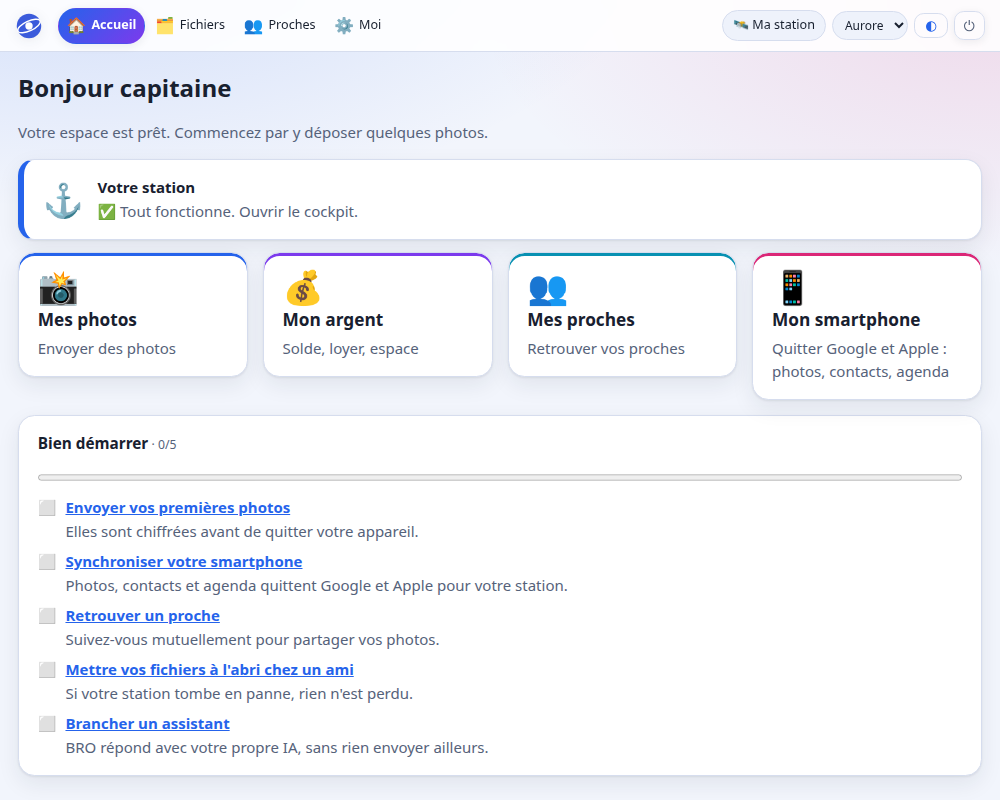
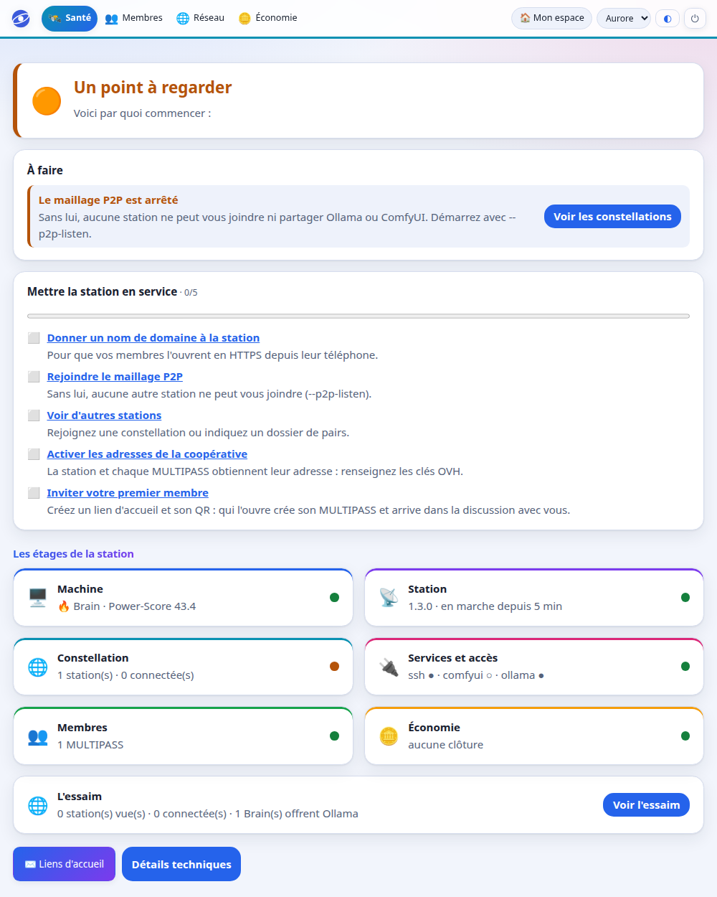
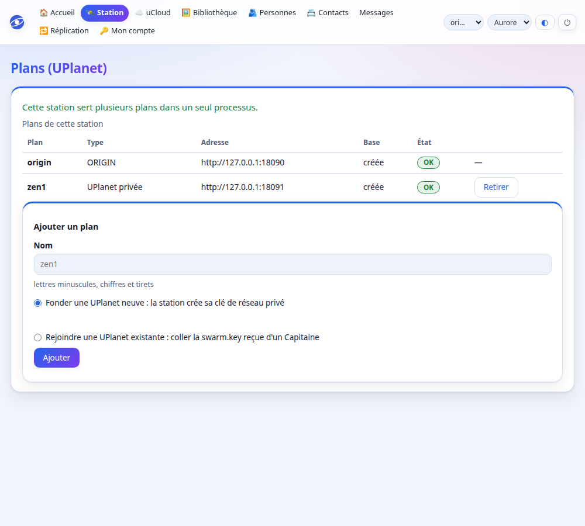

# Guide du Capitaine : ouvrir et tenir sa station

> Version texte du [guide illustré](guide.html). Pour découvrir Astroport sans rien installer : [la page d'accueil](index.html). Version **1.6.0**. Chaque étape propose le **terminal (CLI)** et, quand c'est possible, le **navigateur (Web)**.

**Sommaire** :

- [**Partie 1 — Mettre la station en service**](#partie-1) : [1. Avant de commencer](#etape-0) · [2. Installer astroportd](#etape-1) · [3. Donner une identité à la station (Y-Level)](#etape-2) · [4. Choisir sa constellation](#etape-3) · [5. Démarrer la station](#etape-4) · [6. Créer votre compte de Capitaine, puis ceux des membres](#etape-5) · [7. Vérifier que tout va bien](#etape-6) · [8. Entrer dans l'interface web](#etape-7) · [9. Le cockpit du Capitaine](#etape-7b)
- [**Partie 2 — Ce que la station offre à vos membres**](#partie-2) : [FaceCloud](#etape-8) · [Chercher dans ses documents, ses photos et ses vidéos](#chercher-dans-ses-documents-ses-photos-et-ses-vidos) · [Inviter quelqu'un à recevoir des photos](#etape-8quater) · [La clé de secours](#secours) · [Contacts, agenda et l'espace Moi](#etape-8b) · [Messages privés, et une personne dans plusieurs UPlanet](#etape-8bis-j) · [Appeler en visio](#visio) · [Naviguer ensemble](#cosurf) · [Le coffre de mots de passe (KeePass)](#etape-8bis-b) · [Le site public](#etape-8bis-m) · [Un jeton par appareil (téléphones, tablettes, ordinateurs)](#etape-8bis-f) · [Reprendre ses fichiers d'un autre serveur (Nextcloud, ownCloud…)](#etape-8bis-d) · [Ranger son uCloud par type](#etape-8bis-e) · [Connexion par PASS, compte sans email, signature déléguée](#etape-8quinquies) · [Sur un smartphone](#sur-un-smartphone)
- [**Partie 3 — Les Ẑen de la station**](#partie-3) : [Hébergement facturé et partage de la semaine](#etape-8bis-g) · [Ma UPlanet](#etape-8c) · [Les Ẑen](#etape-8bis-l) · [La PAF de la machine et les nouvelles machines](#la-paf-de-la-machine-et-les-nouvelles-machines) · [Relier une UPlanet à OpenCollective](#relier-une-uplanet-opencollective) · [Ğ1Billet](#1billet-des-billets-papier-en-en)
- [**Partie 4 — Relier, ouvrir, administrer**](#partie-4) : [Être trouvé](#annuaire) · [Relier sa station aux autres Capitaines](#etape-9) · [Les écluses de la station](#ecluses) · [Partages et réglages du Capitaine](#etape-8ter) · [Une adresse pour chaque station et chaque MULTIPASS (DNSLink)](#etape-9b) · [Les anciens clients (zelkova, coracle) sur astroportd](#etape-8bis-h) · [Plusieurs astroportd sur une machine](#plusieurs-astroportd-sur-une-machine-un-seul-bassin-de-fichiers) · [Plusieurs UPlanet dans un seul processus](#etape-8bis-i) · [En cas de problème](#etape-10)

<a id="partie-1"></a>

## Partie 1 — Mettre la station en service

Neuf étapes, à suivre dans l'ordre. À la fin, votre station tourne, vous avez votre compte de Capitaine, et le cockpit vous dit d'un regard ce qui demande votre attention.


**Terminal puis navigateur.** Les étapes 1 à 5 se font au terminal : elles manipulent une clé secrète, qui ne doit jamais passer par un navigateur. Le navigateur prend le relais à l'étape 6 (page `/welcome`).

**Où est quoi.**

| Adresse | À quoi elle sert | Pour qui |
|---|---|---|
| `astroport.one` | Le logiciel libre : télécharger, lire la documentation, ouvrir sa station | Futurs Capitaines, curieux |
| `map.astroport.one` | La carte des stations : trouver celle qui a de la place près de chez soi | Futurs membres |
| `qo-op.com` | Le portail de la coopérative : adhésion, soutien, offres d'hébergement et d'accompagnement | Sociétaires, partenaires |
| `votre-station.exemple.org` | Votre station : l'application de vos membres (photos, proches, messages, compte) et votre cockpit | Vos membres et vous |

**Le nom de la coopérative pointe vers la porte `/stations`, jamais vers une station.** Chaque station sert cette porte.


> **Détails techniques.** Sur `/stations`, « Je suis nouveau » mène à la station la plus proche qui a de la place, « J'ai déjà un MULTIPASS » ramène le membre chez lui. `GET /api/v1/locate?q=<email | npub | hex>` (public, lisible depuis toute origine, 20 recherches par minute et par adresse) répond `here`, `elsewhere` (avec l'adresse publique de la station d'accueil, lue dans sa balise 30850) ou `unknown`. Rien de neuf n'est révélé : l'email et la station d'accueil sont déjà dans le DID kind 30800 du membre. Pour le nom de la coopérative, redirigez-le vers `https://<une station>/stations` ; si cette station s'éteint, changez la redirection vers une autre : toutes servent la même porte.

**Les mots du guide, en clair.**

| Mot du guide | Ce que cela veut dire |
|---|---|
| Y-Level | L'identité de la station : une seule clé secrète d'où viennent ses clés SSH, IPFS, Ğ1 et Nostr |
| ORIGIN | Le réseau ouvert, pour découvrir et tester |
| ẐEN | Le réseau privé de la coopérative, sur invitation (clé `swarm.key`) |
| Certification DRAGON | Le parrainage par un Capitaine du réseau privé |
| MULTIPASS | Le compte d'un membre, avec son code PASS |
| Clé de secours | Une clé en trois morceaux, deux suffisent : un QR imprimé, la station, des amis |
| PAF | Les frais de fonctionnement de la machine (électricité, matériel) |

<a id="etape-0"></a>

## Étape 1 — Avant de commencer

**astroportd** est un programme unique qui fait tourner votre « Astroport » : cloud personnel chiffré, photos avec reconnaissance des visages, partage entre amis et relais Nostr. Chaque étape se fait au **terminal** (à gauche) ou au **navigateur** (à droite).

### 🖥️ Terminal (CLI)

Il vous faut :

- un ordinateur **Linux** (PC, serveur) ou un **Raspberry Pi** (de préférence 64 bits : Pi 4, Pi 5, Pi Zero 2 W), ou un **Mac** Apple Silicon (bêta : voir [MACOS.md](MACOS.md)) ;
- une connexion Internet et environ 15 minutes ;
- une **horloge à l'heure** : un Raspberry Pi sans pile démarre en 1970, et astroportd refuse alors de calculer ses échéances ;
- facultatif, pour une station ouverte sur Internet : un nom de domaine et les ports 80 et 443 ouverts ;
- facultatif : de quoi reconnaître les visages (pour FaceCloud : un service d'inférence, ou les modèles locaux que l'installeur peut mettre en place).

Deux commandes pour vérifier votre machine :

```bash
uname -m   # x86_64, aarch64 ou armv7l
date       # l'année doit être 2026 ou plus
```

### 🌐 Navigateur (Web)

Il vous faut un navigateur récent (Firefox, Chrome, Safari…). L'interface s'installe aussi comme une application sur téléphone. Votre compte **MULTIPASS** sera créé à l'[étape 6](#etape-5).

> **À savoir.** Version **1.6.0**, testée de bout en bout : les anciens formats d'Astroport.ONE ne sont plus repris (voir les notes de version). Gardez une sauvegarde de vos clés.

<a id="etape-1"></a>

## Étape 2 — Installer astroportd

L'installeur choisit le bon fichier pour votre machine et vérifie son empreinte avant de l'installer.

### 🖥️ Terminal (CLI)

```bash
curl -fsSL https://raw.githubusercontent.com/papiche/astroportd/main/install.sh | bash
```

Puis vérifiez :

```bash
astroportd --version
```

Si la commande est introuvable : `export PATH="$HOME/.local/bin:$PATH"`. **Pour mettre à jour**, relancez le même `install.sh` : vos réglages et l'identité de la station sont gardés.

> **À savoir.** L'installeur ne fonctionne que sous **Linux** (Android sous Termux compris, voir la fin du guide). Sur un **Mac**, téléchargez l'archive à la main (colonne Navigateur ci-contre, et [MACOS.md](MACOS.md)).

**L'installeur examine votre machine et recommande un profil** :

| Profil | Ce qui tourne sur la machine | Pour qui |
|---|---|---|
| **léger** | Rien en local : visages et mémoire passent par une autre machine (Brain GPU, Ollama) | Machine juste en mémoire (moins de 2 Go), en place ou en disque : Pi Zero, Pi 2/3, binaire statique |
| **standard** | Visages en local (≈ 190 Mo) et, si la machine a assez de mémoire (≈ 4 Go : au moins 3,5 Go utilisables) et de disque (≥ 2,5 Go libres), **embeddings locaux** (≈ 560 Mo) ; la moitié des cœurs au plus | Raspberry Pi 4/5 (4 Go et plus), mini-PC, NAS correct |
| **confort** | Tout en local, tous les cœurs | PC ou serveur : 8 Go de mémoire (7 Go utilisables) et 6 cœurs ou plus |

Acceptez la recommandation ou choisissez-en une autre :

```bash
curl -fsSL https://raw.githubusercontent.com/papiche/astroportd/main/install.sh | bash -s -- --check-hardware    # diagnostic seul, rien n'est installé
curl -fsSL https://raw.githubusercontent.com/papiche/astroportd/main/install.sh | bash -s -- --profile standard   # impose un profil : leger, standard ou confort
curl -fsSL https://raw.githubusercontent.com/papiche/astroportd/main/install.sh | bash -s -- --no-embed           # pas d'embeddings locaux (ni leur téléchargement de 560 Mo)
```

> **Détails techniques.** L'installeur **vérifie l'empreinte SHA-256** du binaire et s'arrête au moindre doute.
>
> - **Options** : `--version v1.6.0`, `--static` (binaire statique, x86_64 et aarch64 : l'installeur le choisit seul si la glibc est plus ancienne que la 2.35, et passe de lui-même au statique si le binaire standard ne démarre pas), `--prefix DIR`, `--no-init`, `--yes`, `--dry-run` (montre ce qui serait fait), `--no-face`. Les réponses de `init` peuvent être données d'avance : `--mode origin|zen`, `--email`, `--domain`, `--lat`/`--lon` (ou `--locate`).
> - **Outils du système** : `install.sh` n'utilise jamais `sudo`. S'il manque quelque chose, il le dit et propose de lancer **`install_sudo.sh`**, qui demande votre mot de passe et n'installe que ce qui manque : **ffmpeg** (images des vidéos pour la recherche, Médiathèque), **poppler** (lecture des PDF), **python3-pip** (ONNX Runtime), **git** (plugins), **kubo** pour ORIGIN (voir plus bas), et le **démarrage avec la machine** (`loginctl enable-linger` : sans lui, la station s'arrête quand vous fermez votre session). Un kubo déjà installé, par Astroport.ONE par exemple, est gardé tel quel. Pour le relancer seul : `curl -fsSL https://raw.githubusercontent.com/papiche/astroportd/main/install_sudo.sh -o install_sudo.sh && sudo bash install_sudo.sh --user $USER` (`--dry-run` montre ce qu'il ferait).
> - **ORIGIN et IPFS : le disque d'abord, Kubo en miroir.** Vos fichiers vivent **sur le disque de la station**, toujours, qui reste leur vérité. Une station ORIGIN les **publie aussi** par Kubo (`--kubo http://127.0.0.1:5001`, mis par `init`) sur le **réseau IPFS des stations ORIGIN**, pour qu'elles se les échangent. Ce n'est pas l'IPFS mondial : le Kubo d'ORIGIN porte la `swarm.key` à zéros et ne parle qu'aux nœuds qui ont la même (`install_sudo.sh` la pose sur un kubo neuf, avec les stations d'amorçage d'ORIGIN). Kubo garde seulement une **référence** au fichier du disque (*filestore*), sans en doubler la place. Kubo arrêté ou absent : rien ne devient illisible, seule la publication attend son retour. Une station ẐEN n'a jamais de Kubo.
> - **Plugins** : à la fin, l'installeur propose de les présenter (`install-plugins.sh` : `git clone` du dépôt `astroportd-plugins`, puis l'`install.sh` de chacun : films et musique, énergie, DNSLink). Pour y revenir : `curl -fsSL https://raw.githubusercontent.com/papiche/astroportd-plugins/main/install-plugins.sh | bash`.
> - **Mise à jour** : `install.sh` montre l'installation en place (version, constellation, domaine, Capitaine, service), installe la nouvelle version, garde vos modèles et votre station, puis redémarre le service. Il ne relance pas `init`. `--force` réinstalle la même version.
> - **Profil** : reconnaître les visages et comprendre le sens des textes *dans* astroportd (sans service externe) coûte de la mémoire, du disque et du processeur. Avant de télécharger les modèles, l'installeur examine l'architecture, le nombre de cœurs, la mémoire, la place libre, la **vitesse d'écriture du disque** (carte SD, disque mécanique, SSD, NVMe), la carte graphique et la présence d'Ollama, et vous montre ce qu'il a trouvé. Avec `--yes`, il applique la recommandation. Il vous prévient quand la machine est juste (disque très lent, carte SD, pas d'accélération int8) mais il obéit si vous insistez.
> - Chaque modèle est vérifié par SHA-256 avant d'être gardé ; un fichier incorrect est refusé. Les fils de calcul retenus sont inscrits dans `station.conf` et dans la commande de démarrage (`--face-threads`, `--embed-threads`) : un second `astroportd init` les conserve.

### 🌐 Navigateur (Web)

Ouvrez la page des versions : [https://github.com/papiche/astroportd/releases](https://github.com/papiche/astroportd/releases). Téléchargez l'archive qui correspond à votre machine :

- `x86_64-unknown-linux-gnu` : PC et serveurs ;
- `aarch64-unknown-linux-gnu` : Raspberry Pi 4/5 et Zero 2 W en 64 bits ;
- `armv7-unknown-linux-gnueabihf` : Raspberry Pi 2/3, Pi OS 32 bits ;
- `x86_64-unknown-linux-musl` : binaire statique, sans dépendance ;
- `aarch64-unknown-linux-musl` : binaire statique ARM 64 bits (Android sous Termux, Pi, NAS) ;
- `aarch64-apple-darwin` et `x86_64-apple-darwin` : **Mac** (Apple Silicon, Intel). *Bêta* : jamais compilé sur un Mac avant la 0.5.0, voir [MACOS.md](MACOS.md).

Téléchargez aussi `SHA256SUMS`. Décompressez l'archive avec votre gestionnaire de fichiers et copiez `astroportd` dans `~/.local/bin`. Comparez l'empreinte (ligne de commande : `sha256sum archive.tar.gz`) avec celle de `SHA256SUMS`.

<a id="etape-2"></a>

## Étape 3 — Donner une identité à la station (Y-Level)

Y-Level relie **vous**, votre **machine** et le **réseau** : la clé SSH qui ouvre la machine devient aussi son identité sur le réseau. Personne ne peut se faire passer pour votre station sans cette clé.


> **Détails techniques.** À partir de votre clé SSH, astroportd fabrique une graine unique ; les quatre identités (dont une clé SSH « jumelle ») partagent la même clé publique. L'identité IPFS de la station (`12D3Koo…`) s'appelle IPFSNODEID. On peut vérifier, de n'importe où, que l'accès SSH à une machine et son identité sur le réseau sont **la même clé**.

### 🖥️ Terminal (CLI)

L'assistant `init` fait ce rituel, puis vous pose quelques questions (position, email, domaine, PAF, visio) :

```bash
astroportd init
```

Votre ancienne clé SSH est conservée sous `~/.ssh/origin.key` et `~/.ssh/origin.pub`.

> **Détails techniques.** `init` part de `~/.ssh/id_ed25519` (il en crée une si elle n'existe pas). **Une station déjà en niveau Y n'est jamais redérivée** : `secret.june`, le PeerID de kubo (`~/.ipfs/config`, lu seul) et la clé SSH sont comparés, et l'assistant s'arrête plutôt que de changer l'identité : il faut répondre « oui » à sa question, ou passer `--rederive-y`. Si `~/.ipfs/swarm.key` existe, l'assistant propose de reprendre cette constellation ẐEN. Questions posées : position de la station, email du Capitaine, domaine, **PAF** de la machine (sa participation hebdomadaire aux frais, `--paf`) et **visio** : STUN + relais d'appel (recommandé), STUN seul ou aucune, plus d'éventuels serveurs STUN/TURN extérieurs (`--visio relais|stun|aucune`, `--ice-server stun:hôte:port`). Les ports à ouvrir sur la box sont résumés à l'étape 5 (« Réseau : ce qu'il faut ouvrir ») ; `init` les affiche aussi à la fin. Les secrets de la station sont écrits en `0600` dans `~/.zen/game`.

Pour voir la correspondance, ou la vérifier plus tard :

```bash
astroportd ylevel            # affiche SSH ↔ PeerID IPFS ↔ Ğ1 ↔ Nostr
astroportd ylevel --verify   # code de sortie 1 si ça ne correspond pas
```

> ⚠️ **Attention.** Votre clé SSH publique **change** : si vous l'aviez enregistrée ailleurs (GitHub, un serveur), il faudra y mettre la nouvelle. Pour ne pas toucher à SSH : `astroportd init --no-ssh` (le lien SSH ↔ IPFS n'est alors pas établi). Avec Kubo, `--kubo-config` aligne aussi son identité.

### 🌐 Navigateur (Web)

**Volontairement pas d'écran web** : une clé privée ne doit jamais passer par un navigateur. Une fois la station démarrée ([étape 5](#etape-4)), *Ma station › Santé › Détails techniques* montre son identité IPFS (PeerID).

<a id="etape-3"></a>

## Étape 4 — Choisir sa constellation : ORIGIN ou ẐEN

Une **constellation** est un groupe de stations qui se parlent. **Pas de `swarm.key` = ORIGIN ; une `swarm.key` présente = ẐEN.**


> **Détails techniques.** ORIGIN : bac à sable ouvert à tous, sans clé secrète (1 Ẑen = 0,1 Ğ1, un jeu). ẐEN : réseau privé de production, avec la clé du réseau, la `swarm.key` (1 Ẑen = 1 € dans la coopérative UPlanet ẐEN). La clé du réseau sert aussi de « nom » à la constellation (`UPLANETNAME`), dont dépend la dérivation des clés des nouveaux MULTIPASS.

### 🖥️ Terminal (CLI)

**Parcours A — Démarrer une constellation ORIGIN** (le plus simple pour commencer)

```bash
astroportd init --mode origin
```

Aucune clé à fournir. Quand votre machine est acceptée par le collectif, vous recevez la `swarm.key` ẐEN (`astroportd plane-setup add`, ou `astroportd init --join`).

> **Détails techniques.** Vous rejoignez les autres stations ORIGIN et **proposez votre machine au collectif** : la `swarm.key` est remise quand la machine est acceptée et que le Capitaine est inscrit et reconnu. L'assistant résume ensuite le réseau selon votre cas (HTTPS direct, derrière un reverse proxy, sans domaine ; maillage ; visio) : ce qu'il faut ouvrir sur la box, et ce qui ne l'est pas.

**Parcours B — Rejoindre une constellation ẐEN existante**

Un Capitaine de la constellation vous remet sa `swarm.key` (après la certification DRAGON, à demander à support@qo-op.com, objet « Candidature Capitaine DRAGON »). Gardez-la secrète.

```bash
chmod 600 swarm.key
astroportd init --mode zen --swarm-key ./swarm.key
```

Plus simple, **sans recopier de fichier** : le Capitaine de la station marraine lance `astroportd parrainer` et vous donne le jeton affiché (de la main à la main, ou par message chiffré). Sur votre station :

```bash
astroportd init --join 'astro-join:v1|https://marraine.exemple.org|…'
```

Le jeton sert une fois et expire après 24 h. Comparez l'empreinte de la `swarm.key` affichée des deux côtés.

> **Détails techniques.** La station retire une seule fois l'offre de la marraine. Elle reçoit la `swarm.key` chiffrée (seul le jeton l'ouvre), puis s'amorce sur la marraine au démarrage : elle n'est pas seule dans l'essaim. Durée du jeton : `parrainer --hours`, de 1 à 168.

**Parcours C — Fonder SA constellation ẐEN**

```bash
astroportd init --mode zen --found-constellation   # crée la swarm.key et prépare la station en une commande
# Ou en deux temps :
astroportd swarm-key > swarm.key && chmod 600 swarm.key
astroportd init --mode zen --swarm-key ./swarm.key
# Copiez ensuite swarm.key sur chaque autre station, par un canal sûr (scp, clé USB).
```

> ⚠️ **Attention.** Sauvegardez `swarm.key` : la perdre, ou en changer, change le nom de la constellation (`UPLANETNAME`) et donc la dérivation des clés des futurs MULTIPASS. Ne la publiez jamais.

> **À savoir.** Fonder sa constellation crée un **réseau privé** dont vous fixez les règles. La valeur « 1 Ẑen = 1 € » est celle de la coopérative UPlanet ẐEN ; elle ne s'applique pas toute seule à une constellation que vous créez.

### 🌐 Navigateur (Web)

**ORIGIN** — pour essayer sans rien installer, choisissez une station publique sur la carte [map.astroport.one](https://map.astroport.one). Sur votre propre station, vous créez vos MULTIPASS vous-même ([étape 6](#etape-5)).

**ẐEN** — passez par la certification DRAGON, puis recevez la `swarm.key`. Informations : le dépôt [Astroport.ONE](https://github.com/papiche/Astroport.ONE) et support@qo-op.com.

Le **premier** choix se fait au terminal (`astroportd init`). **Ajouter** ensuite une UPlanet se fait aussi dans *Ma station › Réseau › Constellations* (voir [Plusieurs UPlanet dans un seul processus](#etape-8bis-i)).

> **À savoir.** Une commande `astroportd serve` sert **une** constellation. Pour relier **la même station** à ORIGIN **et** à des UPlanet ẐEN : `astroportd planes` (voir [Plusieurs UPlanet dans un seul processus](#etape-8bis-i)).

> **Détails techniques.** Le portail [qo-op.com](https://qo-op.com) est celui de la coopérative (adhésion, soutien, offres d'hébergement), pas une station. Le premier choix se fait au terminal parce qu'il engage une clé secrète ; ajouter une UPlanet, c'est la fonder ou la rejoindre avec une `swarm.key` reçue. Avec `astroportd planes` : un seul processus, la **même identité Y-Level** (même `IPFSNODEID`), et pour chaque *plan* sa base, son dossier de comptes, son **réseau P2P privé** (sa `swarm.key`) et son port. Chaque MULTIPASS est rattaché à un plan et rien ne passe d'un plan à l'autre sans votre accord.

<a id="etape-4"></a>

## Étape 5 — Démarrer la station

`init` a préparé le dossier `~/.zen/astroportd` et affiché la commande de démarrage. Choisissez l'essai local ou la station publique.

### 🖥️ Terminal (CLI)

**Essai local** (HTTP simple, sur votre machine seulement) :

```bash
astroportd serve --db ~/.zen/astroportd/uplanet.db --blobs ~/.zen/astroportd/blobs
# → http://127.0.0.1:8090
```

**Station publique.** Deux cas, et `init` choisit seul le bon :

- **La machine n'a pas de reverse proxy** : la station obtient et renouvelle elle-même son certificat (Let's Encrypt). Elle tient les ports 80 et 443.

  ```bash
  astroportd serve --db ~/.zen/astroportd/uplanet.db --blobs ~/.zen/astroportd/blobs \
    --domain station.exemple.org --acme-email moi@exemple.org \
    --lat 45.76 --lon 4.84          # vos coordonnées règlent l'entretien de nuit (20h12 solaire)
  # en ẐEN, ajoutez : --swarm-key ./swarm.key
  ```

- **Un reverse proxy sert déjà vos sites** (Nginx Proxy Manager, Caddy…), sur cette machine ou une autre du réseau local : il garde le certificat, la station écoute sur le **port 8090** et se présente sous `https://<domaine>`.

  ```bash
  astroportd serve --db ~/.zen/astroportd/uplanet.db --blobs ~/.zen/astroportd/blobs \
    --public-domain station.exemple.org --lat 45.76 --lon 4.84
  ```

  S'il ne peut pas trancher, `init` pose la question ; `astroportd init --proxy` le dit d'avance.

### 🌐 Réseau : ce qu'il faut ouvrir

| Port | Sur la box, vers… | À quoi il sert | |
|---|---|---|---|
| **443 et 80** (TCP) | la station, ou la machine du proxy | les pages web, l'application, le relai Nostr, WebDAV, CardDAV, CalDAV | indispensable avec un domaine |
| **8090** (TCP) | rien : seul le proxy y accède (même machine, Docker ou réseau local) | l'interface de la station derrière le proxy | derrière un proxy |
| **4101** (TCP) | la station | le maillage entre stations de la constellation | indispensable pour une station relais ; conseillé sinon |
| **443** ou **8090** (UDP) | la station (un proxy ne transmet pas l'UDP) | la visio : STUN et relais d'appel. 443 quand la station a son certificat, 8090 derrière un proxy | pour la visio entre deux box |

**Dans Nginx Proxy Manager**, un seul *Proxy Host* :

- *Domain* : `station.exemple.org` ; *Forward* : `http`, l'adresse de la machine de la station, port `8090` (NPM dans Docker sur la même machine : `172.17.0.1`) ;
- **Websockets Support** coché ; *Block Common Exploits* décoché ;
- *SSL* : certificat Let's Encrypt, *Force SSL* ;
- onglet *Advanced* : `proxy_read_timeout 1h; proxy_send_timeout 1h;` ;
- aucune règle par chemin : tout le domaine va à la station.

**Qu'elle démarre toute seule** (systemd, sans droits administrateur) :

```bash
astroportd init --systemd        # écrit ~/.config/systemd/user/astroportd.service
systemctl --user daemon-reload
systemctl --user enable --now astroportd
loginctl enable-linger "$USER"   # démarrer au boot sans session ouverte
journalctl --user -u astroportd -f   # suivre les journaux
```

`init --systemd` choisit seul entre `astroportd serve` et `astroportd planes` (plusieurs UPlanet).

> **Détails techniques.**
>
> - **Proxy** : `init` reconnaît un proxy quand il est sur cette machine (ports 80/443 déjà pris), ou quand le domaine arrive sur un autre serveur web. Le cockpit a la même case, dans l'étape *Donner un nom de domaine à la station* : « Un reverse proxy (Nginx Proxy Manager…) sert ce domaine, sur cette machine ou une autre ».
> - **Nginx Proxy Manager** : dans Docker, `172.17.0.1` et non `127.0.0.1`, qui désigne le conteneur lui-même ; NPM sur une autre machine : l'adresse de la station sur le réseau local. Sans les délais de l'onglet *Advanced*, nginx coupe au bout d'une minute une connexion où rien ne passe. `/.well-known/carddav` et `/.well-known/caldav` vont aussi à la station. Sur une station Astroport.ONE, `~/.zen/Astroport.ONE/admin/system/setup_npm_dynamic.sh astroportd 8090` crée cet hôte (`astroportd.<votre domaine>`), et `firewall.sh ON` ouvre 4101 et 8090/UDP.
> - Derrière un proxy, la station écoute sur `0.0.0.0:8090` (pour être joignable depuis Docker et le réseau local) ; ne redirigez jamais 8090/TCP depuis la box. Elle croit l'en-tête `X-Forwarded-For` seulement quand la connexion vient de la machine elle-même ou d'une adresse privée, et seulement sa dernière adresse, celle que le proxy a posée. Avec son propre certificat, la station a besoin du droit d'ouvrir les ports sous 1024 : `sudo setcap 'cap_net_bind_service=+ep' $(command -v astroportd)`. Pour essayer sans quota : `--acme-staging`. Le relai et la console envoient un ping toutes les 30 s : un proxy ne les coupe pas faute de trafic.
> - **systemd** : si `planes.json` existe (station à plusieurs UPlanet), l'unité lance `astroportd planes`, sinon `astroportd serve`. `--systemd-mode serve|planes` impose l'un ou l'autre ; `planes` est refusé, sans rien écrire, si `planes.json` est absent ou invalide. Quand vous ajoutez un plan avec `astroportd plane-setup add`, une unité qui lance encore `serve` est **basculée sur `planes`** (seules `ExecStart` et `Description` changent, l'ancienne unité est gardée à côté en `astroportd.service.bak-<date>` et les options propres à la station, comme `--lat`, passent dans `args` du plan ORIGIN). Le service n'est pas redémarré pour vous : `systemctl --user daemon-reload && systemctl --user restart astroportd`. L'ajout d'une constellation depuis l'interface fait la même bascule, et le bouton *Basculer le service en multi-constellations* (confirmé par un second clic) la fait à la demande ; seule une unité qui lance `astroportd serve` est réécrite. L'écran *Ma station › Réseau › Constellations* dit ce que lance l'unité : si elle lance encore `serve` alors que plusieurs constellations sont configurées, il l'annonce avec la commande à lui donner ; quand elle lance `planes`, le bouton *Redémarrer la station* (confirmé par un second clic) exécute `daemon-reload` puis le redémarrage.
> - Dossier de la station : la base `uplanet.db`, les fichiers chiffrés `blobs`, les sauvegardes `snapshots`.

### 🌐 Navigateur (Web)

Rien à cliquer : c'est le terminal qui démarre la station. Ouvrez ensuite [http://127.0.0.1:8090](http://127.0.0.1:8090) (essai local) ou `https://votre-domaine/`. La même adresse sert l'application au navigateur et le relai aux clients Nostr.

<a id="etape-5"></a>

## Étape 6 — Créer votre compte de Capitaine, puis ceux des membres

Votre **MULTIPASS** est votre identité sur la station ; il se crée ici même. Commencez par le **Capitaine** (vous), puis les membres.


### 🖥️ Terminal (CLI)

**Le Capitaine d'abord.** Si vous avez donné votre email à `astroportd init`, c'est déjà fait (votre code PASS a été affiché). Sinon, deux chemins :

- **au navigateur** : ouvrez `/welcome` et saisissez votre email et le **code d'installation** écrit dans le journal de la station (« ⚓ Station sans Capitaine : ouvrez …/welcome et saisissez le code d'installation ABCD-EFGH ») ;
- **au terminal** :

```bash
astroportd multipass create capitaine@exemple.org --captain --lang fr
```

> ⚠️ **Attention.** Le programme affiche **une seule fois** : le code `PASS`, le jeton web, les clés (`nsec`, `npub`, Ğ1, IPNS) et la **clé de secours** (part 1). Notez-les maintenant.

**Les membres ensuite** :

```bash
astroportd multipass create ami@exemple.org
astroportd multipass list
```

> **Détails techniques.** Le MULTIPASS réunit une clé Nostr, un portefeuille Ğ1 et une identité IPNS. Tant que le compte du Capitaine n'existe pas, personne ne peut s'inscrire sur la station. `--captain` écrit aussi `~/.zen/game/players/.current/.player` et donne le rôle de Capitaine ; c'est refusé si un autre Capitaine existe déjà. Le compte est **rattaché à une seule constellation** : celle que `init` a choisie (lue dans `station.conf`, rien à ajouter). Le SALT et le PEPPER ne sont plus affichés : ils restent dans le dossier du compte et sortent seulement avec `--json`. Le même SALT/PEPPER donne **d'autres clés** dans une autre constellation. Les membres suivent automatiquement le Capitaine (liste de contacts Nostr, kind 3).
>
> Options : `--lang fr|en|es`, `--relay ws://…` (publier aussi les événements de naissance sur un autre relai), `--home DIR`, `--game-dir DIR`, `--db FICHIER`.
>
> Ce que la création écrit : un dossier `~/.zen/game/nostr/<email>/` (`.secret.nostr`, `.secret.dunikey`, `.keyformula`, `.pass`, `.multipass.json` en `0600`, plus `HEX`, `NPUB`, `G1PUBNOSTR`, `LANG`, `NOSTRNS`) et trois événements signés par le compte : son **profil** (kind 0), le **suivi du Capitaine** (kind 3) et son **DID** (kind 30800).
>
> **Limites.** La création reprend l'essentiel de `make_NOSTRCARD.sh` d'Astroport.ONE, mais pas : l'import de la clé IPNS dans Kubo, l'envoi du zine par email ni la ZenCard. La **primo-transaction** (1 Ğ1 du portefeuille maître) n'est plus envoyée à la création : elle part à la **première connexion** du membre (navigateur, WebDAV ou NIP-98), preuve qu'il a bien reçu ses clés — au plus 20 par jour (`--no-primal-init` coupe toutes les transactions primales). Un MULTIPASS créé ici qui ne s'est jamais connecté en 24 h peut être **éjecté** depuis l'écran Station (bouton « Éjecter ») : si quelqu'un lui a tout de même envoyé des Ğ1, elles sont d'abord reversées au portefeuille primal `UPLANETNAME_G1` (mémo `MULTIPASS:<nom>:PRIMAL:CASH-BACK`, comme `nostr_DESTROY_TW.sh`) ; ses clés vont dans la **corbeille** de la station (`~/.zen/game/trash/ejected/`, vidée à 20h12 après 30 jours, comme `trash/moved/` pour les comptes partis vers une autre station) et l'adresse peut se réinscrire. À l'inscription, le membre peut aussi **indiquer son quartier** : la station n'en garde que la maille UMAP (0,01°, ≈ 1 km), écrite aussi dans les fichiers `GPS` et `ZUMAP` du compte comme le faisait Astroport.ONE. Le découpage SSSS du DISCO envoyé chiffré au Capitaine n'est pas repris tel quel : il est remplacé par la **clé de secours en trois parts** (voir plus bas), avec son QR (`astroportd multipass card <email> --svg`). Retrouver un compte repose donc sur cette clé de secours.

**Comptes inactifs : retirer, puis supprimer.** L'écran *Ma station › Membres* classe les comptes par **dernière activité** (connexion, fichier déposé, note ou message publié, appareil synchronisé ; `src/member_activity.rs`), par disque occupé (%) ou par ancienneté, et chaque réglage s'y fait dans la ligne. Un MULTIPASS resté **plus de 30 jours sans activité** peut être :
- **retiré** (« Retirer le compte », réversible 30 jours) : ses Ğ1 reviennent au portefeuille primal (CASH-BACK), ses clés vont dans `~/.zen/game/trash/removed/`, il n'est plus hébergé ici ; ses fichiers restent. Pour le rendre : remettre le dossier dans `nostr/` et repasser `hosted = 1` ;
- **supprimé complètement** (« Supprimer… », sans retour ; aussi pour un compte déjà retiré) : la boîte dit ce qui sera perdu et demande de **retaper l'adresse** du compte. Dans l'ordre (`src/member_purge.rs`) : Ğ1 reversées ; **adieu Nostr signé de sa clé** — profil (kind 0) vidé et suppressions NIP-09 (kind 5) de tout ce qu'il a publié, rangés ici puis envoyés aux relais ; ses données (uCloud, recherche, plantes, visages, mémoire de BRO, chat, carnet, partages, sauvegardes, appareils, réglages, messages privés reçus) ; les blobs que plus rien ne référence (le bassin partagé garde ceux d'un plan voisin, le miroir Kubo désépingle au passage suivant) ; enfin ses clés, corbeille comprise, et son identité. Un `astroportd replay` ne le fait pas revenir : son DID et ses manifestes sont supprimés par ses propres kind 5.

### 🌐 Navigateur (Web)

Les **membres** s'inscrivent depuis le navigateur, une fois la station démarrée ([étape 5](#etape-4)).

1. Ouvrez `https://votre-domaine/register` (ou, dans la fenêtre **Connexion**, le lien **« Pas de compte ? Créer mon MULTIPASS »**).
2. Saisissez votre **email** et choisissez la **langue**.
3. La page montre votre **identifiant**, votre **code PASS** et votre **carte de secours** ; les clés sont repliées sous *Détails techniques (facultatif)*. **Elle ne s'affiche qu'une fois.**
4. Cliquez **« Imprimer ma carte de secours »**, et si vous voulez **« Télécharger mes informations (.txt) »** ; gardez-les en lieu sûr.
5. Cliquez **« Entrer dans mon espace »** : vous êtes connecté directement.

L'inscription web est **ouverte par défaut**.

> **À savoir.** Sur une station publique, fermez l'inscription quand vos membres sont inscrits : `--no-register`, ou le mode **Forteresse** (*Ma station › Réseau › Écluses*, [voir plus bas](#ecluses)), qui ferme aussi les restaurations ; les invitations d'un membre restent possibles.

**Pour vos membres.** Remettez à chaque nouveau membre la [fiche de bienvenue](BIENVENUE.md) avec son lien d'invitation.

> **Détails techniques.** Garde-fous réglables au démarrage : `--max-accounts N` (500 par défaut, `0` = illimité), `--register-per-hour N` (5 par adresse IP, `0` = illimité) et `--no-register` pour la **fermer**. Un email déjà inscrit est refusé (erreur 409), une adresse invalide aussi (400). La fiche de bienvenue explique la connexion, le code PASS, la clé de secours et les premiers pas, en mots simples.

<a id="etape-6"></a>

## Étape 7 — Vérifier que tout va bien

Trois vérifications, de la plus complète à la plus rapide. Aucune ne modifie rien.

### 🖥️ Terminal (CLI)

```bash
astroportd doctor --db ~/.zen/astroportd/uplanet.db --game-dir ~/.zen/game
astroportd ylevel --verify
curl http://127.0.0.1:8090/health
```

`doctor` signale chaque problème avec la ligne à écrire pour le corriger.

Pour voir le relai Nostr de la station :

```bash
curl -H 'Accept: application/nostr+json' http://127.0.0.1:8090/
```

> **Détails techniques.** `doctor` contrôle l'identité, les permissions `0600` des secrets, la base, les certificats HTTPS et l'horloge (il affiche le prochain 20h12 solaire), puis les réglages de la machine qu'il lit sans jamais les changer : limite de fichiers ouverts et `LimitNOFILE` de l'unité, `loginctl enable-linger`, `PasswordAuthentication no` dans `sshd_config`, plafond `SystemMaxUse` du journal et journal gardé sur disque (`Storage=persistent`, posé par `install_sudo.sh`) (des avertissements). Code de sortie `1` si une vérification échoue. `/health` rend l'état global (`ok`, `degraded` ou `down`, avec le code HTTP 503 si `down`), la version, la durée de fonctionnement et l'état de chaque partie (`subsystems`).

### 🌐 Navigateur (Web)

Ouvrez `http://127.0.0.1:8090/health` : il doit répondre `ok`. Si l'application se charge sur `http://127.0.0.1:8090/`, le serveur web fonctionne.

<a id="etape-7"></a>

## Étape 8 — Entrer dans l'interface web

Il faut un compte hébergé par la station ([étape 6](#etape-5)) et son **code PASS** (ou un jeton). Le Capitaine a en plus un bouton **Ma station** en haut à droite ([étape 9](#etape-7b)).

### 🖥️ Terminal (CLI)

Le jeton est affiché à la création du compte. Pour le retrouver :

```bash
astroportd token vous@exemple.org --game-dir ~/.zen/game
```

Ce jeton sert aussi de mot de passe WebDAV (Finder, Explorateur Windows, application mobile) : adresse `https://votre-domaine/dav`, identifiant = votre email.

### 🌐 Navigateur (Web)

1. Ouvrez la station dans votre navigateur.
2. Dans la fenêtre **Connexion**, saisissez votre email (ou votre clé), puis **Continuer**, puis votre **PASS ou jeton**.
3. Suivez la liste **Bien démarrer** de l'**Accueil** : elle se coche toute seule.
4. **Moi › Mes Ẑen** montre votre solde en Ẑen et votre espace utilisé.



Sur un téléphone, installez la page comme application (menu du navigateur : *Ajouter à l'écran d'accueil*). Le style (**Aurore**, **Sobre**, **Kraft**) et le mode clair ou sombre (◐ ☀ ☾) se choisissent dans l'en-tête.

> **Détails techniques.** L'**Accueil** montre quatre gestes (**Mes photos**, **Mes Ẑen**, **Mes proches**, **Mon assistant** — ou **Mon smartphone** quand il n'y a pas d'assistant), l'encart **Pour vous** (ce qui attend un geste aujourd'hui : visages à ranger, photos à envoyer, vie privée…) et une liste **Bien démarrer**. La barre du bas a quatre onglets : **Accueil**, **Fichiers** (dossiers et photos), **Proches** (carnet, visages et conversations) et **Moi** (compte, argent, sauvegarde). Si le compte vit sur une autre station, un bouton vous y mène au lieu du champ **PASS ou jeton** (voir le schéma en tête du guide). L'Accueil propose d'envoyer vos premières photos, de **synchroniser votre smartphone** (photos, contacts, agenda : on quitte Google et Apple), de reconnaître un visage, de retrouver un proche, de mettre vos fichiers à l'abri chez un ami, de brancher un assistant ; la liste disparaît quand tout est fait. Une alerte n'apparaît que si votre espace dépasse 90 %. **Moi › Mes Ẑen** montre aussi la durée que couvre ce solde, vos dépenses des 28 jours (le loyer) et vos parts de matériel (ce que vous possédez, avec leur amortissement). Styles : **Aurore** (par défaut : dégradés, icônes, liseré coloré sur les cartes), **Sobre** (sans décor) et **Kraft** (papier chaud, inspiré des pochettes de FaceCloud). Mode : automatique (celui de l'appareil), clair ou sombre. Ces choix restent sur l'appareil et ne sont envoyés nulle part.

<a id="etape-7b"></a>

## Étape 9 — Le cockpit du Capitaine

Le bouton **Ma station** ouvre l'espace du Capitaine : **Santé**, **Membres**, **Réseau** et **Économie**. **Santé** est le **cockpit** ; **Mon espace** (même bouton) ramène à l'application des membres.

### 🌐 Navigateur (Web)

1. Lisez **le verdict** : ✅ *Tout va bien*, 🟠 *N points à regarder* ou 🔴 *Intervention nécessaire*.
2. Traitez **À faire** : chaque bouton mène à l'écran qui règle le problème.
3. Sur une station neuve, suivez **Mettre la station en service** ; invitez vos premiers membres avec **✉️ Liens d'accueil**.



> **Détails techniques.**
>
> - **À faire** montre les trois actions les plus urgentes, chacune avec sa raison en clair (sous-système en panne, P2P arrêté, SSH ouvert à tout le réseau, service réglé qui ne répond plus, tâches abandonnées, MULTIPASS presque pleins, comptes verrouillés ou en période de grâce, trésorerie entamée).
> - **Mettre la station en service** : nom de domaine, maillage P2P, autres stations vues, adresses de la coopérative, premier membre invité (**✉️ Liens d'accueil** : un lien `/w/<jeton>` et son QR, pour plusieurs personnes). Les étapes se cochent d'après l'état réel.
> - **Les étages de la station**, chacun avec son voyant : Machine, Station, Constellation, Services et accès, Membres, Économie.
> - **L'essaim**, en une ligne : stations vues, connectées, et *Brains* qui offrent Ollama ; **Voir l'essaim** ouvre une carte par station (Power-Score, distance, services partagés). Viennent aussi les cartes **Réserve de démarrage**, **Énergie**, **PAF de cette machine** et **Adresses de la coopérative**.
> - La page se met à jour toute seule toutes les 30 secondes. Les écrans détaillés restent à un clic : *Détails techniques* (nœud, relais, sous-systèmes), **Membres** (comptes, jeton de secours, hébergement), **Réseau** (Essaim, Constellations, Écluses, Réglages) et **Économie** (Constellation, Régie).

<a id="partie-2"></a>

## Partie 2 — Ce que la station offre à vos membres

Lisez seulement les fonctions dont vos membres ont besoin. Les photos et l'invitation viennent d'abord : c'est par elles que la plupart des gens arrivent.


<a id="etape-8"></a>

## FaceCloud : retrouver et partager les photos entre amis

C'est ce que vos membres utiliseront le plus. La station repère les **visages** dans les photos chiffrées de l'uCloud et aide à les nommer. Les **amis N¹** reçoivent leurs photos tout seuls ; pour les autres, on crée un **lien secret**.

**Une photo ne part seule chez un ami que s'il y est reconnu avec certitude et seul avec vous.** Sinon, elle attend votre accord, en un clic, dans **Proches › Trier les visages**.

> **Avant de relier des amis.** Suivre quelqu'un qui vous suit (ami N¹) ouvre le partage automatique de vos photos où il paraît seul avec vous, la garde de votre sauvegarde et du troisième morceau de votre clé de secours. Ne reliez que des personnes de confiance.


> **Détails techniques.** Les photos sont chiffrées avant de quitter l'appareil. Amis N¹ : ceux que vous suivez *et* qui vous suivent. Une photo attend votre accord dès qu'une autre personne y paraît nettement (un inconnu, ou un autre ami) ; l'Accueil le signale dans *Pour vous*, bouton *Décider*. Un passant flou à l'arrière-plan ne compte pas. Tant que votre propre visage n'est pas nommé, la station ne vous reconnaît pas : vos photos à deux attendent alors aussi un clic. La même règle vaut quand vous **reliez une personne à sa clé** : ses anciennes photos de groupe ne partent pas d'un coup. Chaque membre peut couper l'envoi automatique (case « Envoi auto… » de **Trier les visages**) : tout attend alors son accord. En mode **Forteresse** ([écluses](#ecluses)), tout attend l'accord pour tous les membres.

### 🖥️ Terminal (CLI)

Donnez à la station un service de reconnaissance des visages (modèle InsightFace) :

```bash
astroportd serve ... --face-engine http://127.0.0.1:8000
```

**Ou l'inférence locale, sans service HTTP (facultatif)** :

```bash
cargo build --release --features onnx                      # ou la version publiée compilée avec cette fonction
export ORT_DYLIB_PATH=/chemin/vers/libonnxruntime.so       # chargée à l'exécution : rien n'est téléchargé à la compilation
astroportd serve ... --face-models ~/modeles/buffalo_l     # contient det_10g.onnx et w600k_r50.onnx
```

`astroportd face-check` dit ce qui manque. Les modèles `buffalo_l` ne sont pas fournis : leur licence est **non commerciale**, vérifiez-la.

Déposez vos photos par WebDAV, par exemple avec `curl` :

```bash
curl -u vous@exemple.org:JETON -T photo.jpg https://votre-domaine/dav/Photos/photo.jpg
```

> **Détails techniques.** **Partages entre stations.** Les partages vers un ami d'**une autre station** partent seuls : la station lit sa station d'accueil dans son DID et la joint par le maillage (message chiffré, enveloppé NIP-59). `--relay ws://…` n'est qu'un repli facultatif. Sans `--face-engine` ni `--face-models`, uCloud fonctionne mais sans reconnaissance.
>
> **Inférence locale.** Une station autonome exécute SCRFD (détection) et ArcFace (empreinte 512D) dans le binaire, par ONNX Runtime. `face-check` vérifie la fonction compilée, les modèles, la bibliothèque et le chargement. Si les deux modèles sont dans `~/.zen/astroportd/models` (ou `~/.insightface/models/buffalo_l`) et la bibliothèque aux emplacements habituels (dont le `onnxruntime` d'un venv pip), `serve` active l'inférence locale **tout seul**, sans option. Les deux modèles ne sont **pas** fournis avec astroportd : ce sont ceux du paquet InsightFace `buffalo_l`. Leurs poids sont publiés pour la **recherche non commerciale** : vérifiez la licence avant tout usage commercial, ou utilisez des modèles compatibles dont la licence vous convient (mêmes noms de fichiers, mêmes entrées et sorties). Mesure sur un PC de bureau (build de développement, 2 fils) : environ 0,5 s par photo ; le binaire optimisé est nettement plus rapide.
>
> **Mémoire et recherche : des embeddings calculés dans la station (facultatif).** La mémoire de BRO et la recherche par le sens transforment chaque texte en un vecteur de 1024 nombres (modèle `bge-m3`). Par défaut, c'est Ollama qui les calcule (`--ollama http://…`). Une station peut aussi les calculer **elle-même**, sans Ollama, avec la version quantifiée en entiers 8 bits (int8) de `bge-m3`, par le même ONNX Runtime que les visages :
>
> ```bash
> astroportd embed-check                                     # fonction compilée, fichiers, bibliothèque, chargement, essai
> astroportd serve ... --ollama http://127.0.0.1:11434       # les vecteurs sont calculés en local si les fichiers sont là
> astroportd serve ... --embed-models ~/modeles/bge-m3       # ou impose le dossier (erreur claire s'il est incomplet)
> astroportd serve ... --embed-threads 2                     # limite les fils de calcul (0 = tous les cœurs)
> ```
>
> Les deux fichiers sont `bge-m3-int8.onnx` (≈ 540 Mo) et `bge-m3-tokenizer.json` (≈ 16 Mo), dans `~/.zen/astroportd/models` : l'installeur les met en place (profils *standard* et *confort*), vérifiés par SHA-256. Ils viennent de `Xenova/bge-m3` (licence MIT). Sans option, `serve` les utilise **tout seul** quand ils sont présents (et que `libonnxruntime` est trouvée) ; sinon Ollama reste le moteur, et si les fichiers sont là mais inutilisables, la station le dit à l'écran avant de se rabattre sur Ollama. Ce sont les mêmes 1024 dimensions que celles d'Ollama, et le calcul reproduit exactement celui d'`onnxruntime` sur ce même fichier (cosinus 1,000). **Attention** : le fichier est *quantifié* (int8) alors qu'Ollama sert une autre version du modèle ; leurs vecteurs sont très proches mais **non identiques**, et cet écart n'a pas été mesuré. Sur une mémoire déjà indexée par Ollama, gardez le même moteur ou ré-indexez avant de changer.
>
> Ordres de grandeur sur un PC de bureau à 12 cœurs : chargement ≈ 2 s au démarrage, environ 20 ms pour une phrase courte et 170 ms pour 200 jetons (≈ 150 mots), **≈ 1,3 Go de mémoire au pic**. Ollama reste nécessaire pour les **résumés** du cycle RÊVE ; seuls les vecteurs sont calculés en local. Le binaire statique (musl) n'a pas cette fonction.

### 🌐 Navigateur (Web)

1. **Fichiers › Photos** montre vos photos, de la plus récente à la plus ancienne.
2. **Proches › Trier les visages** : confirmez ou nommez les visages proposés.
3. Entre amis N¹ réciproques, les photos arrivent seules dans `/Partages/De_<nom>/`.
4. Pour quelqu'un d'autre : ouvrez une photo, **Partager** → **Lien magique** (72 h). Envoyez le lien tel quel, `#` compris.

> **À savoir.** Les films et séries déposés (copie privée) ne sont publiés que pour votre cercle N¹, jamais pour tout le cercle N².

> **Détails techniques.**
>
> - Un visage reconnu à plus de 82 % porte son nom ; entre 55 % et 82 %, la station demande « est-ce X ? » : vous acceptez ou vous nommez vous-même. **Proches › Carnet** signale les visages à ranger.
> - Les photos sont copiées chez l'ami (même station), ou lui sont envoyées chiffrées (autre station). Le lien magique sert au cercle N² et aux invités ; l'API accepte de 1 h à 30 jours. La clé de déchiffrement est après le `#` et ne quitte **jamais** votre navigateur ni celui de l'invité. Les liens expirés sont supprimés chaque nuit, avec leurs copies chiffrées.
> - L'onglet **Proches** réunit le carnet d'adresses, les visages et les conversations (sous-onglets **Carnet** et **Conversations**) : **une personne est une fiche de contact**. En tête, le sas **« N visages à ranger »** propose **Trier en grand** (plein écran, une question à la fois : « Ces 3 visages sont-ils Léa ? » Oui / Non, puis « Qui est-ce ? » ; la photo entière s'affiche, le visage entouré ; raccourcis O, N, Espace, Échap) et la **table de tri** pour les gestes en masse. Chaque fiche montre ses visages ; un clic ouvre la photo d'origine, le visage entouré. Si plusieurs fiches portent le nom tapé, l'interface demande laquelle (ou « une nouvelle personne ») : elle ne devine jamais.
> - La **table de tri** (`#/people/tri`) montre les visages sur une table lumineuse : chaque pastille est un visage, les visages inconnus qui se ressemblent sont regroupés en grappes, et on les **glisse** sur la pochette d'une personne (ou au lasso, ou avec la barre d'actions au clavier). Les vignettes sont recadrées par la station ; les empreintes ne quittent jamais la station.

### 🎬 Films, séries, vidéos et musiques (plugin `media`)

astroportd **ne traite pas les médias** : le plugin système [`media`](https://github.com/papiche/astroportd-plugins/tree/main/media) le fait et range tout dans votre uCloud.

```bash
media-add film.mkv --title "Le Voyage de Chihiro" --year 2001 --level circle      # catalogue TMDB si TMDB_API_KEY
media-add https://www.youtube.com/watch?v=… --level private                       # vidéo web (yt-dlp)
media-add S01E03.mkv --type episode --series "Ma Série" --season 1 --episode 3
media-add https://www.youtube.com/watch?v=… --type mix --level circle               # mix de DJ : un morceau par titre + playlist
```

`--level circle` partage avec votre cercle N¹ ; `private` : vous seul.

**Fichiers › Médiathèque** les présente rangés : films et vidéos, séries (par saison et épisode), musique (par album ou par mix).

1. **Cherchez** par titre, artiste, genre, acteur, réalisateur ou mot-clé, sans souci des accents.
2. **▶ Lire** : un film s'ouvre en grand, avec ses sous-titres ; un album ou un mix se lit à la suite (**Tout lire**, **Au hasard**), dans une barre en bas de l'écran qui **continue quand vous changez d'écran**.
3. **Un fichier partagé est-il à l'abri ?** Une pastille discrète dans la liste (🟢 en sécurité, 🟡 en partie, ⏳ pas encore), et dans sa fiche la phrase complète : « 🟢 En sécurité : 3 copies chez vos amis · vérifié il y a 3 h » ou « 🟡 1 copie chez Paul + votre sauvegarde ». Seules comptent les copies que votre station a **vérifiées** chez des amis (stations différentes, moins de 7 jours) ; tant qu'elles ne suffisent pas, le fichier part aussi dans votre sauvegarde chez vos gardiens.
3. **✎ Corriger la fiche** : titre, année, résumé, genres, mots-clés ; la réalisation et la distribution pour un film ; la série, la saison et l'épisode pour un épisode ; l'artiste, l'album, la piste et le compositeur pour un morceau. Ce que vous ajoutez sert aussitôt à la recherche.

Les fiches, affiches, pochettes et sous-titres restent à côté du fichier mais ne s'affichent ni dans **Dossiers** ni dans **Photos**.

Sur la fiche d'un film, en tête d'une série ou d'un album : **Partager avec mes amis** (une série ou un album se partage en entier, comme une liste). Juste dessous, la **trace** : qui l'a copié et quand, de qui vous le tenez, quels amis le repartagent. Décocher retire le partage ; les copies déjà faites restent chez vos amis. Le fichier n'est jamais rechiffré : il circule d'ami en ami sous le même blob, et une station ne le garde qu'une fois.

**Chez mes amis** montre les films et morceaux que vos proches réciproques partagent avec leur cercle, et chez qui ils se trouvent (« 2 copies chez vos amis : Léa, Paul »). **▶ Lire** demande une copie : elle arrive dans votre médiathèque, **rangée comme chez votre ami** (`/Vidéos/Films`, `/Musique/<artiste>/<album>`…), avec sa fiche et son affiche, puis se lit comme vos propres films. L'écran vous prévient quand elle est arrivée. La station d'un ami éteinte n'empêche pas de voir sa dernière liste : la copie partira quand elle reviendra.

> **Détails techniques.** astroportd reste un serveur WebDAV qui partage en P2P, N¹ ou N². Le plugin (dépôt `astroportd-plugins`) remplace `ajouter_media.sh` :
>
> - il sonde (`ffprobe`), réencode en H.264/AAC avec la piste française en premier (`ffmpeg`), télécharge (`yt-dlp`), interroge le catalogue TMDB ;
> - il **écrit lui-même dans votre uCloud**, par WebDAV et avec votre jeton : `/Vidéos/Films`, `/Vidéos/Séries/<série>/Saison NN`, `/Vidéos/Autres`, `/Musique/<artiste>/<album>`, avec à côté la fiche `<nom>.media.json` (contrat `media/v1`, base de la vidéothèque), les images et les sous-titres WebVTT ;
> - avec `--level circle`, il **signe avec votre clé** (lue sur la machine, jamais copiée) et publie l'événement vidéo (NIP-71, kind 21 ou 22, réservé à votre cercle N¹) sur le relai, comme n'importe quel client Nostr. `private` : aucun événement. L'attestation de copie privée (CPI L. 122-5) est posée automatiquement au premier dépôt, en local : rien n'est publié.
>
> **Médiathèque (station).** Chaque `<nom>.media.json` est lu par la station et résumé dans la table `media_index`, un cache local relu seulement quand le CID de la fiche change (une base rejouée le reconstruit à la première ouverture). La lecture passe par `/play/<jeton>` : le jeton, signé par la station (HMAC, 12 h), désigne **un** fichier d'**un** compte ; le fichier est servi en clair avec `Range` et déchiffré à la volée, sans jamais être chargé en entier dans le navigateur. Seuls le son, la vidéo et les sous-titres en reçoivent un. Une correction (`POST /api/v1/ucloud/media/edit`) n'accepte que les champs du type de la fiche, la garde conforme à `media/v1`, et la réécrit à sa place (même chiffrement, même quota). Les fiches et leurs compagnons (`<nom>.poster.jpg`, `.cover.jpg`, `.<langue>.vtt`…) sont masqués de la liste des fichiers tant que le fichier décrit existe, et de Photos toujours.
>
> **Partage et synchronisation (station).** « Partager avec mes amis » signe, avec la clé du membre, l'événement NIP-71 que publiait le plugin (mêmes étiquettes ; série et album : liste NIP-51 kind 30005) ; le retirer publie une suppression NIP-09. La liste d'un ami se met à jour par **Negentropy (NIP-77)** : la station réconcilie son cache avec la station de l'ami, et seuls les nouveaux événements voyagent. Le relai d'astroportd parle NIP-77 (limité à ce que le lecteur peut lire) ; un relai qui ne le parle pas est lu en entier.
>
> **Chez mes amis (station).** La liste d'un ami est lue chez lui (en base s'il est hébergé ici, sinon chez sa station d'accueil par le maillage) en répondant au défi NIP-42 **avec la clé du membre** : le relai de l'ami ne livre ses kinds 21/22 qu'à son cercle N¹, c'est lui qui décide. Elle est gardée dans le cache `friend_media` (relu au plus toutes les 10 minutes) ; un même fichier partagé par plusieurs amis (même empreinte `x`) n'y fait qu'une entrée, avec ses sources. « Lire » envoie une demande NIP-59 (rumeur kind 30078, `t = astro-media`, `op = request`) ; la station de l'ami vérifie que le demandeur est un **proche réciproque** et que l'ami a **lui-même publié** ce fichier pour son cercle, puis envoie le fichier, sa fiche et ses compagnons par le partage ordinaire, avec leur dossier d'origine (`dir`) : la station du demandeur les range au même endroit s'il s'agit d'un dossier `/Vidéos/…` ou `/Musique/…`, sinon dans `/Partages/De_<ami>/`, sans jamais écraser un autre fichier. Une même demande n'est resservie qu'après 6 h ; un refus est renvoyé au demandeur et affiché.
>
> L'événement désigne `/ipfs/<cid>`, le CID que la station a donné au blob chiffré (lu par `PROPFIND`, propriété `getetag`). Le partage de la clé aux amis suit le partage N¹ de la station, comme pour tout fichier. Les événements signés par le plugin sont vérifiés par astroportd comme n'importe quels autres (test d'interopérabilité `tests/plugin_media_interop.rs`).

## Chercher dans ses documents, ses photos et ses vidéos

Vos membres retrouvent une facture en tapant un mot qu'elle contient, et une photo ou un moment de vidéo en décrivant ce qu'on y voit : « gâteau d'anniversaire avec des bougies », « coucher de soleil sur la mer ». **La recherche se fait toujours sur la station, sans réseau.**

Ce que la station sait faire dépend de sa puissance :

| Station | Texte des documents (scans, PDF, photos de tickets) | Ce que montrent les photos et les vidéos |
|---|---|---|
| **Équipée** (≈ 7 Go de mémoire ou plus) | lu sur place | analysé sur place |
| **Légère** (Raspberry Pi…) | lu par la station d'un Capitaine ami, si le membre l'accepte | non : ni proposé, ni promis à l'écran |

Une station **Cerveau de la constellation** prête en plus sa lecture des documents aux membres de vos Capitaines amis.

### 🖥️ Terminal (CLI)

L'installeur propose les modèles selon la machine. Le profil *Cerveau* demande confirmation avant d'ouvrir le service aux amis. À la main :

```bash
astroportd models list                     # ce qui est installé, ce qui manque
astroportd models add ppocrv6-small        # lire le texte (≈ 30 Mo)
astroportd models add siglip2-base         # regarder les photos et les vidéos (≈ 400 Mo)
astroportd models bench [photo.jpg…]       # vitesse de cette machine : une photo, une recherche, un document
astroportd doctor                          # vérifie modèles, ONNX Runtime, poppler (PDF) et ffmpeg (vidéos)
astroportd serve ... --ai-index friends    # prête la lecture aux Capitaines amis (fermé par défaut)
```

Il faut aussi `poppler-utils` pour les PDF et `ffmpeg` pour les vidéos, tous deux facultatifs. Autres options de `serve` : `--index-models <dossier>`, `--index-threads N`, et `--no-index` pour tout couper.

### 🌐 Navigateur (Web)

1. **Ma station › Membres**, carte *Analyse des documents et photos (IA)* : vous activez ou coupez l'analyse pour toute la station, pour les nouveaux comptes, ou pour chaque MULTIPASS (colonne *Lecture*). Vous y prêtez aussi la station à vos Capitaines amis.
2. Le membre, dans **Moi › Documents et photos cherchables**, voit ce que fait sa station et où en est l'analyse. Sur une station légère, il peut **choisir lui-même** une ou plusieurs stations amies pour lire ses documents. Il donne pour cela un accord explicite, qu'il peut retirer en un geste. Il peut aussi **mettre en pause** l'analyse de ses fichiers, et **effacer ce qui a été calculé** (après confirmation, l'analyse se met alors en pause). La carte dit la place que son index occupe dans son espace.
3. Une **seule case de recherche**, sous *Dossiers*, *Photos* et *Médiathèque*, cherche dans tout le uCloud. Son texte grisé annonce ce qui marche sur cette station. Chaque mot peut être trouvé n'importe où : dans le nom, dans le texte lu, ou parce que c'est le prénom d'une **personne reconnue**, une **ville** où le membre a pris des photos, un **mois** ou une **année**. « Léa plage 2024 » donne les photos de Léa, prises en 2024, qui montrent une plage ; la station dit ce qu'elle a compris.
4. Les résultats commencent par **Les plus proches**, puis se rangent en *Documents*, *Photos et vidéos* et *Films et musique*. Une pastille dit pourquoi un fichier est là : **T** pour le texte lu (avec l'extrait), **👁** pour ce que montre l'image. Une vidéo porte le moment trouvé (« ▶ 1:23 ») et s'ouvre à ce moment. Quand rien n'est sûr, la station propose **Peut-être** : ce qui répond à un des mots, ou les photos les plus proches. Le type et la période se choisissent dans **Affiner**, replié par défaut.

**Vérifier que votre station cherche bien.** Le plugin facultatif **corpus** fournit un **corpus d'essai** de 45 fichiers :
- 35 photos libres de Wikimedia Commons : un chat, un chien, une plage, la tour Eiffel, une pizza… et 23 portraits de personnalités, d'Einstein et Marie Curie à John Conway, Katherine Johnson, Thomas Pesquet ou Marilyn Monroe ;
- un panneau et un ticket de caisse photographiés, une facture et une ordonnance en PDF, une attestation scannée sans texte ;
- des notes, et deux vidéos.

Les photos portent des dates et des lieux fictifs. Installez le plugin : il fabrique le corpus, puis propose de le déposer dans votre uCloud (dossier `/Essais/Recherche`) :

```bash
~/.zen/astroportd-plugins/install-plugins.sh corpus          # → ~/.zen/tmp/corpus-recherche (photos gardées en cache)
~/.zen/astroportd-plugins/corpus/setup.sh                    # le déposer plus tard, ou dans un compte d'essai (--login)
```

Le jeton d'appareil est demandé sans écho : il ne passe ni par l'historique ni en argument.

Une fois l'analyse finie, chaque ligne du fichier `LISEZMOI.md` du corpus dit quoi taper et ce qui doit sortir. Une ligne vérifie une voie de la recherche :
- « chat » ou « tour Eiffel » : l'image ;
- « boulangerie » et « assurance » : le texte lu dans une photo et dans un scan ;
- « Doliprane » : le texte d'un PDF ;
- « Lyon » et « juillet 2024 » : le lieu et la date ;
- « montagne » : une image clé de vidéo.

FaceCloud doit regrouper les visages de chaque personnalité ; nommez-en un, les autres suivent. « girafe » ne doit rien donner de sûr. Si une ligne échoue, `astroportd doctor` dit quel modèle ou quel outil manque (ffmpeg, poppler).

> **Détails techniques.**
>
> - **Texte (OCR).** PP-OCRv6 small, par ONNX Runtime dans le binaire (`--features onnx`). Un PDF qui a déjà du texte est lu directement, sinon page par page (30 pages au plus). Le texte va dans `search_text` (FTS5, sans accents ; un mot se cherche entier, au pluriel près, comme dans le nom et la description : « chat » ne trouve pas « achat »). La vigie de `/Public` s'en sert pour repérer les papiers d'identité et les relevés bancaires publiés par erreur.
> - **Photos et vidéos.** SigLIP 2 base (int8) calcule un vecteur par photo, et un par image clé de vidéo : jusqu'à 12 images réparties sur la durée, au moins 3 s d'écart. Ils sont rangés dans `search_frames` et `search_vision_vectors`. ffmpeg lit la vidéo à une adresse en boucle locale à jeton unique, servie en déchiffrant à la volée : aucun clair n'est écrit sur le disque. Le format est imposé d'après le type, si bien qu'une « vidéo » qui serait une liste de lecture ne lit rien d'autre. La question tapée est transformée en vecteur sur place. On lui retire la moyenne de phrases neutres, car certaines images « attirent » toutes les questions, une page de texte surtout. Puis on ne garde que les photos qui **sortent nettement du lot** des photos du membre (3,5 écarts-types, 14 photos au moins). Mesuré sur 41 images et 22 questions : 12 bonnes réponses sur 15, et aucun intrus. Le modèle est meilleur sur une description que sur un mot isolé.
> - **Pourquoi les photos ne se confient pas.** Chercher par l'image demande de transformer chaque question en vecteur au moment de chercher, avec le même modèle. Une station sans ce modèle ne pourrait donc pas s'en servir, même si un ami avait calculé les vecteurs.
> - **Cerveau partagé.** Service P2P `ai-index`, fermé par défaut, qui écoute en boucle locale seulement. La station qui prête lit en mémoire et n'écrit rien. Elle sert les stations amies **à tour de rôle** (2 demandes en attente par station, 16 en tout). Au-delà, elle répond « revenez dans N secondes », et le demandeur va chez la moins chargée des stations que le membre a acceptées (5 au plus). Un résultat d'une autre version du modèle est refusé. L'appelant est reconnu par le tunnel lui-même, jamais par ce qu'il déclare.
> - **Rien à recalculer après une panne.** Ce que la station a calculé pour un membre est rangé, au plus une fois toutes les 20 h, dans **son** uCloud (`/_/Recherche/index.astroidx` : texte lu, vecteurs, états). C'est un fichier comme un autre : chiffré, compté dans son espace (environ 4 Ko par photo), et emporté par la sauvegarde chez un ami. Après une restauration, la nouvelle station le relit. Elle ne reprend que les lignes du même modèle et des fichiers déjà revenus, et ne le réécrit pas tant qu'il n'est pas entièrement repris.
> - **Comprendre la recherche.** `src/search_query.rs` découpe la phrase en termes (deux ou trois mots d'abord, « Saint-Étienne », « Léa Martin », puis un mot seul). Il reconnaît les noms donnés aux visages (sans casse ni accents, un prénom suffit), les mois en français, anglais et espagnol, les années, et les villes de plus de 15 000 habitants. Les villes viennent de GeoNames (CC BY 4.0), embarquées dans le binaire (`src/data/cities.tsv.gz`, environ 650 Ko). Une ville n'est retenue que si le membre a des photos géolocalisées dans un rayon d'environ 15 km. Une interprétation **ajoute** une façon d'être trouvé, elle ne retire jamais le mot : « orange » cherche aussi le mot. Seuls les mots qui ne sont ni une personne, ni un lieu, ni une date vont à la recherche par l'image.
> - **Classement.** À la première page, `best` classe jusqu'à 300 résultats : les mots dans le nom du fichier d'abord, puis le texte lu, puis l'ordre de la recherche par l'image. Sans résultat, `maybe` rend ce qui répond à un des mots, ou les 4 photos les plus proches, sans seuil.
> - **Décision du Capitaine, pause du membre.** Elles sont prises en SQL (`index_members` et `kv` options/search_index ; `kv` search_pause pour la pause du membre) : un compte désactivé ou en pause n'est lu ni ici ni chez un ami. Pour un effacement, la station efface d'abord les calculs, puis retire le paquet du uCloud, et seulement ensuite l'oublie. Ainsi, rien d'effacé ne peut revenir par le paquet. Tout le reste est **état local** : sans paquet, une base rejouée relit les fichiers.

<a id="etape-8quater"></a>

## Inviter quelqu'un à recevoir des photos

Envoyez à quelqu'un les photos où il apparaît : il crée son compte pour les recevoir, et vous voilà amis sur la station.

1. **Proches › ⋯ Plus › Synchroniser et inviter → Inviter** (sur une fiche, ou sur une personne reconnue).
2. Envoyez le **lien** `https://<station>/i/<jeton>` (ou son **QR code**) avec les boutons **Email**, **SMS**, **WhatsApp** ou **Partager**.
3. La personne saisit **son** adresse email : son MULTIPASS est créé, vous devenez **Proches réciproques**, et elle reçoit ses photos.

Si elle est déjà connectée à la station, un clic suffit, sans nouveau compte.

> **Détails techniques.** **Création du lien.** Sur une personne reconnue sans fiche, la fiche est créée d'abord. La station retient la liste des photos où cette personne apparaît (200 au plus). Le bouton *Partager* ouvre le menu de partage du téléphone.
>
> **Ce que voit la personne, sans compte** : qui l'invite, combien de fichiers, de petites vignettes **floutées** (16 pixels de côté : on reconnaît une scène, pas un visage). À la saisie de son email, la station lui remet ses identifiants une seule fois, la rend Proche réciproque de l'expéditeur (chacun suit l'autre, listes de contacts signées par chacune des deux clés et publiées), range les photos dans `/Partages/De_<expéditeur>/` (même blob chiffré, même clé : aucune copie) et **relie la fiche de contact** à son nouveau MULTIPASS. Les autres photos où elle apparaît lui sont partagées aussitôt, comme pour tout Proche relié.
>
> Garde-fous :
>
> - **Usage unique.** La réclamation est prise de façon atomique avant toute création ; si la création échoue (adresse invalide, déjà inscrite), le lien reste valable.
> - **Une adresse qui a déjà un MULTIPASS ici** ne crée rien : la page demande le **code PASS** de ce compte, puis accepte l'invitation avec lui. Lier deux comptes sur la seule foi d'une adresse saisie permettrait de s'imposer comme proche de n'importe qui.
> - Le lien expire (14 jours par défaut, 90 au plus), se retire d'un clic (*Retirer*), et chaque compte garde au plus 50 invitations en attente. La page est servie avec `X-Robots-Tag: noindex` et sans en-tête `Referer`.
> - Le débit d'inscription par adresse IP s'applique aussi aux réclamations (`--register-per-hour`) ; `--no-register` ferme les invitations avec l'inscription.
> - Les clés des fichiers ne quittent pas la station avant la réclamation. Quand le lien est créé pour **une personne** (« toutes les photos de Léa »), la liste est **recalculée au moment où le lien est ouvert et accepté** : les photos traitées entre-temps sont incluses, celles supprimées depuis ne le sont plus. Un lien créé pour des chemins précis garde ces chemins.
>
> **Accepter avec son compte (même station).** Si le visiteur est déjà connecté à la station, la page propose d'abord « Bonjour Léa, ajouter ces N fichiers à votre compte ? » : un clic (`POST /api/v1/invite/<jeton>/accept`) accepte, **sans formulaire et sans nouveau compte**. L'identité est prouvée par la **session**, jamais par une adresse saisie. Le double suivi, le rangement des photos, la liaison de la fiche et la prévenance de l'expéditeur sont les mêmes qu'à la création d'un compte ; l'expéditeur ne peut pas accepter son propre lien. « Utiliser un autre compte » rouvre le formulaire d'inscription. La session de l'application est conservée dans le `localStorage` du navigateur (elle survit à la fermeture de la PWA ; *Déconnexion* l'efface) : c'est ce qui permet à la page d'invitation, ouverte dans un autre onglet, de la reconnaître.
>
> **Envoi du lien.** La station n'envoie **jamais** de courrier : le lien se transmet par la messagerie de l'expéditeur. Après *Inviter*, les boutons **Email** (`mailto:` prérempli avec l'adresse de la fiche), **SMS**, **WhatsApp** et **Partager** (menu du téléphone) ouvrent son application avec le message prêt.
>
> **Erreurs à code stable.** Toute erreur d'invitation porte `{ "error": "…", "code": "invite_used" | "invite_expired" | "invite_revoked" | "email_taken" | "rate_limited" | "registration_closed" | … }` ; la page traduit d'après le code (français, anglais, espagnol), jamais d'après le texte.
>
> **Limites actuelles.** « Accepter avec mon compte » ne fonctionne que pour un compte hébergé sur **cette** station : une personne inscrite sur une autre station n'est pas encore redirigée vers la sienne (acceptation entre stations à faire). Une session ouverte par une extension Nostr (NIP-07) n'est pas reconnue par la page : seule la session par identifiant et jeton ou PASS l'est. Les codes d'erreur ne couvrent pas encore tous les écrans de l'application, seulement les invitations et le PASS. Ce parcours n'a pas été essayé sur un vrai téléphone.

### Compte sur une autre station

Sur la page du lien, **« Mon compte est sur une autre station »** : la personne saisit l'adresse de sa station, s'y connecte si besoin, puis confirme d'un clic.

> **Détails techniques.** La personne est envoyée sur `/claim` de sa station. Le jeton voyage dans le **fragment** de l'adresse (`#origin=…&token=…`), que le navigateur n'envoie à aucun serveur ; la page le retire de l'adresse dès qu'elle l'a lu. Elle demande le PASS s'il n'y a pas de session dans ce navigateur (la session obtenue reste en mémoire), puis nomme la station d'origine et le compte qui recevra, et attend un clic.
>
> Ensuite c'est **la station du destinataire** qui travaille, sans que le navigateur parle à l'autre station (pas de CORS) :
>
> 1. `GET /api/v1/invite/<jeton>` signé NIP-98 : l'aperçu public ne contient jamais la clé de l'expéditeur, la réponse signée la donne.
> 2. Le destinataire suit l'expéditeur (liste de contacts signée avec sa clé, qui ne quitte pas sa station).
> 3. `POST /api/v1/invite/<jeton>/accept` signé NIP-98 (le corps est lié à la signature) : la station d'origine vérifie, marque le lien utilisé par cette clé, suit le destinataire, relie la fiche de contact et rend la liste de contacts de l'expéditeur, que la station du destinataire range **avant** toute photo (un fichier n'est accepté que d'un proche réciproque ; une enveloppe arrivée trop tôt est écartée).
> 4. `POST /api/v1/invite/<jeton>/deliver` : les photos partent par le maillage (NIP-17 emballé en NIP-59, puis rapatriement du blob chiffré par `/astro/blob/1.1.0`) vers `/Partages/De_<expéditeur>/`.
>
> Limites : le lien reste à usage unique (`invite_gone` si la station d'origine répond 404/410) ; l'envoi est réservé à celui qui a accepté, pendant une heure et 3 fois au plus ; l'adresse saisie doit être celle que la station d'origine annonce publiquement (la signature est liée à l'URL). Sans station d'accueil connue pour le destinataire, c'est son `home_station` (envoyé dans le corps signé) qui sert de route.

<a id="secours"></a>

## La clé de secours : tout retrouver après une panne

Si la station tombe en panne, le membre retrouve son compte ailleurs, avec ses amis, ses contacts et ses fichiers.

La **clé de secours** est découpée en **trois parts, dont deux suffisent** :

- **Part 1** : la carte du membre (une ligne `astro-share:v1|…` et son **QR**). Seule, elle ne révèle rien : imprimez-la et gardez-la hors ligne.
- **Part 2** : gardée par votre station.
- **Part 3** : confiée **automatiquement** aux amis qui hébergent votre sauvegarde.


**Pas à pas, tel que le membre le lit** (*Moi › Sauvegarde › Si je perds tout*) :

| Situation | Morceaux réunis | Ce que fait le membre |
|---|---|---|
| PASS oublié, station en marche | station + Capitaine | Il demande un code de secours au Capitaine (cockpit : *Débloquer*, ou *Ma station › Membres* : *Jeton*). Rien n'est perdu. |
| Carte imprimée perdue | station + ami | Rien d'urgent : le compte marche. Il demande au Capitaine de lui réimprimer sa carte (`astroportd multipass card <email> --svg`). |
| Station détruite ou déménagement | carte + ami | 1. Sur une autre station de la même UPlanet, il ouvre `/restore`. 2. Il scanne sa carte imprimée et appuie sur *Prévenir mes gardiens*. 3. Il appelle l'ami qui garde sa sauvegarde ; l'ami, prévenu, confirme d'un geste dans *Moi › Sauvegarde*. Reconnaître sa voix est la seule vérification. 4. Le compte renaît tout seul et un **nouveau PASS** s'affiche, à noter. 5. Amis, contacts et fichiers reviennent seuls au fil des heures (voir ci-dessous). |

**Pour que la clé soit complète, demandez à un proche d'héberger votre sauvegarde** (*Moi › Sauvegarde*).

**Mes gardiens.** Un **gardien** est un ami qui héberge votre sauvegarde **et** garde la part 3. *Moi › Sauvegarde* les nomme et dit le niveau : **aucun** (alerte rouge, rappelée dans *Pour vous* : si la station tombe, le compte est perdu), **un** (fragile), **deux** (bien), **trois ou plus** (solide). Un ami hébergé sur la même station ne compte pas : il tomberait avec elle. La carte imprimée + un seul gardien suffisent ; une part seule ne révèle rien à celui qui la garde. Le bouton *Demander à un proche de devenir gardien* reprend la demande d'hébergement : chaque gardien reçoit sa part de chaque nouveau lot de fichiers, et un nouveau gardien reçoit aussi, au fil des nuits, une part de ce qui est déjà à l'abri.

**Vos fichiers chez vos gardiens.** Vos fichiers ne sont plus copiés en entier chez chaque ami : ils sont regroupés, chiffrés, puis répartis en parts, une par gardien, dont **quelques-unes suffisent** pour tout reconstituer. *Moi › Sauvegarde* le dit en clair : « **Sécurité estimée : 99,9 % (objectif 99,9 %)** », « **3 de vos 5 gardiens suffisent pour tout retrouver** », « **Vos amis gardent 1,7 fois vos fichiers au lieu de 5** » (la place économisée par rapport à une copie complète chez chacun). Quand un gardien ne répond plus juste ou disparaît plus de 14 jours, votre station refait sa part chez un autre : la carte dit « *Réparation en cours* » ; si une partie n'a plus de marge, elle le dit aussi. Quand beaucoup de fichiers ont été effacés, la station range ce qui reste pour prendre moins de place (« *Rangement en cours* ») ; l'ancienne version reste chez vos amis jusqu'à ce que la nouvelle soit bien arrivée.

**Chances estimées.** La station note chaque jour où un gardien s'est montré (message de sauvegarde reçu, événement publié, balise de santé de sa station) sur 30 jours glissants, et en tire sa disponibilité. *Moi › Sauvegarde* affiche alors « Votre compte : 97 % de chances d'être retrouvé » (au moins un gardien joignable), « Vos fichiers : … » quand seuls certains gardiens reçoivent la copie, et « Ajoutez un gardien pour passer à 99 % » quand cela fait gagner au moins un point. Avant une semaine de recul : « pas encore assez de recul », jamais un chiffre inventé.

> **Détails techniques.** **La sauvegarde k-sur-n.** Les blobs privés (déjà chiffrés) sont regroupés en paquets de 16 Mio rechiffrés, codés en `n` fragments Reed-Solomon dont `k` suffisent (`k` choisi pour atteindre 99,9 % d'après la présence mesurée des gardiens), un fragment par station gardienne. Chaque nuit : sonde de présence, contrôle de possession sur ~1 % des fragments (deux plages fausses pour condamner un gardien, jamais une erreur réseau), réparation après 14 jours d'absence, compactage des paquets à moins de 50 % vivants, retrait des anciennes copies complètes une fois les paquets sûrs. *Ma station › Santé › Détails techniques* en donne le résumé (paquets, fragments acquittés, en attente, perdus, réparations, retraits en file, gardiens fautifs). Conception : `docs/design/SAUVEGARDE_RS.md`.
>
> **Détails techniques.** **Les parts.** Une photo ou une carte volée ne donne pas accès au compte. La part 2 est dans le dossier du compte, en `0600`. La part 3 est envoyée par message chiffré à chaque ami, une seule fois ; chacun la voit dans *Moi › Sauvegarde* (bouton *Montrer sa part de secours*), en texte et en QR. Tant qu'aucun ami n'a accepté d'héberger votre sauvegarde, la part 3 n'existe nulle part ailleurs que chez votre station.
>
> **Ce que montre la page `/restore`.** Qui présente la carte imprimée voit, pour chaque contact sollicité, son **nom public** (profil Nostr, déjà visible de tous ; jamais son adresse ni sa clé) et ce que la station en sait : *prévenu*, *station injoignable depuis…*, *a confirmé*, *n'a pas reconnu la demande*. La page n'affirme jamais qui garde une part : les amis qui n'en gardent pas restent muets, comme un gardien qui n'a pas encore répondu. Si le crawl ne trouve **aucun contact**, la page le dit : aucun gardien ne peut rendre la part, et la seule autre voie est l'ancienne station si elle fonctionne encore.
>
> **« J'appelle un ami ».** Sur `/restore`, le membre scanne sa carte et appuie sur **Prévenir mes gardiens** ; l'ami qui garde sa part la reçoit dans *Pour vous* et *Moi › Sauvegarde*, l'appelle, coche « je l'ai reconnu(e) » et confirme. La voix de l'ami est la seule vérification. La demande vit 24 h (trois par jour au plus) ; un refus alerte le Capitaine de l'ami. En repli, l'ami lit sa part (*Montrer sa part de secours*) et le membre la colle sous sa carte. L'ancienne carte complète (`astro-secret:v1|…`) reste acceptée.
>
> **Ce qui se passe, sans que vos amis aient quoi que ce soit à faire.** Chaque nuit, votre station range chez l'ami qui héberge votre sauvegarde vos fichiers privés **et le manifeste de votre uCloud** (la liste de vos fichiers et leurs clés, chiffrée). Après un rétablissement, la nouvelle station :
>
> 1. retrouve votre liste d'amis et vos événements Nostr par le crawl ;
> 2. **annonce qu'elle est votre nouvelle maison** (elle republie votre DID avec sa station d'accueil, et prévient chaque proche) : leurs stations mettent à jour votre adresse d'elles-mêmes ;
> 3. demande à chaque proche ce qu'il détient pour vous : leurs stations **renvoient d'elles-mêmes** le manifeste d'abord, puis les fichiers sauvegardés et ceux que vous leur aviez partagés ;
> 4. applique le manifeste : votre uCloud et son trousseau reviennent, les fichiers au fil des heures ; l'accord de sauvegarde est rétabli, rien n'est renvoyé inutilement ;
> 5. redemande par leur identifiant les fichiers qui manquent encore (ceux que d'autres amis vous avaient envoyés) : un ami ne rend que ce qu'il a lui-même partagé avec vous.
>
> Vous êtes prévenu dans votre messagerie BRO quand c'est fait, et *Moi › Sauvegarde* (avec *Pour vous*) suit le retour : « vos fichiers reviennent : 1 ami a renvoyé, Paul est hors ligne depuis 4 jours ». Si rien n'est revenu en **3 jours**, le compte **repart** (il publie de nouveau son uCloud) mais la station garde le manifeste d'origine et **relance chaque jour, pendant 30 jours**, les amis qui n'ont encore rien renvoyé. Un manifeste qui revient tard — ou après que le membre a déjà ajouté des fichiers — est **fusionné** au uCloud actuel sans jamais rien écraser ni supprimer : en cas de conflit de chemin, les deux sont gardés, l'élément revenu renommé `… (ancien)`. La fusion est rejouable (la rejouer ne change rien). Au bout des 30 jours sans retour, la restauration s'arrête et le Capitaine est alerté.
>
> **Déménagement volontaire.** Si l'ancienne station tourne encore, la nouvelle lui écrit un message `moved`, signé de la clé de votre compte : l'ancienne cesse d'héberger ce compte (plus de connexion ni de sauvegarde pour lui) et met son dossier de côté dans `~/.zen/game/trash/moved/`, effacé à 20h12 après 30 jours. Si elle est détruite, il n'y a personne à prévenir.
>
> **Limites actuelles.** (1) Un fichier qu'un ami vous avait envoyé revient seulement si cet ami est joignable. (2) Seuls les amis réciproques participent. (3) L'ancienne station doit être à jour pour comprendre `moved` ; sinon arrêtez-la.

### 🖥️ Terminal (CLI)

```bash
astroportd multipass card alice@exemple.org            # réaffiche la part 1 (celle du membre) d'un compte hébergé ici
astroportd multipass card alice@exemple.org --svg > carte.svg   # …en QR à imprimer
astroportd multipass card alice@exemple.org --part 3    # la part que gardent les amis
# Sur la NOUVELLE station (les deux parts, une par ligne, lues sur l'entrée standard : un argument se lirait dans `ps`) :
astroportd multipass recover - --relay wss://relais.ami.example < parts.txt
```

Un **nouveau code PASS** est affiché une fois : notez-le.

> **Détails techniques.** `--relay` (répétable) rapatrie tout de suite les événements du compte ; sans lui, le démon (`astroportd serve`) s'en charge au prochain crawl. L'ancien PASS est tiré au hasard et n'est pas récupérable.

### 🌐 Navigateur (Web)

Ouvrez `https://votre-nouvelle-station/restore`, **scannez le QR** (si votre navigateur sait le lire) ou **collez la carte**, puis **« Rétablir mon compte »**. Notez le nouveau PASS, puis **« Ouvrir mon espace »**.

> **À savoir.** **Ne modifiez rien tant que la restauration n'est pas terminée** : la station ne publie alors aucun manifeste, car un manifeste vide remplacerait celui que vos amis détiennent. La station refuse la carte d'une autre constellation, et toute carte dont les secrets ne redonnent pas la clé annoncée (faute de frappe).

<a id="etape-8b"></a>

## Contacts, agenda et l'espace Moi

Le carnet d'adresses et l'agenda du téléphone quittent Google et Apple pour la station, chiffrés et sauvegardés chez vos amis.

**Brancher le téléphone** (« Contacts » et « Agenda » d'Android avec DAVx⁵, d'iPhone, ou Thunderbird) :

- **Serveur** : `https://<station>/dav/` ;
- **identifiant** : votre email ;
- **mot de passe** : un jeton d'appareil (écran *Moi › Appareils*).

**Moi** tient en une seule rangée de cinq sous-onglets, une question chacun : **Compte** (qui je suis : profil, préférences — langue, style, visio —, mon espace, et, replié, ce que je publie), **Mes Ẑen**, **Mon blog**, **Appareils** (ce que je branche : un jeton par appareil, le jeton principal, l'IA, la lecture des documents, les agents) et **Sauvegarde** (ce qui me protège : un bilan « Suis-je à l'abri ? », les gardiens, la carte de secours, ce que je garde pour mes amis, les copies chez les autres stations et, replié, l'export de mes clés). « Bien démarrer » n'est que sur l'accueil.

**L'IA de BRO** (*Moi › Appareils*, carte « Intelligence artificielle ») se donne de deux façons, dites comme telles : **sur votre station** (tout reste chez vous : l'Ollama de la station, ou celui, le vLLM, d'une station amie ouvert par un tunnel) ou **par Internet** (un fournisseur et sa clé — OpenRouter, Mistral, Gemini, Anthropic —, vos messages sortent de la constellation). **Tester** mesure ce qu'elle sait faire (répondre, et en combien de temps ; agir par des outils ; voir les images ; la mémoire ; créer des images) et la carte en déduit **ce que votre IA permet**. Le modèle se choisit dans la liste rendue par le test. La clé est chiffrée pour vous seul et jamais réaffichée.

> **Détails techniques.** Conception : `docs/design/IA.md`. Un seul protocole, celui d'OpenAI (`/models`, `/chat/completions`, `/embeddings`), `src/ai_client.rs`. Le cloud passe par `src/fetch.rs` (HTTPS, adresses publiques seulement) ; l'uCloud est **toujours en boucle locale** (`FetchLimits::loopback_only` : ni DNS ni redirection hors de `127.0.0.0/8`/`::1`). Un membre ne choisit son adresse locale que parmi les **offres** de la station (`--ollama`, et les accès `forwards` vers les services `ollama`/`vllm` d'un ami) : sinon la station appellerait pour lui n'importe quel service local (API de Kubo…). Le Capitaine peut donner tout port local. ComfyUI, qui crée des images par sa propre API, n'est pas une IA de BRO. API : `GET/POST /api/v1/me/ai` (avec `offers`, `providers` et le dernier test de chaque famille, `kv` `member_ai_test`), `POST /api/v1/me/ai/test` (`{ "family": "cloud" | "ucloud" }`). Les prix d'OpenRouter sont gardés en entiers (millièmes de dollar par million de jetons). BRO s'en sert pour discuter (ci-dessous).

**L'IA des membres** (Capitaine, écran *Membres*, carte « IA de vos membres ») : le Capitaine **prête son IA** (celle de sa propre carte ; ses membres ne voient jamais la clé, seulement le fournisseur et le modèle), puis règle pour tous, et membre par membre dans la colonne « IA », **ce qu'ils peuvent utiliser** (aucune IA, l'IA de la station, ou la station et la leur), un **quota** (milliers de jetons par semaine) et un **prix** (ẑ par semaine). Les **liens de parrainage** de la coopérative chez les fournisseurs sont proposés aux membres sans compte, présentés comme tels ; sans réglage, MixRoute propose le lien de la coopérative. Le membre voit dans sa carte l'IA prêtée, ses limites et son test ; sa propre clé ne s'ouvre qu'avec le droit du Capitaine.

> **Détails techniques.** `src/ai_rights.rs` : `kv` portée `ai_rights` (`default`, `<hex>`, `share`, `referral:<fournisseur>`), état local. `GET/POST /api/v1/station/ai` (Capitaine) : `{ share }`, `{ default: { mode, quota_tokens_week, price_zen_week } }`, `{ member: { hex, rights | null } }`, `{ referral: { provider, url | null } }` ; un lien de parrainage doit être en HTTPS sur le domaine du fournisseur. `POST /api/v1/me/ai/test` accepte aussi `{ "family": "station" }`. BRO apparaît selon les droits (`MemberAi::available`). Le prix de l'IA est **prélevé chaque semaine sur le MULTIPASS avec l'hébergement** (un seul virement, `src/hosting_fee.rs` ; locataires seulement, comme l'hébergement) : le journal `hosting_fee` en garde le détail (`hosting_zen`, `ai_zen`), et il entre dans les loyers (`rents`), donc dans la clôture hebdomadaire 3×1/3. Une IA fermée (« Aucune IA ») n'est pas facturée. Chaque clé cloud a son **débit** (requêtes par minute, 50 par défaut, réglé dans la carte de celui qui la déclare) : la clé prêtée par le Capitaine est commune à la station, celle d'un membre n'est qu'à lui.

**Parler à BRO** (écran BRO) : BRO répond avec l'IA qui vous est attribuée, au fil de l'eau, et chaque réponse dit **où elle a été calculée** (🏠 chez vous, 🌐 sur Internet) et avec quel modèle. Il peut **chercher dans vos fichiers** (mots, personnes reconnues, villes, dates, et ce que montrent vos photos), lire **votre solde**, relire **ce que vous lui avez confié** et **retenir** ce que vous lui demandez (« retiens que… », dans votre journal privé) ; dès qu'il a lu vos données, la conversation est marquée 🔒 et **ne part sur Internet qu'avec votre accord**, donné pour une fois (« Envoyer à MixRoute pour cette fois »). Chaque message se **copie**, se **partage** ou se **supprime** (il sort alors aussi de ce que BRO relit). « Nouvelle conversation » repart de zéro. `#solde`, `#aide`… restent les commandes de la station.

> **Détails techniques.** `src/bro_chat.rs`. Routage hybride (`docs/design/IA.md`) : une conversation privée (un outil a rendu une donnée du membre ; drapeau collant renvoyé par le client) ne va qu'en uCloud, ou au cloud avec `allow_cloud` ; une demande ouverte et lourde (plus de 12 000 caractères, ou du code) va d'abord au cloud. Les outils (`chercher` — avec la recherche par l'image de l'écran Fichiers, `ucloud::vision_query` —, `solde`, `souvenirs` — la mémoire de BRO —, et `noter`, seule écriture, dans son propre journal) ne sont offerts qu'à une IA uCloud ou avec cet accord, et seulement s'ils existent sur la station (`Tools::has`) ; un appel d'outil écrit en texte par un petit modèle est rattrapé s'il vise un outil proposé ; conseil : un modèle de 8B ou plus (qwen3) pour des outils fiables ; jusqu'à 4 tours ; un modèle qui refuse les outils est réessayé sans. Quota : jetons annoncés par le fournisseur, table `ai_usage` (état local, par semaine ISO), sauf avec sa propre clé cloud. Débit : une fenêtre d'une minute par clé (`rpm` des paramètres, 50 par défaut ; 600 pour l'uCloud), plus 12 par minute pour un membre sur l'IA prêtée. `POST /api/v1/bro/say` : `{ text, history: [{ role, content }], private, allow_cloud }` → `{ reply, where, via, model, private, tools, tokens }` ou `{ refused: "private" | "none" | "rate" | "failed", reply, cloud? }`. `POST /api/v1/bro/stream` (même corps) répond **en flux** (SSE) : `{ type: "route", via, where, model }`, `{ type: "turn" }` (début d'un tour : le texte précédent est remplacé), `{ type: "delta", text }`, `{ type: "tool", name }`, puis `{ type: "done", … }` (la réponse complète, comme `/bro/say`) ou `{ type: "error", error }` ; l'écran écrit la réponse au fil de l'eau et n'accepte la question suivante qu'à la fin de la réponse. Essai réel contre MixRoute (hors CI) : `MIXROUTE_KEY_FILE=… cargo test -p astroportd --lib ai_client::tests::mixroute_for_real -- --ignored --nocapture`.

> **Détails techniques.** **Le tiroir système `_`.** Mots de passe, contacts et agenda ne sont pas des « fichiers » comme vos photos : ils vivent à part, dans le dossier **`_`** de votre uCloud (`/_/Coffre`, `/_/Contacts`, `/_/Calendrier`). Rien de ce tiroir n'est analysé par la reconnaissance des visages, mis en miniature, montré dans la bibliothèque, rangé automatiquement ni publié. Une station d'avant ce tiroir y déplace d'elle-même, au démarrage, les anciens dossiers `/Coffre`, `/Contacts` et `/Calendrier` (les applications de contacts et d'agenda n'ont rien à changer ; un client KeePass branché sur l'ancienne adresse doit pointer vers `/dav/_/Coffre/…`).
>
> **Carnet d'adresses (CardDAV, RFC 6352).** Les fiches sont des fichiers `.vcf` chiffrés du dossier `/_/Contacts` de votre uCloud (donc répliqués, sauvegardés et comptés dans votre quota). La découverte `/.well-known/carddav` est prise en charge. Limites connues : `sync-collection` est pris en charge (jeton = numéro du journal des changements, suppressions comprises, gardé 30 jours ; un jeton plus ancien renvoie le client à une synchronisation complète) ; `addressbook-query` renvoie tout le carnet sans filtrer.
>
> **Agenda (CalDAV).** L'agenda se synchronise avec le dossier `/_/Calendrier`. Chaque événement, tâche ou note est un fichier `.ics` **chiffré, répliqué avec vos sauvegardes et jamais publié sur Nostr** (rien de public par défaut). Découverte `/.well-known/caldav` et `calendar-home-set` du principal ; mêmes identifiants. Un seul agenda par compte, nommé « Agenda ». Limites connues : `calendar-query` renvoie tout l'agenda sans appliquer le filtre de dates ni développer les récurrences (le client le fait) ; pas d'invitations entre participants ; pas de création d'agendas supplémentaires. `sync-collection` est pris en charge, avec le même journal que le carnet.
>
> **Rapprochement photo ↔ fiche ↔ MULTIPASS.** Une fiche relie un visage à un MULTIPASS de deux façons : la fiche porte une clé Nostr (`X-NOSTR-PUBKEY` ou `X-NOSTR-NPUB`, en hexadécimal ou `npub1…`), ou son email est celui d'un compte **hébergé par cette station** (un email déclaré dans un DID distant n'est jamais une preuve). Un visage est relié à **sa fiche par l'UID vCard** de celle-ci, jamais par le nom : deux homonymes restent deux personnes, renommer la fiche (sur le téléphone ou dans Personnes) renomme ses visages, et supprimer la fiche les délie (ils gardent leur nom). Une fiche sans UID en reçoit un à l'indexation ; le téléphone le récupère à sa synchronisation suivante. La clé Nostr de la fiche passe à ses visages. Les visages nommés avant ce lien sont rattachés une seule fois, par leur clé ou par un nom qu'une seule fiche porte. Si vous êtes Proches réciproques, les photos déjà analysées de cette personne lui sont partagées aussitôt. L'écran **Proches** (menu *⋯ Plus › Synchroniser et inviter*) montre les fiches, leur lien, les personnes reconnues sans fiche (*Créer la fiche*) et permet de relier à la main (email d'un MULTIPASS de la station, ou `npub`) ; une clé ajoutée à la main est écrite dans la fiche, donc elle suit le carnet sur votre téléphone.
>
> **L'espace Moi.** Identité et clés publiques (Sauvegarde › Mes clés et mon identité), profil Nostr (nom, présentation, image : un nouveau kind 0 signé par la station pour votre compte), langue de l'interface (français, English, Español, appliquée dès qu'on la choisit), relais annoncés (NIP-65), **changement du jeton** (l'ancien cesse de fonctionner immédiatement ; la génération est conservée dans la base) et **export de vos clés** (case à cocher de confirmation, 3 exports par heure, chaque export est tracé et vous est signalé).

<a id="etape-8bis-j"></a>

## Messages privés, et une personne dans plusieurs UPlanet

**Messages** (onglet **Proches › Conversations**) : des conversations privées, que seuls les deux interlocuteurs peuvent lire.

Une personne inscrite dans plusieurs UPlanet relie ses comptes dans *Moi › Compte › Ce que je publie › Mes autres comptes*, bouton **Annoncer mes autres comptes** (à faire dans chaque UPlanet).

> **Détails techniques.** **Comment ça marche** (`#/chat`) : conversations 1 à 1 chiffrées (NIP-17 : message kind 14, scellé kind 13, enveloppe kind 1059). La station ouvre toutes les 3 s les enveloppes nouvelles de chaque MULTIPASS hébergé (repère `seq` dans `kv`, car NIP-59 brouille les dates) et range les messages déchiffrés dans `chat_messages` (état local). API : `GET /api/v1/chat`, `GET /api/v1/chat/messages?peer=`, `POST /api/v1/chat/send`, `POST /api/v1/chat/read`.
>
> **Une personne, plusieurs UPlanet.** Le MULTIPASS d'une personne a une clé différente dans chaque UPlanet : on ne peut pas la déduire de son email. La station la retrouve de deux façons :
> 1. **Annuaire de la station** : les plans voisins (`planes.json`) sont lus en lecture seule ; l'email d'un MULTIPASS hébergé donne sa clé dans chaque plan.
> 2. **Lien prouvé** : kind 31903 `d = plane-link`, signé par la clé A, tag `p` = clé B, contenu = événement `d = plane-link-proof` signé par B qui nomme A. Un lien sans les deux signatures est ignoré.
>
> `GET /api/v1/me/links` liste vos clés ; Dans l'interface : *Moi › Compte › Ce que je publie › Mes autres comptes*, bouton **Annoncer mes autres comptes** (`POST /api/v1/me/links` : public, sur demande, à faire dans chaque UPlanet). La fiche d'un contact (`GET /api/v1/book/card`) rend `keys` ; le chat regroupe les clés liées en une conversation et écrit dans l'UPlanet commune.

<a id="visio"></a>

## Appeler en visio

Dans **Proches › Conversations**, le bouton 📹 appelle votre proche ; sur sa fiche (**Proches › Carnet**), le bouton *Appeler*. Chez lui, une carte **« Léa vous appelle »** propose *Décrocher* ou *Refuser*.

- Pour que vos amis vous voient en ligne : **Moi › Compte › Préférences › Visio**, cochez *Être joignable en visio*.
- Pour un **appel de groupe** (4 personnes au plus) : *＋ Ajouter* pendant l'appel.
- **Pour le Capitaine** : la visio demande une adresse `https`, et le port de l'interface ouvert **en UDP** sur la box (443, ou 8090 derrière un reverse proxy).

> **Détails techniques.** La fiche d'une personne reliée à un MULTIPASS a, côte à côte, ses boutons *Écrire* et *Appeler*. La carte d'appel apparaît sur n'importe quel écran, avec une sonnerie et une vibration. Pendant l'appel : *Micro*, *Caméra*, *Raccrocher*. Un appel sans réponse laisse **« 📹 Appel manqué »** dans la conversation, avec un bouton *Rappeler*.
>
> - **Qui est là** : dans **Moi › Compte › Préférences › Visio**, cochez *Être joignable en visio*. Vos amis réciproques voient alors une pastille sur votre avatar dans Conversations (« en ligne », ou « en appel » en rouge), tant qu'une page Astroport est ouverte chez vous. Personne d'autre ne la voit, et rien n'est gardé.
> - **Plusieurs écrans** : si la station est ouverte sur votre téléphone et votre ordinateur, tous sonnent ; décrochez sur l'un, les autres s'arrêtent (« Appel pris sur un autre écran »).
> - **Onglet en arrière-plan** : le titre de l'onglet clignote et, si vous l'avez accepté (*Être prévenu des appels sur cet appareil*, ou au premier appel que vous passez), une notification du système vous prévient.
> - **Sans tiers** : le son et l'image vont directement d'un navigateur à l'autre. La station ne transporte que la sonnerie et la mise en relation, chiffrées comme un message privé, dans une enveloppe que les relais oublient au bout de dix minutes. Seul un proche qui vous suit peut vous faire sonner.
> - **Adresse sécurisée obligatoire** : un navigateur n'ouvre la caméra et le micro que sur une adresse `https` (ou `localhost`). Une station sans nom de domaine ne permet donc la visio que depuis la machine elle-même : `astroportd init --domain votre.domaine`.
> - **Relais d'appel** : quand deux navigateurs ne peuvent pas se joindre en direct (réseaux mobiles, réseaux d'entreprise), le son et l'image passent par la station de l'appelant. Ce relais est **réservé aux membres de la station et à leurs amis N¹** (amis réciproques) : un membre reçoit ses accès de sa station, un ami ne les reçoit que dans l'appel chiffré qui lui est destiné, pour lui seul. Le relais ne fait passer le trafic qu'entre deux appels de la station : il ne peut servir à joindre ni Internet ni le réseau de la station.
> - **Pour le Capitaine** : STUN et relais écoutent en **UDP sur le même port** que l'interface (443 quand la station a son certificat, 8090 derrière un reverse proxy) : ouvrez ce port **en UDP** sur la box, en plus du TCP. Sur une machine à plusieurs adresses (box, VPN, conteneurs), la station ouvre une prise par adresse, pour répondre depuis l'adresse que le navigateur a jointe. `--stun-listen ip:port` change ce port, `--no-turn` garde STUN sans relais, `--no-stun` coupe les deux, `--ice-server stun:…|turn:…` (répétable) ajoute des serveurs. Un reverse proxy ne transmet pas l'UDP : la box doit renvoyer ce port UDP directement vers la machine de la station.
> - **Appel de groupe** (4 personnes au plus) : pendant un appel que vous avez lancé, *＋ Ajouter* invite un autre proche. Chacun voit les autres en tuiles ; qui raccroche quitte l'appel, les autres continuent. Les invités n'ont pas besoin d'être amis entre eux : la station de chacun n'admet les autres participants que dans la salle ouverte par un ami, et tout le monde peut passer par le relais de la station de l'hôte.
> - **Limites** : 4 personnes au plus (chaque navigateur envoie son image à tous les autres) ; si les réseaux bloquent aussi l'UDP vers la station, l'appel échoue et l'écran le dit.

<a id="cosurf"></a>

## Naviguer ensemble : se faire aider par un ami sur un site

Un site vous pose problème (impôts, mutuelle, banque, démarche en ligne) ? Un ami vous aide **en direct** : vous voyez tous les deux la même page, il vous montre où cliquer, ou il le fait pour vous, et vous pouvez vous parler en visio.

1. Dans **Proches › Conversations**, ouvrez la conversation avec votre ami (ou un groupe), puis **⋮ › Naviguer ensemble sur un site**. Depuis le téléphone, vous pouvez aussi partir de la page qui vous pose problème : **Partager › Astroport › Naviguer avec un ami**.
2. Tapez l'adresse du site et choisissez **ce que votre ami pourra faire** :
   - **Tout faire pour moi** : il clique et tape à votre place, même un mot de passe (proposé d'emblée : utile si taper vous est difficile) ;
   - **Me montrer où cliquer** : son pointeur s'affiche sur votre page, nommé, sans rien toucher ;
   - **Seulement regarder**.
3. **Ouvrir la page et inviter** : votre station ouvre le site, et votre ami reçoit dans la conversation **🧭 Rejoindre la navigation**. Il voit la page dans son application, même s'il est inscrit sur une autre station de la constellation.
4. Pendant la navigation, vous changez son niveau d'un geste (**Regarder**, **Montrer**, **Prendre la main** : un seul ami a la main à la fois), vous l'appelez avec 📹, et **Terminer** ferme la page pour tout le monde.

> ⚠️ **Attention.** La page s'ouvre dans un navigateur **neuf** sur votre station : si le site demande de se connecter, faites-le dedans (vous, ou votre ami s'il a la main). Un ami qui a la main peut faire sur ce site tout ce que vous pourriez y faire. Invitez quelqu'un de confiance, et terminez la navigation dès que c'est fini : le navigateur et tout ce qu'il contenait sont alors effacés.

> **Détails techniques.** La navigation partagée utilise le même navigateur jetable que les agents (`src/cosurf.rs`, `src/agent_browser/`) : Chromium sans port de débogage, piloté par un tube, page diffusée en images JPEG seulement quand quelqu'un regarde, gestes rejoués. Elle dure une heure au plus, une seule à la fois par membre, huit invités au plus, amis réciproques choisis par le membre. Le navigateur ne va jamais sur le réseau local ni vers une adresse IP (garde de navigation armée dès le départ). Un ami hébergé sur **une autre station** passe par la sienne : elle relaie par le maillage (service `cosurf`), et chaque demande porte un événement NIP-98 (kind 27235) signé de la clé de l'ami, que votre station vérifie (signature, fraîcheur d'une minute, usage unique, invité de cette navigation). Le lien d'invitation (`#/cosurf?id=…&station=<PeerID>`) dit à sa station où relayer ; il ne donne aucun droit à qui n'est pas invité. Le journal `audit.cosurf` garde l'ouverture, les niveaux donnés et la fin. API : `GET/POST /api/v1/cosurf`, `GET /api/v1/cosurf/view`, `/screen` (flux), `POST /level`, `/input`, `/stop`. Prérequis : Chromium sur la station du membre aidé (`install_sudo.sh --chromium`).

<a id="etape-8bis-b"></a>

## Le coffre de mots de passe (KeePass)

Votre uCloud accueille un **coffre KeePass** (`.kdbx`) dans `/_/Coffre`. Il est chiffré par **votre** mot de passe maître, que la station ne connaît pas. **Il n'est jamais partageable.**

**Deux coffres** :

- **`/_/Coffre/perso.kdbx`** : tout ce qui compte (banque, impôts, santé) ;
- **`/_/Coffre/agents.kdbx`** : seulement les comptes que vous confiez à un assistant (BRO ou un autre agent).

**Brancher une application** (mêmes serveur et identifiants que pour les contacts : `https://<station>/dav/`, votre email, un jeton d'appareil de *Moi › Appareils*) :

| Plateforme | Application | Branchement |
|---|---|---|
| Android | Keepass2Android | *Ouvrir un fichier › WebDAV*, adresse `https://<station>/dav/_/Coffre/perso.kdbx` |
| iPhone | Strongbox | *Ajouter une base › WebDAV* |
| Ordinateur | KeePassXC | monter `/dav/` comme lecteur réseau (WebDAV du gestionnaire de fichiers), ou télécharger le fichier à la main |

Si deux appareils modifient en même temps, KeePass propose de fusionner : acceptez.

**Quitter le coffre de Firefox.**

1. Dans Firefox : `about:logins` › menu **⋯** › *Exporter les identifiants…* (un mot de passe principal éventuel est demandé).
2. Dans KeePassXC : *Base de données › Importer › Fichier CSV*, vérifier l'association des colonnes (URL, identifiant, mot de passe), enregistrer sous `perso.kdbx`.
3. **Supprimer le fichier CSV tout de suite** : il contient tous vos mots de passe en clair. Idéalement, faites l'opération sur un disque chiffré.
4. Installer l'extension **KeePassXC-Browser** et désactiver l'enregistrement des mots de passe de Firefox, pour ne pas garder deux coffres.

> ⚠️ **Attention.** **Le mot de passe maître ne quitte jamais vos appareils.** Votre sauvegarde chez un ami vous rend bien le **fichier** du coffre, mais toujours fermé par ce mot de passe ; la clé de secours rétablit votre compte, pas ce mot de passe. Oublié, personne ne peut le retrouver : notez-le sur papier, rangé avec votre carte de secours.

> **Détails techniques.** L'hébergeur, le Capitaine et les amis qui gardent votre sauvegarde ne voient du coffre qu'un fichier opaque. Il est répliqué avec vos sauvegardes et comptabilisé dans votre quota. Jamais partageable : ni lien d'invité, ni envoi à un ami, même en désignant le dossier racine. `perso.kdbx` n'est lu que par vos applications. Pour `agents.kdbx`, créez d'abord `perso.kdbx`, puis **copiez-y les entrées** à déléguer vers `agents.kdbx` (dans KeePassXC, ouvrez les deux bases et déplacez ou copiez l'entrée de l'une à l'autre). Une entrée copiée n'est plus liée à l'original : changer un mot de passe se fait aux deux endroits. Les agents (BRO ou un autre) passent par le serveur MCP décrit plus bas : ils **demandent**, vous décidez. L'ouverture de `agents.kdbx` par la station n'est pas faite : pour agir sur un site, l'agent demande plutôt un **navigateur prêté** (mode navigateur, plus bas).
>
> À chaque enregistrement, l'application écrase le fichier (la station renvoie `204`) et relit la dernière version à l'ouverture. Les codes à usage unique (TOTP) ne migrent pas depuis Firefox : Firefox n'en stocke pas ; KeePass sait les générer, saisissez-les à la main.
>
> **Agents et serveur MCP (demande d'accord).** La station parle MCP (JSON-RPC 2.0, `POST https://<station>/mcp`). Un agent s'y présente avec **son propre jeton**, jamais avec votre compte :
>
> 1. Vous déclarez l'agent (`POST /api/v1/agents` avec `{ "name": "BRO", "group": "Agents", "max_secs": 600 }`, authentifié comme pour le reste de l'API). La réponse contient son **jeton `ag1_…`, montré une seule fois** : la station n'en garde que l'empreinte SHA-256. Huit agents au plus par compte ; pour en retirer un : `POST /api/v1/agents/revoke`.
> 2. Le registre est un événement Nostr **kind 31903, `d = agents`**, signé de votre clé et **chiffré pour vous seul** (NIP-44) ; il suit vos sauvegardes et se reconstruit au `replay`.
> 3. L'agent appelle l'outil `demander_acces` (`site` = nom d'hôte seul, par exemple `impots.gouv.fr`, et une `raison` de 200 caractères) puis interroge `statut_acces` (`pending`, `login`, `granted`, `denied`, `expired`, `revoked`, `returned`, `ended`). Vous recevez la demande dans le flux d'activité et la tranchez par `POST /api/v1/agents/decide` (`{ "id", "approve", "secs" }`). Une demande non traitée expire au bout de 30 minutes ; la durée d'un accord est plafonnée par l'agent et par une heure. L'écran **Mes agents** montre aussi, sous « Récemment », les demandes terminées dans l'heure (refusée, sans réponse, rendue par l'agent, reprise par vous) : une demande que l'agent retire aussitôt laisse donc une trace, et le flux d'activité le dit.
> 4. Chaque demande, accord, refus et retrait est écrit dans le journal d'audit (`audit.agent`).
>
> 5. **Mode navigateur** (`demander_acces` avec `"mode": "navigateur"`) : au lieu d'une simple autorisation, la station **prête une session de navigateur connectée**. Tout se passe dans **Moi › Appareils › Mes agents** (écran `#/agents`) : la demande y apparaît (« OpenClaw voudrait agir sur linkedin.com pour vous »), vous choisissez la durée et appuyez sur **Me connecter pour lui**. La station ouvre un Chromium **jetable** (profil vierge) à l'adresse du site et vous le **montre dans l'application**, sur ordinateur comme sur téléphone : vous touchez la page pour cliquer, vous tapez dans la case (masquée par défaut), et vous vous connectez comme d'habitude (mot de passe, captcha, SMS). Si la station a un écran, la fenêtre s'y ouvre aussi. Puis **C'est prêt, lui confier** : la durée court à partir de ce moment. `statut_acces` rend alors à l'agent, **et à lui seul**, `browser_ws_endpoint` (`ws://127.0.0.1:<port>/cdp/<jeton>`), à passer à Playwright (`chromium.connectOverCDP(...)`) ou à Puppeteer (`puppeteer.connect({ browserWSEndpoint })`). Pendant qu'il agit, l'écran montre « OpenClaw agit sur linkedin.com pour vous — reste 52 min », avec **Regarder** et **Reprendre la main**. L'agent appelle `rendre_acces` quand il a fini. À l'échéance, sur reprise ou retour, ou si le navigateur se ferme, la station coupe l'agent, tue le navigateur (tous ses processus) et efface son profil. API : `POST /api/v1/agents/decide` (`{ "id", "approve", "secs", "hosts" }`), `/ready` et `/stop` (`{ "id" }`), écran `GET /api/v1/agents/screen?id=` (flux d'images) et gestes `POST /api/v1/agents/input`.
> 6. **Connexion par un autre site.** Si vous entrez sur le site avec un autre compte (Google, FranceConnect…), dépliez **Connexion par un autre site ?** en acceptant et indiquez ce site (5 au plus) : la page pourra y passer aussi.
> 7. **Agents qui ne savent pas piloter un navigateur** (ChatGPT, claude.ai et autres agents hébergés dans le nuage de leur éditeur) : une fois le navigateur prêté, ils utilisent les outils `naviguer` (site accordé seulement), `lire_page` (adresse, titre, texte et éléments numérotés), `cliquer` et `saisir` (sur un numéro rendu par `lire_page`), `capture` (image JPEG). C'est alors la station qui agit dans la page ; l'agent ne touche jamais au navigateur et ne peut pas y exécuter de code. Ces agents doivent joindre `/mcp` en HTTPS (domaine de la station).
> 8. **Agent sur une autre station de la constellation** (la machine GPU d'un ami, par exemple, où votre MULTIPASS n'est pas) : en déclarant l'agent, choisissez **Sur <nom de la station>**. L'agent parle à **sa** station, à l'adresse `https://<sa station>/mcp?station=<PeerID de votre station>` (l'écran Mes agents l'affiche) ; elle relaie ses appels à votre station par le maillage (service `agents-mcp`). Votre station reconnaît la station qui relaie par le maillage lui-même et refuse toute autre station, ainsi qu'un appel direct de l'agent. Au prêt, la porte du navigateur est ouverte à cette seule station par un tunnel DRAGON (`/x/cdp-<demande>-<PeerID>`) ; sa station ouvre un accès en boucle locale et rend à l'agent `ws://127.0.0.1:<port>/cdp/<jeton>`, comme en local. Reprendre la main coupe aussi ce tunnel.
>
> **Ce que l'agent peut et ne peut pas faire dans le navigateur prêté.** Il ne voit jamais votre mot de passe ni votre second facteur. Chromium n'ouvre aucun port : il parle à la station par un tube, et l'agent passe par une porte qui exige le jeton, n'accepte qu'un client à la fois, **refuse la lecture et l'écriture des cookies** et l'accès aux fichiers, et retire les en-têtes `Cookie` de ce qu'elle lui rend. Une **garde de navigation** bloque, dès le prêt, tout chargement de la page principale hors du site accordé (et de ses sous-domaines, et des sites liés que vous avez indiqués), qu'il vienne d'une commande, d'un clic, d'un formulaire ou de JavaScript ; une fenêtre ouverte vers un autre site est fermée. Les cadres intérieurs (captcha, vidéo intégrée) passent. Mais **pendant la durée choisie, il peut faire sur ce site tout ce que vous pourriez y faire** (publier, supprimer, changer un réglage), et du JavaScript exécuté dans la page lit ce que la page lit. Choisissez donc une durée courte et un agent de confiance. Le journal `audit.agent` garde l'ouverture, le prêt et la fin de chaque session, avec le nombre de commandes, les refus et les sites demandés (jamais l'adresse de la porte).
>
> **Prérequis.** Chromium sur la station du membre : `install.sh` le signale et `install_sudo.sh --chromium` l'installe (ou le chemin dans `ASTRO_CHROMIUM`). Aucun réglage d'écran : sans écran, le navigateur tourne sans fenêtre et vous le voyez dans l'application. Un Chromium installé en snap (Ubuntu) n'a pas été essayé. Au plus deux navigateurs prêtés à la fois par membre ; dix minutes pour vous connecter. En mode `planes`, le relais des agents d'autres stations ne sert que le premier plan. Conception complète : `docs/design/SESSION_AGENT.md`.
> **Ce que cette étape ne fait pas :** la station n'ouvre pas `agents.kdbx` et aucun identifiant n'est remis à un agent. Limites : 5 demandes en attente par membre, et 20 demandes par heure pour un même agent.

<a id="etape-8bis-m"></a>

## Le site public : le dossier /Public

Tout ce qui est dans le dossier **`/Public`** d'un membre est servi **en clair, sans mot de passe**, à l'adresse `https://<station>/site/<nom>/`. **Déplacer un fichier dans `/Public` le publie, l'en sortir le retire.**

- **Publier** : dans **Fichiers › Dossiers**, cochez des fichiers puis **« Publier »** ; dans `/Public`, le même bouton devient **« Retirer de Public »**.
- **Démarrer un site** : **Moi › Compte › Ce que je publie › Mon site public**, « Créer un site d'exemple ». L'écran montre aussi un exemple de page à copier :

```html
<!doctype html>
<html lang="fr">
<head><meta charset="utf-8"><title>Ma page</title><link rel="stylesheet" href="style.css"></head>
<body>
  <h1>Bonjour</h1>
  <p><a href="photos/vacances.jpg">Mes vacances</a></p>
</body>
</html>
```

- **Vie privée** : une photo publiée part **sans l'endroit où elle a été prise ni l'appareil qui l'a faite** ; votre original, lui, reste complet dans votre uCloud. Chaque nuit, la station vous prévient si un fichier sensible (mot de passe, contacts, papiers) traîne dans `/Public`.

> **À savoir.** C'est la version HTTP : l'adresse DNSLink n'affiche pas ce site : c'est l'adresse `<nom>.<zone>` (ou `/site/<nom>/`) qui le sert. La publication sur IPFS et l'IPNS du MULTIPASS n'est **pas** prévue.

> **Détails techniques.** Chaque membre a un **site web** : tout ce qui se trouve dans le dossier **`/Public`** de son uCloud est servi **en clair, sans mot de passe**. C'est le geste de publication, et il est simple : **déplacer un fichier dans `/Public` le publie, l'en sortir le retire**. On peut aussi y construire un vrai site (pages HTML, CSS, images, sous-dossiers) depuis n'importe quel client WebDAV (celui de la section « Mon compte », avec le même identifiant).
>
> - **Adresse.** `https://<station>/site/<nom>/`, où `<nom>` est le nom de l'adresse DNSLink du MULTIPASS (`alice.martin@exemple.org` → `martin.alice.exemple.org`). Quand la zone DNS de la coopérative est renseignée (`OVH_ZONE`), la station reconnaît aussi `https://<nom>.<zone>/` : il suffit d'un enregistrement DNS (un joker `*.<zone>`) et d'un certificat vers la station.
> - **Déménagement** (`#/move`, `m-move.js`) : une archive Google Takeout ou un export iCloud, en plusieurs parties, est **lue dans le navigateur** (table zip et zip64, décompression native) ; rien n'est envoyé d'un bloc. Chaque photo est comparée à ce que le compte possède (`POST /api/v1/ucloud/have`, empreinte SHA-256) avant l'envoi ; les albums deviennent des dossiers de `/Photos/Google` (une photo d'album et sa copie « Photos from » ne font qu'une) ; la date (convertie à l'heure de l'appareil), le lieu et la description des `.json` de Google ou du `Photo Details.csv` d'iCloud sont appliqués par `POST /api/v1/ucloud/import-meta` (jamais par-dessus une valeur déjà notée ; repris dans le manifeste, donc rejouables). Les contacts passent par l'import du carnet, l'agenda est découpé en un objet CalDAV par événement (fuseaux compris), Drive va dans `/Drive Google`. Relancer avec les mêmes archives ne renvoie rien.
> - **Page d'accueil.** `index.html` de `/Public` ; sans lui, le site est un **blog** rendu par la station (`src/public_blog.rs`) à partir des événements du membre : articles (kind 30023, Markdown), notes (kind 1 sans réponse) et fichiers publics. Adresses : `/blog/`, `/blog/<d>`, `/tag/<étiquette>`, `/archive/<aaaa-mm>`, `/notes/`, `/files/`, `/feed.xml` (Atom), `/sitemap.xml`. Sous chaque note et chaque article, les réponses (kind 1 qui citent la note par `e` ou l'article par `a = 30023:<auteur>:<d>`) forment un fil replié ; « Répondre » passe **par Nostr** : chaque note et article porte son adresse NIP-19 (`nevent` / `naddr`, avec le relai de la station en indication). Le lien mène à une page du site, `/repondre/<adresse>`, sans script, qui guide chaque visiteur. Un lien `nostr:` ou `web+astro:` nu ne s'ouvrirait nulle part dans un navigateur qui ne connaît pas ces adresses. Quatre chemins sont proposés : **compte sur cette station** (se connecter, l'éditeur s'ouvre prêt à répondre, `/#/write?nostr=…`) ; **compte sur une autre station** (`web+astro:` ouvre la propre application Astroport du visiteur, si ce navigateur l'a enregistrée pour `web+astro:` et `web+nostr:`, sinon l'adresse à coller dans *Mon blog* et le lien « Retrouver ma station ») ; **pas encore de compte** (créer son MULTIPASS) ; **autre application Nostr** (`nostr:`). La réponse part toujours de la station du visiteur : le relai n'accepte que le cercle N², un client Nostr inconnu n'y écrirait pas. La synchro N² la ramène sous la note. Le pied de chaque page propose *Se connecter* et *Créer mon MULTIPASS*, et affiche les pages vues des 30 derniers jours. Ce compteur tient par jour et par page, sans adresse ni identifiant de visiteur. Le pied rappelle aussi qu'il n'y a **aucun cookie** : la station n'en pose jamais, l'identification passe par l'en-tête `Authorization` (Basic ou NIP-98) gardé dans l'application, il n'y a donc pas de bandeau de consentement. L'accueil relie aux blogs des amis réciproques. Un article peut être **réservé** à ses amis réciproques ou aux membres d'un groupe du chat : NIP-70 `["-"]` et un `p` par destinataire ; le relai ne le livre qu'à eux et à l'auteur (`astro-relay` `can_read`), le site public ne le montre jamais, l'ami le lit dans **Mon blog › Chez mes amis**. Les brouillons (30024) ne sont lus que par leur auteur. Le blog d'un membre hébergé ailleurs est **lu sur la station du visiteur** : `/site/<nom>/` demande au crawler N² de rapatrier ses événements (station d'accueil d'abord, une fois par 10 min, `Site::with_replicator`) et les rend ici, sans redirection ; ses fichiers partagés restent un lien vers sa station. Rien encore ici : la station attend la réplication 5 s, puis redirige si sa station répond. Si elle est injoignable (sonde `/health`, 3 s, gardée 60 s), la page le dit (**copie de secours**). Le membre écrit dans **Moi › Mon blog** (`m-write.js`) : notes, articles en Markdown avec aperçu fidèle, brouillons (kind 30024), publication programmée (`published_at` futur : l'article attend sa date), images rangées dans `/Public/images`, thème du site (Aurore, Sobre, Kraft) ; la station signe (`POST /api/v1/me/blog/publish` : kinds 1, 5, 30023, 30024 seulement, retrait de ses propres articles seulement). Sur téléphone, l'application installée apparaît dans « Partager » (`share_target` du manifeste, reçu par le service worker) : publier en note, ou **ranger en privé** dans un dossier du uCloud ; un lien devient un favori, fichier `.url` (raccourci Internet standard) dans `/Favoris`, listé dans **Fichiers › Favoris** (`m-favs.js`). Un vrai fichier au même chemin passe toujours avant. Ces pages n'ont aucun script (politique `default-src 'none'`), le HTML brut du Markdown est rendu comme du texte, et seuls les liens `http(s)`/`mailto`/relatifs et les images `https`/relatives sont repris.
> - **Exemple.** Dans **Moi › Compte › Ce que je publie › Mon site public**, « Créer un site d'exemple » dépose `index.html`, `style.css` et `LISEZMOI.txt` dans `/Public` (sans jamais écraser une page d'accueil existante). L'écran montre aussi un exemple de page à copier :
> - **Chiffrement.** Les fichiers restent chiffrés au repos comme tout l'uCloud ; la station ne les déchiffre qu'à la demande, et seulement pour ce dossier. Un fichier hors de `/Public` n'est jamais lisible par cette adresse, quel que soit le chemin demandé (`..`, fichiers cachés `.nom` refusés).
> - **Isolation.** Le code d'une page (scripts compris) est celui de son auteur : chaque réponse porte une politique `sandbox` (origine opaque, sans `allow-same-origin`), `nosniff` et `no-referrer`. Une page publique n'atteint ni la session ni l'API de la station.
> - **Publier depuis l'explorateur.** Dans **Fichiers › Dossiers**, cochez des fichiers ou dossiers puis **« Publier »** : un panneau (dans la page) dit ce qui va devenir public et demande confirmation, puis la station les **déplace** dans `/Public` (rien n'est copié ; un nom déjà pris n'est jamais écrasé). Dans `/Public`, le même bouton devient **« Retirer de Public »** : les éléments vont dans `/Retirés de Public`, visibles de vous seul. Le tiroir système (coffre, contacts, agenda) n'est jamais publié.
> - **Photos nettoyées à la sortie.** Une photo de téléphone garde souvent la position GPS de l'endroit où elle a été prise (votre domicile…), le numéro de série de l'appareil ou le nom de son propriétaire. Le site public ne sert donc jamais l'original d'une photo : la station la reconnaît **à ses octets** (pas à son nom ni à son type), et la copie qui part vers le visiteur est **nettoyée** (`src/public_clean.rs`) — **JPEG** : EXIF, XMP, IPTC, commentaires et tout ce qui suit la fin d'image (seconde image MPF) retirés, profil de couleur gardé ; **PNG** : `eXIf`, `tEXt`, `zTXt`, `iTXt`, `tIME` et fragments inconnus retirés ; **WebP** : `EXIF`, `XMP` et fragments inconnus retirés. L'**orientation** est gardée (un EXIF minimal d'une seule étiquette). **HEIC/HEIF, AVIF et TIFF** ne sont **pas servis** (415) : la station ne sait pas en réécrire les métadonnées — publiez-les en JPEG. Dans le doute (fichier tronqué, segment qui déborde, fichier modifié pendant la lecture), la photo est **refusée**, jamais servie brute. L'original n'est **jamais modifié** : il reste chiffré et complet dans l'uCloud. La copie nettoyée a sa propre empreinte (`ETag` `"<CID>-public"`), sa longueur exacte et ses plages (`Range`) ; les plus vues restent en mémoire (64 Mo au total), une photo de plus de 64 Mo n'est pas servie. Les vidéos et les PDF partent tels quels (leurs métadonnées ne sont pas retirées).
> - **Vigie « vie privée ».** Chaque nuit à 20h12, la station repère dans `/Public` les **fichiers sensibles** (coffre de mots de passe, fiche de contact, agenda, clé), les **papiers** (pièce d'identité, IBAN, numéro de sécurité sociale lus dans une image ou un PDF) et les **photos HEIC, AVIF ou TIFF** qui ne sont pas montrées aux visiteurs, et **prévient** le membre ; l'accueil affiche « 🔒 … fichier(s) de Public en disent trop » tant qu'un fichier sensible y est. La position et l'appareil d'une photo ne déclenchent plus d'alerte : ils sont retirés à la sortie. Elle ne modifie rien. Le Capitaine ne voit que des nombres (membres prévenus, fichiers concernés), jamais les fichiers.
> - **Image de profil depuis /Public.** Dans **Moi › Compte › Profil**, « Choisir dans mes fichiers publics » affiche les images de `/Public` ; un clic en fait l'image ou le bandeau du profil (la station la relit elle-même, aucun autre dossier n'est accepté). Le bandeau sert aussi de fond aux Ğ1Billets.
> - **Visites.** La carte « Mon site public » compte les pages vues (aujourd'hui, 7 et 90 jours, pages les plus vues). Seule une **page** (HTML ou liste de dossier) compte, pas une image ni une feuille de style. Le compteur ne garde **aucune adresse IP ni identifiant de visiteur** : un compte, un jour, une page, un nombre ; 90 jours de mémoire, 200 pages distinctes par jour au plus.
> - **Plusieurs stations derrière le même DNS.** Un enregistrement DNS en tourniquet (`*.<zone>` vers plusieurs stations) fonctionne : une station qui reçoit `https://<nom>.<zone>/` (ou `/site/<nom>/`) pour un membre qu'elle n'héberge pas le **redirige** (307) vers la station qui l'héberge, à l'adresse `…/site/<nom>/…`. Elle la trouve par la station d'accueil du DID du membre (`home_station`) et l'adresse publique que chaque station annonce dans son résumé de santé nocturne (tag `url` du kind 30850, répliqué par la constellation). Une station neuve est donc connue au plus tard le lendemain de sa première nuit ; sans adresse connue, la page répond 404 plutôt que de deviner.

<a id="etape-8bis-f"></a>

## Un jeton par appareil (téléphones, tablettes, ordinateurs)

**Moi › Appareils** donne à chaque appareil **son propre jeton WebDAV**, limité à un seul dossier de votre uCloud.

1. **Ajouter un appareil** : un nom, un dossier (par défaut `/Photos/<nom>`) et des droits : **envoi seul** (le bon choix pour sauvegarder les photos d'un téléphone), **lecture et écriture**, ou **lecture seule**.
2. Saisissez dans l'application de l'appareil l'adresse WebDAV, votre email et le **jeton** (`dv_…`), montré **une seule fois**.
3. **Révoquer** coupe le jeton tout de suite.

> **Détails techniques.** L'appareil ne voit ni ne touche rien d'autre que son dossier (par exemple `/Photos/Téléphone de Léa`), créé s'il manque. **Envoi seul** : déposer, créer des dossiers, déplacer ; ni lire, ni supprimer. **Lecture seule** : un écran qui montre un album. La station ne garde que l'empreinte du jeton. L'appareil voit son dossier comme la **racine** du WebDAV : les liens renvoyés n'indiquent jamais le chemin au-dessus. Aucun `..` ne l'en fait sortir. Contacts et agenda lui sont fermés (utilisez le jeton principal pour synchroniser le carnet d'adresses et l'agenda). Après révocation, ce que l'appareil a déjà déposé reste dans votre uCloud. Le **dernier envoi** de chaque appareil est affiché. 16 appareils au plus. Un jeton d'appareil n'ouvre jamais l'interface : seulement ce dossier, en WebDAV. Le jeton principal du compte (et NIP-98) fonctionne comme avant, sans confinement.

<a id="etape-8bis-d"></a>

## Reprendre ses fichiers d'un autre serveur (Nextcloud, ownCloud…)

Le uCloud peut **tirer** un dossier d'un autre serveur WebDAV (Nextcloud, ownCloud, autre station astroportd), depuis **Fichiers › Sources**.

1. **Ajouter une source** : adresse WebDAV du serveur (par exemple `https://nextcloud.example/remote.php/dav/files/votre-identifiant`), identifiant et **mot de passe d'application** créé côté serveur.
2. **Aperçu** compte ce qui serait repris ; **Reprendre** lance le passage ; **Arrêter** l'interrompt.
3. Les fichiers arrivent sous `/Imports/<libellé>`. Relancer ne reprend jamais deux fois le même fichier.

> **Détails techniques.** Mode « pull ». Le mot de passe d'application se révoque à tout moment. Dossier distant, libellé et dossier de dépôt sont facultatifs. L'adresse et les identifiants sont vérifiés avant l'enregistrement, et le mot de passe est rangé **chiffré pour vous seul**. Le passage tourne en arrière-plan, avec une barre de progression ; **Arrêter** laisse s'achever le fichier en cours. Un seul passage à la fois par compte. L'arborescence du serveur est gardée. L'écran propose de ne reprendre que certains **types** et de **ranger chaque fichier dans le dossier de son type** (`--kinds`, `--sort` en ligne de commande) ; il n'y a pas de tri par date. **Rejouable** : un fichier déjà repris n'est ni repris ni écrasé, même si vous l'avez déplacé ailleurs dans le uCloud depuis (la station retient ce qui vient de quelle source). Un fichier modifié depuis sur le serveur est signalé, jamais dupliqué.
>
> Garde-fous : seules les adresses **publiques** sont jointes depuis l'interface (un serveur sur votre réseau local se branche par la ligne de commande de l'opérateur, `--allow-private`) ; les identifiants ne suivent **jamais** une redirection vers un autre serveur ; un serveur qui désignerait des chemins hors du dossier demandé ne peut rien écrire ailleurs ; fichiers de 200 Mo au plus, 50 000 fichiers au plus par passage.
>
> En ligne de commande : `astroportd pull-webdav <compte> add --url … --user … --password-stdin --remote-path Photos [--dest /Imports/X] [--allow-private]`, puis `list`, `run [id] [--dry-run] [--limit N]` et `remove <id>`. Le mot de passe se lit sur l'entrée standard, jamais en argument.

<a id="etape-8bis-e"></a>

## Ranger son uCloud par type

**Fichiers › Ranger** réorganise le uCloud **comme un ordinateur de bureau** : Documents, Images, Musique, Vidéos, Archives.

1. **Voir ce qui serait rangé** : un aperçu, sans rien écrire.
2. **Réglages** : le dossier à ranger, des sous-dossiers par date, les types à ranger.
3. **Ranger maintenant**.
4. **Annuler ce rangement** remet chaque fichier à sa place d'avant.

> **Détails techniques.** Le uCloud est alimenté par de nombreuses sources (dépôts, reprises WebDAV, téléphones). L'aperçu donne, par type, le nombre de fichiers, la taille, des exemples de destination, et ce qui reste en place. Dossier à ranger : `/` pour tout le uCloud, ou par exemple `/Imports` ; sous-dossiers par date : aucun, par année, par année et mois (la date de prise de vue, sinon de modification). Le rangement tourne en arrière-plan, avec une barre de progression et un bouton **Arrêter**. Les dossiers laissés vides disparaissent. Chaque passage est journalisé ; l'annulation recrée les dossiers, et si une place a été reprise entre-temps, le fichier revient sous un numéro.
>
> Seuls les **chemins** changent : aucun fichier n'est recopié ni re-chiffré (le rangement de 30 000 photos est donc quasi instantané), vos **visages** et vos **partages** suivent leur photo. Jamais touchés : le coffre, les contacts, l'agenda, les partages reçus, les sauvegardes et tous les dossiers cachés. Un fichier de type inconnu reste où il est, un fichier déjà dans un dossier de type aussi, et un nom déjà pris reçoit un numéro (jamais d'écrasement).

<a id="etape-8quinquies"></a>

## Connexion par PASS, compte sans email, signature déléguée

**Connexion par PASS.** Dans la fenêtre **Connexion**, saisissez votre email, puis votre code **PASS** (6 chiffres ; 4 pour les anciens comptes) à la place du long jeton.

| Échecs consécutifs | Réponse |
|---|---|
| 1 à 4 | « code PASS incorrect : N essai(s) restant(s) » |
| 5ᵉ | compte **verrouillé 15 min** ; le Capitaine reçoit une alerte, le titulaire aussi dans son flux |
| chaque échec suivant, délai écoulé | le verrou **double** (30 min, 1 h, 2 h… 24 h au plus) |

Le Capitaine lève un verrou dans **Ma station › Membres**, bouton **Déverrouiller**, ou depuis l'alerte *Débloquer* du cockpit.

**Je préfère ne pas donner mon email.** Sur `/register` comme sur la page d'une invitation, une case crée un compte **invité**, avec une adresse générée par la station.

> **Détails techniques.** **L'email tient lieu de `npub`.** Chaque MULTIPASS en a un, unique : un index de la base refuse deux MULTIPASS hébergés de même adresse (casse comprise) ; la ZenCard et le Capitaine d'un même membre, eux, peuvent porter la même adresse que son MULTIPASS. L'unicité sur **toute** la constellation ne peut pas être garantie par une base centrale : c'est la station qui crée le compte qui la contrôle.
>
> **Compte invité.** Sur `/register` comme sur la page d'une invitation, une case crée un compte **invité**. La station génère `<prénom ou pseudo>-<6 caractères>@<domaine>` (par exemple `lea-x7k2p9@copylaradio.com`), en vérifiant qu'elle est libre. Le domaine est celui de l'**API OVH** : `OVH_ZONE` de la configuration coopérative, sinon le `--domain` de la station, sinon `uplanet.local`. La station **ne crée aucune boîte aux lettres** pour cette adresse : c'est un identifiant UPlanet (Nostr et IPFS). Comme le domaine est celui de la zone OVH, une messagerie SMTP/IMAP pourra la servir plus tard sans rien changer au compte. Un compte invité voit, dans **Mon compte**, un bandeau qui rappelle que la carte (SALT, PEPPER) et le PASS sont ses seuls moyens de récupération. Changer plus tard d'adresse n'est **pas** encore possible.
>
> **PASS.** Un nouveau MULTIPASS reçoit un code **PASS à 6 chiffres** (les comptes existants gardent le leur, à 4 chiffres ; les deux sont acceptés). Dans la fenêtre **Connexion**, saisissez votre email, puis votre PASS à la place du long jeton : la station le vérifie (`POST /api/v1/account/unlock`) et rend le jeton de session, que l'application conserve. Le PASS n'a que 10⁶ valeurs : sa défense est la limite d'essais **de la station**, jamais un secret chiffré avec lui.
>
> Un succès remet tout à zéro, et une erreur isolée s'oublie après 24 h. Le PASS n'est **jamais détruit** par des échecs : n'importe qui connaissant une adresse pourrait sinon l'invalider à distance. Le Capitaine lève un verrou dans **Ma station › Membres**, bouton **Déverrouiller** (visible sur un compte verrouillé), ou depuis l'alerte *Débloquer* du cockpit. Une même adresse IP est en outre limitée à 30 tentatives par quart d'heure.
>
> **`window.nostr` sans extension.** Après la connexion, l'application fournit `window.nostr` (NIP-07) aux scripts de **sa propre origine** : `getPublicKey()` rend la clé du compte, `signEvent()` envoie l'événement non signé à `POST /api/v1/account/sign` et reçoit l'événement signé. **La clé secrète ne quitte jamais la station** : un téléphone volé se révoque en changeant le jeton (Mon compte), alors qu'une clé Nostr ne se change pas. La station refuse de signer les kinds 30800 (configuration coopérative) et 30852 (grand livre), les enveloppes NIP-59 et les réactions `+N` (elles déclenchent un paiement) ; la signature est limitée à 120 par minute et par compte, et tracée dans le journal d'audit (kind seulement). Une extension de navigateur déjà installée n'est jamais remplacée. Les clients d'une **autre** origine (Coracle…) ne voient pas ce `window.nostr` : un signataire distant NIP-46 le permettra, il n'est pas encore fait.

<a id="sur-un-smartphone"></a>

## Sur un smartphone

Deux façons de s'en servir, de la plus simple à la plus aventureuse.

**1. Le téléphone comme client (recommandé, rien à installer).** Faites tourner astroportd sur un PC, une box ou un Raspberry Pi, puis utilisez le téléphone pour s'y connecter :
- l'**interface web** est une application installable (PWA) : ouvrez l'adresse de votre station dans le navigateur, puis « Ajouter à l'écran d'accueil » ;
- le **disque réseau** : tout gestionnaire de fichiers qui sait parler WebDAV (Material Files, Solid Explorer, Cx Explorer sous Android ; Fichiers sous iOS) se connecte à `https://votre-station/dav` avec votre adresse e-mail et le jeton (`astroportd token <email>`). Vos photos s'y déposent et la station les chiffre.

**2. astroportd directement sur le téléphone (Android seulement, expérimental).** Le binaire statique ARM 64 bits (`aarch64-unknown-linux-musl`) tourne sous [Termux](https://f-droid.org/packages/com.termux/) (installez-le depuis F-Droid, pas depuis le Play Store). L'installeur le choisit tout seul :

```bash
pkg install curl openssh            # ssh-keygen sert au rituel Y-Level
curl -fsSL https://raw.githubusercontent.com/papiche/astroportd/main/install.sh | bash   # bash, pas sh : l'installeur en a besoin
astroportd serve --db ~/.zen/astroportd/uplanet.db --blobs ~/.zen/astroportd/blobs \
  --game-dir ~/.zen/game --http-listen 127.0.0.1:8090
```

Puis ouvrez `http://127.0.0.1:8090` dans le navigateur du téléphone et ajoutez le serveur WebDAV `http://127.0.0.1:8090/dav` dans votre gestionnaire de fichiers. Pensez à `termux-wake-lock`, sinon la station s'endort.

> **Détails techniques.** Limites à connaître (non vérifiées sur un appareil réel) :
> - **DNS** : un binaire statique musl lit `/etc/resolv.conf`, que Android n'a pas. Si la station n'arrive pas à joindre un nom d'hôte (nœuds Duniter, pairs), lancez-la dans `termux-chroot` (paquet `proot`), qui fournit ce fichier.
> - « localhost » est un contexte sécurisé : l'application s'installe. Le téléphone devient alors une station : ses photos sont chiffrées sur place, et vos proches les voient par le maillage.
> - **Veille** : Android coupe les applications en arrière-plan. Lancez `termux-wake-lock` et retirez Termux de l'optimisation de batterie, sans quoi la station s'endort.
> - **Reconnaissance de visages et embeddings locaux** : ils demandent `libonnxruntime` (glibc), indisponible pour un binaire statique. Pointez `--face-engine` vers le service d'une autre station, et `--ollama` vers une machine qui héberge Ollama pour les vecteurs de la mémoire.
> - **Réseau** : un téléphone est derrière un NAT d'opérateur ; il est joignable par ses pairs grâce aux stations relais de la constellation (`P2P_RELAYS`, voir [Relier sa station aux autres Capitaines](#etape-9)). iOS n'est pas supporté.

<a id="partie-3"></a>

## Partie 3 — Les Ẑen de la station

Votre station peut être gratuite, ou demander à chaque membre un prix à la semaine : c'est vous qui décidez. Ce qui est encaissé se partage chaque semaine, dans cet ordre, et seulement si le montant le permet :

1. **une part, la PAF (participation aux frais), pour l'Armateur** : celui qui fournit la machine et paie l'électricité ;
2. **deux parts pour le Capitaine**, pour le temps passé à tenir la station et à aider les membres ;
3. **le surplus**, s'il y en a : une provision pour l'impôt, 1 % de prime de gestion au Capitaine, puis trois tiers égaux pour la trésorerie, la recherche et développement, et le matériel durable (la règle des 3×1/3).

Un membre qui ne paie pas n'est jamais coupé : son compte passe en période de grâce, puis en attente, sans perdre ni son accès ni ses fichiers. Tous les portefeuilles de la coopérative sont visibles de tous les membres.

<a id="etape-8bis-g"></a>

## Hébergement facturé et partage de la semaine

Le Capitaine fixe, par MULTIPASS hébergé, un **quota** et un **prix hebdomadaire en ẑ** (*Ma station › Membres › Hébergement*), et un **palier par défaut** pour les autres. Sans réglage, tout est gratuit. Ensuite, la station prélève et répartit chaque semaine, sans rien à faire à la main.

> **Détails techniques.**
>
> - **Prélèvement** : la machine d'états du cycle de vie décide ; tous les 7 jours depuis le dernier prélèvement réussi, le prix part du MULTIPASS sur la Ğ1 vers le **compte technique d'hébergement** (`<UPLANETNAME>.HOSTING.<PeerID du NODE>` : indépendant de l'email du Capitaine). Un prix tout juste fixé ne débite que dans une semaine. Solde insuffisant : *période de grâce* de 7 jours puis *suspension* — un **statut et un message**, jamais une coupure du service, jamais une suppression.
> - **Règlement hebdomadaire** (`--weekly-costs` en centimes de ẑ ; `0`, le défaut, prend 3×`paf` de `station.conf` ; sans `paf`, rien n'est réglé) : une fois la semaine clôturée à 20h12, si le montant reçu le permet, le compte technique vire 1×PAF au NODE, 2×PAF au MULTIPASS du Capitaine, puis le surplus ventilé par la clôture (`IMPOT`, prime de 1 %, `TREASURY`, `RND`, `ASSETS`).
> - **Transaction primale** : le portefeuille maître `UPLANETNAME_G1` envoie **1 Ğ1** à chaque portefeuille coopératif vide (`UPLANETNAME`, `SOCIETY`, `TREASURY`, `RND`, `ASSETS`, `IMPOT`, `INTRUSION`, `CAPITAL`, `AMORTISSEMENT`), au compte technique et au NODE : c'est leur *primal*, qui les marque comme appartenant à cette UPlanet (équivalent de `UPLANET.init.sh`). **Actif par défaut : c'est ce qui rend une UPlanet officielle** (`--no-primal-init` pour le couper ; cela dépense de vrais Ğ1). Le maître doit détenir au moins 1 Ğ1 par portefeuille en plus de son propre dépôt ; sinon la station le dit une fois par jour et reprend seule.
>
> **Correction des intrusions.** Un virement reçu par un compte de la station (MULTIPASS, Capitaine) ou par un portefeuille coopératif (sauf `INTRUSION`, le maître et le NODE), dont l'émetteur a une primale **prouvée** étrangère (deux indexeurs d'accord), n'est pas compté en Ẑen et il est **renvoyé vers `INTRUSION`** dès le bloc, avec le mémo de `primal_wallet_control.sh` (`…:INTRUSION:<émetteur>:ID:<bloc>_<émetteur>`). Jamais sur une primale inconnue ou non vérifiée, jamais la réserve de 1 Ğ1 (ce qui a déjà été dépensé est signalé au Capitaine), une seule fois par virement. Les virements reçus pendant un arrêt de la station ne sont pas rattrapés : l'écran Économie (vigilance) les montre.
>
> Chaque virement est noté **avant** d'être signé ; une issue inconnue n'est jamais rejouée (alerte au Capitaine : vérifier le solde du compte concerné).

<a id="etape-8c"></a>

## Ma UPlanet : nom, charte et comptes visibles de tous

L'écran **Ma UPlanet** (`#/constellation` : *Moi › Mes Ẑen › Voir la constellation* ; Capitaine : *Ma station › Économie › Constellation*) montre à **tous les membres** :

- **les portefeuilles de la coopérative**, avec leurs soldes ;
- **l'économie en mouvement**, une carte animée (bouton **Rejouer**) ;
- **les Ğ1Billets en circulation** ;
- **la charte** de l'UPlanet.

**Le Capitaine** nomme l'UPlanet et publie la charte dans **Configuration coopérative** (groupe *Mettre en service*, section « Nom et charte de la constellation » : `UPLANET_NAME`, `CHARTER_VERSION`, `CHARTER_TEXT`, 6000 caractères au plus). Chaque Capitaine signe ensuite la version courante (« Je signe cette charte »).

> **À savoir.** Seuls les **Capitaines** signent la charte ; l'acceptation par chaque membre à l'inscription n'est pas faite.

> **Détails techniques.** Chaque UPlanet a un **nom**, une **charte** et un **argent commun visible de tous ses membres**.
>
> - **Les portefeuilles de la coopérative** : `UPLANETNAME_G1` (le portefeuille maître) et ceux que la transaction primale marque (`UPLANETNAME`, `SOCIETY`, `TREASURY`, `RND`, `ASSETS`, `IMPOT`, `INTRUSION`, `CAPITAL`, `AMORTISSEMENT`, l'hébergement et le NODE). Pour chacun : l'adresse Ğ1, le solde en Ğ1 et en Ẑen, et l'état de sa transaction primale. **Tous les membres** les voient. Les soldes sont lus sur la chaîne Ğ1 : sans nœud Duniter, l'écran le dit.
> - **L'économie en mouvement** : une carte animée en SVG, sans bibliothèque. Chaque virement est une **impulsion** qui court dans un **tuyau** entre deux portefeuilles ; la taille d'un portefeuille suit son solde. Le bouton **Rejouer** déroule toute l'histoire en trente secondes (vitesses ×1, ×4, ×16), le curseur permet de se placer à une date. Les comptes des membres sont regroupés en un seul point « membres », tout autre compte en « extérieur » : aucune adresse personnelle n'apparaît.
> - **Les Ğ1Billets en circulation** : créés, en circulation (et leur valeur en Ẑen), encaissés, renvoyés à l'émetteur, expirés non renvoyés. Les billets forment le point « billets » de la carte animée (cadre en haut à gauche) : leur création, leur encaissement et leur retour y apparaissent comme des impulsions entre `UPLANETNAME_G1`, « billets » et « membres ».
> - **La charte** : un texte court, versionné, publié dans la configuration coopérative et donc **signé par la clé de la coopérative**. Tant que le Capitaine n'en a pas publié une, la charte type ([CHARTE_UPLANET.md](CHARTE_UPLANET.md), tirée du [Manuel des membres](UPLANET_ManuelDesMembresEtDesContributeurs.md)) est proposée. **Chaque Capitaine signe** la version courante : un bouton « Je signe cette charte » publie un événement Nostr public (kind 31903, `d = charter-accept`) portant l'empreinte SHA-256 du texte, signé de sa clé. L'écran liste les Capitaines que la station connaît et dit qui a signé la version courante ; une nouvelle version de la charte a une autre empreinte et demande une nouvelle signature (on ne peut signer qu'une version que l'on a sous les yeux).
>
> **L'historique vient de l'indexeur.** Le nœud Duniter ne garde pas l'historique d'un portefeuille : la station le copie depuis un indexeur squid (`--squid-url`, ou découverte automatique), toutes les 15 minutes, dans la table `coop_ledger`. Sans indexeur, ou tant qu'il n'a pas répondu, la carte affiche **« historique partiel »** et seuls les soldes d'aujourd'hui sont connus.
>
> ```bash
> curl -s -H "Authorization: Basic …" https://ma-station/api/v1/constellation          # portefeuilles, charte, état de l'historique
> curl -s -H "Authorization: Basic …" "https://ma-station/api/v1/constellation/ledger?since=1700000000&limit=5000"
> curl -s -X POST -H "Authorization: Basic …" -d '{"sha256":"<empreinte de la charte>"}' https://ma-station/api/v1/constellation/charter/accept   # Capitaine
> ```
>
> La liste ne montre que les Capitaines que votre station connaît : les signatures d'une autre station n'arrivent que si leurs événements sont répliqués jusqu'à vous (maillage N¹/N²). Le rendu animé est vérifié par un test de la disposition et des soldes rejoués, pas encore sur un grand nombre de virements réels.

<a id="etape-8bis-l"></a>

## Les Ẑen : alimenter, verser, encaisser les dons

Un Ẑen n'est jamais créé : il est adossé à de la Ğ1 réellement détenue par le **Ğ1 maître** (`UPLANETNAME_G1`), à raison de **1 Ğ1 = 10 Ẑen**.

- **Alimenter la coopérative** : dans **Ma UPlanet**, la carte **Alimenter la coopérative** (Capitaine) montre l'adresse du Ğ1 maître, son QR code et un bouton **Copier**. Virez-y des Ğ1 depuis n'importe quel portefeuille (Cesium, Gecko…).
- **Verser des Ẑen à un MULTIPASS** (Capitaine) : bouton **Verser des Ẑen** (Ma UPlanet ou Moi › Mes Ẑen), en **crédit d'usage** ou en **part sociale**, confirmé en deux clics.
- **Encaisser les dons OpenCollective** : la carte **Dons OpenCollective** de Ma UPlanet montre ce qui est à créditer, et vous confirmez (voir la section suivante).
- **Les membres** envoient des Ẑen depuis **Moi › Mes Ẑen**, bouton **Envoyer des Ẑen**, à la trésorerie ou à un proche réciproque.

> **Détails techniques.**
>
> Tout part du **Ğ1 maître** (`UPLANETNAME_G1`) : un Ẑen n'est jamais créé, il est adossé à de la Ğ1 réellement détenue (**1 Ğ1 = 10 Ẑen** : c'est l'adossement ; en ẐEN, l'unité de compte vaut en plus 1 €, sans que 1 Ğ1 vaille 10 €). La première transaction reçue par chaque portefeuille de l'UPlanet vient de lui, ce qui dessine la zone économique Ẑen.
>
> **Alimenter la coopérative.** Dans **Ma UPlanet**, la carte **Alimenter la coopérative** (Capitaine) montre l'adresse du Ğ1 maître en entier, son QR code, un bouton **Copier** et son solde. N'importe quel portefeuille Ğ1 (Cesium, Gecko…) peut y virer des Ğ1. Ce n'est pas un compte personnel : ce qu'un membre y envoie est un don à la coopérative.
>
> **Verser des Ẑen à un MULTIPASS**. Bouton **Verser des Ẑen** (Ma UPlanet ou Moi › Mes Ẑen), réservé au Capitaine, pour son MULTIPASS comme pour ceux des membres hébergés sur la station :
>
> - **Crédit d'usage** : maître → `UPLANETNAME` → MULTIPASS, avec la référence `UPLANET:<8 car.>:ZENCOIN:<email>`. Si le MULTIPASS est encore vide, le maître lui avance **d'abord** son 1 Ğ1 d'activation (c'est sa transaction primale : sans elle, la vigilance des portefeuilles le prendrait pour un intrus) ; le récapitulatif le montre à part.
> - **Part sociale** (satellite, constellation) : maître → `SOCIETY`, puis 33 % au MULTIPASS, 33 % à R&D, 33 % à ASSETS, le reste au Capitaine. La ZenCard n'est plus une étape de transit.
>
> Le Capitaine peut aussi **se verser des Ẑen à lui-même** : son MULTIPASS est le premier de la liste des destinataires.
>
> Garde-fous : **10 000 Ẑen au plus par versement** (plusieurs tranches au-delà), un récapitulatif (destinataire, Ğ1 débitées, solde restant du maître), puis une confirmation en deux clics. Le versement est refusé si le maître ne couvre pas le montant. Chaque versement a un identifiant : s'il s'arrête en route (panne du nœud), le relancer **reprend là où il s'est arrêté** sans payer deux fois. Si l'issue d'un virement est inconnue, il n'est jamais rejoué : vérifiez les soldes dans Ma UPlanet.
>
> **Les dons OpenCollective**. Une fois `OCSLUG` et `OCAPIKEY` réglés dans la configuration coopérative, la station lit les contributions du mois toutes les 30 minutes : don simple → crédit d'usage (1 € = 1 Ẑ), palier infrastructure → part sociale, palier labo → portefeuille R&D (paliers réglables dans la section *Routage des paliers* des *Réglages experts* : `TIER_SLUG_*`). Par défaut elle **liste seulement** : la carte **Dons OpenCollective** de Ma UPlanet montre ce qui est à créditer et vous confirmez. Avec `OC_AUTO_CREDIT=1`, la station crédite seule. Un don est versé au plus une fois ; un don dont le MULTIPASS vit sur une autre station est laissé à cette station ; un don sans adresse e-mail ou de plus de 10 000 Ẑ reste bloqué, visible dans la carte.
>
> **Les mouvements des membres.** Sur **Moi › Mes Ẑen**, **Envoyer des Ẑen** permet à un membre d'envoyer de son propre solde à la **trésorerie de la coopérative** (CASH) ou à un **proche réciproque** hébergé sur la même station. Mêmes plafond et confirmation ; la station signe avec le portefeuille du membre, et la référence du virement ne porte que des préfixes de clés, jamais une adresse e-mail.

## La PAF de la machine et les nouvelles machines

**La PAF** (participation aux frais) est fixée par le Capitaine de **chaque machine**, en Ẑ par semaine, **par paliers de 3 Ẑ** (9 Ẑ proposés). Chaque semaine, la station règle **3×PAF** : **1×PAF au NODE** (l'Armateur, qui prête la machine) et **2×PAF au MULTIPASS du Capitaine**.

- **À l'installation**, `astroportd init` vous propose une estimation (`--paf 12` pour l'imposer).
- **Ensuite**, la carte **💶 PAF de cette machine** du cockpit permet de la changer ; redémarrez la station pour l'appliquer.

**Une nouvelle machine rejoint la constellation** : vous recevez une alerte. L'accueil d'un nouvel Armateur-Capitaine reste votre décision.

> **Détails techniques.**
>
> **La PAF** (participation aux frais) est propre à **chaque machine** et fixée par **son Capitaine**. Chaque semaine, la station règle **3×PAF** sur la Ğ1 : **1×PAF au NODE** (l'Armateur, qui prête la machine) et **2×PAF au MULTIPASS du Capitaine** (son administrateur système). Elle se lit dans `station.conf` (`paf = 9`, en Ẑ par semaine, **par paliers de 3 Ẑ** : 9, 12, 15… ; **9 Ẑ est la valeur proposée** à l'installation, et le plancher de l'estimation, jamais appliquée d'office) ; sans PAF, aucune charge n'est réglée et l'économie de la station reste coupée.
>
> - **À l'installation**, `astroportd init` estime la PAF d'après ce que la machine apporte et vous la propose (`--paf 12` pour l'imposer, `--yes` pour accepter l'estimation). L'estimation ajoute l'**énergie** (puissance moyenne × 168 h × 0,20 Ẑ/kWh : mesurée par le plugin `energy`, supposée d'après le profil sinon) et la **capacité** (1 Ẑ par tranche de 10 points de Power-Score). Avec un **régulateur solaire** (plugin `victron`), l'énergie produite n'est pas un rabais : c'est un **effort d'autosuffisance** qui fait *monter* la PAF de **+3 Ẑ par tiers de la consommation du mois couverte** (+6 Ẑ au plus), et le **🎯 Bingo résilience** ajoute **+3 Ẑ** quand la production du mois **dépasse** la consommation (rien en dessous de 1 kWh mesuré). L'estimation est arrondie au palier de 3 Ẑ supérieur : c'est une proposition, jamais appliquée seule, le Capitaine la confirme dans le cockpit.
> - **Dans le cockpit**, la carte **💶 PAF de cette machine** montre la valeur en vigueur, le détail de l'estimation (avec la consommation mesurée dès que le plugin `energy` tourne) et la valeur par défaut de la coopérative (réglage `PAF`), et permet de l'enregistrer. La station lit la PAF au **démarrage** : la carte dit « enregistrée, pas encore réglée » tant qu'elle n'a pas redémarré. L'option `--weekly-costs` (centimes, déjà 3×PAF) l'emporte si le service la porte.
> - **La balise** de la station annonce sa PAF (étiquette `paf:machine`) à côté de son Power-Score, pour que chacun voie ce que coûte une machine.
>
> **Une nouvelle machine rejoint la constellation.** La station relit l'annuaire de son UPlanet toutes les deux minutes. Chaque machine inconnue donne **une alerte** dans le flux du Capitaine : nom, profil, Power-Score, GPU et PAF annoncée, avec un renvoi vers `#/constellation`. Au tout premier passage, les machines déjà présentes sont seulement notées, sans alerte. L'alerte prévient : elle n'admet personne, l'accueil d'un nouvel Armateur-Capitaine reste une décision du Capitaine. Une station reliée à ORIGIN et à une UPlanet ẐEN reçoit les alertes des deux constellations, chacune dans son plan.

## Relier une UPlanet à OpenCollective

OpenCollective est l'**entrée en euros** de la coopérative : un don devient des Ẑen sur le MULTIPASS du donateur (1 € = 1 Ẑ), une part sociale, ou un don à R&D.

**Ce qu'il faut avoir.** Un collectif OpenCollective dont vous êtes administrateur. Les donateurs doivent avoir un **MULTIPASS sur cette station avec la même adresse e-mail** que celle de leur don.

**1. Créer la clé.** Dans OpenCollective : votre compte → *For developers* → *Personal tokens*, avec la portée **`email`**.

**2. Renseigner la station.** Dans **Configuration coopérative**, section OpenCollective :

| Réglage | Rôle |
|---|---|
| `OCSLUG` | identifiant du collectif |
| `OCAPIKEY` | la clé (chiffrée avant publication, jamais affichée) |
| `OC_AUTO_CREDIT` | `1` : la station crédite seule ; `0` ou vide : elle liste, vous confirmez (par défaut) |
| `TIER_SLUG_SATELLITE`, `TIER_SLUG_CONSTELLATION`, `TIER_SLUG_LABO`, `TIER_SLUG_CLOUD` (section *Routage des paliers*) | paliers (virgules ; `*` = n'importe quoi ; un mot nu doit former un segment entier entre tirets) |
| `OC_URL_*` | adresses de contribution proposées aux membres |

**3. Vérifier.** Dans **Ma UPlanet**, la carte **Dons OpenCollective** liste les dons du mois ; **Créditer N don(s)** les verse, confirmé en deux clics.

> ⚠️ **Attention.** En **ORIGIN**, n'importe qui peut déchiffrer la clé publiée : n'y mettez pas une clé réelle en production, ou régénérez-la après vos essais.

**Dépannage.**

| Ce que vous voyez | Cause probable |
|---|---|
| « OpenCollective n'est pas configuré » | `OCSLUG` ou `OCAPIKEY` absent |
| « e-mail null » sur tous les dons | portée `email` manquante sur le jeton |
| « aucun MULTIPASS hébergé ici pour … » | le donateur n'a pas de compte ici, ou son e-mail diffère |
| « collectif introuvable (OCSLUG ?) » | mauvais identifiant de collectif |
| don « en échec » | le maître ne couvre pas le montant, ou le nœud Ğ1 ne répond pas : relancez, la reprise est sûre |

> **Détails techniques.** La station lit le collectif, vous montre ce qui est à créditer, et verse depuis le Ğ1 maître (voir « Les Ẑen »). Rien ne passe par un tiers : la station interroge l'API d'OpenCollective avec votre clé.
>
> **Ce qu'il faut avoir.** Un collectif OpenCollective dont vous êtes administrateur, et son identifiant (le *slug*, la fin de l'adresse `opencollective.com/<slug>`). Les donateurs doivent avoir un **MULTIPASS sur cette station avec la même adresse e-mail** que celle de leur don (casse ignorée) : c'est ce qui relie le don à un compte.
>
> **1. Créer la clé.** Dans OpenCollective : votre compte → *For developers* → *Personal tokens*. Donnez au jeton la portée **`email`** (voir la liste des portées dans la [documentation OAuth d'OpenCollective](https://documentation.opencollective.com/development/oauth)). Sans elle, OpenCollective renvoie `emails: null` pour chaque donateur : la carte « Dons OpenCollective » affiche alors tous les dons « bloqués : aucune adresse e-mail (OpenCollective : e-mail null) ». Un jeton ne peut jamais lire plus que son propriétaire : il doit appartenir à un administrateur du collectif.
>
> Valeurs par défaut des paliers : satellite `*parrainage*128*,extension-128,satellite,*love-box*claude*` · constellation `*parrainage*gpu*,module-gpu,constellation,*love-box*deluxe*,*love-box*gpu*` · labo `infrastructure,labo,genereux-donateur,r-d,recherche`. Tout autre don est un **crédit d'usage**.
>
> **3. Vérifier.** Ouvrez **Ma UPlanet** : la carte **Dons OpenCollective** liste les contributions du mois (lues toutes les 30 minutes). Chaque don est « à créditer », « déjà versé », « pour une autre station » (son MULTIPASS vit ailleurs) ou « bloqué » avec la raison. Le bouton **Créditer N don(s)** demande une confirmation en deux clics. Un donateur sans MULTIPASS sur aucune station de la constellation est marqué « à créer » ; s'il en a déjà un sur une **autre** station, la station vous alerte (collision possible) et ne crée rien.
>
> **4. Ce que fait chaque palier.**
>
> - *Don simple* → crédit d'usage du MULTIPASS : maître → `UPLANETNAME` → MULTIPASS.
> - *Satellite* ou *constellation* → part sociale : maître → `SOCIETY`, puis 33 % MULTIPASS, 33 % R&D, 33 % ASSETS, le reste au Capitaine.
> - *Labo* → portefeuille R&D directement (aucun MULTIPASS nécessaire).
>
> Un don est versé **au plus une fois** (son identité est l'empreinte du compte donateur, du montant et de la date). Les dons de plus de 10 000 Ẑ, ou sans adresse e-mail, restent bloqués : à traiter à la main.
>
> **Sécurité de la clé.** La clé est chiffrée avec `UPLANETNAME`. En **ẐEN**, ce nom vient de la `swarm.key` : seuls les membres du réseau privé peuvent la lire. En **ORIGIN**, `UPLANETNAME` vaut 64 zéros, donc **n'importe qui peut déchiffrer la clé publiée** : n'y mettez pas une clé réelle en production, ou régénérez-la après vos essais. Si vous devez renouveler la clé, remplacez `OCAPIKEY` dans la configuration coopérative.

## Ğ1Billet : des billets papier en Ẑen

Des billets papier en Ẑen, que vos membres impriment, donnent de la main à la main, et que n'importe qui encaisse en scannant deux QR codes.

**Pour le porteur**, la page publique **`/scan`** (aucun compte à créer) :

1. **Scanner** le QR en clair puis le QR sous le pli, dans n'importe quel ordre.
2. **Destination** : l'adresse `g1…` d'un compte de l'UPlanet (ou le bouton **« Mon compte (email) »**).
3. **Encaisser**.

> **Détails techniques.** Un **Ğ1Billet** est un billet papier dont la valeur est portée par une clé Ğ1 jetable. Son secret est découpé en trois parts dont deux suffisent : un **QR en clair**, un **QR sous le pli**, et une troisième part qui n'est pas imprimée. Les billets déjà imprimés par UPassport restent valables : le découpage est le même.
>
> **Pour le porteur**, la page publique **`/scan`** (aucun compte à créer) tient en trois étapes :
>
> 1. **Scanner** : la caméra s'ouvre toute seule ; on lit le QR en clair puis le QR sous le pli, **dans n'importe quel ordre**. La station retrouve laquelle est laquelle. Un lien `/scan?g1pub=…` (le QR « vérifier » du billet) affiche déjà la valeur, l'authenticité et la date de fin. Sans caméra : « Choisir une photo » du QR, ou saisie du texte.
> 2. **Destination** : l'adresse `g1…` d'un compte de l'UPlanet, à coller ou à scanner. Si ce navigateur a une session ouverte sur la station, un bouton **« Mon compte (email) »** remplit l'adresse du portefeuille Ğ1 de votre MULTIPASS d'un geste (sans session, on colle ou on scanne l'adresse). La station vérifie tout de suite que ce portefeuille est reconnu par l'UPlanet.
> 3. **Encaisser** : un récapitulatif, puis un bouton. La valeur est visible en Ẑen et en Ğ1.
>
> La lecture utilise `BarcodeDetector` quand le navigateur l'a (Chrome, Android) ; sinon un décodeur (jsQR, Apache-2.0, environ 46 Ko compressés) n'est chargé qu'à ce moment-là. Il est hors du budget de l'application : seule la page `/scan` y touche.
>
> **Ce que fait la station** (inchangé par rapport à UPassport) : le billet est **vidé vers `UPLANETNAME_G1`**, qui **renvoie `solde − 1 Ğ1`** au destinataire (ce 1 Ğ1 est le dépôt d'activation que `UPLANETNAME_G1` avait avancé : le porteur reçoit exactement la valeur du billet). Avant tout virement, deux contrôles : le billet est bien **de cette UPlanet** (son premier virement reçu vient de `UPLANETNAME_G1`) et le destinataire l'est aussi. Sans indexeur Ğ1 (`--squid-url`) l'origine ne peut pas être lue : l'encaissement est refusé, par prudence.
>
> - **Reprise.** L'état du billet est écrit **avant** chaque virement. Si le transfert final échoue après le vidage, les fonds restent sur `UPLANETNAME_G1`, le porteur est prévenu (« en cours »), le Capitaine reçoit une alerte et la station **réessaie toutes les 5 minutes**. Un vidage dont l'issue est inconnue n'est jamais rejoué.
> - **Validité.** Un billet peut porter une date de fin, écrite dans un événement signé par la clé de la coopérative (kind 31903, `d = billet:<adresse>`, tag `u` en secondes Unix). Passée cette date, le porteur ne l'encaisse plus. Seule la clé de la coopérative fait foi.
> - **Limites de débit** : 40 lectures par minute et 6 encaissements par 10 minutes et par adresse.
>
> ```bash
> curl -s "https://ma-station/api/v1/billet/check?g1pub=g1…"                    # valeur, origine, validité
> curl -s "https://ma-station/api/v1/billet/destination?g1pub=g1…"             # destinataire reconnu ?
> curl -s -d '{"parts":["<64 hex>","<64 hex>"]}' https://ma-station/api/v1/billet/identify
> ```
>
> Ces billets servent aussi à **remplir le compte d'un MULTIPASS** : le porteur donne son adresse `g1…` comme destination.

### Créer des billets (Capitaine et MULTIPASS autorisés)

Le **Capitaine** autorise un MULTIPASS avec la case « Peut créer des Ğ1Billets » du bouton « Hébergement » (*Ma station › Membres*). Ce MULTIPASS trouve alors **« Mes Ğ1Billets »** dans *Moi › Mes Ẑen*.

1. Choisissez le **nombre de billets**, la **valeur de chacun en ẑ**, une **durée de validité** et, si vous voulez, le **« retour automatique »**.
2. **Créer la planche**, puis imprimez-la tout de suite (`Imprimer la planche`) : les parts ne s'affichent **qu'une seule fois**.
3. **Financer** chaque billet (ou « Tout financer ») depuis votre portefeuille.
4. **Plier selon le pointillé**.

> **À savoir.** Pas de verso personnalisé comme dans UPassport. Avec le retour automatique, un billet expiré revient à l'émetteur à 20h12 : expiré à 9 h, il revient le soir même.

> **Détails techniques.** Le Capitaine choisit les MULTIPASS qui peuvent créer des Ğ1Billets **dans la même action que le quota et le prix en ẑ par semaine** : le bouton « Hébergement » d'un compte (*Ma station › Membres* ; absent pour un compte illimité) ouvre un **panneau dans la page** (pas de fenêtre de saisie) avec le quota, le prix et la case « Peut créer des Ğ1Billets ». Un 🎫 le rappelle dans la liste. L'option **« Mes Ğ1Billets »** apparaît alors dans *Moi › Mes Ẑen* de ce MULTIPASS ; le Capitaine y a toujours accès.
>
> L'écran propose : le **nombre de billets** (1 à 6 par planche), la **valeur de chacun en ẑ**, une **durée de validité** (sans limite, 7 jours, 30 jours, 3 mois, 1 an) et l'option **« retour automatique »** (qui demande une durée). Puis, en deux temps :
>
> 1. **Créer la planche** : la station tire une clé jetable par billet et affiche une **planche A4 paysage de 6 billets** (2 × 3) : le QR **sous le pli** (bande de gauche), le QR **en clair**, le QR **« vérifier »** (lien `/scan?g1pub=…`), la valeur, l'adresse et la date de fin. Les parts ne s'affichent **qu'une seule fois** : on imprime tout de suite (`Imprimer la planche`).
> 2. **Financer** chaque billet (ou « Tout financer ») : 1 Ğ1 d'activation avancé par `UPLANETNAME_G1`, puis la valeur, du **portefeuille de l'émetteur**. Chaque billet a son propre appel : un échec n'en touche pas un autre, et on peut rappeler sans rien payer deux fois. Seul l'émetteur d'un billet peut le financer (sinon n'importe qui ferait avancer des Ğ1 gratuits par la coopérative). Un virement refusé pour cause de nonce (« Invalid Transaction (1010) ») est réessayé.
>    **Plier selon le pointillé** : la bande « sous le pli » (26 mm) vient recouvrir le début du billet ; logo, valeur, QR « à scanner », QR « vérifier » et adresse commencent donc **au-delà** de cette bande, et restent lisibles billet plié, pour encaisser sans décoller les deux parties.
>    **Supprimer un billet pas encore financé** : bouton « Supprimer » à côté de « Financer » et dans « Mes billets créés » (état *pas encore financé*, deux clics pour confirmer). La station publie une suppression Nostr (NIP-09, signée par la coopérative qui a signé le témoin) : le billet disparaît de la station et des relais qui suivent la règle. Un billet qui porte de la valeur ne se supprime pas (on l'encaisse, ou il revient à l'émetteur à sa date de fin) ; le dépôt d'activation de 1 Ğ1 qu'il a pu recevoir du maître y reste, la station ne gardant pas sa clé.
>
> **Retour automatique.** Si l'option est choisie, la station garde **P2 et P3, chiffrées pour son NODE seul** (dans le témoin, événement kind 31903 `d = billet:<adresse>` signé par la coopérative, tags `p` émetteur, `a` valeur, `u` date de fin, `r` retour). À la date de fin, si le billet n'a pas été encaissé, le porteur est refusé et la station renvoie la valeur au portefeuille de l'émetteur (par le même circuit), **une fois par jour, à 20h12 solaire** (étape « billets » de la nuit ; sans l'orchestrateur de nuit, rien n'est renvoyé). Sans l'option, la station ne garde **aucune part** : elle ne peut pas toucher au billet. Avec elle, la station garde le billet **en dépôt** jusqu'à l'échéance ; sur ORIGIN (clés publiques) ce dépôt n'est protégé que par la clé du NODE.
>
> **Fond et icône.** Chaque billet prend pour **fond le bandeau (`banner`)** et pour **icône l'image (`picture`)** du profil Nostr (kind 0) de l'émetteur, voilés pour garder les QR lisibles. Dans **Moi › Compte › Profil**, on envoie une image depuis l'appareil (réduite dans le navigateur puis réencodée par la station, qui la range comme **blob public** — CID brut, JPEG sans métadonnées — et republie le profil avec l'adresse `/ipfs/<cid>` plus `picture_cid`/`banner_cid` ; toute station amie qui l'a vue la sert à son tour et la rapatrie chez ses pairs si la station d'origine s'éteint) ou on colle une adresse `https://`. Une image d'un site tiers est lue par la station (taille limitée, adresses privées refusées) et intégrée au billet ; ce qui manque ou reste illisible est complété par le style **Eugro**. L'écran propose ce choix (« Fond et logo ») : *Mon Profil*, *Eugro* ou *Astroport*.
>
> La mise en page a été vérifiée en code et sur la vraie chaîne Ğ1 (création, financement, retour automatique), pas sur du papier imprimé. Le retour automatique se fait à 20h12 : un billet expiré à 9 h revient le soir même.

<a id="partie-4"></a>

## Partie 4 — Relier, ouvrir, administrer

Rien de cette partie n'est nécessaire pour démarrer. Vous y viendrez pour être trouvé par les futurs membres, vous entraider entre Capitaines, donner des adresses lisibles, ou servir plusieurs UPlanet depuis une même machine.

<a id="annuaire"></a>

## Être trouvé : balise et annuaire des stations

Un futur membre choisit une station sur la carte [map.astroport.one](https://map.astroport.one) (la plus proche qui a encore de la place est proposée). Pour que la vôtre y figure, il suffit d'avoir donné sa position à `astroportd init` ; le reste se fait seul. La carte montre toutes les UPlanet, avec le nom et la charte de chacune ; une station en mode **Forteresse** n'y apparaît pas.

> **Détails techniques.** Le futur membre arrive sur la page d'inscription de la station choisie. Chaque station publie sa **balise** (événement NOSTR kind 30850, `d = economic-health`, signé par le NODE) : santé économique de la dernière semaine close, **places libres** (`capacity:multipass_used` / `capacity:multipass_total`, `register:open`), **position arrondie à la case UMAP** (0,01°, ≈ 1 km ; seulement si `--lat` / `--lon` sont réglés, ce que demande `astroportd init`), matériel, prix du MULTIPASS, adresse publique, **mode** de la station (`station:mode`) et identité de son UPlanet : nom (`uplanet:name`), charte (`charter:version`, `charter:sha256`) et clé de la coopérative (`coop`), dont la configuration publiée (kind 30800 `d = cooperative-config`) porte le texte de la charte. Les noms de tags sont ceux d'`ECONOMY.broadcast.sh` : la vue **LIVE** d'astroport.one et `heartbox.js` la lisent sans changement.
>
> - **Quand** : au démarrage, dès que le nombre de comptes ou l'ouverture des inscriptions change (au plus toutes les 2 minutes), toutes les 6 heures et après la clôture de 20h12.
> - **Où** : relai local, relais `--relay`, et le **relai commun de la coopérative** `wss://relay.<zone>`, où `<zone>` est le domaine `OVH_ZONE` de la configuration coopérative (configuration coopérative, section « Domaine de la coopérative (OVH) »). Une station **ẐEN** en mode Village ou Place publique l'annonce **aussi sur le relai ORIGIN** (`ORIGIN_RELAY` de la configuration coopérative, section « Stations relais du maillage » : jusqu'à quatre relais, un par ligne, où chaque Capitaine peut ajouter le sien ; `wss://relay.copylaradio.com` par défaut, `none` pour ne rien annoncer hors de la constellation) : c'est là que la carte trouve toutes les UPlanet. Une station **ORIGIN** s'annonce toujours sur `wss://relay.copylaradio.com` : c'est le relai qu'écoute la carte [map.astroport.one](https://map.astroport.one), qui la découvre ainsi sans réglage. Une Forteresse ne s'annonce jamais hors de sa constellation.
> - **Annuaire** : la station relit ces relais tous les quarts d'heure et sert les stations de **la même UPlanet** (même `swarm_id`, l'adresse du portefeuille `<UPLANETNAME>`, comme le legacy) vues depuis moins de 8 jours : `GET /api/v1/stations` (public, lisible depuis toute origine) et la page **`/stations`**. Côté **« Je suis nouveau »**, le futur membre clique « Me localiser » : sa position **reste dans son navigateur** et sert seulement au tri ; la station conseillée est revérifiée en direct (`GET <url>/api/v1/register`). Une station complète renvoie vers `/stations` depuis `/register`. Côté **« J'ai déjà un MULTIPASS »**, le portail retrouve la station du membre par `GET /api/v1/locate` (20 recherches par minute et par adresse) et l'y conduit.
> - **Relai commun** : un relai astroportd accepte la balise d'une station **inconnue** seulement si elle porte le `swarm_id` de son UPlanet et un PeerID (débit limité par adresse) ; le reste du relai ne s'ouvre pas. Un relai **ORIGIN** accepte en plus les balises des stations ouvertes (Village, Place publique) de toutes les UPlanet ; son annuaire `/api/v1/stations` reste limité à ORIGIN.
> - **Énergie** : avec le plugin système [`energy`](https://github.com/papiche/astroportd-plugins/tree/main/energy) (dépôt `astroportd-plugins` : PowerJoular pour la consommation, régulateurs Victron en Bluetooth pour la production solaire), la balise porte aussi `hw:energy_today_kwh`, `hw:energy_month_kwh`, `hw:energy_total_kwh`, `hw:avg_w_recent` et les `hw:solar_*`, plus le contenu `hardware.energy` / `hardware.solar`, comme le rapport d'Astroport.ONE ; le cockpit affiche la carte « Énergie de la station ». Le plugin dépose `~/.zen/astroportd/plugins/energy/energy.json` (contrat `energy/v1`, schéma JSON et OpenAPI dans le dépôt des plugins) ; la station le lit et ne l'exécute jamais. Un fichier de plus d'une heure (collecteur arrêté) ou hors contrat est ignoré, et le cockpit le signale à l'étage Machine.

<a id="etape-9"></a>

## Relier sa station aux autres Capitaines

Grâce à Y-Level, la clé SSH d'une station **se déduit de son identité IPFS**. Deux Capitaines qui se suivent peuvent donc s'ouvrir un accès entre machines de confiance.


> **Détails techniques.** Grâce à Y-Level, la clé publique SSH d'une station **se déduit de son identité IPFS** (`12D3Koo…`) : c'est la même clé. Quand deux Capitaines se suivent sur Nostr, ils peuvent donc s'ouvrir un accès SSH entre machines de confiance : de l'**individu**, à l'**Astroport**, au **territoire**.
>
> Qui fait quoi ? **astroportd** ouvre les **tunnels** P2P entre les stations et laisse chaque Capitaine **suivre** les autres (à la main, depuis l'écran Essaim). Chaque MULTIPASS créé sur la station suit automatiquement son Capitaine ; ce suivi est à sens unique.

### 🖥️ Terminal (CLI)

**Le maillage est actif par défaut** (port 4101). Dans *Ma station › Réseau › Essaim* (`#/mesh`), la carte *Capitaines* permet de **Suivre / Ne plus suivre** un autre Capitaine. Pour un ami réciproque, elle montre les services qu'il vous ouvre et la commande à lancer.

Sur la station qui **offre** son accès SSH :

```bash
astroportd serve ... [--swarm-key ./swarm.key]   # maillage actif sur 4101 par défaut ; le SSH est fermé par défaut en ẐEN, ouvert aux Capitaines amis en ORIGIN : réglage dans Ma station › Réseau › Partages
```

Sur la station qui **rejoint** (le PeerID est celui de l'hôte, visible avec `astroportd ylevel`) :

```bash
astroportd serve ... --p2p-forward 127.0.0.1:2222=12D3Koo…/ssh
ssh -p 2222 utilisateur@127.0.0.1
```

> ⚠️ **Attention.** Le tunnel transporte les octets : c'est toujours `sshd` qui décide. Ajoutez volontairement la clé publique de l'autre Capitaine dans `~/.ssh/authorized_keys`, et en réseau **ORIGIN (ouvert)** n'exposez SSH que si `PasswordAuthentication no`.

> **Détails techniques.** **Le maillage est actif par défaut** : sans `--p2p-listen`, la station écoute sur `/ip4/0.0.0.0/tcp/4101` (ou le premier port libre après) ; `--no-p2p` le coupe. Avec `astroportd planes`, chaque UPlanet reçoit son propre port (4101, 4102…) et son propre réseau privé : une station d'une autre UPlanet ne peut pas être jointe.
>
> L'écran du Capitaine **Essaim et pairs** (*Ma station › Réseau › Essaim*, `#/mesh`) réunit, dans cet ordre :
> - *Capitaines* (voir ci-dessous) ;
> - *L'essaim* : les stations classées par Power-Score, avec un filtre « offre Ollama » ;
> - *Stations* : joindre une station à chaud par son adresse (`/ip4/…/tcp/4101/p2p/12D3Koo…`), et la **garder comme bootstrap** (rejointe à chaque démarrage et rappelée toutes les 5 minutes si la liaison tombe) ;
> - *Ma station* : l'UPlanet servie, le nombre de stations connectées et l'adresse à donner aux autres Capitaines.
>
> La carte *Capitaines* montre les Capitaines connus, qui suit qui, **Suivre / Ne plus suivre** (liste de contacts du Capitaine, signée par la station et publiée). Pour un ami réciproque, l'écran demande à **sa** station les services qu'elle nous ouvre ; elle ne répond qu'avec ceux que sa politique de tunnels nous permet, rien n'est publié. La carte dit combien de services il vous ouvre et mène à **Réseau › Partages**, où chacun a son bouton **Utiliser** ; l'accès local s'utilise ensuite avec `ssh`, un client de bureau à distance ou le navigateur. Il n'y a pas de console SSH dans le navigateur.
>
> **Bail géographique.** Par le maillage, chaque station dit aux autres stations de son UPlanet sa position (`--lat`/`--lon`) et ses cases de quartier : UMAP (0,01°), SECTOR (0,1°) et REGION (1°), les siennes et celles de ses membres qui ont indiqué leur quartier. Toutes calculent le même propriétaire de chaque case : **la station la plus proche de son centre**, le PeerID départageant deux distances égales. Seule celle-là publiera avec les clés du quartier, si bien que deux stations voisines n'écrivent jamais deux versions concurrentes. Une station muette depuis 36 h sort du calcul et la suivante reprend. L'API `mesh` du Capitaine en donne l'état (champ `geo` : cases tenues, cases cédées et à qui). Les noms de cases sont ceux d'Astroport.ONE (`_43.61_1.44`, `_43.6_1.4`, `_43_1`).
>
> Quand le maillage P2P est actif, la station **offre aussi son relai Nostr** aux autres stations (service `strfry`, tunnel `/x/strfry-<PeerID>`) : c'est par là que la synchronisation N¹/N² et l'écran « Réplication » joignent les relais des autres stations, sans port public **une fois les deux stations reliées** (voir « Stations derrière une box » ci-dessous).

### 📶 Stations derrière une box : comment elles se trouvent

Il faut un **chemin** entre deux stations pour qu'un partage passe. Dans la plupart des cas, il se fait tout seul :

| Où sont les deux stations | Ce qu'il faut faire |
|---|---|
| Sur la même station | Rien. |
| Sur le **même réseau local** (même box, même association) | Rien : elles se trouvent par **mDNS** et se relient seules, sans adresse ni nom de domaine. Une station d'une autre constellation est refusée. |
| Une des deux est **joignable** depuis internet | Rien de plus que la station relais ci-dessous ; à défaut, gardez son adresse dans *Stations*. |
| Les deux derrière une box, sur des réseaux différents | Une **station relais** dans la constellation. |

**La station relais** est une station dont le **port TCP 4101 est ouvert** sur la box. Il en faut **au moins une par constellation**. Un Capitaine l'inscrit **une fois pour toute la constellation**, dans *Configuration coopérative › Mettre en service › Stations relais du maillage* (clé `P2P_RELAYS`), une adresse par ligne :

```text
/dns4/relais.exemple.org/tcp/4101/p2p/12D3Koo…
/ip4/203.0.113.7/tcp/4101/p2p/12D3Koo…
```

Le plus simple : sur la station dont le port est ouvert, *Réseau* (`#/mesh`) › *Ma station* › **Devenir station relais** construit l'adresse et l'ajoute à la liste. Où trouver chaque valeur de la configuration coopérative : [annexe](CONFIG_COOP.md). Le reste se fait seul.

> ⚠️ **Attention.** **Le premier contact.** Une station neuve apprend les stations relais par la configuration coopérative, qu'elle reçoit… d'une station à laquelle elle est déjà reliée. Il lui faut donc **un** premier lien :
> - **le parrainage**, le plus simple : `astroportd parrainer` sur une station de la constellation donne un jeton, et la nouvelle station lance `astroportd init --join '<jeton>'` (amorçage P2P, relai et, en ẐEN, `swarm.key` chiffrée) ;
> - une station déjà installée colle ce jeton dans *Réseau* › **Rejoindre ma constellation** (ou *Joindre une station*) : ses stations d'amorçage sont jointes et gardées, sans réinstaller ;
> - une station de la constellation sur le **même réseau local** (mDNS, rien à faire) ;
> - le relai Nostr de la coopérative au démarrage : `--relay wss://relay.<zone de la coopérative>` ;
> - **une** adresse de station collée une fois dans `#/mesh` › *Joindre une station*, case « Garder » cochée (ou `astroportd bootstrap add <adresse>`).
>
> Ensuite tout suit seul.

Pour vérifier : l'écran `#/mesh` montre, sous *Ma station*, chaque station relais avec son état (**place réservée**, reliée sans place, injoignable), puis le nombre de stations **connectées**. Une station qui n'y est pas reliée ne reçoit aucun partage.

Pour utiliser le service d'une autre station (GPU, Ollama, ComfyUI, SSH…), l'écran **Ma station › Réseau › Partages** a une carte **Chez mes amis** : chaque station de la constellation qui vous ouvre un service y figure, avec le service en clair (*Console à distance (SSH)*, *IA de discussion (Ollama)*, *Images par IA (ComfyUI)*…).

- **Utiliser** ouvre un accès sur votre station, chez cette station précise ; **Au plus puissant** laisse la station choisir celle qui a le meilleur Power-Score parmi celles qui vous ouvrent ce service.
- Une fois ouvert, l'écran montre l'adresse à utiliser, avec **Copier** : `http://127.0.0.1:11434` pour Ollama (port habituel s'il est libre), `ssh -p <port> <utilisateur>@127.0.0.1` pour SSH. Le port est **stable** : rouvrir le même service chez la même station redonne le même port, le client (ssh, Open WebUI…) n'est pas à reconfigurer. L'accès se ferme seul après 8 heures, ou avec **Fermer**.
- Une station ne vous montre jamais un service qu'elle ne fait que relayer : si son Capitaine a lui-même ouvert l'Ollama d'un ami, elle ne vous le propose pas (pas de cascade d'un tunnel vers un autre). Un service éteint chez elle (Ollama arrêté) n'est pas proposé non plus.
- Rien ne s'affiche ? *Aucun ami ne vous ouvre de service pour l'instant* : c'est la politique de chaque station qui décide. Une station qui ne répond pas est citée (*Injoignables*) ; un refus s'affiche en clair.

La même chose en ligne de commande (l'écran et la commande passent par la même porte du démon) :

```bash
astroportd tunnel list                          # les stations, ce qu'elles vous ouvrent, vos accès locaux
astroportd tunnel connect ollama --port 11434   # la meilleure station qui vous ouvre ollama, sur 127.0.0.1:11434
astroportd tunnel connect ssh --peer 12D3Koo…   # une station précise ; --hours 1 à 168 (8 par défaut)
astroportd tunnel close ollama
astroportd route ollama --mode closest          # affiche seulement le PeerID retenu (power, closest ou random)
```

> **Ports des accès locaux.** Sans `--port`, la station prend le port habituel du client (Ollama 11434, ComfyUI 8188, Open WebUI 8080, Jellyfin 8096) s'il est libre **et** s'il n'est pas celui d'un service qu'elle offre elle-même. Sinon, et pour SSH ou un bureau à distance, elle prend un **port stable** dans la plage **24000–24999** (sous la plage éphémère de Linux) : déterminé par le couple service × station amie (SHA-256), avec 8 essais déterministes s'il est occupé, puis un port au hasard en dernier recours ; le dernier port obtenu est redonné à la réouverture. C'est l'héritier de l'`ALT_PORT` de DRAGON (21220 + décalage du NODE). `--port 0` demande un port au hasard.
>
> **Anti-cascade.** Une station n'annonce (`/astroport/services/1`) ni ne sert un service dont la cible est l'un de ses propres accès locaux vers un ami (accès à chaud, `--p2p-forward`) : le flux est refusé et noté au journal du Capitaine (`_is_native_process` de DRAGON). Elle n'annonce pas non plus un service dont la cible refuse la connexion TCP (sondage gardé 30 s).

> **Détails techniques.** Partager la même `swarm.key` donne le **droit** d'entrer dans le maillage. Pour qu'un partage passe entre deux stations, il faut aussi un **chemin** : le message part vers la station de l'ami, puis sa station vient chercher le fichier chiffré chez vous. Ce chemin se fait tout seul dans la plupart des cas.
>
> **La station relais.** C'est une station joignable depuis internet : **port TCP 4101 ouvert** sur sa box, à une IP publique ou à un **nom de domaine** (une IP qui change va très bien avec un nom DynDNS). Une adresse web en HTTPS ne suffit pas : c'est le port 4101 qui compte. Il en faut **au moins une par constellation** ; deux ou trois, c'est mieux, pour qu'une panne ne coupe personne.
>
> Ensuite, sans autre réglage :
>
> 1. la station inscrite **devient relais** à son prochain démarrage ;
> 2. chaque autre station y **réserve sa place** dans la minute, et la refait si elle se perd (relais redémarré, coupure) ;
> 3. chaque station annonce dans sa **balise** (kind 30850, tag `p2p:addrs`) l'adresse qui passe par le relais, jamais l'IP de sa box ni ses adresses de réseau local ;
> 4. toutes les 5 minutes, chaque station lit l'annuaire des balises de son UPlanet et **joint les stations qu'elle ne connaît pas encore** ;
> 5. une fois reliées, deux stations essaient de se parler **en direct à travers leurs box** ; sinon tout passe par le relais. Le relais ne peut rien lire (tout est chiffré), mais il transporte alors les photos : choisissez une station avec un bon débit montant.
>
> **Le dossier de l'essaim.** Chaque station décrit la sienne aux stations reliées (une **carte** au format `12345.json`), et astroportd range ces cartes dans `~/.zen/tmp/swarm/<PeerID>/`. La synchronisation N¹/N², l'envoi des partages, la réplication et le routage y trouvent les stations de l'essaim, même sans Astroport.ONE. Un `12345.json` écrit par Astroport.ONE n'est jamais remplacé. Avec `astroportd planes`, chaque UPlanet autre qu'ORIGIN a son propre dossier, pour que deux constellations ne se mêlent pas.
>
> Options de `astroportd serve` : `--p2p-relay-server` (servir de relais sans être inscrit dans `P2P_RELAYS`), `--p2p-use-relay <adresse>` (un relais de plus, répétable), `--p2p-external <adresse>` (adresse publique annoncée dans la balise), `--no-mdns` (ne pas chercher sur le réseau local). La liste `P2P_RELAYS` est lue au démarrage pour décider si la station est relais, et chaque minute pour les réservations. Les adresses acceptées : `/ip4/`, `/ip6/`, `/dns4/` ou `/dns6/` suivies de `/tcp/<port>/p2p/<PeerID>` ; huit stations relais au plus. En ORIGIN, la configuration coopérative est signée par une clé que tout le monde peut calculer : n'importe qui peut y inscrire un relais ; il ne verrait que des flux chiffrés.
>
> Pour utiliser le service d'une autre station (GPU, Ollama, ComfyUI, SSH…), la ligne de commande parle au démon qui tourne (même utilisateur, socket `control.sock` à côté de la base : aucun jeton, aucun port de plus) :
>
> Le choix part de l'annuaire des balises (Power-Score, position) et ne retient que les stations qui **vous** ouvrent le service : un service fermé, même sur la machine la plus puissante, n'est jamais proposé. La politique de **cette** station se règle de la même façon : `astroportd tunnel policy`, `tunnel mode ssh listed`, `tunnel allow ollama 12D3Koo… --hours 24`, `tunnel revoke …`, `tunnel share vnc 127.0.0.1:5900`, `tunnel unshare vnc`. Ces commandes passent par la même politique que l'écran Réseau › Partages.

### 🌐 Navigateur (Web)

Le Capitaine voit dans **Ma station › Santé** (le cockpit, [étape 9](#etape-7b)) l'état de la constellation, l'économie de la station et les comptes hébergés ; les cartes **Ollama** et **ComfyUI** de *Réseau › Partages* n'apparaissent que si le service répond sur la machine.

Le territoire se lit sur la carte UPlanet : chaque dalle de 0,01° (environ 1 km²) a sa propre identité, et les stations voisines forment le territoire.

<a id="ecluses"></a>

## Les écluses de la station : ce qui entre, ce qui sort

L'écran **Ma station › Réseau › Écluses** dessine ce canal.


**Trois modes, un geste.** Choisissez un mode pour en voir l'**aperçu**, puis « Appliquer ce mode » (sans redémarrage).

| | 🏰 Forteresse | 🏡 Village (défaut) | 🎪 Place publique |
|---|---|---|---|
| Cercle du relai | hébergés + amis **réciproques** | + suivis et amis d'amis | comme Village |
| Copie (crawl) | amis seulement | + amis d'amis | + amis d'amis |
| Inscriptions libres, restaurations | fermées (les invitations d'un membre restent possibles) | selon la station | selon la station |
| Photos (FaceCloud) | toutes attendent un accord | envoyées seules quand l'ami est seul avec le membre | comme Village |
| Profil et notes publiques sur le relai | cercle | cercle | **tout le monde** peut publier |

**Comprendre « Suivre ».** Suivre quelqu'un le fait entrer dans le **cercle**, sans rien lui envoyer de privé. Seuls les **amis réciproques** (qui se suivent l'un l'autre) reçoivent photos, sauvegarde et clé de secours.

> **Détails techniques.** Le chiffre sous un bassin compte ce qu'il contient chez vous. Le coffre, les contacts et l'agenda sont rangés dans `/_/`, à l'écart des photos. Choisir un mode montre l'aperçu sur le canal (les portes bougent) ; seul « Appliquer ce mode » change la station. Les portes fermées en ligne de commande (`--no-register`, `--no-crawl`) le restent quel que soit le mode, et l'écran le dit. Les réglages fins (service par service dans **Réseau › Partages**, kind par kind dans la matrice du relai) gardent le dernier mot sur le mode. Un membre du cercle peut écrire sur le relai et ses publications sont copiées ici. Un **ami d'ami** (N²) peut écrire sur le relai, sauf en Forteresse, et ne reçoit jamais rien de privé.
>
> Le mode est une valeur `kv` (`scope = 'station'`, `key = 'mode'`, voir `astro_db::station_mode`) lue **en SQL** là où chaque écluse se décide : le cercle du relai (`astro-relay::circle`, rafraîchi aussitôt), les cibles du crawl (`astro-sync::crawl`), le partage automatique (`astro_facecloud::review::auto_share`), les entrées libres (`Registrar::open_to_strangers`). La Place publique ajoute une couche `write=open` aux kinds 0 et 1, entre `station.conf` et les réglages du Capitaine. API : `GET/POST /api/v1/station/admin/locks` (`{ "mode": "forteresse" | "village" | "place" }`). Entre plans d'une même machine, le bassin de blobs commun ne laisse sortir par un plan que les blobs que **sa** base référence, et `bridge-copy` refuse le passage d'un plan privé vers ORIGIN (`--cross-swarm` entre deux plans privés).

<a id="etape-8ter"></a>

## Partages et réglages du Capitaine : services, entraide, visages, règles du relai

L'écran **Ma station › Réseau › Partages** réunit tout ce qui circule entre stations amies, rangé par tâche :

- **Chez mes amis** : les services que les autres stations vous ouvrent (une IA, un bureau à distance, des films…). *Utiliser* crée une adresse sur votre station (127.0.0.1), à copier ; *Fermer* la retire (elle se ferme seule après 8 heures).
- **Sur cette machine** : ce que votre station prête. Pour chaque service, un seul choix, *qui peut l'utiliser* — *Personne*, *Seulement les amis ajoutés*, *Tous mes Capitaines amis* ou *Toute la constellation* — puis *+ Ajouter un ami* pour une durée. *+ Partager un service de cette machine* liste **les ports TCP qui écoutent sur la machine** (avec le programme qui les tient quand il est connu) : un clic suffit ; un autre port, ou un appareil du réseau local, se saisit à la main (`5900` ou `192.168.1.20:8123`).
- **S'entraider** : demander de l'aide pour un service, pour une durée ; rien ne s'ouvre avant qu'un ami accepte. Quand vous acceptez d'aider, *Ouvrir l'accès* vous donne l'adresse à utiliser, sans ligne de commande. Une demande en attente passe en tête de l'écran, et la pastille de l'interrupteur *Ma station* y mène directement.

L'écran **Ma station › Santé › Réglages** change sans redémarrer :

- **File de traitement** : les tâches en attente, en cours ou abandonnées, avec relance.
- **Reconnaissance des visages** : *ONNX local*, *Brain GPU distant* ou *Arrêté*.
- **Relai : lecture, écriture, projection par kind**, réglable aussi dans `station.conf` :

```ini
kind.30078 = write=open project=off
kind.7     = read=circle write=circle project=on
```

> **Détails techniques.**
>
> - **Qui peut utiliser un service** : pour chaque service offert (SSH, ComfyUI, Ollama, plus ceux de `--p2p-expose`), les modes `off`, `listed`, `friends`, `swarm` de la politique des tunnels, et la liste nominative avec une durée. Un service qui ne répond pas sur la machine n'a pas de carte : une ligne *Non détectés* le nomme, jusqu'à ce qu'il démarre. Un réglage s'applique tout de suite, sessions ouvertes comprises.
> - **Ports qui écoutent** : la station lit `/proc/net/tcp` et `/proc/net/tcp6` (sockets à l'état LISTEN) et, quand c'est lisible, le programme qui tient chaque socket ; rien n'est sondé. Sont écartés les ports de la station elle-même — dont les accès ouverts chez un ami, qu'on ne doit pas repartager (tunnel → tunnel) — et les adresses publiques ; 64 ports au plus. Hors Linux, la liste est vide et la saisie à la main reste. Un service ajouté est fermé à tous tant que le Capitaine ne nomme personne ; *Ne plus partager* coupe aussi les sessions ouvertes. La cible est cette machine ou le réseau local privé, jamais une adresse publique. L'ami s'y connecte d'un clic (*Chez mes amis*), avec `astroportd tunnel connect` ou `--p2p-forward`.
> - **Reconnaissance des visages** : *ONNX local* (modèles `det_10g.onnx` + `w600k_r50.onnx`), *Brain GPU distant* (adresse `http://hôte:port/chemin`, testée avant d'être appliquée) ou *Arrêté* (les photos attendent, aucune tentative n'est consommée). L'écran montre ce qui manque (fonction `onnx` compilée, modèles, `libonnxruntime`). Le choix est conservé ; une option `--face-engine` / `--face-models` sur la ligne de commande l'impose et fige le réglage.
> - **Relai : lecture, écriture, projection par kind.** Lecture : *Tous*, *Auteur et destinataires*, *Auteur et ses Proches*, *Cercle social*, *Personne*. Écriture : *Cercle social*, *Tous (débit limité)*, *Personne*. Projection : l'événement alimente-t-il les tables dérivées (comptes, ledger…) ; il reste stocké et servi. Couches, de la plus faible à la plus forte : défauts du relai, `station.conf`, réglages du Capitaine. Dans `station.conf` :
>
> Une règle invalide est refusée avant d'être enregistrée (ou signalée au démarrage, la politique par défaut s'applique). Le kind 22242 (authentification) n'a pas de règle ; le kind 1059 garde sa règle d'amorçage.
>
> **NIP-65.** À sa création, un MULTIPASS publie sa liste de relais (kind 10002) avec le relai de la station (`--domain`). Pour écrire à un ami dont la station est inconnue, la station essaie ses relais de **lecture** annoncés avant les `--relay` fixes.

<a id="etape-9b"></a>

## Une adresse pour chaque station et chaque MULTIPASS (DNSLink)

La coopérative peut donner à **chaque station** et à **chaque MULTIPASS** une adresse lisible dans sa zone DNS, résolue par n'importe quelle passerelle IPFS.

> **Détails techniques.** `_dnslink.<nom>.<zone>` pointe vers l'espace IPNS (`/ipns/k51…`), et la passerelle résout alors `<nom>.<zone>`. La station écrit les **mêmes** enregistrements que l'outil `Astroport.ONE/admin/system/ovh.me.sh`, que l'on peut garder pour inspecter la zone. Le bouton **Tester la connexion OVH** vérifie la saisie en cours (ou, champ vide, la valeur publiée) par une lecture signée de la zone : il échoue avec une clé fausse ou une zone non accordée, et n'écrit rien chez OVH.

### 🖥️ Terminal (CLI)

La station s'en charge seule dès que les clés OVH de la coopérative sont renseignées (`OVH_APP_KEY`, `OVH_APP_SECRET`, `OVH_CONSUMER_KEY`, `OVH_ZONE`, `astroport.one` par défaut). Pour inspecter la zone :

```bash
~/.zen/Astroport.ONE/admin/system/ovh.me.sh list
```

### 🌐 Navigateur (Web)

1. Dans *Ma station › Économie › Régie › Configuration coopérative*, renseignez les clés OVH (chiffrées, jamais ré-affichées), puis cliquez **Tester la connexion OVH**.
2. Dans le cockpit, la carte **Adresses de la coopérative** montre l'adresse de la station, combien d'adresses sont à jour, en attente ou en échec ; **Enregistrer maintenant** lance un passage tout de suite.
3. Un MULTIPASS s'appelle `<partie locale à l'envers>.<domaine>` (`geg-la@exemple.org` devient `la.geg.exemple.org`) ; une station `<nom de machine>-<6 derniers caractères du PeerID>`.

> **À savoir.** Un passage a lieu 90 secondes après le démarrage puis toutes les 15 minutes, et n'appelle OVH que pour ce qui a changé. La station ne supprime jamais un enregistrement. Un échec est affiché et le Capitaine en est averti une fois.

<a id="etape-8bis-h"></a>

## Les anciens clients (zelkova, coracle) sur astroportd

astroportd répond, sur **un seul hôte**, aux adresses qu'attendent les clients d'Astroport.ONE (zelkova, coracle…) : ils reconnaissent la station sans compte, et seulement par des cartes publiques. Vos membres gèrent leurs images envoyées depuis ces clients dans **Mon compte › Moi**, « Mes images publiques ».

> **Détails techniques.** Ces clients attendaient les conventions d'Astroport.ONE (`u.<domaine>`, `relay.<domaine>`, `ipfs.<domaine>`, ports 54321 / 7777 / 12345). astroportd tient tout sur **un seul hôte** et répond, sans compte, à ce qui sert à les reconnaître (cartes publiques, rien de privé : ni e-mail, ni jeton, ni solde) :
>
> | Adresse | Contenu |
> |---|---|
> | `/12345` | carte de la station : `_source: "astroportd"`, `ipfsnodeid`, `NODEHEX`, `captainHEX`, `UPLANETG1PUB`, `UPLANETNAME_G1`, `myRELAY`, `uSPOT`, position arrondie. `UPLANETG1PUB` et `UPLANETNAME_G1` sont deux portefeuilles distincts. |
> | `/UPLANET/HEX`, `/UPLANET/G1HEX` | clés Nostr publiques de l'UPlanet (profil de la station ; configuration coopérative) |
> | `/.well-known/nostr/nip96.json` | sonde « une station UPlanet répond » et annonce de l'envoi d'images (`api_url`) |
> | `POST /api/upload/image` | envoi d'une image par un membre (NIP-96) : voir ci-dessous |
> | `POST /api/v1/attachments?days=N` | pièce jointe d'un message privé (octets déjà chiffrés, UENC v2) : voir ci-dessous |
> | `/check_balance?g1pub=` | solde d'une **adresse Ğ1** (jamais d'e-mail) : `balance`, `g1_cents`, `zen`, `zen_cents`. Public, résultat gardé 20 s, 4 lectures Duniter simultanées au plus. |
> | `POST /api/v1/feedback` | retour d'un utilisateur (authentifié) : voir ci-dessous |
> | `GET /api/v1/account/oc` | le compte appelant est-il inscrit sur OpenCollective ? (authentifié) |
> | `/ipfs/<cid>` | Images publiques en clair (avatars, bandeaux) : toujours servies, rapatriées chez les pairs si absentes (8 Mo au plus, octets JPEG/PNG/WebP vérifiés). Blobs chiffrés : **désactivée par défaut** (`serve --ipfs-gateway`). Lecture seule, un blob à la fois, jamais de dossier. |
>
> **Envoi d'images (`POST /api/upload/image`).** Un client Nostr (coracle…) envoie une image en `multipart/form-data` (champ `file`) avec une authentification NIP-98 (ou Basic) : **jamais anonyme**. La station la **relit et la réencode** (JPEG sans aucune métadonnée, donc sans la position GPS d'une photo, ou PNG si elle est transparente ; 2 048 px de côté au plus), la range comme **blob public en clair**, adressé par son contenu (une seule copie, plus de dossier `/Public/uploads` pour les nouveaux envois) ; ses octets **entament le quota du membre** comme ses fichiers (refus net quand il est atteint ; la renvoyer ne crée pas de doublon) ; elle rend `url`, l'adresse `…/ipfs/<cid>` (et `cid`) : n'importe quelle station amie qui a vu l'image la sert à la même adresse de contenu et la rapatrie chez ses pairs si celle-ci s'éteint, de sorte qu'un post Nostr qui la cite reste lisible. Formats : JPEG, PNG, WebP, 8 Mo au plus ; GIF, SVG, HTML et tout le reste sont refusés. Les routes `POST /api/upload/image`, `/api/v1/account/unlock` et `/api/v1/account/keys` répondent aux requêtes de pré-vérification CORS (`Access-Control-Allow-Origin: *`, sans cookie : l'authentification est dans l'en-tête `Authorization`), pour qu'un client servi depuis un autre domaine puisse les appeler. Sur `/ipfs/<cid>`, les CID inconnus sont rapatriés au plus 4 à la fois et 60 par minute (429 au-delà) ; un CID introuvable n'est pas redemandé pendant 2 minutes. **Gestion par le membre** : dans Mon compte › Moi, « Mes images publiques » liste ses images (aperçu, taille, date, espace utilisé) et permet d'en retirer une, ce qui libère son quota (`GET /api/v1/account/images`, `DELETE /api/v1/account/images/<cid>`). Une image qui sert de photo de profil ou de bandeau ne se retire pas avant d'être remplacée. Les stations amies qui l'avaient déjà rapatriée la gardent jusqu'à leur propre nettoyage.
>
> **Pièces jointes de messages (`POST /api/v1/attachments?days=N`).** L'expéditeur chiffre le fichier **chez lui** (AES-256-GCM, format UENC v2 : `UENC` + `02` + `01` + `10` + préfixe de nonce de 7 octets, puis des blocs de 64 Kio chiffrés + étiquette de 16 octets) et l'envoie en `application/octet-stream`, authentifié (Basic ou NIP-98), jamais anonyme. La station ne connaît pas la clé, qui voyage dans le message privé chiffré de bout en bout (`{"_uenc_img": {cid, enc_key, …}}`). Elle **refuse tout ce qui n'a pas l'en-tête UENC** (elle n'héberge pas de fichiers lisibles), plus de 20 Mo, `days` hors 1–90 (30 par défaut), et au-delà de 200 pièces jointes ou 1 Go actifs par compte. Réponse : `{cid, size, expires_at, gateway, url}` ; `cid` est le CIDv1 raw sha2-256 des octets reçus, servi par `GET /ipfs/<cid>` (CORS `*`, CSP `sandbox`) tant que l'échéance n'est pas passée. Il faut `--ipfs-gateway`. L'enregistrement est celui des liens d'invité (même purge à l'échéance, même porte) ; des octets déjà connus de la station ne créent pas de second enregistrement, pour que l'échéance courte d'un tiers ne supprime pas le blob de l'expéditeur d'origine. L'adresse désigne un **contenu** : tout lecteur peut recalculer le CID et vérifier ce qu'une passerelle lui a rendu. **Copie chez les amis hébergeurs.** Dès le dépôt, la station envoie la pièce jointe (message NIP-59 `op: attachment`, avec `cid`, `size`, `expires`, `station`) aux amis qui hébergent la sauvegarde de l'expéditeur, ceux qui gardent sa part P3 (trois au plus, accord accepté). L'ami rapatrie le blob par le maillage (CID vérifié, plafonné à 20 Mo, abandonné après 60 s sans octet reçu : un pair qui annonce plus gros est refusé avant le moindre octet reçu) et le sert à son tour à `/ipfs/<cid>` jusqu'à l'échéance, puis la purge le supprime : pas de semaine de grâce, pas d'entrée dans son uCloud. Il refuse, avant tout rapatriement, ce qui dépasse le volume qu'il a accordé (la copie y compte), plus de 20 Mo, une échéance passée ou au-delà de 90 jours ; il refuse aussi après, d'après le blob réellement reçu, ce qui n'a pas l'en-tête UENC v2 (jamais de clair) et le retire s'il l'a lui-même apporté. Un ami sans volume ou hors ligne ne retarde rien. Le message porte seulement l'adresse de la station de l'expéditeur dans `gw` : les amis hébergeurs ne sont pas annoncés au destinataire (c'est une information sociale).
>
> **Retours des utilisateurs (`POST /api/v1/feedback`).** Toute application cliente (coracle, zelkova, une autre) envoie `{title, description, source, category?, app_version?, platform?}`, authentifiée. La station crée une **issue Git** dans `<GIT_OWNER>/<source>` (`source` = nom du dépôt de l'application) avec les réglages de la coopérative (*Ma station › Économie › Régie*, clés d'API) : `GIT_HOST` (GitHub par défaut, ou l'adresse `https://…` d'un GitLab), `GIT_OWNER`, `GIT_TOKEN` (secret). Sans forge réglée, ou si elle ne répond pas, le retour est **gardé sur la station** (journal) et le Capitaine est prévenu : l'utilisateur n'a jamais d'erreur à lire. Garde-fous : compte authentifié obligatoire, 5 retours par heure et par compte, textes bornés et nettoyés, nom de dépôt réduit à un identifiant simple, et la clé publique n'est jointe à l'issue que si l'utilisateur le demande (`share_identity`).
>
> **Inscription OpenCollective (`GET /api/v1/account/oc`).** Avec `OCSLUG` et `OCAPIKEY` réglés (secret) et, pour le lien de rappel, `OC_URL_MEMBRE`, la station lit les membres du collectif (jusqu'à 1 000) et répond **seulement pour l'adresse du compte qui demande** : `{configured, is_member, url}`. `is_member` vaut `null` si la vérification n'est pas réglée ou en panne : un client ne doit jamais rappeler de s'inscrire dans ce cas. Résultat gardé 10 minutes.
>
> **Codes d'erreur de la connexion par PASS.** Le verrouillage après des PASS faux est décidé **par la station seule** ; les clients n'ont aucun compteur. Les réponses portent un code stable : `pass_denied` (PASS faux ; le message dit les essais restants), `pass_locked` (compte verrouillé quelques minutes), `rate_limited` (limite de débit du réseau ou des exports). `POST /api/v1/account/keys` renvoie aussi `g1pub` (adresse Ğ1 du compte) pour que le client vérifie le portefeuille qu'il reconstruit.
>
> La passerelle `/ipfs/<cid>` ne sert que des **octets chiffrés** : un blob d'un **lien de partage actif** (révoquer ou laisser échoir le lien ferme aussi cette porte). Les blobs d'un compte qui ne sont pas partagés ne sont jamais servis. Sans leur clé (le `#clé` du lien), elle ne donne que du bruit.
>
> **CID.** Pour un contenu qui tient dans un seul bloc (jusqu'à 262 144 octets), le CID d'astroportd (CID v1, `raw`, sha2-256) est **identique** à celui de `ipfs add --cid-version=1 --raw-leaves` : un fichier ajouté plus tard dans Kubo garde la même adresse. Au-delà, Kubo nomme le fichier par la racine d'un arbre de blocs (`bafybei…`), qui n'est plus le CID `raw` : les deux ne sont pas interchangeables, et astroportd accepte les deux préfixes en lecture.
>
> **Miroir Kubo (ORIGIN).** Toute écriture va sur le disque, sous le CID `raw` du fichier entier : vérifiable par le contrôle de nuit, et échangeable par le maillage entre stations, quelle que soit sa taille. Toutes les 60 s (toutes les 5 s quand il reste du travail, 500 fichiers au plus par passage), le miroir :
> 1. **rapatrie** sur le disque ce que la base référence mais qui ne vit que dans Kubo (fichiers rangés avant ce choix) : un CID `raw` est vérifié par son empreinte, une racine `bafybei…` en la faisant recalculer par Kubo sur ce qui a été reçu (`only-hash`, rien gardé) ; un contenu qui ne correspond pas est refusé ;
> 2. **publie** le reste : par référence au fichier (`nocopy`, si `Experimental.FilestoreEnabled` ; `install_sudo.sh` l'active), sinon par copie. Le miroir relit un octet de chaque référence : si Kubo ne peut pas ouvrir le fichier (service `ipfs` sous un autre utilisateur), la référence est retirée, la publication continue par copie, et le Capitaine est prévenu ;
> 3. **désépingle** ce que plus rien ne référence.
>
> L'état est dans la table `kubo_mirror` (état local : perdue, elle fait seulement republier). Kubo arrêté : le Capitaine est prévenu une fois, puis à son retour. Les anciens CID `Qm…` (CID v0) ne sont ni lus ni rapatriés. `pull-webdav` range les fichiers repris sur le disque, dans le dossier de blobs du plan (le bassin commun avec `planes`), et le miroir les publie ensuite.

## Plusieurs astroportd sur une machine : un seul bassin de fichiers

Chaque plan est un `astroportd serve` à lui (ses `--db`, `--game-dir`, ports, `--swarm-key`). Pour **ne pas payer deux fois le disque**, tous pointent leur `--blobs` vers **le même dossier**, et chacun déclare les bases des autres avec `--pool-peer` :

```bash
astroportd serve --db ~/.zen/origin/uplanet.db --blobs ~/.zen/pool --pool-peer ~/.zen/zen1/uplanet.db --kubo http://127.0.0.1:5001 …
astroportd serve --db ~/.zen/zen1/uplanet.db   --blobs ~/.zen/pool --pool-peer ~/.zen/origin/uplanet.db …   # sans --kubo : Kubo n'appartient qu'à ORIGIN
```

- **Rien n'est perdu** : un fichier n'est supprimé que si plus aucun plan ne s'en sert.
- **Adopter sans copier** : `astroportd bridge-copy` fait apparaître les fichiers d'un plan dans un autre, sans un octet de plus.
- **Contrôler le bassin** : `astroportd pool-status` montre la place économisée par le partage.

> **Détails techniques.**
>
> - **Un blob n'est supprimé que si plus aucun plan ne le référence** : avant de supprimer, la station interroge la base de chaque pair en lecture seule (entrées, clés, miniatures, manifestes). Un pair illisible fait **garder** le blob (une place perdue vaut mieux qu'un fichier perdu).
> - **Adopter sans copier** : `astroportd bridge-copy --from-db … --from alice@… --to-db … --to alice@… --blobs ~/.zen/pool --path /Photos --dest /Imports/ORIGIN --same-person` fait apparaître les fichiers du premier plan dans le second, **même blob, même clé, zéro octet de plus**. `--same-person` atteste l'accord explicite (les deux comptes partagent la clé de fichier). Rejouable, jamais d'écrasement, quota du compte de destination appliqué, `--dry-run` pour compter. Les fichiers de l'ancien format (CID `Qm…`, vivants dans Kubo) et ceux absents du bassin sont **signalés, jamais copiés en silence** : leur transfert demande un ré-chiffrement (non fait). **Passages refusés** : d'un plan privé vers ORIGIN, toujours ; entre deux plans privés, sauf avec `--cross-swarm` ; chaque plan doit avoir démarré une fois avec cette version (il y note sa constellation).
> - **Contrôler le bassin** : `astroportd pool-status --blobs ~/.zen/pool --db …/origin/uplanet.db --db …/zen1/uplanet.db` affiche le poids, la part de chaque plan, la **place économisée par le partage** et les orphelins (`--sweep` supprime ceux de plus de 24 h).

<a id="etape-8bis-i"></a>

## Plusieurs UPlanet dans un seul processus

Un **plan** est une UPlanet vue de cette machine : ORIGIN, ou une UPlanet privée avec sa `swarm.key`. Une seule commande les sert tous.

**ORIGIN puis ẐEN.** Une station démarre presque toujours sur ORIGIN. Quand le Capitaine renseigne la `swarm.key` d'une UPlanet ẐEN (*Réseau › Constellations*), l'écran propose deux choix :

- **Garder les deux** (le réglage par défaut) : ORIGIN reste la porte d'entrée, la station **accueille les nouveaux**, qui passent en ẐEN quand ils sont prêts. C'est le rôle des Capitaines accueillants.
- **Basculer en ẐEN** : ORIGIN n'est plus servi au prochain démarrage et la constellation ẐEN **reprend son adresse** (`127.0.0.1:8090`) : le DNS, le proxy et les favoris qui menaient à ORIGIN mènent à elle, sans rien reconfigurer. Elle reprend aussi son **port P2P** (4101) : la redirection de la box sert telle quelle, rien à ouvrir. Sa balise annonce seule la nouvelle adresse et les autres stations la retrouvent par l'annuaire ; seule une ligne de `P2P_RELAYS` qui désignerait cette station avec son ancien port est à corriger à la main. La base, les comptes et le dossier d'ORIGIN restent sur le disque, et **Remettre ORIGIN** rend à chacun son adresse et son port. La bascule est **refusée tant qu'ORIGIN héberge des MULTIPASS** : personne ne perd son accès par surprise. Le démarrage automatique passe sur `astroportd planes`, qui ne sert que ce que dit `planes.json`.


**Configurer, au choix :**
- **En ligne de commande** : `astroportd plane-setup list` · `plane-setup add` (pose les questions : fonder une UPlanet neuve — la station crée sa `swarm.key` et vous la montre pour la donner aux autres stations — ou rejoindre avec la clé reçue) · `plane-setup add --name zen1 --found` · `plane-setup add --name zen2 --swarm-key reçue.key` · `plane-setup remove zen2`.
- **Sur le web** : Ma station › Réseau › *Constellations* › *Ajouter une constellation* (Capitaine) : liste, état (servi / au prochain démarrage), ajout (fonder ou coller la `swarm.key` reçue) et retrait.



**Servir** : `astroportd planes --check` vérifie la configuration sans rien lancer ; `astroportd planes` démarre tous les plans, à la place de `serve`. Ajouter un plan demande de relancer cette commande.

**Un nom de domaine par UPlanet, sans reverse proxy** : dans *Constellations*, la colonne **Domaine public** donne à chaque constellation son adresse (`origin.mondomaine.org`, `zen1.mondomaine.org`…). Le DNS est vérifié avant l'enregistrement. Puis la carte **Certificats HTTPS** › *La station gère les certificats* : la station prend elle-même les ports 80 et 443, obtient et renouvelle **un certificat Let's Encrypt qui couvre tous ces domaines**, et envoie chaque visiteur vers la bonne UPlanet. Il suffit de rediriger les ports 80 et 443 de la box vers la machine, puis de cliquer *Redémarrer la station*. Si vous avez déjà Nginx Proxy Manager, gardez *Confier à mon reverse proxy* : chaque constellation écoute alors en clair sur son port.

> **À savoir.** Retirer un plan ne supprime aucune donnée, et ORIGIN reste dans sa base et son dossier actuels.

> **Détails techniques.** Un **plan** est une UPlanet vue de cette machine : ORIGIN (sans `swarm.key`) ou une UPlanet privée (ZEN1, ZEN2…, avec sa `swarm.key`). Une seule commande les sert tous : même NODE (même `IPFSNODEID`), même bassin de blobs, **une base, un dossier de comptes et un port par plan** ; l'étanchéité est structurelle.
>
> Dans les deux cas : ports choisis libres, clé écrite en `0600` sous `~/.zen/game/<plan>/swarm.key` sans jamais écraser une clé existante, **ORIGIN reste dans sa base et son dossier actuels (rien n'est déplacé)**, et **retirer un plan ne supprime aucune donnée**. Les règles du démarrage sont vérifiées dès l'ajout : Kubo n'appartient qu'à ORIGIN, pas deux plans avec la même clé, la même base ou le même port.
>
> **Servir** : `astroportd planes --check` valide `~/.zen/astroportd/planes.json` et prépare les dossiers (liens vers les fichiers du NODE) sans rien lancer ; `astroportd planes` démarre tous les plans, à la place de `serve` : chaque plan a son propre `serve` (donc son propre nœud P2P, avec sa `swarm.key`) dans le même processus. Ajouter un plan demande de relancer cette commande.
>
> - **Un seul nom, plusieurs plans** : `astroportd planes --front 127.0.0.1:18000` écoute sur un port commun et route **par nom d'hôte** : le domaine propre d'un plan, puis `zen1.votre-domaine` ouvre le plan `zen1`, le nom nu ouvre ORIGIN (en local : `zen1.localhost`). HTTP en clair : à placer derrière le terminateur TLS (Nginx Proxy Manager).
> - **HTTPS par la station** : `"https": { "email": "…" }` dans `planes.json` (ou `astroportd planes --tls`) ouvre les ports 80 (défi ACME HTTP-01 et redirection) et 443. Un seul certificat couvre le domaine public de chaque plan : `domain` de son `station.conf`, ou `--public-domain` dans ses `args`. Il est gardé dans `front.db`, à côté de `planes.json`, et non dans la base d'un plan. Le routage par domaine exact passe avant `<plan>.<domaine>`, et deux plans ne partagent jamais un domaine. `"staging": true` utilise l'autorité de test de Let's Encrypt. Le bouton *Redémarrer la station* du cockpit vaut aussi en `planes` : tous les plans s'arrêtent et systemd relance le processus.
> - **Choisir le plan d'une commande** : `--plane zen1` (par exemple `astroportd --plane zen1 multipass create alice@exemple.org`, `token`, `doctor`, `pool-status`) remplit la base, les blobs, le dossier de comptes et la clé du plan choisi, sans remplacer ce que vous donnez vous-même. Un plan inconnu est refusé.
> - **Dans l'interface** : quand la station route par nom d'hôte, le Capitaine a un **sélecteur de plan** dans l'en-tête ; l'écran *Ma station › Réseau › Constellations* dit si la station sert plusieurs plans dans un seul processus.

<a id="etape-10"></a>

## En cas de problème

Les réponses aux questions les plus fréquentes. Dans tous les cas, `astroportd doctor` est le premier réflexe.

### 🖥️ Terminal (CLI)

- **« L'horloge est antérieure à 2026 »** : réglez l'heure (`sudo timedatectl set-ntp true`). Sur Raspberry Pi sans pile, c'est normal au premier démarrage.
- **Le port 80 ou 443 est refusé** : un utilisateur ordinaire ne peut pas ouvrir les ports sous 1024. Autorisez-le : `sudo setcap 'cap_net_bind_service=+ep' ~/.local/bin/astroportd`.
- **`doctor` signale un secret lisible par d'autres** : `chmod 600 ~/.zen/game/secret.*` (et `chmod 600` sur la base).
- **`ylevel --verify` échoue** : la clé SSH a été remplacée après Y-Level (ou une autre machine l'a écrasée). Relancez `astroportd init`, ou restaurez `~/.ssh/id_ed25519` depuis vos sauvegardes.
- **La reconnaissance de visages ne démarre pas** : vérifiez `--face-engine` ou `--face-models` (voir [FaceCloud](#etape-8)). Avec `--face-models`, le binaire doit avoir été compilé avec `--features onnx`, `ORT_DYLIB_PATH` doit désigner `libonnxruntime.so` et le dossier doit contenir `det_10g.onnx` et `w600k_r50.onnx`.
- **Les embeddings locaux ne démarrent pas** : lancez `astroportd embed-check`, il dit ce qui manque. Si la mémoire manque, relancez l'installeur avec `--check-hardware` et choisissez le profil *léger* ou `--no-embed`.
- **L'installeur recommande « léger » alors que je veux tout en local** : forcez avec `--profile standard` ou `--profile confort`, ou changez de disque (un SSD USB ou NVMe vaut mieux qu'une carte SD).
- **Un virement Ğ1 n'apparaît pas en Ẑen** : seul un virement venu de cette UPlanet compte en Ẑen (contrôle « primal »). Si aucun indexeur ne répond, l'origine reste « non vérifiée ».
- **La station ne voit pas les autres** : en ẐEN, toutes les stations doivent avoir **exactement la même** `swarm.key`.
- **Passer d'ORIGIN à ẐEN** : les clés des MULTIPASS existants ont été calculées pour ORIGIN et ne valent pas en ẐEN. Ajoutez plutôt un plan : `astroportd plane-setup add --name zen1 --swarm-key ./swarm.key` ; ORIGIN reste intact et le plan ẐEN a sa propre base ([plusieurs UPlanet](#etape-8bis-i)).

> **Détails techniques.**
>
> - **Embeddings locaux** : `embed-check` vérifie la fonction `onnx` compilée, `bge-m3-int8.onnx` et `bge-m3-tokenizer.json` dans `~/.zen/astroportd/models`, et `libonnxruntime`. Sans option, des fichiers inutilisables font dire pourquoi à la station, qui se rabat alors sur Ollama ; avec `--embed-models`, un dossier incomplet ou une bibliothèque introuvable est une **erreur** et la station ne démarre pas. Sur une petite machine, le démarrage charge ≈ 560 Mo de modèle.
> - **Profil « léger »** : l'installeur a vu un manque de mémoire, de place ou un disque très lent (chaque raison est affichée). Forcer un profil plus lourd, c'est assumer la lenteur.
> - **Virements Ğ1** : l'écoute des virements compte un virement comme Ẑen seulement s'il vient de cette UPlanet. Les nœuds Duniter et les indexeurs squid sont **découverts automatiquement** au démarrage (amorces, pairs, fichier réseau officiel, annonces on-chain ; sondés puis triés par latence ; cache d'une heure) : `--duniter-rpc` et `--squid-url` ne servent qu'à les imposer, `--no-duniter` à ne pas joindre la Ğ1. Sans indexeur, le titulaire est prévenu sans que le montant soit compté.
> - **Photos : GPS et date de prise de vue.** À la réception d'une photo, la station lit son EXIF (position GPS, date de prise de vue) avant que la miniature n'en efface les métadonnées, et les note dans l'uCloud (jamais d'écrasement d'une valeur déjà saisie ; une position « 0, 0 » ou hors du globe est ignorée). L'**orientation** EXIF est appliquée partout : la détection des visages, leurs vignettes et la visionneuse partagent le même repère. Les photos reçues **avant** cette version ne sont pas rattrapées.

Une question, un bug ? Ouvrez un ticket : [https://github.com/papiche/astroportd/issues](https://github.com/papiche/astroportd/issues). Pour la coopérative (adhésion, soutien, hébergement géré) : [qo-op.com](https://qo-op.com) ou support@qo-op.com.

### 🌐 Navigateur (Web)

- **Impossible de se connecter** : la connexion demande d'abord l'identifiant. Si le compte vit sur une autre station, l'écran le dit et propose *Aller sur ma station* ; s'il est inconnu, *Retrouver ma station* (`/stations#membre`) ou *Créer mon MULTIPASS*. Sur sa propre station, le PASS se débloque depuis *Ma station › Membres*, et un jeton s'obtient avec `astroportd token <email>`.
- **La page ne se charge pas** : essayez `/health` ; si elle répond, videz le cache du navigateur.
- **Le lien magique ne s'ouvre pas** : l'adresse doit être copiée en entier, avec le `#` et ce qui le suit.
- **Un membre a perdu son code PASS** : cockpit, alerte *Débloquer* si le compte est verrouillé, ou *Ma station › Membres* : **Jeton de secours** (un jeton long, que le membre saisit à la place du PASS). Rien n'est perdu. S'il a aussi perdu sa carte imprimée, le compte marche quand même : réimprimez-la avec `astroportd multipass card <email> --svg`.
- **La reconnaissance des visages classe tout le monde en « inconnu »** : lancez `astroportd face-check` (fonction compilée, modèles, bibliothèque, chargement), puis vérifiez le mode dans *Ma station › Santé › Réglages* (ONNX local, Brain GPU distant ou arrêté).
- **Ma box a redémarré, l'adresse a changé** : donnez un **nom de domaine** à la station (un nom DynDNS suffit) ; une IP qui change n'est alors plus un problème pour les autres stations. Vérifiez que le port TCP 4101 est toujours ouvert sur la box, puis `astroportd doctor`.
- **Le guide en ligne** : [Astroport.ONE](https://github.com/papiche/Astroport.ONE) pour le suivi automatique des Capitaines, la ZenCard et les QR codes.

---

Pour comprendre en profondeur ORIGIN, ẐEN et Y-Level : [CONSTELLATIONS.md](CONSTELLATIONS.md). Fiche à remettre à vos membres : [BIENVENUE.md](BIENVENUE.md). Licence AGPL-3.0.
