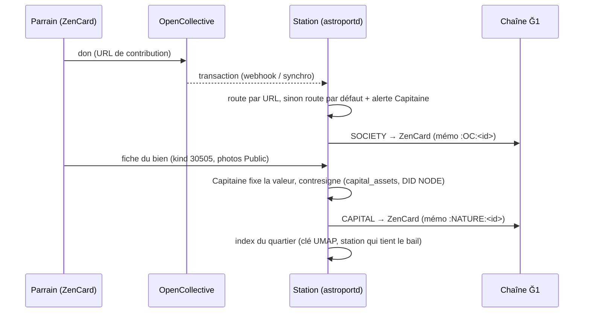

# Plugin « Communs » — document de conception

*État : proposition à discuter (2026-11-07). Rien n'est codé. Les questions ouvertes sont regroupées au § 9.*

## 1. Ce que l'on veut

UPlanet repose sur des **parrains**. Ils donnent de l'argent, ou ils apportent un bien qui leur appartient déjà : une machine, un lieu de vie, un espace de stockage, de la puissance de calcul. La coopérative doit pouvoir faire trois choses :

1. **Reconnaître chaque apport, en monnaie ou en nature, dans un registre notarié.** Ce registre est vérifiable par tous et ne peut pas être réécrit.
2. **Transposer en Ẑen ce qui a été apporté** : les euros reçus sur OpenCollective, et la valeur convenue d'un bien.
3. **Tenir un répertoire des biens mis en commun.** Chaque bien a des photos, une description, une localisation et des versions. Le répertoire est visible du cercle N1, du cercle N², puis au-delà.

Ce répertoire n'est **pas un marché**. C'est l'esprit du logiciel libre appliqué au monde réel : un bien commun est entretenu, amélioré et documenté version après version, comme un dépôt de code. Le savoir et le savoir-faire qui le font vivre sont partagés. C'est le socle du futur jeu « H2G2 » (un monde que l'on sait construire, à la Minecraft), qui sera un autre plugin.

## 2. Ce qui existe déjà

| Brique | Où | Ce qu'on en garde |
|---|---|---|
| Primale = première Ğ1 reçue, venue de `UPLANETNAME_G1` | `astroportd` `funds.rs` (accord de 2 indexeurs), `primal_wallet_control.sh` | La **racine** du registre : un compte officiel descend du maître, et c'est vérifiable sur la chaîne. |
| ZenCard : parts sociales reçues de `UPLANETNAME_SOCIETY` | `G1zencard_history.sh` (mémo `UPLANET:…:SOCIETY:<email>:<type>:<IPFSNODEID>`) | L'**historique des dons** d'un parrain : la chaîne Ğ1 sert déjà de journal. |
| OpenCollective → Ẑen | `OC2UPlanet/oc2uplanet.sh` (tiers satellite, constellation, labo, cloud) | Le flux € → Ẑen. Le **routage par mots-clés** (globs sur le slug du tier) est à remplacer (§ 4). |
| Actifs du capital (CAPEX) | Table `capital_assets` d'astroportd, alimentée par le DID du NODE (kind 30800, `d = IPFSNODEID`) | La valeur, l'amortissement (portefeuilles `CAPITAL` et `AMORTISSEMENT`) et l'auteur de chaque bien de station. |
| Objets WoTx² | kind 30505 (`emit_object.sh`) | Un format d'objet existant, partagé avec le futur H2G2. |
| Révisions chaînées | Savoirs 30500-30505 : tags `prev` (CID IPFS) et `rev` (`knowledge-rev.js`) | Le **versionnage façon git** des fiches de biens. |
| Bail géographique | `geo_lease.rs` : une seule station tient chaque case UMAP/SECTOR/REGION | La **localisation** sans conflit entre stations voisines. |
| uMARKET | `_uMARKET.*.sh` (annonces `#market`, inachevé) | L'idée d'un affichage par quartier. **Pas** le modèle « annonce marchande ». |

## 3. Le registre notarié

### 3.1 Principe

Chaque apport donne une **inscription** au registre. Sa preuve est double :

- **Côté monnaie** : la transaction Ğ1, déjà publique et immuable, portant un mémo normalisé.
- **Côté description** : un événement Nostr signé, qui cite la transaction et le bien.

Un apport n'est « reconnu » que lorsque la coopérative le **contresigne**. La station qui le reçoit (sa clé NODE) publie l'acceptation. Un parrain ne peut pas s'auto-déclarer propriétaire d'une part.

### 3.2 La ZenCard comme historique du parrain

La ZenCard reste la clé d'identité du parrain sur toutes les UPlanets (sa formule est brute, non isolée). Son historique devient l'**unique vue** de ce qu'il a apporté :

| Nature | Preuve monétaire | Mémo (proposé) |
|---|---|---|
| Don en monnaie (OpenCollective) | `UPLANETNAME_SOCIETY` → ZenCard | `UPLANET:<g1>:SOCIETY:<email>:OC:<id de transaction OC>` |
| Apport en nature | `UPLANETNAME_CAPITAL` → ZenCard (parts représentant la valeur convenue) | `UPLANET:<g1>:SOCIETY:<email>:NATURE:<id du bien>` |
| Location/usage d'un bien commun (plus tard) | MULTIPASS de l'usager → portefeuille de répartition | `UPLANET:<g1>:USAGE:<id du bien>:<semaine>` |

`G1zencard_history.sh` lit déjà le premier cas. Il suffit d'étendre la lecture au `:NATURE:`. astroportd reprendra cette lecture, en n'acceptant que les émetteurs dont la primale est prouvée.

## 4. Routage OpenCollective : une route par défaut, puis des routes par URL

### 4.1 Pourquoi changer

Aujourd'hui, un don est classé selon des **mots-clés trouvés dans le slug** du tier (`*parrainage*128*`, `labo`, `cloud-usage`…). Ce routage a trois défauts :

- **Fragile** : renommer un tier sur OpenCollective change la destination de l'argent.
- **Ambigu** : un slug peut correspondre à deux motifs.
- **Opaque** : le Capitaine ne voit pas à l'avance où partira un don.

### 4.2 Proposition

Une **table de routes** dans la configuration coopérative (kind 30800, chiffrée avec `UPLANETNAME`, déjà propagée aux stations de la constellation) :

```json
{
  "default": { "action": "societaire", "label": "Don libre" },
  "routes": [
    { "url": "https://opencollective.com/monnaie-libre/contribute/parrainage-infrastructure-extension-128-go-12345",
      "action": "societaire", "label": "Satellite 128 Go" },
    { "url": "https://opencollective.com/monnaie-libre/contribute/cotisation-services-cloud-usage-67890",
      "action": "locataire", "label": "Usage cloud" },
    { "url": "https://opencollective.com/monnaie-libre/projects/four-a-pain",
      "action": "bien", "asset": "<id du bien>", "label": "Four à pain du village" }
  ]
}
```

- **Correspondance exacte** sur l'URL de contribution, dont le numéro de tier est stable même si le titre change. Plus aucun glob.
- **Route par défaut** pour tout ce qui ne correspond à aucune URL. Le don n'est jamais perdu ni bloqué : il est crédité selon le défaut, et le Capitaine reçoit l'alerte « nouvelle source à classer ». Classer la source ajoute une route.
- **Action `bien`** : un don fléché vers un bien commun précis, par exemple un projet OpenCollective « four à pain ». Il alimente la ligne de ce bien dans le registre.
- **Idempotence** par l'identifiant de transaction OpenCollective, et non plus par `email:montant:tier:ts`.
- **Écran Capitaine** (onglet Économie) : la table des routes, et pour chacune les dons du mois et la destination effective. On voit avant l'émission où partira chaque euro.

`oc2uplanet.sh` peut lire la même table pendant la transition. Elle remplacerait `TIER_SLUG_*`, avec des globs encore lus en repli pendant une version.

## 5. La fiche d'un bien commun

### 5.1 Contenu

| Champ | Exemple | Remarque |
|---|---|---|
| Titre, type | « Serveur GPU RTX 3090 », `calcul` | Types : `habitat`, `lieu`, `calcul`, `stockage`, `outil`, `vehicule`, `terrain`… |
| Description | Texte long (Markdown) | État, usage, règles d'usage. |
| Photos | Fichiers du **dossier Public** du parrain (`/site/`) ou blobs IPFS | Pas d'hébergement nouveau : réutiliser l'uCloud. |
| Localisation | Case UMAP (`_43.61_1.44`), jamais l'adresse exacte | L'adresse précise n'est donnée qu'aux usagers autorisés. |
| Apporté par | ZenCard du parrain | Lien vers son historique (§ 3.2). |
| Valeur convenue | En Ẑen, fixée avec le Capitaine | Sert aux parts sociales et à l'amortissement. |
| Disponibilité | Libre, sur demande, réservée N1… | Prépare la location et le prêt. |
| Portée | `N1`, `N2`, `public` | Qui voit la fiche (§ 6). |
| Version | `rev`, `prev` (CID de la version précédente) | Chaîne façon git (§ 5.2). |

### 5.2 Versions : le bien comme un dépôt

Chaque modification publie une **nouvelle version**, avec la même convention que les savoirs : un tag `prev` vers le CID de la précédente et un compteur `rev`.

- **Entretien** (réparation, pièce changée) et **amélioration** (nouvelle version du bien) laissent une trace datée, avec photos.
- Une **bifurcation** (copie d'un modèle de four, de serre ou de machine dans un autre village) garde le lien vers l'original. C'est l'arbre des « forks » du monde réel.
- Les savoir-faire nécessaires (kinds 30500-30505, futur H2G2) se rattachent à la fiche : « pour entretenir ce four, voici qui sait faire ».

### 5.3 Format Nostr (proposition)

On **ne crée pas de nouveau kind** :

- La fiche est un **kind 30505**, signé par le parrain, avec `d = <id du bien>`, des tags `prev`/`rev`, `g = case UMAP`, `t = type` et `l = commun`. C'est le kind des objets WoTx², ce qui rend le répertoire directement lisible par H2G2.
- La **reconnaissance** par la coopérative passe par la ligne correspondante de `capital_assets`, publiée dans le DID du NODE (kind 30800). Elle porte l'`id` du bien, sa valeur, son amortissement et la référence à la transaction de parts sociales. Une fiche sans cette ligne est un bien **proposé**, pas encore **reconnu**.

## 6. Le répertoire

- **Portée par cercles.** Une fiche `N1` n'est servie qu'aux amis réciproques du parrain, une fiche `N2` aux amis d'amis : c'est le pare-feu social du relai, déjà en place. Une fiche `public` est lisible de tous.
- **Par quartier.** La station qui tient la case UMAP (bail géographique) publie l'**index du quartier**, une liste des fiches signée avec la clé UMAP. On évite ainsi deux index concurrents pour le même quartier. Les cases SECTOR et REGION agrègent avec le seuil de likes des flux géographiques : ≥ 1 UMAP, ≥ 3 SECTOR, ≥ 12 REGION.
- **Écran membre** « Biens communs » : une carte et une liste par quartier, la fiche avec ses photos et son historique, puis les boutons « je l'entretiens » (proposer une version) et « je voudrais l'utiliser » (demande au parrain par message privé). Aucun prix ni panier : ce n'est pas une boutique.

## 7. Flux de bout en bout



## 8. Phases proposées

1. **Routes OpenCollective par URL** dans astroportd : table de routes, route par défaut, alerte « source à classer », idempotence par identifiant OC. On peut le livrer seul, et il corrige tout de suite la fragilité du routage par mots-clés.
2. **Historique ZenCard** dans astroportd : lecture des parts `:OC:` et `:NATURE:`, émetteurs à primale prouvée, et vue « Mes apports » du parrain.
3. **Fiche de bien et reconnaissance** : kind 30505, photos depuis Public, contresignature par `capital_assets`, parts en nature.
4. **Répertoire** : index par quartier (bail UMAP), écran « Biens communs », portées N1/N2/public.
5. **Usage et location** : réservation, contribution d'usage en Ẑen, répartition 3×1/3 et amortissement. Ce volet reprend la vision « location/vente d'habitat et de ressources numériques mises en commun ».

## 9. Questions ouvertes (décisions de Fred)

1. **Parts en nature et adossement Ğ1.** Le Ẑen est adossé à la Ğ1. Un apport en nature ne fait entrer aucune Ğ1. Faut-il que `CAPITAL` émette des parts sans contrepartie Ğ1, plafonnées par la valeur amortissable ? Ou que le bien soit inscrit en capital **sans** Ẑen, les parts n'étant versées qu'au fil des revenus d'usage ?
2. **Qui fixe la valeur d'un bien ?** Le Capitaine seul, deux Capitaines de la constellation, ou une valeur de référence par type (barème) ?
3. **Kind 30505 partagé avec H2G2 ?** Il offre un seul format d'objet pour les deux plugins, au prix d'une dépendance entre eux. L'alternative est un kind 30505 avec `l = commun` réservé au répertoire.
4. **Retrait d'un bien.** Un parrain qui reprend sa machine : la fiche passe « retirée » (version finale), et ses parts sont-elles rachetées, gelées ou conservées ?
5. **Adresse exacte d'un lieu de vie.** À qui la donner, et par quel canal ? Un message privé du parrain à l'usager accepté semble suffire.
6. **Route par défaut.** Un don non classé va-t-il en parts sociales (sociétaire), en R&D, ou reste-t-il en attente de classement tout en étant crédité ?
